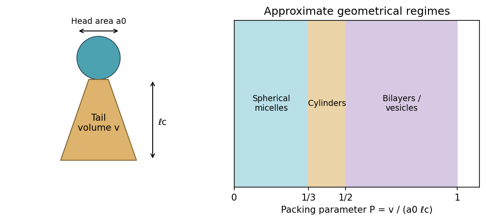

<h1 id="section-b/23/i/solution">Solution</h1>

↑ **Parent:** [I](../i.md)

An **[amphiphile](../../../../../../amphiphile.md)** has a solvent-compatible polar head and a hydrophobic tail region. The three geometrical parameters are the tail volume $v$, effective head-group area $a_0$ at the interface, and maximum effective tail length $\ell_c$. Their dimensionless combination is the **[amphiphile packing parameter](../../../../../../amphiphile-packing-parameter.md)**, $P=v/(a_0\ell_c)$.

**[Figure 10](#section-b/23/i/image-head-area-hydrophobic-volume-and-tail-length-control-preferred-aggregate-curvature). Head area, hydrophobic volume and tail length control preferred aggregate curvature**. [Source](paper-2-amphiphile-packing.py).

The head area is an effective interfacial area affected by solvent, electrostatic repulsion and composition; it is not simply a fixed atomic cross-section.

## ↑ Ancestors (11)

1. [I](../i.md)
2. [23](../../23.md)
3. [Section B](../../../section-b.md)
4. [Paper 2](../../../../paper-2-split.md)
5. [2019](../../../../split.md)
6. [Past exam of the MPhil in micro- and nanotechnology enterprise course of the University of Cambridge](../../../../../split.md)
7. [MPhil in micro- and nanotechnology enterprise course of the University of Cambridge](../../../../../../mphil-in-micro-and-nanotechnology-enterprise-course-of-the-university-of-cambridge.md)
8. [Course of the University of Cambridge](../../../../../../course-of-the-university-of-cambridge.md)
9. [University of Cambridge](../../../../../../university-of-cambridge-split.md)
10. [List of universities](../../../../../../list-of-universities.md)
11. [Codex Wiki](../../../../../../split.md)
