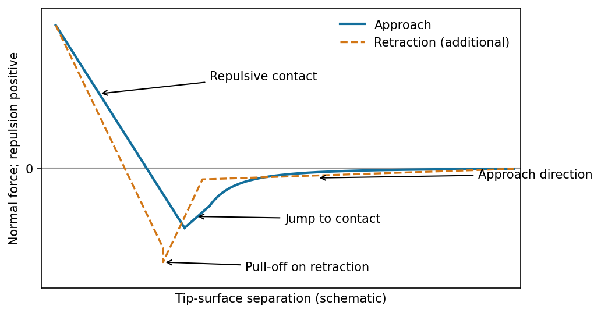
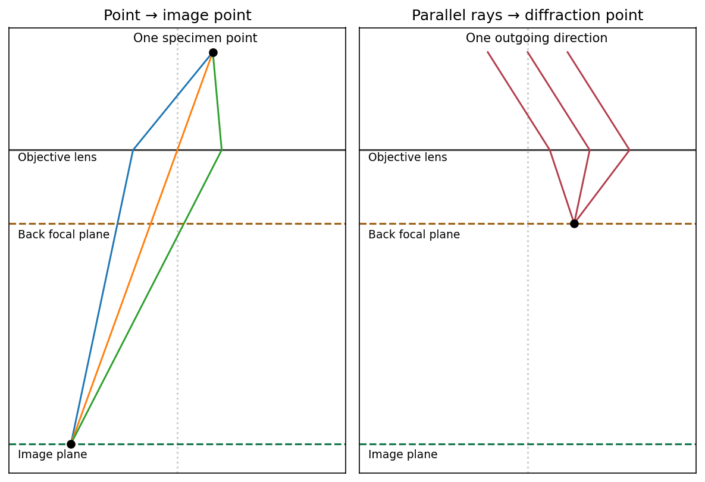

# Paper 1

↑ **Parent:** [2020](../2020.md)

[Original examination download archive; NanoMPhil Paper 1 2020.pdf](https://www.whatdotheyknow.com/request/mphil_in_micro_and_nanotechnolog_5/response/2556540/attach/2/FOI%202024%2050%20Dai%20materials.zip?cookie_passthrough=1)

**Table of contents**

- [Section A(i)](#section-a-i)
  - [1](#section-a-i/1)
    - [i](#section-a-i/1/i)
      - [Solution](#section-a-i/1/i/solution)
    - [ii](#section-a-i/1/ii)
      - [a](#section-a-i/1/ii/a)
        - [Solution](#section-a-i/1/ii/a/solution)
      - [b](#section-a-i/1/ii/b)
        - [Solution](#section-a-i/1/ii/b/solution)
  - [2](#section-a-i/2)
    - [i](#section-a-i/2/i)
      - [Solution](#section-a-i/2/i/solution)
    - [ii](#section-a-i/2/ii)
      - [Solution](#section-a-i/2/ii/solution)
    - [iii](#section-a-i/2/iii)
      - [Solution](#section-a-i/2/iii/solution)
- [Section A(ii)](#section-a-ii)
  - [3](#section-a-ii/3)
    - [i](#section-a-ii/3/i)
      - [Solution](#section-a-ii/3/i/solution)
    - [ii](#section-a-ii/3/ii)
      - [Solution](#section-a-ii/3/ii/solution)
    - [iii](#section-a-ii/3/iii)
      - [Solution](#section-a-ii/3/iii/solution)
  - [4](#section-a-ii/4)
    - [i](#section-a-ii/4/i)
      - [Solution](#section-a-ii/4/i/solution)
    - [ii](#section-a-ii/4/ii)
      - [Solution](#section-a-ii/4/ii/solution)
- [Section A(iii)](#section-a-iii)
  - [5](#section-a-iii/5)
    - [i](#section-a-iii/5/i)
      - [Solution](#section-a-iii/5/i/solution)
    - [ii](#section-a-iii/5/ii)
      - [Solution](#section-a-iii/5/ii/solution)
    - [iii](#section-a-iii/5/iii)
      - [Solution](#section-a-iii/5/iii/solution)
    - [iv](#section-a-iii/5/iv)
      - [Solution](#section-a-iii/5/iv/solution)
    - [v](#section-a-iii/5/v)
      - [Solution](#section-a-iii/5/v/solution)
  - [6](#section-a-iii/6)
    - [i](#section-a-iii/6/i)
      - [Solution](#section-a-iii/6/i/solution)
    - [ii](#section-a-iii/6/ii)
      - [Solution](#section-a-iii/6/ii/solution)
  - [7](#section-a-iii/7)
    - [i](#section-a-iii/7/i)
      - [Solution](#section-a-iii/7/i/solution)
    - [ii](#section-a-iii/7/ii)
      - [Solution](#section-a-iii/7/ii/solution)
    - [iii](#section-a-iii/7/iii)
      - [Solution](#section-a-iii/7/iii/solution)
- [Section B](#section-b)
  - [8](#section-b/8)
    - [i](#section-b/8/i)
      - [a](#section-b/8/i/a)
        - [Solution](#section-b/8/i/a/solution)
      - [b](#section-b/8/i/b)
        - [Solution](#section-b/8/i/b/solution)
    - [ii](#section-b/8/ii)
      - [a](#section-b/8/ii/a)
        - [Solution](#section-b/8/ii/a/solution)
      - [b](#section-b/8/ii/b)
        - [Solution](#section-b/8/ii/b/solution)
      - [c](#section-b/8/ii/c)
        - [Solution](#section-b/8/ii/c/solution)
  - [9](#section-b/9)
    - [i](#section-b/9/i)
      - [Solution](#section-b/9/i/solution)
    - [ii](#section-b/9/ii)
      - [Solution](#section-b/9/ii/solution)
    - [iii](#section-b/9/iii)
      - [a](#section-b/9/iii/a)
        - [Solution](#section-b/9/iii/a/solution)
      - [b](#section-b/9/iii/b)
        - [Solution](#section-b/9/iii/b/solution)
  - [10](#section-b/10)
    - [i](#section-b/10/i)
      - [a](#section-b/10/i/a)
        - [Solution](#section-b/10/i/a/solution)
      - [b](#section-b/10/i/b)
        - [Solution](#section-b/10/i/b/solution)
      - [c](#section-b/10/i/c)
        - [Solution](#section-b/10/i/c/solution)
      - [d](#section-b/10/i/d)
        - [Solution](#section-b/10/i/d/solution)
    - [ii](#section-b/10/ii)
      - [Solution](#section-b/10/ii/solution)
    - [iii](#section-b/10/iii)
      - [a](#section-b/10/iii/a)
        - [Solution](#section-b/10/iii/a/solution)
      - [b](#section-b/10/iii/b)
        - [Solution](#section-b/10/iii/b/solution)
  - [11](#section-b/11)
    - [i](#section-b/11/i)
      - [Solution](#section-b/11/i/solution)
    - [ii](#section-b/11/ii)
      - [Solution](#section-b/11/ii/solution)
  - [12](#section-b/12)
    - [i](#section-b/12/i)
      - [a](#section-b/12/i/a)
        - [Solution](#section-b/12/i/a/solution)
      - [b](#section-b/12/i/b)
        - [Solution](#section-b/12/i/b/solution)
      - [c](#section-b/12/i/c)
        - [Solution](#section-b/12/i/c/solution)
    - [ii](#section-b/12/ii)
      - [a](#section-b/12/ii/a)
        - [Solution](#section-b/12/ii/a/solution)
      - [b](#section-b/12/ii/b)
        - [Solution](#section-b/12/ii/b/solution)

<h2 id="section-a-i">Section A(i)</h2>

↑ **Parent:** [Paper 1](paper-1.md)

<h3 id="section-a-i/1">1</h3>

↑ **Parent:** [Section A(i)](#section-a-i)

<h4 id="section-a-i/1/i">i</h4>

↑ **Parent:** [1](#section-a-i/1)

<h5 id="section-a-i/1/i/solution">Solution</h5>

↑ **Parent:** [I](#section-a-i/1/i)

The [atomic force microscope](../../engineering.md#atomic-force-microscope) measures the [cantilever](../../elasticity-physics.md#cantilever) deflection $d$, converted to normal [force](../../force.md) by $F=k_cd$ after [calibration](../../differential-geometry.md#calibration-differential-geometry). On approach, the [force](../../force.md) is initially almost zero, then attractive; a sufficiently steep attractive [force](../../force.md) gradient causes [jump-to-contact](../../engineering.md#jump-to-contact). After contact, further approach bends the [cantilever](../../elasticity-physics.md#cantilever) and indents the sample, giving a rising repulsive branch. With tip-surface separation increasing to the right, approach proceeds from right to left. The instability occurs when the magnitude of the attractive [force](../../force.md) gradient exceeds the [cantilever](../../elasticity-physics.md#cantilever) stiffness. The contact-branch slope depends on both [cantilever](../../elasticity-physics.md#cantilever) and sample compliance.

**[Figure 1](#section-a-i/1/i/image-approach-force-curve-and-the-additional-retraction-information-used-in-mechanical-mapping). Approach force curve and the additional retraction information used in mechanical mapping**. [Source](paper-1-afm-force.py).

<h4 id="section-a-i/1/ii">ii</h4>

↑ **Parent:** [1](#section-a-i/1)

<h5 id="section-a-i/1/ii/a">a</h5>

↑ **Parent:** [Ii](#section-a-i/1/ii)

<h6 id="section-a-i/1/ii/a/solution">Solution</h6>

↑ **Parent:** [A](#section-a-i/1/ii/a)

**The controlled quantity is the maximum repulsive [force](../../force.md) in each tapping cycle.** In [PeakForce quantitative nanomechanical mapping](../../engineering.md#peakforce-quantitative-nanomechanical-mapping), a vertical modulation below the [cantilever](../../elasticity-physics.md#cantilever) resonance produces a force-distance cycle at each pixel. The optical lever measures deflection; the calibrated [cantilever](../../elasticity-physics.md#cantilever) stiffness converts this to [force](../../force.md). Subtract the measured peak [force](../../force.md) from the setpoint and use [proportional-integral control](../../control-theory.md#proportional-integral-control) to adjust the mean vertical scanner position. Excessive peak [force](../../force.md) makes the controller withdraw the sample or tip; insufficient [force](../../force.md) makes it approach. The scanner position required to maintain the setpoint supplies the topography signal. This controls the top of the repulsive branch in the preceding curve, rather than the oscillation amplitude used in conventional tapping mode.[Peak normal-force control and simultaneous mechanical-property channels](../../physics-bibliography.md#peakforce-qnm-by-bruker)

**[Figure 2](#section-a-i/1/ii/a/image-peak-force-feedback-with-an-independent-vertical-modulation). Peak-force feedback with an independent vertical modulation**. [Source](paper-1-afm-feedback.py).

<h5 id="section-a-i/1/ii/b">b</h5>

↑ **Parent:** [Ii](#section-a-i/1/ii)

<h6 id="section-a-i/1/ii/b/solution">Solution</h6>

↑ **Parent:** [B](#section-a-i/1/ii/b)

Two useful properties are **[adhesion](../../continuum-mechanics.md#adhesion)** and **contact [elastic modulus](../../elasticity-physics.md#elastic-modulus)**. The [pull-off force](../../continuum-mechanics.md#pull-off-force), the most negative [force](../../force.md) on retraction relative to the noncontact baseline, maps [adhesion](../../continuum-mechanics.md#adhesion). Fit the contact part of the force-indentation relation using a suitable [contact mechanics](../../continuum-mechanics.md#contact-mechanics) model to obtain a reduced [elastic modulus](../../elasticity-physics.md#elastic-modulus); for example, the [DMT contact model](../../continuum-mechanics.md#dmt-contact-model) uses

$$
F-F_{\rm adh}=\frac43E^*\sqrt R\,\delta^{3/2},
$$

where $F_{\rm adh}<0$, $R$ is the calibrated tip radius and $\delta$ is indentation. Converting $E^*$ to a sample [Young's modulus](../../elasticity-physics.md#young-s-modulus) also requires the tip modulus and the two [Poisson's ratios](../../elasticity-physics.md#poisson-s-ratio). The approach curve alone does not supply a retraction pull-off measurement. The loop area can additionally map dissipated energy; it is not automatically a purely viscous loss.[Sections 2.5.1, 2.5.3 and 2.5.5: modulus, [adhesion](../../continuum-mechanics.md#adhesion) and dissipation](../../physics-bibliography.md#peakforce-qnm-user-guide-by-bruker)

<h3 id="section-a-i/2">2</h3>

↑ **Parent:** [Section A(i)](#section-a-i)

<h4 id="section-a-i/2/i">i</h4>

↑ **Parent:** [2](#section-a-i/2)

<h5 id="section-a-i/2/i/solution">Solution</h5>

↑ **Parent:** [I](#section-a-i/2/i)

Treat the magnetic [electron lens](../../optics.md#electron-lens) as a paraxial [thin lens](../../geometrical-optics.md#thin-lens). A point in the specimen sends rays through different lens positions; the lens brings these to a conjugate point in the image plane, with $1/u+1/v=1/f$ and transverse [magnification](../../optics.md#magnification) $-v/u$. Conversely, waves leaving different specimen points at the same angle are focused to the same point in the [back focal plane](../../optical-instrument.md#back-focal-plane). This plane therefore contains the [electron diffraction](../../quantum-scattering.md#electron-diffraction) pattern, with radius $r\simeq f\theta$ for small scattering angle $\theta$. The specimen is just beyond the front focal plane, giving a magnified real image farther downstream.

**[Figure 3](#section-a-i/2/i/image-distinct-real-space-image-and-angular-diffraction-planes-of-a-tem-objective). Distinct real-space image and angular diffraction planes of a TEM objective**. [Source](paper-1-tem-planes.py).

The sketch assumes a thin specimen, coherent approximately parallel illumination, small angles and an ideal lens without aberrations. Quantitative diffraction intensities may require dynamical scattering; the ray sketch only establishes the plane conjugacies.[Objective image formation](../../physics-bibliography.md#objective-lens-by-jeol)

<h4 id="section-a-i/2/ii">ii</h4>

↑ **Parent:** [2](#section-a-i/2)

<h5 id="section-a-i/2/ii/solution">Solution</h5>

↑ **Parent:** [Ii](#section-a-i/2/ii)

For [bright-field transmission electron microscopy](../../optics.md#bright-field-transmission-electron-microscopy), place the objective aperture in the [back focal plane](../../optical-instrument.md#back-focal-plane) around the transmitted beam, excluding most diffracted beams. Adjust the intermediate lens to image the objective's real-space image plane; projector lenses enlarge that image onto the screen or camera. Regions removing [electrons](../../physics.md#electron) from the admitted beam tend to be darker, although phase contrast can also contribute.

For [selected-area electron diffraction](../../quantum-scattering.md#selected-area-electron-diffraction), put the selected-area aperture in the objective image plane to choose a specimen region. Remove or open the objective aperture and change the intermediate-lens excitation to image the objective's [back focal plane](../../optical-instrument.md#back-focal-plane) onto the camera. The projector then magnifies the diffraction pattern, rather than the specimen image. Thus the two apertures act in different conjugate planes.

**[Figure 4](#section-a-i/2/ii/image-the-plane-selected-by-the-intermediate-lens-determines-tem-imaging-or-diffraction-mode). The plane selected by the intermediate lens determines TEM imaging or diffraction mode**. [Source](paper-1-tem-modes.py).

[Area-selection aperture in the objective image plane and conjugate diffraction-plane imaging](../../physics-bibliography.md#selected-area-diffraction-by-jeol)

<h4 id="section-a-i/2/iii">iii</h4>

↑ **Parent:** [2](#section-a-i/2)

<h5 id="section-a-i/2/iii/solution">Solution</h5>

↑ **Parent:** [Iii](#section-a-i/2/iii)

The resolved graphitic fringes indicate **high-resolution phase contrast** in a [multi-walled carbon nanotube](../../chemical-substance.md#multi-walled-carbon-nanotube). Interference of transmitted and diffracted [electron](../../physics.md#electron) waves produces lattice fringes; their darkness is controlled by defocus, thickness and the [contrast transfer function](../../optics.md#contrast-transfer-function), so a dark fringe is not an unqualified map of individual carbon atoms. The weakly scattering central channel is lighter than the multilayer walls. Curved, roughly parallel fringes at its sides identify concentric graphitic shells; the dense fringes at the lower edge arise from overlapping graphitic material or another tube, not necessarily the wall count of the central tube.

Using the printed $5\,\mathrm{nm}$ scale bar, the central tube has an outer diameter of roughly **$9$–$10\,\mathrm{nm}$** and an inner channel of roughly **$6$–$7\,\mathrm{nm}$**, depending on the cross-section selected away from the overlap. Several wall fringes are resolved on each side, with separations of order **$0.34\,\mathrm{nm}$**, consistent with graphitic interlayer spacing. These are approximate image measurements, not a determination of chirality, chemical purity or an exact shell count. The image alone cannot establish those quantities.

<h2 id="section-a-ii">Section A(ii)</h2>

↑ **Parent:** [Paper 1](paper-1.md)

<h3 id="section-a-ii/3">3</h3>

↑ **Parent:** [Section A(ii)](#section-a-ii)

<h4 id="section-a-ii/3/i">i</h4>

↑ **Parent:** [3](#section-a-ii/3)

<h5 id="section-a-ii/3/i/solution">Solution</h5>

↑ **Parent:** [I](#section-a-ii/3/i)

A **high-pressure [Mercury](../../planetary-science.md#mercury-planet) arc lamp** is a conventional source for [proximity photolithography](../../engineering.md#proximity-photolithography). An electric discharge excites [Mercury](../../planetary-science.md#mercury-planet) vapour; radiative transitions produce strong spectral lines, selected by filters and delivered through collimating optics. Common lines are **$365\,\mathrm{nm}$ (i-line)** and **$436\,\mathrm{nm}$ (g-line)**. The finite mask-wafer gap gives near-field [Fresnel diffraction](../../physical-optics.md#fresnel-diffraction), rather than the far-field approximation. Diffracted light spreads into nominally dark regions, limiting the minimum printable feature.

<h4 id="section-a-ii/3/ii">ii</h4>

↑ **Parent:** [3](#section-a-ii/3)

<h5 id="section-a-ii/3/ii/solution">Solution</h5>

↑ **Parent:** [Ii](#section-a-ii/3/ii)

With the proximity-resolution convention $w=k\sqrt{\lambda g}$, the maximum mask-wafer gap is

$$
\boxed{g_{\max}=\frac{w^2}{k^2\lambda}}.
$$

For $w=5\,\mu\mathrm m$ and $k=2$, **$g_{\max}\simeq17.1\,\mu\mathrm m$ at $365\,\mathrm{nm}$**. If the g-line is used instead, **$g_{\max}\simeq14.3\,\mu\mathrm m$ at $436\,\mathrm{nm}$**. The wavelength must be specified; the question's preceding choice of two lamp lines does not select a unique number. This estimate neglects extra loss of resolution from finite resist thickness, mask imperfections and angular illumination spread.

<h4 id="section-a-ii/3/iii">iii</h4>

↑ **Parent:** [3](#section-a-ii/3)

<h5 id="section-a-ii/3/iii/solution">Solution</h5>

↑ **Parent:** [Iii](#section-a-ii/3/iii)

[Projection lithography](../../engineering.md#projection-lithography) images a mask through [reduction](../../chemical-reaction.md#reduction-chemistry) optics; its resolution scales approximately as $k_1\lambda/\mathrm{NA}$. It offers parallel exposure, high throughput and accurate repeat patterning, but small features demand short wavelengths, large [numerical aperture](../../point-spread-function.md#numerical-aperture), costly optics and high-quality masks, with a shrinking depth of focus.

[Electron beam lithography](../../engineering.md#electron-beam-lithography) directly writes a programmable pattern using a focused [electron](../../physics.md#electron) beam. Its much shorter wavelength and small probe permit nanometre-scale features without an optical mask, making it attractive for research prototypes, low-volume devices and mask fabrication. Its limitations are serial writing time, charging of insulating substrates, beam drift, field stitching and forward/backscattering [proximity effects in electron-beam lithography](../../engineering.md#proximity-effects-in-electron-beam-lithography). [Electron](../../physics.md#electron) wavelength alone does not set the resist resolution. **E-beam is often preferable for a few very small custom structures; projection remains preferable for high-volume repeated manufacture.**

<h3 id="section-a-ii/4">4</h3>

↑ **Parent:** [Section A(ii)](#section-a-ii)

<h4 id="section-a-ii/4/i">i</h4>

↑ **Parent:** [4](#section-a-ii/4)

<h5 id="section-a-ii/4/i/solution">Solution</h5>

↑ **Parent:** [I](#section-a-ii/4/i)

Use **thermal evaporation** or electron-beam evaporation: evaporated Au travels approximately ballistically to the Si wafer. For [line-of-sight deposition](../../engineering.md#line-of-sight-deposition), the [gas](../../thermodynamics.md#gas) [mean free path](../../ideal-gas.md#mean-free-path)

$$
\ell=\frac{k_BT}{\sqrt2\pi d_g^2p}
$$

should greatly exceed the source-wafer distance $L$. Increasing the chamber's useful transport length therefore requires a proportionately lower pressure to retain the same $\ell/L$, for fixed [gas](../../thermodynamics.md#gas) and temperature. There is no universal pressure requirement determined by chamber volume alone.

A distant compact source gives a more uniform angular flux across the wafer, but the deposition rate falls roughly as $L^{-2}$. For an ideal cosine-emitting point source and a parallel wafer, the relative thickness at lateral radius $r$ is approximately $[1+(r/L)^2]^{-2}$. Mitigate the trade-off with wafer rotation and planetary motion, multiple or extended sources, shaped masks and suitable source/wafer geometry. Rotation averages azimuthal variation; ordinary rotation alone does not remove a purely radial thickness gradient. A thin Ti or Cr [adhesion](../../continuum-mechanics.md#adhesion) layer may be needed for robust Au [adhesion](../../continuum-mechanics.md#adhesion) to oxidized Si.

<h4 id="section-a-ii/4/ii">ii</h4>

↑ **Parent:** [4](#section-a-ii/4)

<h5 id="section-a-ii/4/ii/solution">Solution</h5>

↑ **Parent:** [Ii](#section-a-ii/4/ii)

The arrangement is **diode sputter deposition**: the Au target, **a**, is attached to the upper cathode assembly **c**; positive Ar [ions](../../chemistry.md#ion) bombard it and sputter Au onto the wafer. The lower wafer-holder [electrode](../../electrochemistry.md#electrode) **b is the anode** in the simple two-electrode arrangement shown.

Unlike evaporation, [sputtering](../../engineering.md#sputtering) needs enough inert [gas](../../thermodynamics.md#gas) to sustain a discharge. Over a low-pressure operating interval, raising Ar pressure can increase [ionization](../../atomic-physics.md#ionization) and [ion](../../chemistry.md#ion) current and hence the [sputtering](../../engineering.md#sputtering) rate at comparable applied [voltage](../../random-walk.md#voltage). This is not a universal monotonic law: at higher pressure, scattering and thermalization of sputtered Au reduce the fraction reaching the wafer; at fixed regulated power, target [voltage](../../random-walk.md#voltage) and current also adjust. **A pressure increase can initially increase the rate, but excessive pressure lowers transport efficiency.**

<h2 id="section-a-iii">Section A(iii)</h2>

↑ **Parent:** [Paper 1](paper-1.md)

<h3 id="section-a-iii/5">5</h3>

↑ **Parent:** [Section A(iii)](#section-a-iii)

<h4 id="section-a-iii/5/i">i</h4>

↑ **Parent:** [5](#section-a-iii/5)

<h5 id="section-a-iii/5/i/solution">Solution</h5>

↑ **Parent:** [I](#section-a-iii/5/i)

[DLVO theory](../../mixture.md#dlvo-theory) adds short-range attractive [Van der Waals forces](../../force.md#van-der-waals-force) to repulsive overlap of the [electric double layer](../../electrostatics.md#electric-double-layer). Increasing salt concentration raises the [ionic strength](../../mixture.md#ionic-strength) and shortens the [Debye length](../../physics.md#debye-length), screening the repulsion. The repulsive barrier falls, so thermal collisions can carry particles into the primary attractive minimum and cause [colloidal coagulation](../../mixture.md#colloidal-coagulation). An intermediate shallow secondary minimum can instead produce weak, potentially reversible association.

The figure's assignments are **a: low salt; b: intermediate salt; c: high salt**. Curve a has the largest protective barrier, b a lower barrier and secondary minimum, and c no effective repulsive barrier. This explanation assumes the surface charging chemistry does not independently reverse or radically change the surface potential.

<h4 id="section-a-iii/5/ii">ii</h4>

↑ **Parent:** [5](#section-a-iii/5)

<h5 id="section-a-iii/5/ii/solution">Solution</h5>

↑ **Parent:** [Ii](#section-a-iii/5/ii)

The **[critical coagulation concentration](../../mixture.md#critical-coagulation-concentration)** is the [electrolyte](../../electrochemistry.md#electrolyte) concentration at which rapid, approximately diffusion-limited [colloidal coagulation](../../mixture.md#colloidal-coagulation) begins: the electrostatic barrier has become ineffective and nearly every sufficiently close encounter sticks. It is an operational threshold for the specified [colloid](../../mixture.md#colloid) and [electrolyte](../../electrochemistry.md#electrolyte), not a universal concentration or a guarantee of a mathematically exact zero barrier in every system.

<h4 id="section-a-iii/5/iii">iii</h4>

↑ **Parent:** [5](#section-a-iii/5)

<h5 id="section-a-iii/5/iii/solution">Solution</h5>

↑ **Parent:** [Iii](#section-a-iii/5/iii)

In the usual high-surface-potential [Schulze-Hardy rule](../../mixture.md#schulze-hardy-rule) approximation, $c_{\rm ccc}\propto z^{-6}$, where $z$ is the magnitude of the counterion valence. Consequently,

$$
\boxed{c_{2:2}=\frac{100}{2^6}=1.56\,\mathrm{mM},\qquad c_{3:3}=\frac{100}{3^6}=0.137\,\mathrm{mM}.}
$$

Multivalent counterions screen surface charge much more effectively and strongly lower the electrostatic barrier. The sixth-power estimate includes the way the critical [ionic strength](../../mixture.md#ionic-strength) and screening condition change with valence; merely scaling the ordinary [Debye length](../../physics.md#debye-length) at fixed salt concentration would not derive it. Specific adsorption, charge regulation or [ion](../../chemistry.md#ion) correlations can produce substantial deviations.[Counterion-valence sensitivity of the [critical coagulation concentration](../../mixture.md#critical-coagulation-concentration)](../../chemistry-bibliography.md#schulze-hardy-rule-in-the-iupac-gold-book)

<h4 id="section-a-iii/5/iv">iv</h4>

↑ **Parent:** [5](#section-a-iii/5)

<h5 id="section-a-iii/5/iv/solution">Solution</h5>

↑ **Parent:** [Iv](#section-a-iii/5/iv)

Use **[steric stabilization](../../mixture.md#steric-stabilization)**: attach or strongly adsorb a dense layer of [polymer](../../polymer.md) chains or compatible ligands, with tails well solvated by the nonpolar liquid. Overlap of these layers costs osmotic and conformational [free energy](../../thermodynamic-potential.md#thermodynamic-free-energy) and prevents particle cores reaching the strongly attractive contact region. The anchoring groups must bind the particle while the exposed chains prefer the solvent; sufficient coverage and a good solvent are essential. Nonpolar media do not make charging impossible, but electrostatic stabilization there requires an appropriate ion-generation and charge-stabilization mechanism, rather than assuming aqueous dissociation behaviour.

<h4 id="section-a-iii/5/v">v</h4>

↑ **Parent:** [5](#section-a-iii/5)

<h5 id="section-a-iii/5/v/solution">Solution</h5>

↑ **Parent:** [V](#section-a-iii/5/v)

Adsorbed or grafted [polymers](../../polymer.md) **stabilize** a [colloid](../../mixture.md#colloid) through [steric stabilization](../../mixture.md#steric-stabilization) when coverage is high and the solvent keeps the chains extended. Charged chains can add electrostatic repulsion, giving [electrosteric stabilization](../../mixture.md#electrosteric-stabilization).

They can **destabilize** it through [polymer bridging flocculation](../../mixture.md#polymer-bridging-flocculation) when a chain adsorbs onto two particles, especially at incomplete coverage; through [depletion force](../../mixture.md#depletion-force) when nonadsorbing [polymer](../../polymer.md) is excluded from the gap and the surrounding solution's [osmotic pressure](../../cell-membrane.md#osmotic-pressure) pushes particles together; or through collapse of an adsorbed layer in a poor solvent. [Polymer](../../polymer.md) identity, molecular size, solvent quality, adsorption and concentration determine which mechanism dominates.

<h3 id="section-a-iii/6">6</h3>

↑ **Parent:** [Section A(iii)](#section-a-iii)

<h4 id="section-a-iii/6/i">i</h4>

↑ **Parent:** [6](#section-a-iii/6)

<h5 id="section-a-iii/6/i/solution">Solution</h5>

↑ **Parent:** [I](#section-a-iii/6/i)

The discharge reaction is $2\mathrm{Li}+\mathrm I_2\to2\mathrm{LiI}$. It transfers two [electrons](../../physics.md#electron) and has $\Delta G^\circ=-539.4\,\mathrm{kJ\,mol^{-1}}$ per reaction as written. The reversible [open-circuit voltage](../../electrical-engineering.md#open-circuit-voltage) is

$$
\boxed{E^\circ=-\frac{\Delta G^\circ}{2F}=\frac{539400}{2(96500)}=2.795\,\mathrm V.}
$$

The supplied [free energy](../../thermodynamic-potential.md#thermodynamic-free-energy) is already at approximately the requested temperature, so an additional temperature factor is unnecessary. Actual activities or discharge polarization could alter the terminal [voltage](../../random-walk.md#voltage).

<h4 id="section-a-iii/6/ii">ii</h4>

↑ **Parent:** [6](#section-a-iii/6)

<h5 id="section-a-iii/6/ii/solution">Solution</h5>

↑ **Parent:** [Ii](#section-a-iii/6/ii)

The stored energy is $0.75(7)=5.25\,\mathrm{Wh}$, and the load draws $P=IV=(20\times10^{-6})(2.5)=50\,\mu\mathrm W$. Hence

$$
\boxed{t=\frac{5.25}{50\times10^{-6}}=105000\,\mathrm h\simeq12.0\text{ years}.}
$$

This is an ideal energy-budget estimate using 365.25 days per year. It assumes the stated energy is usable at this load, constant current and [voltage](../../random-walk.md#voltage), and negligible self-discharge, ageing and reserve capacity. No biological operating model is required.

<h3 id="section-a-iii/7">7</h3>

↑ **Parent:** [Section A(iii)](#section-a-iii)

<h4 id="section-a-iii/7/i">i</h4>

↑ **Parent:** [7](#section-a-iii/7)

<h5 id="section-a-iii/7/i/solution">Solution</h5>

↑ **Parent:** [I](#section-a-iii/7/i)

The [Seebeck effect](../../thermoelectric-effect.md#seebeck-effect) produces an [open-circuit voltage](../../electrical-engineering.md#open-circuit-voltage) when a material has a temperature gradient: $S=-dV/dT$ for the stated sign convention. A circuit containing dissimilar thermoelectric legs converts this into useful [voltage](../../random-walk.md#voltage) and current. The intrinsic [thermoelectric figure of merit](../../thermoelectric-effect.md#thermoelectric-figure-of-merit) is

$$
\boxed{Z=\frac{S^2\sigma}{\kappa},\qquad ZT=\frac{S^2\sigma T}{\kappa}.}
$$

Here $\sigma$ is [electrical conductivity](../../electric-charge.md#electrical-conductivity) and $\kappa=\kappa_e+\kappa_L$ total [thermal conductivity](../../heat.md#thermal-conductivity). $Z$ has units $\mathrm{K^{-1}}$; $ZT$ is dimensionless. A large [Seebeck coefficient](../../thermoelectric-effect.md#seebeck-coefficient) and [electrical conductivity](../../electric-charge.md#electrical-conductivity), together with low [thermal conductivity](../../heat.md#thermal-conductivity), favour efficient conversion.

<h4 id="section-a-iii/7/ii">ii</h4>

↑ **Parent:** [7](#section-a-iii/7)

<h5 id="section-a-iii/7/ii/solution">Solution</h5>

↑ **Parent:** [Ii](#section-a-iii/7/ii)

At low carrier concentration, $|S|$ can be large but [electrical conductivity](../../electric-charge.md#electrical-conductivity) is too small. Increasing the carrier concentration usually increases $\sigma=ne\mu$, while $|S|$ decreases. Electronic [thermal conductivity](../../heat.md#thermal-conductivity) rises approximately as $\kappa_e=L\sigma T$ by the [Wiedemann-Franz law](../../heat.md#wiedemann-franz-law); lattice conduction supplies an additional background. Thus neither an insulator nor an ordinary metal usually maximizes $Z$.

**Heavily doped [semiconductors](../../semiconductor.md) and semimetals** often give the useful compromise, near a maximum of $S^2\sigma/\kappa$ as doping is varied. The optimum is material- and temperature-dependent; there is no universal optimal concentration.

**[Figure 5](#section-a-iii/7/ii/image-qualitative-competition-between-thermopower-conduction-and-heat-leakage-as-carrier-density-rises). Qualitative competition between thermopower, conduction and heat leakage as carrier density rises**. [Source](paper-1-thermoelectric.py).

[Carrier-concentration trade-off and thermoelectric optimization](../../physics-bibliography.md#complex-thermoelectric-materials-by-g-jeffrey-snyder-and-eric-s-toberer)

<h4 id="section-a-iii/7/iii">iii</h4>

↑ **Parent:** [7](#section-a-iii/7)

<h5 id="section-a-iii/7/iii/solution">Solution</h5>

↑ **Parent:** [Iii](#section-a-iii/7/iii)

Tune doping to the optimum carrier concentration; a rise in conductivity is useful only if it outweighs the accompanying loss of thermopower and extra electronic heat conduction. Band convergence, favourable [density of states](../../quantum-ideal-gas-statistics.md#density-of-states) and energy-dependent transport can improve the power factor $S^2\sigma$, provided [mobility](../../critical-phenomenon.md#order-parameter-mobility) is retained.

Reduce lattice [thermal conductivity](../../heat.md#thermal-conductivity) through alloy disorder, heavy or complex unit cells, grain boundaries and nanoscale inclusions that scatter [phonons](../../quantum-ideal-gas-statistics.md#phonon). Aim to scatter heat-carrying [phonons](../../quantum-ideal-gas-statistics.md#phonon) much more strongly than charge carriers; indiscriminate disorder can reduce both thermal and [electrical conductivity](../../electric-charge.md#electrical-conductivity). Nanostructuring and interfaces can therefore help, but an improvement must be demonstrated in **total $ZT$ at the operating temperature**, not inferred from lower $\kappa$ alone.[Strategies for improving electronic transport and reducing lattice heat conduction](../../physics-bibliography.md#complex-thermoelectric-materials-by-g-jeffrey-snyder-and-eric-s-toberer)

## Section B

↑ **Parent:** [Paper 1](paper-1.md)

<h3 id="section-b/8">8</h3>

↑ **Parent:** [Section B](#section-b)

<h4 id="section-b/8/i">i</h4>

↑ **Parent:** [8](#section-b/8)

<h5 id="section-b/8/i/a">a</h5>

↑ **Parent:** [I](#section-b/8/i)

<h6 id="section-b/8/i/a/solution">Solution</h6>

↑ **Parent:** [A](#section-b/8/i/a)

One image takes $512\,\mathrm s$ if $1\,\mathrm{Hz}$ means one completed scan line per second. The slow-axis speed is $10/512=0.01953\,\mu\mathrm{m\,s^{-1}}$. Recording a wire spanning $1\,\mu\mathrm m$ along that axis therefore takes $51.2\,\mathrm s$. Meanwhile the fast-axis drift is $20/3600=0.005556\,\mu\mathrm{m\,s^{-1}}$, giving a transverse displacement of $0.2844\,\mu\mathrm m$. The apparent straight-line length is

$$
\boxed{L_{\rm app}=\sqrt{1^2+0.2844^2}=1.040\,\mu\mathrm m.}
$$

Its slow-axis projection remains $1\,\mu\mathrm m$; the overestimate refers to length along the slanted trace.

With the wire along the fast axis and drift along the slow axis, its length is acquired within one line, so **$L_{\rm app}\simeq1.000\,\mu\mathrm m$**. Taking a forward sweep of $1\,\mathrm s$ across $10\,\mu\mathrm m$, the wire is crossed in $0.1\,\mathrm s$ and the perpendicular displacement is only $0.556\,\mathrm{nm}$. The corresponding length change is about $1.5\times10^{-7}\,\mu\mathrm m$, far below the $19.5\,\mathrm{nm}$ pixel pitch. For the convention in which one hertz includes a forward and reverse sweep, that already negligible displacement halves. The slow-axis calculation still uses one completed line per second.

<h5 id="section-b/8/i/b">b</h5>

↑ **Parent:** [I](#section-b/8/i)

<h6 id="section-b/8/i/b/solution">Solution</h6>

↑ **Parent:** [B](#section-b/8/i/b)

Place the wire **parallel to the fast scan axis**. The endpoints are then recorded in a fraction of a line period, rather than tens of seconds apart, minimizing the differential drift accumulated between them.

**[Figure 6](#section-b/8/i/b/image-acquisition-time-separation-explains-the-orientation-dependence-of-nanowire-drift). Acquisition-time separation explains the orientation dependence of nanowire drift**. [Source](paper-1-afm-drift.py).

This does not remove drift of the wire's transverse position or apparent width between successive lines. A very thin wire parallel to the fast axis may fall between the discrete slow-axis scan lines, so a smaller scan area or denser sampling can be needed. Tip convolution, pixel resolution and feedback lag remain; trace/retrace comparisons and allowing thermal equilibration are still valuable. Increasing the scan speed indefinitely is limited by the scanner and feedback bandwidth.

<h4 id="section-b/8/ii">ii</h4>

↑ **Parent:** [8](#section-b/8)

<h5 id="section-b/8/ii/a">a</h5>

↑ **Parent:** [Ii](#section-b/8/ii)

<h6 id="section-b/8/ii/a/solution">Solution</h6>

↑ **Parent:** [A](#section-b/8/ii/a)

**[Scanner bow](../../engineering.md#scanner-bow)** is the relevant artefact. A piezoelectric tube scanner bends to produce lateral displacement; its moving end also follows a curved vertical trajectory. Cross-coupling of lateral and vertical motion therefore gives a roughly quadratic height background even over a flat reference. Over a wide scan it can mimic or conceal a genuine parabolic sample profile; its sign depends on scanner geometry and height convention.

**[Figure 7](#section-b/8/ii/a/image-a-curved-scanner-trajectory-adds-a-background-indistinguishable-from-a-parabolic-sample-in-one-scan). A curved scanner trajectory adds a background indistinguishable from a parabolic sample in one scan**. [Source](paper-1-scanner-bow.py).

<h5 id="section-b/8/ii/b">b</h5>

↑ **Parent:** [Ii](#section-b/8/ii)

<h6 id="section-b/8/ii/b/solution">Solution</h6>

↑ **Parent:** [B](#section-b/8/ii/b)

Common processing fits and subtracts a low-order polynomial background, often a quadratic surface or a polynomial for each scan line. This [AFM image flattening](../../engineering.md#afm-image-flattening) removes scanner curvature on an assumed flat sample. Here the desired specimen signal is itself roughly quadratic, so such subtraction can remove the actual $200\,\mathrm{nm}$ bulge along with the artefact. **The two contributions cannot be separated by polynomial fitting to this image alone.** A plane subtraction removes tilt but does not independently calibrate curvature.

<h5 id="section-b/8/ii/c">c</h5>

↑ **Parent:** [Ii](#section-b/8/ii)

<h6 id="section-b/8/ii/c/solution">Solution</h6>

↑ **Parent:** [C](#section-b/8/ii/c)

Measure a genuinely flat [calibration](../../differential-geometry.md#calibration-differential-geometry) reference over the same scan range, scanner position and operating conditions, then subtract its reproducible bow background from the specimen data. Retain reference flat regions outside the feature if available, fitting only those regions rather than the bulge. A scanner with independently measured vertical motion or suitable closed-loop correction reduces the instrumental uncertainty. Translating or rotating the specimen checks whether a feature follows the specimen or the scanner coordinates; independent optical or stylus profilometry can corroborate its height. For a rotationally symmetric parabola, rotation alone is not sufficient. Report drift and [calibration](../../differential-geometry.md#calibration-differential-geometry) uncertainty as part of the $200\,\mathrm{nm}$ height measurement.

<h3 id="section-b/9">9</h3>

↑ **Parent:** [Section B](#section-b)

<h4 id="section-b/9/i">i</h4>

↑ **Parent:** [9](#section-b/9)

<h5 id="section-b/9/i/solution">Solution</h5>

↑ **Parent:** [I](#section-b/9/i)

The left transistor is an n-channel [MOSFET](../../semiconductor.md#mosfet) in a p-type [silicon](../../chemical-substance.md#silicon) substrate; the right is a p-channel [MOSFET](../../semiconductor.md#mosfet) in an n-well. The region assignments are:

- **a:** n-well, [silicon](../../chemical-substance.md#silicon) doped with a donor such as [phosphorus](../../chemical-substance.md#phosphorus).
- **b:** p+ substrate contact, heavily boron-doped [silicon](../../chemical-substance.md#silicon).
- **c:** n+ source of the nMOS device, arsenic- or phosphorus-doped [silicon](../../chemical-substance.md#silicon).
- **d:** n+ drain of the nMOS device, with the same donor dopants.
- **e:** p+ drain of the pMOS device, boron-doped [silicon](../../chemical-substance.md#silicon).
- **f:** p+ source of the pMOS device, boron-doped [silicon](../../chemical-substance.md#silicon).
- **g:** n+ well contact, heavily donor-doped [silicon](../../chemical-substance.md#silicon).
- **h:** nMOS gate, conventionally heavily doped polycrystalline [silicon](../../chemical-substance.md#silicon) in this process.
- **i:** thin nMOS gate dielectric, conventionally [silicon dioxide](../../chemical-substance.md#silicon-dioxide).
- **j:** pMOS gate, conventionally heavily doped polycrystalline [silicon](../../chemical-substance.md#silicon).
- **k:** thin pMOS gate dielectric, conventionally [silicon dioxide](../../chemical-substance.md#silicon-dioxide).

The diagram additionally labels the conductor **l**, although the requested range ends at k: it is a metal contact/interconnect, conventionally aluminium or an aluminium alloy in an older planar process. Modern processes can use metal gates, high-permittivity gate dielectrics and different interconnect stacks; these are alternatives, not evidence that the illustrated conventional gate is aluminium.

For a [CMOS inverter](../../semiconductor.md#cmos-inverter), join h and j to the input and d and e to the output. Connect f and g to $V_{\rm DD}$, and b and c to ground; these ties keep the body junctions appropriately biased.

**[Figure 8](#section-b/9/i/image-complementary-transistor-connections-with-each-body-tied-to-its-supply-rail). Complementary transistor connections, with each body tied to its supply rail**. [Source](paper-1-cmos-inverter.py).

<h4 id="section-b/9/ii">ii</h4>

↑ **Parent:** [9](#section-b/9)

<h5 id="section-b/9/ii/solution">Solution</h5>

↑ **Parent:** [Ii](#section-b/9/ii)

A [MOSFET](../../semiconductor.md#mosfet) is a voltage-controlled three-terminal switch: the insulated gate controls a conductive channel, giving high input impedance and useful current gain at the circuit level. A [CMOS inverter](../../semiconductor.md#cmos-inverter) actively restores either logic rail, has [voltage](../../random-walk.md#voltage) gain near its switching threshold, and ideally draws no static supply current in either settled logic state. Real devices have leakage and consume energy while switching.

A single [p-n junction](../../semiconductor.md#p-n-junction) is a two-terminal diode; its current is controlled by its own terminal [voltage](../../random-walk.md#voltage), so it does not by itself provide an independently controlled switch, gain and restoring inversion. Cross-coupled [CMOS inverters](../../semiconductor.md#cmos-inverter) form a bistable memory element. **A lone inverter is not itself a complete memory cell**, and a [p-n junction](../../semiconductor.md#p-n-junction) can still serve useful rectification or capacitance functions.

<h4 id="section-b/9/iii">iii</h4>

↑ **Parent:** [9](#section-b/9)

<h5 id="section-b/9/iii/a">a</h5>

↑ **Parent:** [Iii](#section-b/9/iii)

<h6 id="section-b/9/iii/a/solution">Solution</h6>

↑ **Parent:** [A](#section-b/9/iii/a)

Start with a lightly boron-doped p-type Si wafer. Define an implantation opening for the pMOS region using an oxide/nitride implantation mask, then implant donor [ions](../../chemistry.md#ion), commonly [phosphorus](../../chemical-substance.md#phosphorus), at energies and doses giving the required well depth and concentration. An anneal activates donors and repairs damage; thermal drive-in can deepen and smooth the well profile. The donor concentration must exceed the original acceptor concentration in the well. Retain p-type material outside it for the nMOS device. Form a later n+ well contact to tie the n-well to the positive supply; the p+ substrate contact ties the substrate to ground. [Diffusion](../../thermodynamics.md#diffusion) from a donor source is an alternative to [ion implantation](../../semiconductor.md#ion-implantation) and drive-in.

<h5 id="section-b/9/iii/b">b</h5>

↑ **Parent:** [Iii](#section-b/9/iii)

<h6 id="section-b/9/iii/b/solution">Solution</h6>

↑ **Parent:** [B](#section-b/9/iii/b)

Clean the exposed [silicon](../../chemical-substance.md#silicon) and grow a thin, high-quality **SiO2 gate dielectric by controlled dry thermal [oxidation](../../chemical-reaction.md#oxidation)**. Deposit polycrystalline [silicon](../../chemical-substance.md#silicon), conventionally by low-pressure [chemical vapour deposition](../../engineering.md#chemical-vapor-deposition) from silane, dope it in situ or by subsequent implantation and activation, and pattern/etch it to define the two gates. [Phosphorus](../../chemical-substance.md#phosphorus) or [arsenic](../../chemical-substance.md#arsenic) gives n+ polysilicon; [boron](../../chemical-substance.md#boron) gives p+ polysilicon where the selected gate-work-function process requires it. A traditional single-poly process may use a common gate doping instead; gate and source/drain doping need not be identical.

The patterned gates subsequently serve as self-alignment masks for donor-doped nMOS source/drain and acceptor-doped pMOS source/drain regions. Annealing activates these dopants. Keep the oxide thin and uniform enough for strong electrostatic control but free from pinholes and excessive leakage. A high-permittivity dielectric deposited by [atomic layer deposition](../../engineering.md#atomic-layer-deposition) with a metal gate is a modern alternative, rather than the conventional polysilicon/SiO2 stack drawn.

<h3 id="section-b/10">10</h3>

↑ **Parent:** [Section B](#section-b)

<h4 id="section-b/10/i">i</h4>

↑ **Parent:** [10](#section-b/10)

<h5 id="section-b/10/i/a">a</h5>

↑ **Parent:** [I](#section-b/10/i)

<h6 id="section-b/10/i/a/solution">Solution</h6>

↑ **Parent:** [A](#section-b/10/i/a)

A soap film has two air-water interfaces. The [Young–Laplace equation](../../surface-tension.md#young-laplace-equation) therefore gives

$$
\boxed{\Delta p=\frac{4\gamma}{r}=\frac{4(0.025)}{0.10}=1.00\,\mathrm{Pa}.}
$$

The radius is half the specified diameter; using the single-interface droplet expression would miss a factor of two.

<h5 id="section-b/10/i/b">b</h5>

↑ **Parent:** [I](#section-b/10/i)

<h6 id="section-b/10/i/b/solution">Solution</h6>

↑ **Parent:** [B](#section-b/10/i/b)

For the same ideal [gas](../../thermodynamics.md#gas) composition and temperature, $\rho=pM/(RT)$, hence $\Delta\rho/\rho_0=\Delta p/p_0=10^{-5}$. The bubble volume is $V=4\pi r^3/3=4.189\times10^{-3}\,\mathrm{m^3}$. The [gas](../../thermodynamics.md#gas)'s mass in excess of displaced ambient air is

$$
\boxed{m_b=\Delta\rho V=(1.2\times10^{-5})(4.189\times10^{-3})=5.03\times10^{-8}\,\mathrm{kg}=50.3\,\mu\mathrm g.}
$$

This is a **positive buoyant mass**, meaning a net downward weight after subtracting ordinary air buoyancy. It is not an upward lifting capacity. Temperature, humidity and gas-composition differences have been excluded.

<h5 id="section-b/10/i/c">c</h5>

↑ **Parent:** [I](#section-b/10/i)

<h6 id="section-b/10/i/c/solution">Solution</h6>

↑ **Parent:** [C](#section-b/10/i/c)

Treat the two film surfaces as an effective interfacial tension $\Gamma=2\gamma$. The relevant [Bond number](../../surface-tension.md#bond-number) for the gas-density difference is $\mathrm{Bo}=\Delta\rho gr^2/\Gamma$. Substituting the [Young–Laplace equation](../../surface-tension.md#young-laplace-equation) and the preceding density relation gives

$$
\mathrm{Bo}=\frac{(4\rho_0\gamma/(rp_0))gr^2}{2\gamma}=\frac{2r}{h_0},\qquad h_0=\frac{p_0}{\rho_0g}.
$$

Thus the formal crossover $\mathrm{Bo}>1$ gives **$r>h_0/2\simeq4.25\,\mathrm{km}$**. This compares gravity on the excess [gas](../../thermodynamics.md#gas) with capillary restoration and neglects film weight. It does not say gravity-driven drainage of a real water film is negligible below kilometre scales. At this enormous radius, treating ambient pressure and density as uniform is itself no longer quantitatively reliable.

<h5 id="section-b/10/i/d">d</h5>

↑ **Parent:** [I](#section-b/10/i)

<h6 id="section-b/10/i/d/solution">Solution</h6>

↑ **Parent:** [D](#section-b/10/i/d)

Approximating the skin as a uniform thin water shell with density $1000\,\mathrm{kg\,m^{-3}}$,

$$
\boxed{m_{\rm skin}\simeq4\pi r^2\tau\rho_w=1.26\times10^{-4}\,\mathrm{kg}=0.126\,\mathrm g.}
$$

This is about **2500 times** the $5.03\times10^{-8}\,\mathrm{kg}$ buoyant mass of the enclosed [gas](../../thermodynamics.md#gas). The film weight therefore dominates the bubble's downward gravitational [force](../../force.md) under the stated assumptions. Equal-temperature air inside does not provide a net lift to balance it: an apparently floating bubble can be transiently supported by air currents or have different internal temperature/composition. Film thickness is generally nonuniform and changes with drainage and evaporation; the uniform $1\,\mu\mathrm m$ thickness is an estimate, not a stable equilibrium condition.

<h4 id="section-b/10/ii">ii</h4>

↑ **Parent:** [10](#section-b/10)

<h5 id="section-b/10/ii/solution">Solution</h5>

↑ **Parent:** [Ii](#section-b/10/ii)

For a spherical liquid droplet, the [Kelvin equation](../../thermodynamic-potential.md#kelvin-equation) is

$$
\ln\frac{p(r)}{p(\infty)}=\frac{2\gamma V_m}{rRT}.
$$

Here $V_m=0.018/957=1.881\times10^{-5}\,\mathrm{m^3\,mol^{-1}}$, so

$$
\boxed{r=\frac{2(0.0585)(1.881\times10^{-5})}{8.314(375)\ln2}=1.02\times10^{-9}\,\mathrm m.}
$$

The formal answer is **about $1.0\,\mathrm{nm}$**. At molecular dimensions, bulk [surface tension](../../surface-tension.md), incompressible-liquid and continuum curvature assumptions are only approximate. There is one liquid-vapour interface here, unlike a soap bubble's two interfaces.

<h4 id="section-b/10/iii">iii</h4>

↑ **Parent:** [10](#section-b/10)

<h5 id="section-b/10/iii/a">a</h5>

↑ **Parent:** [Iii](#section-b/10/iii)

<h6 id="section-b/10/iii/a/solution">Solution</h6>

↑ **Parent:** [A](#section-b/10/iii/a)

Under uniform geometric scaling, write $\mathbf r'_i=\lambda\mathbf r_i$. Each volume element contributes a factor $\lambda^3$, while the inverse-sixth-power separation contributes $\lambda^{-6}$. The double integral therefore scales as $\lambda^3\lambda^3\lambda^{-6}=1$, and

$$
\boxed{V'_{\rm vdW}=V_{\rm vdW}.}
$$

This assumes unchanged material [Hamaker constant](../../mathematical-biology.md#hamaker-constant), pairwise-additive nonretarded interactions and the same intervening medium. It is a simultaneous scaling of both body sizes and their separation, not merely moving fixed bodies apart.

<h5 id="section-b/10/iii/b">b</h5>

↑ **Parent:** [Iii](#section-b/10/iii)

<h6 id="section-b/10/iii/b/solution">Solution</h6>

↑ **Parent:** [B](#section-b/10/iii/b)

For nonretarded attraction between planar half-spaces, the interaction [free energy](../../thermodynamic-potential.md#thermodynamic-free-energy) per area is $W(h)=-A_H/(12\pi h^2)$. The [Derjaguin approximation](../../mixture.md#derjaguin-approximation) gives $F=2\pi R_{\rm eff}W(h)$, with $R_{\rm eff}=R_1R_2/(R_1+R_2)=a/2$ for equal spheres. Thus

$$
\boxed{F=-\frac{A_Ha}{12h^2}=-\frac{(15.6\times10^{-20})(10^{-3})}{12(10^{-9})^2}=-1.30\times10^{-5}\,\mathrm N.}
$$

The [force](../../force.md) is **$13.0\,\mu\mathrm N$, attractive**. Scaling both radii and the gap by two gives $F'=F/2$, or **$6.50\,\mu\mathrm N$ attractive**. This agrees with the invariant energy $V\simeq-A_Ha/(12h)$: differentiating with respect to a gap that doubles makes the [force](../../force.md) halve. The approximation requires $h\ll a$ and neglects roughness and retardation.

<h3 id="section-b/11">11</h3>

↑ **Parent:** [Section B](#section-b)

<h4 id="section-b/11/i">i</h4>

↑ **Parent:** [11](#section-b/11)

<h5 id="section-b/11/i/solution">Solution</h5>

↑ **Parent:** [I](#section-b/11/i)

A **[lead-acid battery](../../electrical-circuit.md#lead-acid-battery)** is suitable. Its positive [electrode](../../electrochemistry.md#electrode) reduces PbO2 to PbSO4 and its negative [electrode](../../electrochemistry.md#electrode) oxidizes Pb to PbSO4. The net discharge reaction is

$$
\mathrm{Pb}+\mathrm{PbO}_2+4\mathrm H^++2\mathrm{SO}_4^{2-}\to2\mathrm{PbSO}_4+2\mathrm H_2\mathrm O.
$$

Using the supplied rounded potentials gives $E^\circ=1.70-(-0.35)=2.05\,\mathrm V$. The [Nernst equation](../../electrochemistry.md#nernst-equation), taking solid and water activities as unity, gives

$$
E=2.05+\frac{RT}{2F}\ln\left(a_{\mathrm H^+}^4a_{\mathrm{SO}_4^{2-}}^2\right).
$$

At $\mathrm{pH}=1$ and $298\,\mathrm K$,

$$
\boxed{E\simeq1.932+0.0591\log_{10}a_{\mathrm{SO}_4^{2-}}\;\mathrm V.}
$$

Thus **$1.93\,\mathrm V$ if [sulfate](../../chemistry.md#sulfate) activity is assumed unity**. The pH alone does not specify [sulfate](../../chemistry.md#sulfate) activity, particularly where bisulfate formation and nonideal concentrated acid matter; without that assumption the numerical [voltage](../../random-walk.md#voltage) is underdetermined.

For recharge, reverse both [electrode](../../electrochemistry.md#electrode) reactions without irreversible loss of active material. Use porous, electronically connected Pb and PbO2 on acid-compatible conducting grids, with enough pore volume for PbSO4 formation and [electrolyte](../../electrochemistry.md#electrolyte) transport. Fine, reversible [sulfate](../../chemistry.md#sulfate) deposits are desirable; coarse persistent crystals cause [sulfation](../../electrical-circuit.md#sulfation). The separator must remain acid-resistant, electronically insulating and permeable to [electrolyte](../../electrochemistry.md#electrolyte) [ions](../../chemistry.md#ion) while preventing shorts; selective [ion](../../chemistry.md#ion) exchange is not intrinsically required. A compatible lead-alloy grid is preferable to assuming any metallic substrate survives the positive [electrode](../../electrochemistry.md#electrode)'s oxidizing acidic environment. Control current and charging [voltage](../../random-walk.md#voltage) to limit hydrogen evolution, oxygen evolution, water loss, corrosion, heating and active-material shedding. Nickel hydroxide-based alkaline [electrodes](../../electrochemistry.md#electrode) are poor choices in this acidic [electrolyte](../../electrochemistry.md#electrolyte) because their phase stability and reaction conditions differ from those of their tabulated alkaline half-reactions.

<h4 id="section-b/11/ii">ii</h4>

↑ **Parent:** [11](#section-b/11)

<h5 id="section-b/11/ii/solution">Solution</h5>

↑ **Parent:** [Ii](#section-b/11/ii)

An alkaline **[zinc-air battery](../../electrical-circuit.md#zinc-air-battery)** combines a porous Zn negative [electrode](../../electrochemistry.md#electrode), aqueous KOH, an ion-permeable separator and a gas-diffusion positive [electrode](../../electrochemistry.md#electrode). At discharge, oxygen is reduced at the air [electrode](../../electrochemistry.md#electrode):

$$
\mathrm O_2+2\mathrm H_2\mathrm O+4e^-\to4\mathrm{OH}^-.
$$

Zinc [oxidation](../../chemical-reaction.md#oxidation) can be written $\mathrm{Zn}+4\mathrm{OH}^-\to\mathrm{Zn(OH)}_4^{2-}+2e^-$, followed by ZnO precipitation and hydroxide regeneration. The net reaction is $2\mathrm{Zn}+\mathrm O_2\to2\mathrm{ZnO}$.

High energy requires high accessible Zn loading and low inactive mass; high power requires short [ion](../../chemistry.md#ion) paths, good electronic conduction and a large catalytically active [gas](../../thermodynamics.md#gas)/[electrolyte](../../electrochemistry.md#electrolyte)/[electron](../../physics.md#electron) interface. A porous hydrophobic gas-diffusion layer admits oxygen while controlling [electrolyte](../../electrochemistry.md#electrolyte) flooding and drying. Zn morphology and [electrolyte](../../electrochemistry.md#electrolyte) composition must avoid premature passivation, excessive corrosion and hydrogen evolution; atmospheric CO2 can carbonate the alkaline [electrolyte](../../electrochemistry.md#electrolyte). A very high loading can impair transport, so energy and power must be optimized together.

**Electrical recharge is possible, but is not guaranteed by a primary Zn-air design.** It requires reversible Zn deposition with controlled morphology and an oxygen [electrode](../../electrochemistry.md#electrode) that can evolve oxygen efficiently without rapid catalyst or support corrosion. Dendrites, shape change, ZnO redistribution, [gas](../../thermodynamics.md#gas) evolution and large oxygen-reaction overpotentials limit cycling. Bifunctional oxygen catalysts, or separate oxygen-reduction and oxygen-evolution [electrodes](../../electrochemistry.md#electrode), help. Mechanical replacement of spent Zn is a different form of refuelling.[Demonstration of rechargeable alkaline Zn-air [electrodes](../../electrochemistry.md#electrode) and transport/passivation limitations](../../chemistry-bibliography.md#phase-transition-tailored-nanoporous-zinc-metal-electrodes-by-liangyu-li-and-others)

<h3 id="section-b/12">12</h3>

↑ **Parent:** [Section B](#section-b)

<h4 id="section-b/12/i">i</h4>

↑ **Parent:** [12](#section-b/12)

<h5 id="section-b/12/i/a">a</h5>

↑ **Parent:** [I](#section-b/12/i)

<h6 id="section-b/12/i/a/solution">Solution</h6>

↑ **Parent:** [A](#section-b/12/i/a)

**[Specific energy](../../energy.md#specific-energy)** is usable energy divided by device mass, commonly $\mathrm{Wh\,kg^{-1}}$; **[specific power](../../energy.md#specific-power)** is deliverable power divided by mass, commonly $\mathrm{W\,kg^{-1}}$. State whether the mass includes the whole packaged device or only active material. Volumetric [energy density](../../statistical-physics.md#energy-density) uses volume instead.

A conventional [capacitor](../../electromagnetism.md#capacitor) separates charge across a dielectric and stores $U=CV^2/2$, enabling rapid charge/discharge but relatively little energy. A [supercapacitor](../../electromagnetism.md#supercapacitor) uses very large interfacial area for [electrical double-layer capacitance](../../electromagnetism.md#electrical-double-layer-capacitance), sometimes supplemented by fast surface redox [pseudocapacitance](../../electromagnetism.md#pseudocapacitance); it generally stores more energy than an ordinary [capacitor](../../electromagnetism.md#capacitor) while retaining high power. A [battery](../../electrical-circuit.md#electric-battery) stores energy in electrochemical reactions, often involving bulk conversion or insertion, usually yielding higher energy but stronger reaction and transport limits on power. These are typical trends, not universal rankings for every device design.

<h5 id="section-b/12/i/b">b</h5>

↑ **Parent:** [I](#section-b/12/i)

<h6 id="section-b/12/i/b/solution">Solution</h6>

↑ **Parent:** [B](#section-b/12/i/b)

A **[primary battery](../../electrical-circuit.md#primary-battery)** is intended for a single discharge; a **[secondary battery](../../electrical-circuit.md#rechargeable-battery)** is designed for repeated electrical recharge through sufficiently reversible reactions. A **[microbattery](../../electrical-circuit.md#microbattery)** is defined by its small dimensions or microfabricated construction, not by rechargeability. Therefore microbatteries can belong to either class. A thin-film Li-ion [microbattery](../../electrical-circuit.md#microbattery) with reversible insertion [electrodes](../../electrochemistry.md#electrode) is secondary because lithium can shuttle back and forth during discharge and charging; a miniature cell using irreversible primary chemistry remains primary. **Small size alone does not justify assigning every [microbattery](../../electrical-circuit.md#microbattery) to the secondary class.**

<h5 id="section-b/12/i/c">c</h5>

↑ **Parent:** [I](#section-b/12/i)

<h6 id="section-b/12/i/c/solution">Solution</h6>

↑ **Parent:** [C](#section-b/12/i/c)

Two [electrons](../../physics.md#electron) are transferred per formula unit of Li2O2. Its theoretical [specific capacity](../../electrical-circuit.md#specific-capacity) is

$$
\boxed{q=\frac{2F}{3600M}=\frac{2(96500)}{3600(46)}=1.165\,\mathrm{Ah\,g^{-1}}.}
$$

At $3\,\mathrm V$, the corresponding theoretical [specific energy](../../energy.md#specific-energy) is **$3q=3.50\,\mathrm{Wh\,g^{-1}}$**, or $3500\,\mathrm{Wh\,kg^{-1}}$. The mass basis is Li2O2, equivalently the combined stoichiometric masses of consumed Li and O2; a value normalized to Li metal alone would be different.

A real [lithium-air battery](../../electrical-circuit.md#lithium-air-battery) also includes [electrolyte](../../electrochemistry.md#electrolyte), porous positive-electrode support, separator, current collectors, excess reactants, packaging and possibly oxygen treatment. Insulating Li2O2 can block pores and [electron](../../physics.md#electron) transport, limiting utilization; polarization, [electrolyte](../../electrochemistry.md#electrolyte) decomposition, moisture/CO2 contamination and parasitic reactions lower useful [voltage](../../random-walk.md#voltage) and reversible capacity. A [lithium-ion battery](../../electrical-circuit.md#lithium-ion-battery) instead shuttles Li [ions](../../chemistry.md#ion) between pre-existing host [electrodes](../../electrochemistry.md#electrode), generally in a closed cell without consuming atmospheric oxygen; the oxygen/peroxide reaction and its mass/transport requirements make the Li-air mechanism distinct.

<h4 id="section-b/12/ii">ii</h4>

↑ **Parent:** [12](#section-b/12)

<h5 id="section-b/12/ii/a">a</h5>

↑ **Parent:** [Ii](#section-b/12/ii)

<h6 id="section-b/12/ii/a/solution">Solution</h6>

↑ **Parent:** [A](#section-b/12/ii/a)

The **[Shockley-Queisser limit](../../quantum-mechanics.md#shockley-queisser-limit)** is the detailed-balance efficiency bound for an ideal single-junction [solar cell](../../quantum-mechanics.md#solar-cell) with [radiative recombination](../../atomic-physics.md#radiative-recombination) under specified illumination and optical conditions. Below-gap photons are not absorbed and excess energy of above-gap photons is thermalized; radiative emission further limits the output [voltage](../../random-walk.md#voltage). The often quoted unconcentrated terrestrial maximum is roughly one third, not an illumination-independent universal percentage.

A [multi-junction solar cell](../../quantum-mechanics.md#multi-junction-solar-cell) places a high-gap junction before lower-gap junctions, dividing the spectrum so photons generate carriers in a better-matched absorber. This reduces transmission and thermalization losses and can exceed the single-junction bound without violating its assumptions: there is now more than one junction. In a two-terminal series stack, all junctions carry the same current, so the lowest photocurrent limits the whole device. **Current matching** uses bandgap choice, absorber thickness, optical management and sometimes lateral area to make the generated currents comparable for the intended spectrum. Independently contacted junctions need not share the same current.[Single-junction radiative detailed-balance assumptions](../../physics-bibliography.md#detailed-balance-limit-of-efficiency-of-p-n-junction-solar-cells-by-william-shockley-and-hans-j-queisser)

<h5 id="section-b/12/ii/b">b</h5>

↑ **Parent:** [Ii](#section-b/12/ii)

<h6 id="section-b/12/ii/b/solution">Solution</h6>

↑ **Parent:** [B](#section-b/12/ii/b)

The longest wavelength capable of producing an above-gap [electron-hole pair](../../quantum-mechanics.md#electron-hole-pair) is

$$
\lambda_g=\frac{hc}{E_g}\simeq\frac{1240}{2.4}=517\,\mathrm{nm}.
$$

Every transmitted wavelength is longer than $600\,\mathrm{nm}$, so every transmitted photon has energy below $2.4\,\mathrm{eV}$. Consequently the ideal single-photon absorber generates no photocurrent and **$\boxed{\eta=0\%}$**. The stated irradiance does not change this spectral-threshold conclusion. Defect-mediated or multiphoton absorption is outside the assumed ideal band-to-band model.

## ↑ Ancestors (7)

1. [2020](../2020.md)
2. [Past exam of the MPhil in micro- and nanotechnology enterprise course of the University of Cambridge](../../past-exam-of-the-mphil-in-micro-and-nanotechnology-enterprise-course-of-the-university-of-cambridge.md)
3. [MPhil in micro- and nanotechnology enterprise course of the University of Cambridge](../../university-of-cambridge.md#mphil-in-micro-and-nanotechnology-enterprise-course-of-the-university-of-cambridge)
4. [Course of the University of Cambridge](../../university-of-cambridge.md#course-of-the-university-of-cambridge)
5. [University of Cambridge](../../university-of-cambridge.md)
6. [List of universities](../../README.md#list-of-universities)
7. [Codex Wiki](../../README.md)
