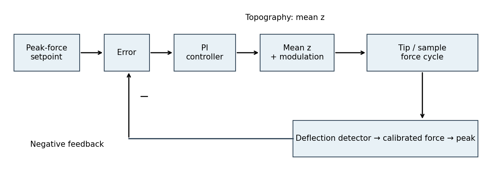

<h1 id="section-a-i/1/ii/a/solution">Solution</h1>

↑ **Parent:** [A](../a.md)

**The controlled quantity is the maximum repulsive [force](../../../../../../../force-split.md) in each tapping cycle.** In [PeakForce quantitative nanomechanical mapping](../../../../../../../peakforce-quantitative-nanomechanical-mapping.md), a vertical modulation below the [cantilever](../../../../../../../cantilever.md) resonance produces a force-distance cycle at each pixel. The optical lever measures deflection; the calibrated [cantilever](../../../../../../../cantilever.md) stiffness converts this to [force](../../../../../../../force-split.md). Subtract the measured peak [force](../../../../../../../force-split.md) from the setpoint and use [proportional-integral control](../../../../../../../proportional-integral-control.md) to adjust the mean vertical scanner position. Excessive peak [force](../../../../../../../force-split.md) makes the controller withdraw the sample or tip; insufficient [force](../../../../../../../force-split.md) makes it approach. The scanner position required to maintain the setpoint supplies the topography signal. This controls the top of the repulsive branch in the preceding curve, rather than the oscillation amplitude used in conventional tapping mode.[Peak normal-force control and simultaneous mechanical-property channels](../../../../../../../peakforce-qnm-by-bruker.md)

**[Figure 2](#section-a-i/1/ii/a/image-peak-force-feedback-with-an-independent-vertical-modulation). Peak-force feedback with an independent vertical modulation**. [Source](paper-1-afm-feedback.py).

## ↑ Ancestors (12)

1. [A](../a.md)
2. [Ii](../../ii.md)
3. [1](../../../1.md)
4. [Section A(i)](../../../../section-a-i.md)
5. [Paper 1](../../../../../paper-1-split.md)
6. [2020](../../../../../split.md)
7. [Past exam of the MPhil in micro- and nanotechnology enterprise course of the University of Cambridge](../../../../../../split.md)
8. [MPhil in micro- and nanotechnology enterprise course of the University of Cambridge](../../../../../../../mphil-in-micro-and-nanotechnology-enterprise-course-of-the-university-of-cambridge.md)
9. [Course of the University of Cambridge](../../../../../../../course-of-the-university-of-cambridge.md)
10. [University of Cambridge](../../../../../../../university-of-cambridge-split.md)
11. [List of universities](../../../../../../../list-of-universities.md)
12. [Codex Wiki](../../../../../../../split.md)
