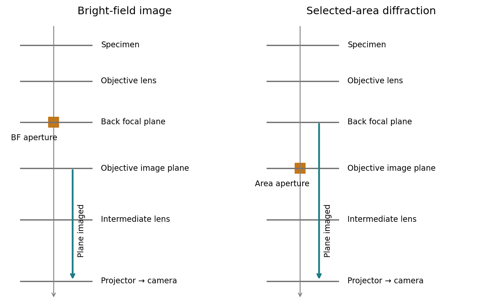

<h1 id="section-a-i/2/ii/solution">Solution</h1>

↑ **Parent:** [Ii](../ii.md)

For [bright-field transmission electron microscopy](../../../../../../bright-field-transmission-electron-microscopy.md), place the objective aperture in the [back focal plane](../../../../../../back-focal-plane.md) around the transmitted beam, excluding most diffracted beams. Adjust the intermediate lens to image the objective's real-space image plane; projector lenses enlarge that image onto the screen or camera. Regions removing [electrons](../../../../../../electron.md) from the admitted beam tend to be darker, although phase contrast can also contribute.

For [selected-area electron diffraction](../../../../../../selected-area-electron-diffraction.md), put the selected-area aperture in the objective image plane to choose a specimen region. Remove or open the objective aperture and change the intermediate-lens excitation to image the objective's [back focal plane](../../../../../../back-focal-plane.md) onto the camera. The projector then magnifies the diffraction pattern, rather than the specimen image. Thus the two apertures act in different conjugate planes.

**[Figure 4](#section-a-i/2/ii/image-the-plane-selected-by-the-intermediate-lens-determines-tem-imaging-or-diffraction-mode). The plane selected by the intermediate lens determines TEM imaging or diffraction mode**. [Source](paper-1-tem-modes.py).

[Area-selection aperture in the objective image plane and conjugate diffraction-plane imaging](../../../../../../selected-area-diffraction-by-jeol.md)

## ↑ Ancestors (11)

1. [Ii](../ii.md)
2. [2](../../2.md)
3. [Section A(i)](../../../section-a-i.md)
4. [Paper 1](../../../../paper-1-split.md)
5. [2020](../../../../split.md)
6. [Past exam of the MPhil in micro- and nanotechnology enterprise course of the University of Cambridge](../../../../../split.md)
7. [MPhil in micro- and nanotechnology enterprise course of the University of Cambridge](../../../../../../mphil-in-micro-and-nanotechnology-enterprise-course-of-the-university-of-cambridge.md)
8. [Course of the University of Cambridge](../../../../../../course-of-the-university-of-cambridge.md)
9. [University of Cambridge](../../../../../../university-of-cambridge-split.md)
10. [List of universities](../../../../../../list-of-universities.md)
11. [Codex Wiki](../../../../../../split.md)
