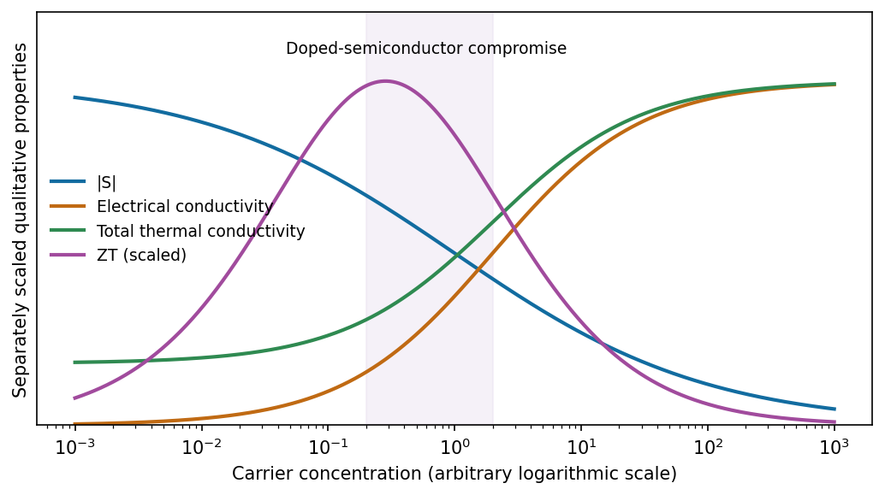

<h1 id="section-a-iii/7/ii/solution">Solution</h1>

↑ **Parent:** [Ii](../ii.md)

At low carrier concentration, $|S|$ can be large but [electrical conductivity](../../../../../../electrical-conductivity.md) is too small. Increasing the carrier concentration usually increases $\sigma=ne\mu$, while $|S|$ decreases. Electronic [thermal conductivity](../../../../../../thermal-conductivity.md) rises approximately as $\kappa_e=L\sigma T$ by the [Wiedemann-Franz law](../../../../../../wiedemann-franz-law.md); lattice conduction supplies an additional background. Thus neither an insulator nor an ordinary metal usually maximizes $Z$.

**Heavily doped [semiconductors](../../../../../../semiconductor-split.md) and semimetals** often give the useful compromise, near a maximum of $S^2\sigma/\kappa$ as doping is varied. The optimum is material- and temperature-dependent; there is no universal optimal concentration.

**[Figure 5](#section-a-iii/7/ii/image-qualitative-competition-between-thermopower-conduction-and-heat-leakage-as-carrier-density-rises). Qualitative competition between thermopower, conduction and heat leakage as carrier density rises**. [Source](paper-1-thermoelectric.py).

[Carrier-concentration trade-off and thermoelectric optimization](../../../../../../complex-thermoelectric-materials-by-g-jeffrey-snyder-and-eric-s-toberer.md)

## ↑ Ancestors (11)

1. [Ii](../ii.md)
2. [7](../../7.md)
3. [Section A(iii)](../../../section-a-iii.md)
4. [Paper 1](../../../../paper-1-split.md)
5. [2020](../../../../split.md)
6. [Past exam of the MPhil in micro- and nanotechnology enterprise course of the University of Cambridge](../../../../../split.md)
7. [MPhil in micro- and nanotechnology enterprise course of the University of Cambridge](../../../../../../mphil-in-micro-and-nanotechnology-enterprise-course-of-the-university-of-cambridge.md)
8. [Course of the University of Cambridge](../../../../../../course-of-the-university-of-cambridge.md)
9. [University of Cambridge](../../../../../../university-of-cambridge-split.md)
10. [List of universities](../../../../../../list-of-universities.md)
11. [Codex Wiki](../../../../../../split.md)
