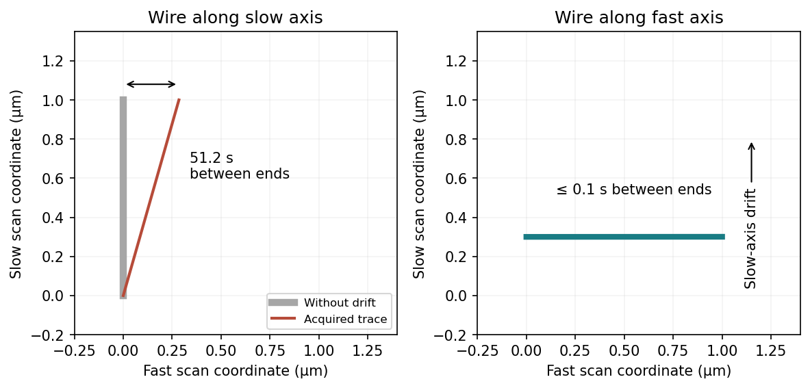

<h1 id="section-b/8/i/b/solution">Solution</h1>

↑ **Parent:** [B](../b.md)

Place the wire **parallel to the fast scan axis**. The endpoints are then recorded in a fraction of a line period, rather than tens of seconds apart, minimizing the differential drift accumulated between them.

**[Figure 6](#section-b/8/i/b/image-acquisition-time-separation-explains-the-orientation-dependence-of-nanowire-drift). Acquisition-time separation explains the orientation dependence of nanowire drift**. [Source](paper-1-afm-drift.py).

This does not remove drift of the wire's transverse position or apparent width between successive lines. A very thin wire parallel to the fast axis may fall between the discrete slow-axis scan lines, so a smaller scan area or denser sampling can be needed. Tip convolution, pixel resolution and feedback lag remain; trace/retrace comparisons and allowing thermal equilibration are still valuable. Increasing the scan speed indefinitely is limited by the scanner and feedback bandwidth.

## ↑ Ancestors (12)

1. [B](../b.md)
2. [I](../../i.md)
3. [8](../../../8.md)
4. [Section B](../../../../section-b.md)
5. [Paper 1](../../../../../paper-1-split.md)
6. [2020](../../../../../split.md)
7. [Past exam of the MPhil in micro- and nanotechnology enterprise course of the University of Cambridge](../../../../../../split.md)
8. [MPhil in micro- and nanotechnology enterprise course of the University of Cambridge](../../../../../../../mphil-in-micro-and-nanotechnology-enterprise-course-of-the-university-of-cambridge.md)
9. [Course of the University of Cambridge](../../../../../../../course-of-the-university-of-cambridge.md)
10. [University of Cambridge](../../../../../../../university-of-cambridge-split.md)
11. [List of universities](../../../../../../../list-of-universities.md)
12. [Codex Wiki](../../../../../../../split.md)
