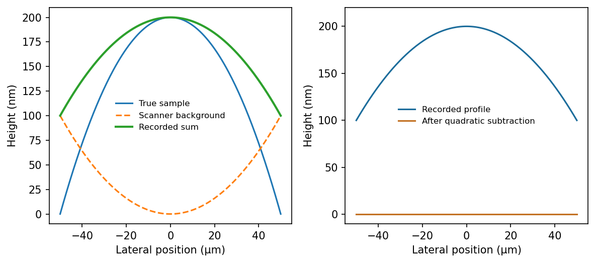

<h1 id="section-b/8/ii/a/solution">Solution</h1>

↑ **Parent:** [A](../a.md)

**[Scanner bow](../../../../../../../scanner-bow.md)** is the relevant artefact. A piezoelectric tube scanner bends to produce lateral displacement; its moving end also follows a curved vertical trajectory. Cross-coupling of lateral and vertical motion therefore gives a roughly quadratic height background even over a flat reference. Over a wide scan it can mimic or conceal a genuine parabolic sample profile; its sign depends on scanner geometry and height convention.

**[Figure 7](#section-b/8/ii/a/image-a-curved-scanner-trajectory-adds-a-background-indistinguishable-from-a-parabolic-sample-in-one-scan). A curved scanner trajectory adds a background indistinguishable from a parabolic sample in one scan**. [Source](paper-1-scanner-bow.py).

## ↑ Ancestors (12)

1. [A](../a.md)
2. [Ii](../../ii.md)
3. [8](../../../8.md)
4. [Section B](../../../../section-b.md)
5. [Paper 1](../../../../../paper-1-split.md)
6. [2020](../../../../../split.md)
7. [Past exam of the MPhil in micro- and nanotechnology enterprise course of the University of Cambridge](../../../../../../split.md)
8. [MPhil in micro- and nanotechnology enterprise course of the University of Cambridge](../../../../../../../mphil-in-micro-and-nanotechnology-enterprise-course-of-the-university-of-cambridge.md)
9. [Course of the University of Cambridge](../../../../../../../course-of-the-university-of-cambridge.md)
10. [University of Cambridge](../../../../../../../university-of-cambridge-split.md)
11. [List of universities](../../../../../../../list-of-universities.md)
12. [Codex Wiki](../../../../../../../split.md)
