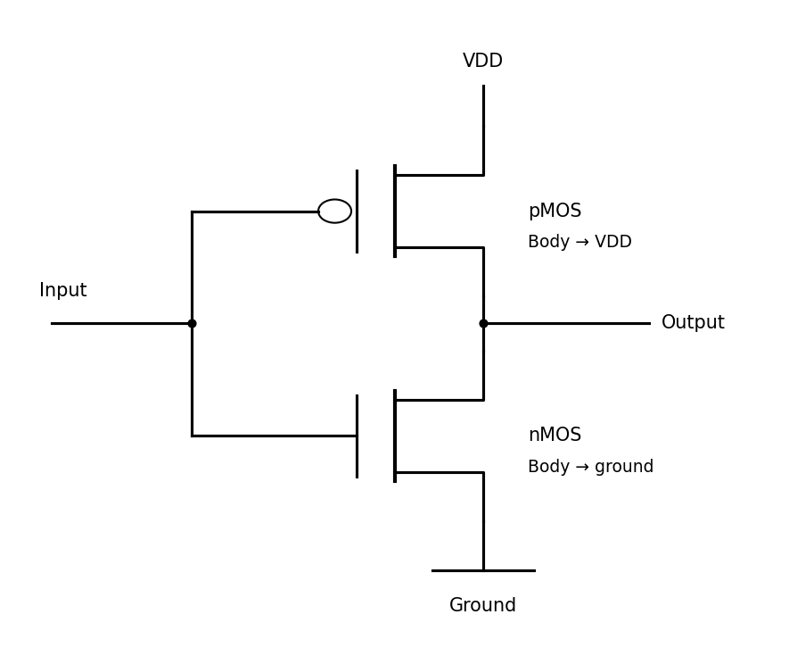

<h1 id="section-b/9/i/solution">Solution</h1>

↑ **Parent:** [I](../i.md)

The left transistor is an n-channel [MOSFET](../../../../../../mosfet.md) in a p-type [silicon](../../../../../../silicon.md) substrate; the right is a p-channel [MOSFET](../../../../../../mosfet.md) in an n-well. The region assignments are:

- **a:** n-well, [silicon](../../../../../../silicon.md) doped with a donor such as [phosphorus](../../../../../../phosphorus.md).
- **b:** p+ substrate contact, heavily boron-doped [silicon](../../../../../../silicon.md).
- **c:** n+ source of the nMOS device, arsenic- or phosphorus-doped [silicon](../../../../../../silicon.md).
- **d:** n+ drain of the nMOS device, with the same donor dopants.
- **e:** p+ drain of the pMOS device, boron-doped [silicon](../../../../../../silicon.md).
- **f:** p+ source of the pMOS device, boron-doped [silicon](../../../../../../silicon.md).
- **g:** n+ well contact, heavily donor-doped [silicon](../../../../../../silicon.md).
- **h:** nMOS gate, conventionally heavily doped polycrystalline [silicon](../../../../../../silicon.md) in this process.
- **i:** thin nMOS gate dielectric, conventionally [silicon dioxide](../../../../../../silicon-dioxide.md).
- **j:** pMOS gate, conventionally heavily doped polycrystalline [silicon](../../../../../../silicon.md).
- **k:** thin pMOS gate dielectric, conventionally [silicon dioxide](../../../../../../silicon-dioxide.md).

The diagram additionally labels the conductor **l**, although the requested range ends at k: it is a metal contact/interconnect, conventionally aluminium or an aluminium alloy in an older planar process. Modern processes can use metal gates, high-permittivity gate dielectrics and different interconnect stacks; these are alternatives, not evidence that the illustrated conventional gate is aluminium.

For a [CMOS inverter](../../../../../../cmos-inverter.md), join h and j to the input and d and e to the output. Connect f and g to $V_{\rm DD}$, and b and c to ground; these ties keep the body junctions appropriately biased.

**[Figure 8](#section-b/9/i/image-complementary-transistor-connections-with-each-body-tied-to-its-supply-rail). Complementary transistor connections, with each body tied to its supply rail**. [Source](paper-1-cmos-inverter.py).

## ↑ Ancestors (11)

1. [I](../i.md)
2. [9](../../9.md)
3. [Section B](../../../section-b.md)
4. [Paper 1](../../../../paper-1-split.md)
5. [2020](../../../../split.md)
6. [Past exam of the MPhil in micro- and nanotechnology enterprise course of the University of Cambridge](../../../../../split.md)
7. [MPhil in micro- and nanotechnology enterprise course of the University of Cambridge](../../../../../../mphil-in-micro-and-nanotechnology-enterprise-course-of-the-university-of-cambridge.md)
8. [Course of the University of Cambridge](../../../../../../course-of-the-university-of-cambridge.md)
9. [University of Cambridge](../../../../../../university-of-cambridge-split.md)
10. [List of universities](../../../../../../list-of-universities.md)
11. [Codex Wiki](../../../../../../split.md)
