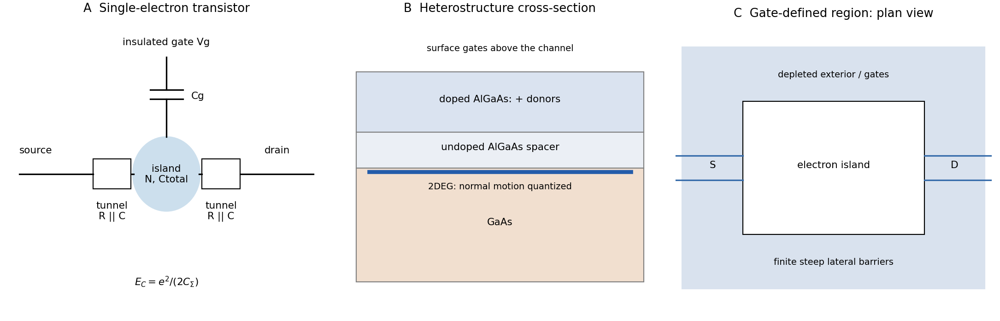

# Paper 2

↑ **Parent:** [2020](../2020.md)

Original source: [Original FOI download archive](https://www.whatdotheyknow.com/request/mphil_in_micro_and_nanotechnolog_5/response/2556540/attach/2/FOI%202024%2050%20Dai%20materials.zip?cookie_passthrough=1). Source: NanoMPhil Paper 2 2020.pdf, physical PDF pages 1–11 of that ZIP member. Every optional nonbiology question is covered; questions 17 and 21 are explicitly user-deferred.

**Table of contents**

- [Section A(i)](#section-a-i)
  - [13](#section-a-i/13)
    - [i](#section-a-i/13/i)
      - [Solution](#section-a-i/13/i/solution)
    - [ii](#section-a-i/13/ii)
      - [Solution](#section-a-i/13/ii/solution)
    - [iii](#section-a-i/13/iii)
      - [Solution](#section-a-i/13/iii/solution)
  - [14](#section-a-i/14)
    - [i](#section-a-i/14/i)
      - [Solution](#section-a-i/14/i/solution)
    - [ii](#section-a-i/14/ii)
      - [Solution](#section-a-i/14/ii/solution)
    - [iii](#section-a-i/14/iii)
      - [Solution](#section-a-i/14/iii/solution)
- [Section A(ii)](#section-a-ii)
  - [15](#section-a-ii/15)
    - [i](#section-a-ii/15/i)
      - [Solution](#section-a-ii/15/i/solution)
    - [ii](#section-a-ii/15/ii)
      - [Solution](#section-a-ii/15/ii/solution)
    - [iii](#section-a-ii/15/iii)
      - [Solution](#section-a-ii/15/iii/solution)
  - [16](#section-a-ii/16)
    - [i](#section-a-ii/16/i)
      - [Solution](#section-a-ii/16/i/solution)
    - [ii](#section-a-ii/16/ii)
      - [Solution](#section-a-ii/16/ii/solution)
    - [iii](#section-a-ii/16/iii)
      - [Solution](#section-a-ii/16/iii/solution)
    - [iv](#section-a-ii/16/iv)
      - [Solution](#section-a-ii/16/iv/solution)
- [Section A(iii)](#section-a-iii)
  - [17](#section-a-iii/17)
    - [i](#section-a-iii/17/i)
      - [a](#section-a-iii/17/i/a)
        - [Solution](#section-a-iii/17/i/a/solution)
      - [b](#section-a-iii/17/i/b)
        - [Solution](#section-a-iii/17/i/b/solution)
      - [c](#section-a-iii/17/i/c)
        - [Solution](#section-a-iii/17/i/c/solution)
    - [ii](#section-a-iii/17/ii)
      - [Solution](#section-a-iii/17/ii/solution)
    - [iii](#section-a-iii/17/iii)
      - [Solution](#section-a-iii/17/iii/solution)
  - [18](#section-a-iii/18)
    - [i](#section-a-iii/18/i)
      - [Solution](#section-a-iii/18/i/solution)
    - [ii](#section-a-iii/18/ii)
      - [Solution](#section-a-iii/18/ii/solution)
    - [iii](#section-a-iii/18/iii)
      - [Solution](#section-a-iii/18/iii/solution)
- [Section B](#section-b)
  - [19](#section-b/19)
    - [i](#section-b/19/i)
      - [Solution](#section-b/19/i/solution)
    - [ii](#section-b/19/ii)
      - [Solution](#section-b/19/ii/solution)
    - [iii](#section-b/19/iii)
      - [a](#section-b/19/iii/a)
        - [Solution](#section-b/19/iii/a/solution)
      - [b](#section-b/19/iii/b)
        - [Solution](#section-b/19/iii/b/solution)
      - [c](#section-b/19/iii/c)
        - [Solution](#section-b/19/iii/c/solution)
  - [20](#section-b/20)
    - [i](#section-b/20/i)
      - [Solution](#section-b/20/i/solution)
    - [ii](#section-b/20/ii)
      - [Solution](#section-b/20/ii/solution)
    - [iii](#section-b/20/iii)
      - [Solution](#section-b/20/iii/solution)
  - [21](#section-b/21)
    - [i](#section-b/21/i)
      - [Solution](#section-b/21/i/solution)
    - [ii](#section-b/21/ii)
      - [Solution](#section-b/21/ii/solution)
    - [iii](#section-b/21/iii)
      - [a](#section-b/21/iii/a)
        - [Solution](#section-b/21/iii/a/solution)
      - [b](#section-b/21/iii/b)
        - [Solution](#section-b/21/iii/b/solution)
    - [iv](#section-b/21/iv)
      - [Solution](#section-b/21/iv/solution)
    - [v](#section-b/21/v)
      - [Solution](#section-b/21/v/solution)
  - [22](#section-b/22)
    - [i](#section-b/22/i)
      - [a](#section-b/22/i/a)
        - [Solution](#section-b/22/i/a/solution)
      - [b](#section-b/22/i/b)
        - [Solution](#section-b/22/i/b/solution)
      - [c](#section-b/22/i/c)
        - [Solution](#section-b/22/i/c/solution)
    - [ii](#section-b/22/ii)
      - [Solution](#section-b/22/ii/solution)
    - [iii](#section-b/22/iii)
      - [a](#section-b/22/iii/a)
        - [Solution](#section-b/22/iii/a/solution)
      - [b](#section-b/22/iii/b)
        - [Solution](#section-b/22/iii/b/solution)
      - [c](#section-b/22/iii/c)
        - [Solution](#section-b/22/iii/c/solution)
      - [d](#section-b/22/iii/d)
        - [Solution](#section-b/22/iii/d/solution)
    - [iv](#section-b/22/iv)
      - [a](#section-b/22/iv/a)
        - [Solution](#section-b/22/iv/a/solution)
      - [b](#section-b/22/iv/b)
        - [Solution](#section-b/22/iv/b/solution)
    - [v](#section-b/22/v)
      - [Solution](#section-b/22/v/solution)

<h2 id="section-a-i">Section A(i)</h2>

↑ **Parent:** [Paper 2](paper-2.md)

<h3 id="section-a-i/13">13</h3>

↑ **Parent:** [Section A(i)](#section-a-i)

<h4 id="section-a-i/13/i">i</h4>

↑ **Parent:** [13](#section-a-i/13)

<h5 id="section-a-i/13/i/solution">Solution</h5>

↑ **Parent:** [I](#section-a-i/13/i)

The [carbon nanotube chiral vector](../../chemical-substance.md#carbon-nanotube-chiral-vector) identifies equivalent sites of [graphene](../../chemical-substance.md#graphene) that become one point on rolling:

$$
\mathbf C_h=n\mathbf a_1+m\mathbf a_2,\quad
|\mathbf a_1|=|\mathbf a_2|=a=\sqrt3b,\quad
d=\frac a\pi\sqrt{n^2+nm+m^2}.
$$

The primitive vectors meet at $60^\circ$, $b$ is the C–C bond length, and one can choose $0\le m\le n$. The [carbon nanotube chiral angle](../../chemical-substance.md#carbon-nanotube-chiral-angle) satisfies $\tan\theta=\sqrt3m/(2n+m)$. **Armchair tubes have $(n,n)$ and $\theta=30^\circ$; zigzag tubes have $(n,0)$ and $\theta=0$**. Other pairs are chiral, with mirror-related left- and right-handed forms. Armchair and zigzag tubes themselves have mirror symmetry.

The circumferential [boundary condition](../../differential-equation.md#boundary-condition) requires $\mathbf k\cdot\mathbf C_h=2\pi\ell$. In [nanotube zone folding](../../chemical-substance.md#nanotube-zone-folding), an allowed [wavevector](../../elasticity-physics.md#wavevector) line intersects one of the [Dirac valleys in graphene](../../chemical-substance.md#dirac-valleys-in-graphene) precisely when **$n-m$ is divisible by three**. Thus all armchair tubes are metallic in this approximation. Zigzag tubes are metallic for $n$ divisible by three and otherwise semiconducting; general chiral tubes follow the same modular rule. Curvature can open small gaps in nominally metallic non-armchair tubes. Strain, interactions and broken symmetries can modify the ideal result; metallic band structure does not imply zero device resistance.

<h4 id="section-a-i/13/ii">ii</h4>

↑ **Parent:** [13](#section-a-i/13)

<h5 id="section-a-i/13/ii/solution">Solution</h5>

↑ **Parent:** [Ii](#section-a-i/13/ii)

For an armchair [single-walled carbon nanotube](../../chemical-substance.md#single-walled-carbon-nanotube), $|\mathbf C_h|=3bn$. Hence

$$
d_n=\frac{0.426n}{\pi}\ {\rm nm},\qquad
\frac{\pi}{0.426}\le n\le\frac{1.7\pi}{0.426}.
$$

The integer bounds give **$(n,m)=(8,8),(9,9),(10,10),(11,11),(12,12)$**.

| Indices | Exact diameter in nm | Rounded diameter in nm |
| --- | --- | --- |
| $(8,8)$ | $3.408/\pi$ | $1.08480$ |
| $(9,9)$ | $3.834/\pi$ | $1.22040$ |
| $(10,10)$ | $4.260/\pi$ | $1.35600$ |
| $(11,11)$ | $4.686/\pi$ | $1.49160$ |
| $(12,12)$ | $5.112/\pi$ | $1.62720$ |

The neighboring values $d_7\simeq0.9492\ {\rm nm}$ and $d_{13}\simeq1.7628\ {\rm nm}$ lie outside the interval. “Exact” here means exact within the stipulated cylindrical model and input bond length; the decimals are rounded. No van der Waals wall thickness is added because the diameter is measured between atomic centers.

<h4 id="section-a-i/13/iii">iii</h4>

↑ **Parent:** [13](#section-a-i/13)

<h5 id="section-a-i/13/iii/solution">Solution</h5>

↑ **Parent:** [Iii](#section-a-i/13/iii)

Four advantages are **strong electrostatic gate control, rapid charge transport, high current-carrying capability and mechanical flexibility**.

A semiconducting [single-walled carbon nanotube](../../chemical-substance.md#single-walled-carbon-nanotube) has a nanometre-scale channel cross-section, allowing efficient gate control in a [field-effect transistor](../../semiconductor.md#field-effect-transistor). A clean short tube can have a long [mean free path](../../ideal-gas.md#mean-free-path) and correspondingly little channel scattering. Strong covalent bonding supports large [current densities](../../electric-charge.md#current-density) for interconnect applications, while high axial [thermal conductivity](../../heat.md#thermal-conductivity) can help distribute heat. Small mass, large [aspect ratio](../../physics.md#aspect-ratio) and mechanical compliance also permit conducting or semiconducting networks on flexible substrates. Metallic interconnects and low-leakage transistors require different electronic tube populations.

Manufacturing must control diameter, [carbon nanotube chiral vector](../../chemical-substance.md#carbon-nanotube-chiral-vector), purity, alignment and placement. Metallic contaminants short-circuit transistor networks; low network density reduces current, whereas excessive density makes isolation difficult. Tube–metal [contact resistance](../../electric-charge.md#contact-resistance), [schottky barriers](../../semiconductor.md#schottky-barrier), tube–tube junctions, catalyst residues and substrate charge traps can dominate the intrinsic channel response. Thermal boundary resistance can limit cooling despite high axial [thermal conductivity](../../heat.md#thermal-conductivity). Compare sorted and unsorted networks at matched density and contact geometry, measure contact and channel contributions separately, and assess uniformity across many devices. High intrinsic mobility alone is not evidence of a reproducible integrated circuit.

<h3 id="section-a-i/14">14</h3>

↑ **Parent:** [Section A(i)](#section-a-i)

<h4 id="section-a-i/14/i">i</h4>

↑ **Parent:** [14](#section-a-i/14)

<h5 id="section-a-i/14/i/solution">Solution</h5>

↑ **Parent:** [I](#section-a-i/14/i)

The competition between crystallization, exposed surfaces, adhesion and elastic strain can be summarized by

$$
\Delta G=-V\Delta g+\sum_j\gamma_jA_j+
(\gamma_{\rm int}-\gamma_{\rm support})A_{\rm contact}+E_{\rm strain}.
$$

Here $\Delta g>0$ measures the bulk driving force from [supersaturation](../../extremal-graph-theory.md#supersaturation), and the $\gamma$ values are interfacial [free energies](../../thermodynamic-potential.md#thermodynamic-free-energy). For a free spherical nucleus, $\Delta G=4\pi r^2\gamma-4\pi r^3\Delta g/3$ gives $r_*=2\gamma/\Delta g$. A support changes the [heterogeneous nucleation](../../critical-phenomenon.md#heterogeneous-nucleation) barrier through adhesion and geometry.

Precursor activities and supply rate, [temperature](../../temperature.md), time, solvent and ligands control nucleation, attachment, detachment and [surface diffusion](../../surface-tension.md#surface-diffusion). Many nuclei divide a fixed solute inventory into smaller particles; continued growth or [Ostwald ripening](../../critical-phenomenon.md#ostwald-ripening) can enlarge them. Substrate defects determine preferred nucleation sites; [lattice mismatch](../../semiconductor.md#lattice-mismatch) and interface bonding constrain orientation and elastic relaxation. Facet-selective adsorption can change both surface energies and growth rates.

Near equilibrium, a free [nanocrystal](../../engineering.md#nanocrystal) follows a [Wulff construction](../../thermodynamics.md#wulff-construction); a supported particle can follow a [Winterbottom construction](../../thermodynamics.md#winterbottom-construction). Under kinetic control, slowly advancing facets remain visible while rapidly growing ones disappear. **Equilibrium facet energy and kinetic growth rate are different controls**, so a crystal structure does not uniquely determine particle shape.

<h4 id="section-a-i/14/ii">ii</h4>

↑ **Parent:** [14](#section-a-i/14)

<h5 id="section-a-i/14/ii/solution">Solution</h5>

↑ **Parent:** [Ii](#section-a-i/14/ii)

The upper island has lower contrast than the rod in [HAADF imaging](../../optics.md#high-angle-annular-dark-field-imaging), consistent with a lighter Zn-containing region above a Ru-rich support. Thickness, orientation and detector conditions also affect contrast, so intensity alone is not a compositional assay. The island is a flattened supported cap, not an isolated regular bulk crystal.

Using the 2 nm scale bar as a ruler gives a **projected lateral size of order 4–6 nm and height of order 1–2 nm**, depending on placement of the diffuse edges. These are approximate image estimates, not a three-dimensional diameter or size distribution. The height/width ratio is roughly $0.2$–$0.5$, and only a few atomic rows span the height. Thus surface and interface atoms form a substantial fraction of the particle. The truncated, irregular cap and weak edge order depart from an infinite, fully coordinated, perfectly periodic [wurtzite](../../physical-chemistry.md#wurtzite) crystal.

Adhesion can favor spreading across the rod. [epitaxy](../../engineering.md#epitaxy) can orient ZnO against a compatible surface repeat of the [rutile structure](../../physical-chemistry.md#rutile-structure), despite the different bulk symmetries. Coherent growth initially introduces strain; free edges allow relaxation, while larger islands may develop [misfit dislocations](../../physical-chemistry.md#misfit-dislocation). Facet-dependent attachment, polar surface energies, ligand coverage and unequal precursor delivery can further alter the cap. A final image does not uniquely reveal which kinetic pathway operated.

To measure strain, first index the [zone axis](../../physical-chemistry.md#zone-axis) and projected lattices. For pixel spacing $s$ and scale-bar length $s_{\rm bar}$, $d_{\rm image}=2s/s_{\rm bar}\ {\rm nm}$. Compare an indexed spacing with its unstrained reference:

$$
\epsilon_{hkl}=\frac{d_{\rm image}-d^0_{hkl}}{d^0_{hkl}},\qquad
\frac1{(d^0_{hkl})^2}=
\frac{4(h^2+hk+k^2)}{3a^2}+\frac{l^2}{c^2}.
$$

The latter is the hexagonal [wurtzite](../../physical-chemistry.md#wurtzite) relation. An ideal tetrahedral geometry has $c/a=\sqrt{8/3}$ and internal coordinate $u=3/8$; real bulk ZnO itself need not attain those ideal values. Measure several periods and compare interface and free-edge regions to distinguish strain from tilt and calibration errors.

**A unique numerical lattice strain, vacancy concentration or phase assignment is not established by this unindexed single projection.** Oxygen columns are weak, so a missing bright spot does not prove an oxygen vacancy. Tilted images, [electron diffraction](../../quantum-scattering.md#electron-diffraction), chemical mapping and thickness-aware simulations would test those claims. The full [rutile structure](../../physical-chemistry.md#rutile-structure) is primitive tetragonal with a basis: its metal positions can appear body-centered in a conventional cell, but the oxygen basis prevents calling the entire structure a body-centered tetragonal Bravais lattice.

<h4 id="section-a-i/14/iii">iii</h4>

↑ **Parent:** [14](#section-a-i/14)

<h5 id="section-a-i/14/iii/solution">Solution</h5>

↑ **Parent:** [Iii](#section-a-i/14/iii)

Two applications are **ultraviolet photodetection and ultraviolet/near-band-edge light emission**. The bulk edge corresponds approximately to

$$
\lambda_g=\frac{hc}{E_g}\simeq\frac{1240\ {\rm eV\,nm}}{3.2\ {\rm eV}}
\simeq388\ {\rm nm}.
$$

Above-gap absorption creates carriers that can be collected in a [photodetector](../../optical-instrument.md#photodetector). Measure dark current and wavelength-dependent response to separate photocarriers from heating or leakage. An optically or electrically excited emitter instead uses [electron-hole recombination](../../quantum-mechanics.md#electron-hole-recombination). [quantum confinement](../../quantum-mechanics.md#quantum-confinement) in sufficiently small dots can shift absorption and emission above the bulk [band gap](../../bloch-s-theorem.md#band-gap). Surface states can produce broad defect luminescence or nonradiative loss, so a direct bulk gap does not guarantee an efficient, narrow-band emitter.

<h2 id="section-a-ii">Section A(ii)</h2>

↑ **Parent:** [Paper 2](paper-2.md)

<h3 id="section-a-ii/15">15</h3>

↑ **Parent:** [Section A(ii)](#section-a-ii)

<h4 id="section-a-ii/15/i">i</h4>

↑ **Parent:** [15](#section-a-ii/15)

<h5 id="section-a-ii/15/i/solution">Solution</h5>

↑ **Parent:** [I](#section-a-ii/15/i)

Sweep the in-plane [magnetic field](../../magnetic-field.md) approximately along the wires' easy axes. At large negative field, both [magnetizations](../../electromagnetism.md#magnetization) are parallel. If the wires reverse at different positive coercive fields, an antiparallel interval separates this state from the final parallel positive-field state. In the usual positive [giant magnetoresistance](../../electric-charge.md#giant-magnetoresistance) case, **the antiparallel interval has higher resistance**; the reverse sweep gives a mirrored interval and a [hysteresis](../../critical-phenomenon.md#hysteresis) loop.

An ideal angular model is

$$
R(\phi)=R_P+\frac{\Delta R}{2}(1-\cos\phi),\qquad \Delta R=R_{AP}-R_P>0.
$$

Spin-dependent injection and scattering favor transmission through similarly aligned electrodes. The [two-current resistor model](../../electric-charge.md#two-current-resistor-model) represents this using unequal majority- and minority-spin resistances. Both layers can reverse, hence [pseudo spin valve](../../electric-charge.md#pseudo-spin-valve), rather than an absolutely pinned reference layer.

The different thicknesses can produce different switching properties, but **thickness alone does not identify which electrode reverses first**. Measure their coercive fields. The local resistance also contains Cu, contact and Py [anisotropic magnetoresistance](../../electric-charge.md#anisotropic-magnetoresistance) contributions. Rotation scans and individual-wire controls distinguish them. Py/Cu experiments showed that local contact-related signals can exceed the spin-valve contribution, motivating nonlocal detection.[2003, abstract and local/nonlocal measurement comparison](../../physics-bibliography.md#spin-injection-and-spin-accumulation-in-all-metal-mesoscopic-spin-valves-by-f-j-jedema-and-others)

**[Figure 1](#section-a-ii/15/i/image-ideal-spin-valve-switching-and-surface-energy-balances-for-wetting). Ideal spin-valve switching and surface-energy balances for wetting**. Original chosen switching curves, force diagram and composite-wetting curve. Switching fields and signal heights are illustrative rather than measured.

<h4 id="section-a-ii/15/ii">ii</h4>

↑ **Parent:** [15](#section-a-ii/15)

<h5 id="section-a-ii/15/ii/solution">Solution</h5>

↑ **Parent:** [Ii](#section-a-ii/15/ii)

Measure nonlocal alignment-dependent resistance in otherwise comparable devices with several injector–detector spacings $L$. Steady [spin accumulation](../../electrical-engineering.md#spin-accumulation) obeys a diffusion–relaxation equation,

$$
D\frac{d^2\mu_s}{dx^2}-\frac{\mu_s}{\tau_s}=0,\qquad
\mu_s(L)\propto e^{-L/\lambda_s},\qquad
\boxed{\lambda_s=\sqrt{D\tau_s}}.
$$

In a weakly invasive detector limit, $\Delta R_{\rm NL}=(V_P-V_{AP})/I\propto e^{-L/\lambda_s}$; a semilog plot gives slope $-1/\lambda_s$. With transparent Py/Cu interfaces, fit a spin-resistance model including contact absorption and wire cross-section rather than assuming that every amplitude reduction is a bulk Cu loss.

Keep Cu processing, cross-section and [temperature](../../temperature.md) fixed, characterize [contact resistances](../../electric-charge.md#contact-resistance), reverse injector current and subtract alignment-independent offsets. Repeat at different [temperatures](../../temperature.md) to assess interface and bulk contributions. A [Hanle spin-precession measurement](../../angular-momentum-operator.md#hanle-spin-precession-measurement) provides an independent check of spin relaxation, with diffusion times and electrode rotation included in its model.

<h4 id="section-a-ii/15/iii">iii</h4>

↑ **Parent:** [15](#section-a-ii/15)

<h5 id="section-a-ii/15/iii/solution">Solution</h5>

↑ **Parent:** [Iii](#section-a-ii/15/iii)

Spin-polarized injection produces different spin-resolved [electrochemical potentials](../../chemical-potential.md#electrochemical-potential) in Cu, $\mu_s=\mu_\uparrow-\mu_\downarrow$. Their imbalance diffuses beyond the charge-current path. Oppositely directed spin-resolved currents can cancel in net charge while transporting spin.

The second Py contact is a spin-selective voltage probe. In a weakly invasive model,

$$
V_{\rm NL}-V_0\simeq\frac{P_{\rm det}}{2e}\mu_s(L),\qquad
\mu_s(L)\propto P_{\rm inj}I\,e^{-L/\lambda_s}.
$$

Its open-circuit potential adjusts until the total detector charge current vanishes. That potential changes when the detector [magnetization](../../electromagnetism.md#magnetization) reverses relative to the injected spins. **Zero detector charge current does not imply zero spin imbalance or zero measured voltage.**

Reverse injector current and each electrode's alignment to test the predicted signal symmetries. Remove spin-independent thermoelectric offsets and stray-field Hall contributions. A nonzero voltage alone would not prove [spin accumulation](../../electrical-engineering.md#spin-accumulation).[2003, nonlocal detection and separation from contact-related magnetoresistance](../../physics-bibliography.md#spin-injection-and-spin-accumulation-in-all-metal-mesoscopic-spin-valves-by-f-j-jedema-and-others)

<h3 id="section-a-ii/16">16</h3>

↑ **Parent:** [Section A(ii)](#section-a-ii)

<h4 id="section-a-ii/16/i">i</h4>

↑ **Parent:** [16](#section-a-ii/16)

<h5 id="section-a-ii/16/i/solution">Solution</h5>

↑ **Parent:** [I](#section-a-ii/16/i)

For standard deviations of [position](../../classical-mechanics.md#position) and [momentum](../../momentum.md),

$$
\boxed{\Delta x\,\Delta p_x\ge\hbar/2}.
$$

Confinement to a region of size $R$ requires a momentum spread of order $\hbar/R$, hence kinetic energy of order $\hbar^2/(2m^*R^2)$. A sufficiently small semiconducting [nanocrystal](../../engineering.md#nanocrystal) therefore has discrete [energy levels](../../quantum-mechanics.md#energy-level) and an optical edge shifted above the bulk [band gap](../../bloch-s-theorem.md#band-gap).

An illustrative strong-confinement model is

$$
E_{\rm opt}(R)\simeq E_g+
\frac{\pi^2\hbar^2}{2R^2}\left(\frac1{m_e^*}+\frac1{m_h^*}\right)
-\frac{\alpha e^2}{4\pi\epsilon_0\epsilon_rR},
$$

where $\alpha$ is a geometry-dependent number of order unity. The positive confinement contribution grows as $R^{-2}$; [electron-hole Coulomb interaction](../../quantum-mechanics.md#electron-hole-coulomb-interaction) contributes an attractive term of order $-R^{-1}$. The uncertainty principle motivates the scale, not the exact coefficient or oscillator strength. Strong size dependence occurs near the [exciton Bohr radius](../../quantum-mechanics.md#exciton-bohr-radius). Finite barriers, dielectric mismatch and surface states modify this model, while size distributions broaden ensemble spectra.

<h4 id="section-a-ii/16/ii">ii</h4>

↑ **Parent:** [16](#section-a-ii/16)

<h5 id="section-a-ii/16/ii/solution">Solution</h5>

↑ **Parent:** [Ii](#section-a-ii/16/ii)

Choose zero potential for $0<x<L$. In an [infinite square well](../../quantum-mechanics.md#infinite-square-well),

$$
\psi_n(x)=\sqrt{\frac2L}\sin\frac{n\pi x}{L},\qquad
E_n=\frac{n^2\pi^2\hbar^2}{2mL^2}.
$$

The first three levels have ratios **$1:4:9$**, with zero, one and two interior nodes; the [wavefunctions](../../wave-function.md) vanish outside.

For a [finite square well](../../quantum-mechanics.md#finite-square-well) with exterior potential $V_0$, bound states have $0<E<V_0$, sinusoidal interiors and tails with $\kappa=\sqrt{2m(V_0-E)}/\hbar$. Matching [wavefunction](../../wave-function.md) and derivative for equal masses gives

$$
k\tan(kL/2)=\kappa\ \text{(even)},\qquad
-k\cot(kL/2)=\kappa\ \text{(odd)},\qquad
k=\sqrt{2mE}/\hbar,
$$

when parity is taken about the well center. Corresponding energies fall below the infinite-barrier values, and the [wavefunctions](../../wave-function.md) spread beyond the walls. There are finitely many bound states; a shallow well need not possess three. States above $V_0$ form a scattering continuum.

**[Figure 2](#section-a-ii/16/ii/image-wavefunctions-probability-densities-and-core-shell-confinement). Wavefunctions, probability densities and core-shell confinement**. Original normalized infinite- and finite-well calculations with a chosen dimensionless barrier, plus qualitative type-I envelope sketches. The envelope panel is not a two-particle probability density or material-specific fit.

<h4 id="section-a-ii/16/iii">iii</h4>

↑ **Parent:** [16](#section-a-ii/16)

<h5 id="section-a-ii/16/iii/solution">Solution</h5>

↑ **Parent:** [Iii](#section-a-ii/16/iii)

The second infinite-well state has

$$
\boxed{\rho_2(x)=\frac2L\sin^2\frac{2\pi x}{L}}\quad(0<x<L).
$$

Its maxima are at $L/4$ and $3L/4$, with nodes at the walls and center. The density is zero outside.

If the second bound state exists in a symmetric [finite square well](../../quantum-mechanics.md#finite-square-well), odd parity preserves its central node and two equal lobes. However, the density is nonzero at the walls and has exterior tails proportional to $e^{-2\kappa|x-x_{\rm wall}|}$. Normalization includes those tails, and internal peak positions and heights change. **Finite barriers change penetration and energy; symmetry preserves the central node.** The original wells figure compares the two normalized second-state densities.

<h4 id="section-a-ii/16/iv">iv</h4>

↑ **Parent:** [16](#section-a-ii/16)

<h5 id="section-a-ii/16/iv/solution">Solution</h5>

↑ **Parent:** [Iv](#section-a-ii/16/iv)

An [exciton](../../quantum-mechanics.md#exciton) is a correlated electron–hole pair with a full [wavefunction](../../wave-function.md) $\Psi(\mathbf r_e,\mathbf r_h)$. In strong confinement, a useful leading approximation is a product of lowest electron and hole envelope functions, followed by a Coulomb correction. A spherical hard-wall ground envelope is nodeless, proportional to $\sin(\pi r/R)/r$, and finite at the origin. Finite barriers produce exterior tails.

For a [core-shell semiconductor nanocrystal](../../semiconductor.md#core-shell-semiconductor-nanocrystal) with **[type-I band alignment](../../semiconductor.md#type-i-band-alignment)**, both conduction- and valence-band offsets confine the carriers mainly to the core. Their envelopes penetrate the shell but overlap less with external traps. Chemical [surface passivation](../../semiconductor.md#surface-passivation) and spatial separation from defects can suppress nonradiative losses and increase [photoluminescence](../../optics.md#photoluminescence) [quantum yield](../../chemical-bond.md#quantum-yield). Shell thickness, interfacial quality and strain must be controlled; a defective shell can introduce losses.

**A larger shell [band gap](../../bloch-s-theorem.md#band-gap) alone does not guarantee type-I alignment.** A staggered [type-II band alignment](../../semiconductor.md#type-ii-band-alignment) can move one carrier toward the shell, reduce electron–hole overlap and alter lifetime and emission energy. The sketch illustrates the conditional type-I case. In CdSe/ZnS experiments, optical spectra were combined with structural and compositional measurements to test shell-growth interpretations.[1997, abstract: spectroscopy, structural/compositional characterization and locally epitaxial shell growth](../../physics-bibliography.md#cdse-zns-core-shell-quantum-dots-synthesis-and-characterization-of-a-size-series-of-highly-luminescent-nanocrystallites-by-b-o-dabbousi-and-others)

<h2 id="section-a-iii">Section A(iii)</h2>

↑ **Parent:** [Paper 2](paper-2.md)

<h3 id="section-a-iii/17">17</h3>

↑ **Parent:** [Section A(iii)](#section-a-iii)

<h4 id="section-a-iii/17/i">i</h4>

↑ **Parent:** [17](#section-a-iii/17)

<h5 id="section-a-iii/17/i/a">a</h5>

↑ **Parent:** [I](#section-a-iii/17/i)

<h6 id="section-a-iii/17/i/a/solution">Solution</h6>

↑ **Parent:** [A](#section-a-iii/17/i/a)

**TODO: user-deferred biological question; no biological research or solution provided.**

<h5 id="section-a-iii/17/i/b">b</h5>

↑ **Parent:** [I](#section-a-iii/17/i)

<h6 id="section-a-iii/17/i/b/solution">Solution</h6>

↑ **Parent:** [B](#section-a-iii/17/i/b)

**TODO: user-deferred biological question; no biological research or solution provided.**

<h5 id="section-a-iii/17/i/c">c</h5>

↑ **Parent:** [I](#section-a-iii/17/i)

<h6 id="section-a-iii/17/i/c/solution">Solution</h6>

↑ **Parent:** [C](#section-a-iii/17/i/c)

**TODO: user-deferred biological question; no biological research or solution provided.**

<h4 id="section-a-iii/17/ii">ii</h4>

↑ **Parent:** [17](#section-a-iii/17)

<h5 id="section-a-iii/17/ii/solution">Solution</h5>

↑ **Parent:** [Ii](#section-a-iii/17/ii)

**TODO: user-deferred biological question; no biological research or solution provided.**

<h4 id="section-a-iii/17/iii">iii</h4>

↑ **Parent:** [17](#section-a-iii/17)

<h5 id="section-a-iii/17/iii/solution">Solution</h5>

↑ **Parent:** [Iii](#section-a-iii/17/iii)

**TODO: user-deferred biological question; no biological research or solution provided.**

<h3 id="section-a-iii/18">18</h3>

↑ **Parent:** [Section A(iii)](#section-a-iii)

<h4 id="section-a-iii/18/i">i</h4>

↑ **Parent:** [18](#section-a-iii/18)

<h5 id="section-a-iii/18/i/solution">Solution</h5>

↑ **Parent:** [I](#section-a-iii/18/i)

At a straight [contact line](../../surface-tension.md#contact-line), take forces per unit transverse length and measure the [contact angle](../../surface-tension.md#contact-angle) $\theta$ through the liquid. Solid–vapor [surface tension](../../surface-tension.md) pulls outward along the solid, solid–liquid [surface tension](../../surface-tension.md) pulls inward, and the liquid–vapor force has horizontal component $\gamma_{LV}\cos\theta$. Tangential equilibrium gives

$$
\gamma_{SV}-\gamma_{SL}-\gamma_{LV}\cos\theta=0,\qquad
\boxed{\cos\theta=\frac{\gamma_{SV}-\gamma_{SL}}{\gamma_{LV}}}.
$$

This is [Young's equation](../../surface-tension.md#young-s-equation). The substrate supplies the normal reaction balancing the vertical capillary component. The original force sketch labels directions at a right-hand contact line. The result assumes smooth, chemically uniform, rigid surfaces in partial-wetting equilibrium, with negligible pinning and line tension.

<h4 id="section-a-iii/18/ii">ii</h4>

↑ **Parent:** [18](#section-a-iii/18)

<h5 id="section-a-iii/18/ii/solution">Solution</h5>

↑ **Parent:** [Ii](#section-a-iii/18/ii)

Advance the projected contact line by $dx$ per unit transverse length without wetting the gaps. A fraction $f$ converts solid–vapor interface into solid–liquid interface, contributing $f(\gamma_{SL}-\gamma_{SV})dx$. The remaining fraction creates liquid–vapor interface above trapped gas, costing $(1-f)\gamma_{LV}dx$. The outer droplet surface contributes $\gamma_{LV}\cos\theta^*dx$. Thus

$$
\frac{dG}{dx}=
f(\gamma_{SL}-\gamma_{SV})+(1-f)\gamma_{LV}
+\gamma_{LV}\cos\theta^*=0.
$$

Substituting [Young's equation](../../surface-tension.md#young-s-equation) gives

$$
\boxed{\cos\theta^*=f\cos\theta-(1-f)=f(1+\cos\theta)-1}.
$$

This is the ideal [Cassie–Baxter state](../../surface-tension.md#cassie-baxter-state) relation. Its $f$ is projected solid-contact fraction, not the roughness factor of [Wenzel wetting](../../surface-tension.md#wenzel-wetting). A suspended interface over the gaps is essential; invasion of the texture changes the area bookkeeping.

<h4 id="section-a-iii/18/iii">iii</h4>

↑ **Parent:** [18](#section-a-iii/18)

<h5 id="section-a-iii/18/iii/solution">Solution</h5>

↑ **Parent:** [Iii](#section-a-iii/18/iii)

With $f=3/4$,

$$
\cos\theta^*=\frac34\cos\theta-\frac14.
$$

Hydrophobicity requires $\theta^*>90^\circ$, hence

$$
\boxed{\theta>\cos^{-1}(1/3)\simeq70.53^\circ}.
$$

Equality is the $\theta^*=90^\circ$ boundary. A smooth-solid angle between about $70.53^\circ$ and $90^\circ$ can therefore become apparently hydrophobic if the suspended state persists.

For general $0<f\le1$, the criterion is $\cos\theta<1/f-1$. For $1/2<f\le1$, the threshold is $\cos^{-1}(1/f-1)$, reaching $90^\circ$ at $f=1$. For $f=1/2$, all $\theta>0$ satisfy it, with $\theta=0$ marginal. For $f<1/2$, the ideal equation predicts hydrophobicity for every original angle; formally $\theta^*\to180^\circ$ as $f\to0$.

**These conclusions require retention of gas beneath the liquid.** On intrinsically wettable textures the [Cassie–Baxter state](../../surface-tension.md#cassie-baxter-state) can be metastable. Pressure, condensation or defects may trigger invasion; penetration tests and contact-angle hysteresis distinguish that failure from the ideal suspended state. Roughness alone does not guarantee stable water repellency.

## Section B

↑ **Parent:** [Paper 2](paper-2.md)

<h3 id="section-b/19">19</h3>

↑ **Parent:** [Section B](#section-b)

<h4 id="section-b/19/i">i</h4>

↑ **Parent:** [19](#section-b/19)

<h5 id="section-b/19/i/solution">Solution</h5>

↑ **Parent:** [I](#section-b/19/i)

A zero-dimensional example is **[buckminsterfullerene](../../chemical-substance.md#buckminsterfullerene), $\mathrm C_{60}$**: a closed cage with 60 vertices, 90 edges, 12 pentagons and 20 hexagons. Euler's relation is $60-90+32=2$. Each carbon has three neighbors in a curved, approximately $sp^2$-bonded network; bonds are not all equivalent. Its cage diameter is of order $0.7\ {\rm nm}$.

Confinement in all directions gives discrete [molecular orbitals](../../chemistry.md#molecular-orbital), unlike the extended dispersion of [graphene](../../chemical-substance.md#graphene). It is an electron acceptor with characteristic electronic and vibrational spectra. Its pentagons supply the positive curvature needed to close the carbon network. A molecular solid of cages is held together predominantly by intermolecular forces, so its mechanical and electrical properties differ from those of an individual strongly bonded cage. Undoped fullerene is not a high-conductivity [graphene](../../chemical-substance.md#graphene) sheet; doping, packing and charge transfer can strongly change transport.

<h4 id="section-b/19/ii">ii</h4>

↑ **Parent:** [19](#section-b/19)

<h5 id="section-b/19/ii/solution">Solution</h5>

↑ **Parent:** [Ii](#section-b/19/ii)

Three point-defect structures are **a [Stone-Wales defect](../../physical-chemistry.md#stone-wales-defect), a reconstructed [graphene monovacancy](../../physical-chemistry.md#graphene-monovacancy) and a reconstructed [graphene divacancy](../../physical-chemistry.md#graphene-divacancy)**. The original sketch gives ring inventories rather than fitted atomic coordinates.

A [Stone-Wales defect](../../physical-chemistry.md#stone-wales-defect) rotates one C–C bond, converting four hexagons into a 5–7–7–5 group without changing the number of atoms. A [graphene monovacancy](../../physical-chemistry.md#graphene-monovacancy) removes one carbon; a common reconstruction gives a 5–9 group with residual under-coordination. A [graphene divacancy](../../physical-chemistry.md#graphene-divacancy) removes two adjacent carbons; a 5–8–5 reconstruction can eliminate dangling bonds. Other divacancy reconstructions exist, so atom loss does not uniquely select one topology.

Irradiation, energetic processing, etching and incomplete growth can create vacancies; thermally or beam-activated bond rearrangement can change their structures. Electron microscopy itself can create defects, so compare exposures before attributing a time sequence to unperturbed material.

Pentagons favor positive curvature and heptagons negative curvature. Such defects can bend tubes, help form caps or junctions, or change a local wrapping relationship. They scatter carriers and alter the local [density of states](../../quantum-ideal-gas-statistics.md#density-of-states); vacancies can add localized states and chemical reactivity. Whether a clean [band gap](../../bloch-s-theorem.md#band-gap) appears depends on defect identity, concentration and arrangement, not merely on the presence of a defect.

**[Figure 3](#section-b/19/ii/image-carbon-point-defect-ring-inventories). Carbon point-defect ring inventories**. Original topology summaries of a Stone-Wales rearrangement and vacancy reconstructions. Atom deficits and nonhexagonal ring counts are explicit; the polygons do not represent energy-minimized atomic coordinates.

<h4 id="section-b/19/iii">iii</h4>

↑ **Parent:** [19](#section-b/19)

<h5 id="section-b/19/iii/a">a</h5>

↑ **Parent:** [Iii](#section-b/19/iii)

<h6 id="section-b/19/iii/a/solution">Solution</h6>

↑ **Parent:** [A](#section-b/19/iii/a)

Separated [graphene](../../chemical-substance.md#graphene) sheets offer high accessible [surface area](../../differential-geometry.md#surface-area), short lithium-transport distances and a conducting network. Edges and exposed sheet faces can supply additional storage sites; mechanical flexibility can help preserve contact during cycling. These advantages can improve rate capability when electrolyte access and electronic continuity are retained.

The [graphite](../../chemical-substance.md#graphite) reference composition $\mathrm{LiC_6}$ gives

$$
Q=\frac{F}{3.6(6M_C)}\simeq372\ {\rm mAh\,g^{-1}},
$$

where the host-carbon mass is used. An idealized $\mathrm{LiC_3}$ inventory doubles this figure, but **two accessible faces do not prove a reversible $\mathrm{LiC_3}$ electrode**. Binding energies, aggregation, defects and electrolyte stability determine actual storage.

Large area increases electrolyte decomposition and [solid electrolyte interphase](../../electrochemistry.md#solid-electrolyte-interphase) formation, consuming lithium in early cycles. Restacking reduces accessible area, low packing density reduces volumetric capacity, and residual oxygen, defects or binder can lower conductivity and active mass fraction. A broad storage-voltage profile may lower full-cell energy efficiency. Compare electrodes at matched areal loading and practical [current density](../../electric-charge.md#current-density), reporting first-cycle efficiency, retention, voltage profile and volumetric as well as gravimetric capacity.

<h5 id="section-b/19/iii/b">b</h5>

↑ **Parent:** [Iii](#section-b/19/iii)

<h6 id="section-b/19/iii/b/solution">Solution</h6>

↑ **Parent:** [B](#section-b/19/iii/b)

I would choose **[liquid-phase exfoliation](../../chemical-substance.md#liquid-phase-exfoliation) of [graphite](../../chemical-substance.md#graphite) into few-layer [graphene](../../chemical-substance.md#graphene)**, followed by controlled electrode formation. It uses bulk feedstock and preserves much of the $sp^2$ framework; a battery electrode does not require a wafer-sized perfect monolayer.

Disperse [graphite](../../chemical-substance.md#graphite) in a compatible liquid, apply shear or sonication, and classify the dispersion to separate thin flakes from unexfoliated material. Recover and wash the selected fraction, remove contaminants and dispersants, then coat a Cu current collector with a suitably bound, porous and electrically connected film. Drying and consolidation should establish contacts without collapsing every transport pore. Characterize thickness and size distributions, residual impurities and conductivity after processing.

The advantages are solution compatibility, accessible feedstock and less basal-plane chemical disruption than oxidation–reduction routes. Limitations include a distribution of layer numbers, limited single-pass yield, flake fragmentation, solvent recovery and drying-induced restacking. Solvent toxicity and retained surfactants matter for manufacturing. In the original exfoliation study, microscopy and spectroscopy distinguished thin flakes from [graphite](../../chemical-substance.md#graphite) and checked structural preservation; those controls precede any performance claim.[2008, pp. 563–568, preparation and microscopy/spectroscopy characterization](../../physics-bibliography.md#high-yield-production-of-graphene-by-liquid-phase-exfoliation-of-graphite-by-yenny-hernandez-and-others)

Oxidation–exfoliation–reduction is another scalable route, but irreversible lattice damage and residual oxygen make conductivity and first-cycle losses separate concerns.

<h5 id="section-b/19/iii/c">c</h5>

↑ **Parent:** [Iii](#section-b/19/iii)

<h6 id="section-b/19/iii/c/solution">Solution</h6>

↑ **Parent:** [C](#section-b/19/iii/c)

**Yes: [carbon nanotubes](../../chemical-substance.md#carbon-nanotube) can store lithium and form a porous, conducting anode network.** Their external surfaces, defects and intertube spaces provide possible storage sites. Open ends and suitable defects may make internal surfaces accessible; a closed pristine tube should not be credited with its full internal area.

Axial conduction and an entangled mechanical scaffold can support either active storage or a composite electrode. Limitations include tube–tube [contact resistance](../../electric-charge.md#contact-resistance), low packing density, catalyst residues and large-area [solid electrolyte interphase](../../electrochemistry.md#solid-electrolyte-interphase) formation. Opening or functionalizing tubes may improve ion access while increasing defects and irreversible reactions. Compare reversible capacity, first-cycle efficiency, retention and full-cell lithium inventory under matched loading and voltage-window conditions. A high first-cycle capacity alone is insufficient evidence of a superior anode.

<h3 id="section-b/20">20</h3>

↑ **Parent:** [Section B](#section-b)

<h4 id="section-b/20/i">i</h4>

↑ **Parent:** [20](#section-b/20)

<h5 id="section-b/20/i/solution">Solution</h5>

↑ **Parent:** [I](#section-b/20/i)

The infinite exterior potential enforces $\psi=0$ outside $0<x<L$. Within the well,

$$
-\frac{\hbar^2}{2m}\psi''=E\psi,\qquad
\psi=A\sin kx+B\cos kx,\qquad k^2=\frac{2mE}{\hbar^2}.
$$

The [boundary conditions](../../differential-equation.md#boundary-condition) give $B=0$ and $kL=n\pi$, with $n\ge1$. Since $\int_0^L\sin^2(n\pi x/L)\,dx=L/2$, normalization gives

$$
\boxed{E_n=\frac{n^2h^2}{8mL^2},\quad
\psi_n=\sqrt{\frac2L}\sin\frac{n\pi x}{L},\quad
\rho_n=\frac2L\sin^2\frac{n\pi x}{L}}.
$$

These functions vanish outside the well. The ground state $n=1$ has energy $E_1$ and one density maximum at $L/2$. The first excited state $n=2$ has energy $4E_1$, a central node, and maxima at $L/4,3L/4$. The second excited state $n=3$ has energy $9E_1$, nodes at $L/3,2L/3$, and maxima at $L/6,L/2,5L/6$.

There is no normalized $n=0$ state: that choice gives the zero function. The original wells figure shows all three [wavefunctions](../../wave-function.md) and [probability densities](../../wave-function.md#probability-density). An arbitrary overall [wavefunction](../../wave-function.md) sign does not affect the probability distribution.

<h4 id="section-b/20/ii">ii</h4>

↑ **Parent:** [20](#section-b/20)

<h5 id="section-b/20/ii/solution">Solution</h5>

↑ **Parent:** [Ii](#section-b/20/ii)

An isolated nanometre-sized island has small total [capacitance](../../electromagnetism.md#capacitance) $C_\Sigma=C_S+C_D+C_G+\cdots$, so discrete charge carries appreciable [charging energy](../../quantum-mechanics.md#charging-energy). A simple [constant interaction model](../../quantum-mechanics.md#constant-interaction-model) is

$$
U_N=E_C(N-n_g)^2,\quad E_C=\frac{e^2}{2C_\Sigma},\quad
n_g=\frac{C_GV_G+Q_0+\text{other induced charges}}e.
$$

Away from charge degeneracy, adding or removing an electron costs more energy than a sufficiently small thermal/bias window supplies. **[Coulomb blockade](../../quantum-mechanics.md#coulomb-blockade) suppresses sequential tunnelling between resolved charge states.**

A [single-electron transistor](../../semiconductor.md#single-electron-transistor) has source and drain reservoirs connected to an island through two [tunnel junctions](../../quantum-mechanics.md#tunnel-junction), plus an insulated capacitive gate. Each junction has resistance and [capacitance](../../electromagnetism.md#capacitance); the gate shifts electrostatic energies without carrying the transport current. The original device schematic labels all components.

Require $k_BT\ll E_C$, a source–drain window below the relevant transition, and junction resistances well above $h/e^2\simeq25.8\ {\rm k\Omega}$ to suppress strong quantum charge fluctuations. Electromagnetic noise and lifetime broadening must also be small. Gate-induced charge degeneracy permits conduction even at small bias; there is no gate-independent blockade threshold. Resolving orbital levels additionally requires [temperature](../../temperature.md) and broadening below their spacing between [energy levels](../../quantum-mechanics.md#energy-level).

**[Figure 4](#section-b/20/ii/image-single-electron-charging-and-lateral-confinement-of-a-heterostructure-electron-gas). Single-electron charging and lateral confinement of a heterostructure electron gas**. Original circuit, heterostructure and gate-defined confinement schematics. The band profiles and layer thicknesses are qualitative, not material-specific measurements.

<h4 id="section-b/20/iii">iii</h4>

↑ **Parent:** [20](#section-b/20)

<h5 id="section-b/20/iii/solution">Solution</h5>

↑ **Parent:** [Iii](#section-b/20/iii)

A [gallium arsenide](../../chemical-substance.md#gallium-arsenide)/[aluminium gallium arsenide](../../chemical-substance.md#aluminium-gallium-arsenide) [semiconductor heterostructure](../../semiconductor.md#semiconductor-heterostructure) combines lower-gap GaAs with a higher-gap AlGaAs barrier. In a modulation-doped design, AlGaAs donors supply electrons to lower conduction-band states on the GaAs side. An undoped spacer separates the channel from ionized donors and reduces impurity scattering. The interface barrier and band bending quantize motion normal to the interface while allowing in-plane motion: a **[two-dimensional electron gas](../../quantum-ideal-gas-statistics.md#two-dimensional-electron-gas)**.

The normal confining potential is commonly triangular and finite rather than an [infinite square well](../../quantum-mechanics.md#infinite-square-well). At suitable density and low [temperature](../../temperature.md), only the lowest normal subband is occupied. [modulation doping](../../semiconductor.md#modulation-doping) reduces an important scattering source; it does not eliminate all disorder.

Use negatively biased surface gates to deplete the surrounding electron gas and leave a rectangular central region. Gate voltage controls lateral dimensions and barrier heights. Two constrictions can weakly couple the region to reservoirs, with a plunger gate controlling population. Etched boundaries are possible but may introduce edge disorder. A flat interior and steep edges approximate a box, giving

$$
E_{n_xn_y}\simeq E_z+\frac{\pi^2\hbar^2}{2m^*}
\left(\frac{n_x^2}{L_x^2}+\frac{n_y^2}{L_y^2}\right).
$$

Fringing fields, finite barriers and penetration change the ideal result. **A 2DEG confines only the normal direction; gates supply the extra lateral confinement.** Gate-dependent spectroscopy can test level spacings, while charging measurements separate orbital confinement from [Coulomb blockade](../../quantum-mechanics.md#coulomb-blockade).

<h3 id="section-b/21">21</h3>

↑ **Parent:** [Section B](#section-b)

<h4 id="section-b/21/i">i</h4>

↑ **Parent:** [21](#section-b/21)

<h5 id="section-b/21/i/solution">Solution</h5>

↑ **Parent:** [I](#section-b/21/i)

**TODO: user-deferred biological question; no biological research or solution provided.**

<h4 id="section-b/21/ii">ii</h4>

↑ **Parent:** [21](#section-b/21)

<h5 id="section-b/21/ii/solution">Solution</h5>

↑ **Parent:** [Ii](#section-b/21/ii)

**TODO: user-deferred biological question; no biological research or solution provided.**

<h4 id="section-b/21/iii">iii</h4>

↑ **Parent:** [21](#section-b/21)

<h5 id="section-b/21/iii/a">a</h5>

↑ **Parent:** [Iii](#section-b/21/iii)

<h6 id="section-b/21/iii/a/solution">Solution</h6>

↑ **Parent:** [A](#section-b/21/iii/a)

**TODO: user-deferred biological question; no biological research or solution provided.**

<h5 id="section-b/21/iii/b">b</h5>

↑ **Parent:** [Iii](#section-b/21/iii)

<h6 id="section-b/21/iii/b/solution">Solution</h6>

↑ **Parent:** [B](#section-b/21/iii/b)

**TODO: user-deferred biological question; no biological research or solution provided.**

<h4 id="section-b/21/iv">iv</h4>

↑ **Parent:** [21](#section-b/21)

<h5 id="section-b/21/iv/solution">Solution</h5>

↑ **Parent:** [Iv](#section-b/21/iv)

**TODO: user-deferred biological question; no biological research or solution provided.**

<h4 id="section-b/21/v">v</h4>

↑ **Parent:** [21](#section-b/21)

<h5 id="section-b/21/v/solution">Solution</h5>

↑ **Parent:** [V](#section-b/21/v)

**TODO: user-deferred biological question; no biological research or solution provided.**

<h3 id="section-b/22">22</h3>

↑ **Parent:** [Section B](#section-b)

<h4 id="section-b/22/i">i</h4>

↑ **Parent:** [22](#section-b/22)

<h5 id="section-b/22/i/a">a</h5>

↑ **Parent:** [I](#section-b/22/i)

<h6 id="section-b/22/i/a/solution">Solution</h6>

↑ **Parent:** [A](#section-b/22/i/a)

A [liquid crystal](../../critical-phenomenon.md#liquid-crystal) flows while retaining partial molecular order. A [nematic liquid crystal](../../critical-phenomenon.md#nematic-liquid-crystal) has long-range orientational order but no crystal-like positional lattice. Its local mean axis is the [nematic director](../../critical-phenomenon.md#nematic-director) $\mathbf n$, with $\mathbf n\equiv-\mathbf n$ for an ordinary apolar nematic. Order leads to anisotropic optical and dielectric response and an elastic cost for director distortions.

**Nematic order selects an axis, not a common molecular head direction or density-layer stack.** The original sketch uses short rods as a coarse-grained orientation map.

**[Figure 5](#section-b/22/i/a/image-liquid-crystal-order-defects-anchoring-and-cylindrical-confinement). Liquid-crystal order, defects, anchoring and cylindrical confinement**. Original director sketches. Rods have no arrowheads. Sphere profiles are illustrative boundary-compatible fields, not elastic-energy minimizers. Channel panels are axial sections; the homeotropic profile escapes toward the pore axis.

<h5 id="section-b/22/i/b">b</h5>

↑ **Parent:** [I](#section-b/22/i)

<h6 id="section-b/22/i/b/solution">Solution</h6>

↑ **Parent:** [B](#section-b/22/i/b)

A [cholesteric liquid crystal](../../critical-phenomenon.md#cholesteric-liquid-crystal) is locally nematic but its [nematic director](../../critical-phenomenon.md#nematic-director) rotates helically, for example

$$
\mathbf n(z)=(\cos q_0z,\sin q_0z,0),\qquad p=2\pi/|q_0|.
$$

The sign of $q_0$ specifies handedness and $p$ is the full-turn pitch. The sketch shows rods rotating through transverse planes. **This is helical orientational order, not a smectic density-layer lattice.** Although an apolar director repeats physically after a half-turn, the conventional pitch denotes a full $2\pi$ turn. A pitch comparable to visible wavelengths can give selective reflection.

<h5 id="section-b/22/i/c">c</h5>

↑ **Parent:** [I](#section-b/22/i)

<h6 id="section-b/22/i/c/solution">Solution</h6>

↑ **Parent:** [C](#section-b/22/i/c)

The [blue phases](../../critical-phenomenon.md#blue-phase) result when strong local chirality favors double twist that cannot fill three-dimensional space everywhere without frustration. Double-twist regions are connected through a network of [nematic disclinations](../../critical-phenomenon.md#nematic-disclination).

**Blue phase I has body-centered cubic order and blue phase II simple-cubic order** in their director/defect structures. The periodicity can cause selective optical reflection. Blue phase III is disordered or amorphous, not another ideal cubic lattice. These are structured fluid phases rather than ordinary crystals with molecules fixed to every lattice site.

<h4 id="section-b/22/ii">ii</h4>

↑ **Parent:** [22](#section-b/22)

<h5 id="section-b/22/ii/solution">Solution</h5>

↑ **Parent:** [Ii](#section-b/22/ii)

A [topological defect](../../critical-phenomenon.md#topological-defect) occurs where the local order cannot be continued smoothly while retaining its surrounding texture. At a [nematic disclination](../../critical-phenomenon.md#nematic-disclination) core, the director model fails and the orientational order may decrease.

For a planar texture $\mathbf n=(\cos\phi,\sin\phi)$,

$$
s=\frac1{2\pi}\oint d\phi.
$$

Because $\mathbf n\equiv-\mathbf n$, half-integer winding strengths are allowed. The original sketches use $\phi=s\alpha+\phi_0$ to show **$s=+1/2,-1/2,+1$**, corresponding to director turns $+\pi,-\pi,+2\pi$. A radial $+1$ pattern and an azimuthally rotated version have the same winding.

These are planar labels. In unrestricted three dimensions an integer line texture may escape by tilting out of the plane; half-integer lines have a different classification. A planar disclination strength must not be identified automatically with a three-dimensional hedgehog point charge.

<h4 id="section-b/22/iii">iii</h4>

↑ **Parent:** [22](#section-b/22)

<h5 id="section-b/22/iii/a">a</h5>

↑ **Parent:** [Iii](#section-b/22/iii)

<h6 id="section-b/22/iii/a/solution">Solution</h6>

↑ **Parent:** [A](#section-b/22/iii/a)

[homeotropic anchoring](../../critical-phenomenon.md#homeotropic-anchoring) favors the [nematic director](../../critical-phenomenon.md#nematic-director) normal to a surface. For a flat wall at $z=0$, uniform $\mathbf n=\hat{\mathbf z}$ is a simple compatible profile, shown as perpendicular rods. If a remote wall demands another orientation, elastic bending interpolates between the boundaries.

A common surface energy is $f_s=(W/2)[1-(\mathbf n\cdot\boldsymbol\nu)^2]$, with wall normal $\boldsymbol\nu$ and $W>0$. Its minima have $\mathbf n$ parallel or antiparallel to $\boldsymbol\nu$. The profile is controlled jointly by this preference and [Frank elastic energy](../../critical-phenomenon.md#distortion-free-energy-density).

<h5 id="section-b/22/iii/b">b</h5>

↑ **Parent:** [Iii](#section-b/22/iii)

<h6 id="section-b/22/iii/b/solution">Solution</h6>

↑ **Parent:** [B](#section-b/22/iii/b)

[planar anchoring](../../critical-phenomenon.md#planar-anchoring) favors the [nematic director](../../critical-phenomenon.md#nematic-director) tangent to a surface. A flat wall at $z=0$ permits uniform $\mathbf n=\hat{\mathbf x}$, as in the sketch. A rubbed surface can select one in-plane axis; degenerate [planar anchoring](../../critical-phenomenon.md#planar-anchoring) selects only the tangent plane.

For the degenerate case, $f_s=(W/2)(\mathbf n\cdot\boldsymbol\nu)^2$ has minima at $\mathbf n\cdot\boldsymbol\nu=0$. A remote incompatible boundary produces elastic distortion. **Tangency alone does not specify an azimuthal direction within the surface.**

<h5 id="section-b/22/iii/c">c</h5>

↑ **Parent:** [Iii](#section-b/22/iii)

<h6 id="section-b/22/iii/c/solution">Solution</h6>

↑ **Parent:** [C](#section-b/22/iii/c)

Strong [homeotropic anchoring](../../critical-phenomenon.md#homeotropic-anchoring) requires radial orientation just outside a sphere, while the remote director is uniform. A plausible **dipolar texture contains a compensating [hyperbolic hedgehog defect](../../critical-phenomenon.md#hyperbolic-hedgehog-defect) on one side**. The particle's radial boundary has charge $+1$ under a consistent convention, balanced by an exterior point defect of charge $-1$ so the far field is uniform. The original cross-section depicts this configuration.

An alternative has an equatorial [Saturn-ring defect](../../critical-phenomenon.md#saturn-ring-defect). Its local disclination winding is half-integer; that local winding is not itself the net three-dimensional compensating charge. Particle size, elastic constants, confinement and anchoring strength select between configurations. The elastic theory explicitly compares dipolar, Saturn-ring and surface-ring states.[1999, configuration comparison and dependence on particle/surface parameters](../../physics-bibliography.md#director-field-configurations-around-a-spherical-particle-in-a-nematic-liquid-crystal-by-holger-stark)

<h5 id="section-b/22/iii/d">d</h5>

↑ **Parent:** [Iii](#section-b/22/iii)

<h6 id="section-b/22/iii/d/solution">Solution</h6>

↑ **Parent:** [D](#section-b/22/iii/d)

A sphere with degenerate [planar anchoring](../../critical-phenomenon.md#planar-anchoring) can have a **bipolar texture with two surface [boojums](../../critical-phenomenon.md#boojum) at opposite poles** along the far-field axis. Surface director lines remain tangent, curve between the polar cores and relax toward uniform alignment far away. The original cross-section shows both cores.

A globally regular tangent orientation field cannot cover a sphere; the associated surface winding indices sum to its Euler characteristic, two. These are surface defects, not two arbitrarily placed bulk hedgehogs. Finite anchoring allows deviations near the cores, while an azimuth-selective coating could favor a different texture.

<h4 id="section-b/22/iv">iv</h4>

↑ **Parent:** [22](#section-b/22)

<h5 id="section-b/22/iv/a">a</h5>

↑ **Parent:** [Iv](#section-b/22/iv)

<h6 id="section-b/22/iv/a/solution">Solution</h6>

↑ **Parent:** [A](#section-b/22/iv/a)

Choose an asymmetric [diblock copolymer](../../polymer.md#diblock-copolymer) in a cylinder-forming regime: minority cylinders lie in a continuous majority matrix. Form and anneal a film to develop [microphase separation](../../critical-phenomenon.md#microphase-separation), control substrate and top-surface preferences or apply a suitable field to orient cylinders normal to the film, then selectively remove the minority phase. The retained majority matrix becomes the porous support. Infiltrate the channels with [liquid crystal](../../critical-phenomenon.md#liquid-crystal). **The majority phase forms the channel walls; removing that continuous matrix would not generally leave a continuous nanoporous membrane.**

With [homeotropic anchoring](../../critical-phenomenon.md#homeotropic-anchoring), the director is radial at a cylindrical side wall. A strictly transverse radial texture has a line core, but an **escaped radial texture** can avoid it:

$$
\mathbf n(r)=\sin\beta(r)\hat{\mathbf r}+\cos\beta(r)\hat{\mathbf z},
\quad \beta(0)=0,\quad\beta(a)=\pi/2.
$$

The director turns axially at the center and is normal to the wall at radius $a$. The original axial-section sketch shows this three-dimensional escape. End conditions, channel dimensions and anchoring strength determine whether escape or a defect-containing profile is favored.

<h5 id="section-b/22/iv/b">b</h5>

↑ **Parent:** [Iv](#section-b/22/iv)

<h6 id="section-b/22/iv/b/solution">Solution</h6>

↑ **Parent:** [B](#section-b/22/iv/b)

With [planar anchoring](../../critical-phenomenon.md#planar-anchoring) on the cylindrical side wall, **uniform axial alignment $\mathbf n=\hat{\mathbf z}$ is a simple defect-free profile**. The axial direction is tangent at every wall point, so it satisfies the lateral boundary everywhere without elastic distortion.

This assumes degenerate [planar anchoring](../../critical-phenomenon.md#planar-anchoring), or an azimuthal preference compatible with axial alignment. End constraints, selected circumferential anchoring or imposed twist can favor another state. [planar anchoring](../../critical-phenomenon.md#planar-anchoring) alone does not require a circumferential vortex. The original axial-section sketch shows the uniform axial option.

<h4 id="section-b/22/v">v</h4>

↑ **Parent:** [22](#section-b/22)

<h5 id="section-b/22/v/solution">Solution</h5>

↑ **Parent:** [V](#section-b/22/v)

Surface-treated colloids impose boundary conditions on a [nematic liquid crystal](../../critical-phenomenon.md#nematic-liquid-crystal), producing director distortions and defects. Bringing particles together can reduce total [Frank elastic energy](../../critical-phenomenon.md#distortion-free-energy-density) by sharing distortion or defect structures. The interactions are directional: particle–hedgehog dipoles can favor chains, while quadrupolar and confined configurations can favor other arrays. **The defects provide orientation-selective bonds rather than an isotropic attraction alone.**

Prepare a cell with controlled far-field alignment and particle anchoring. Image textures with a [polarizing microscope](../../optical-instrument.md#polarizing-microscope); use optical tweezers to place two particles at selected separations and orientations, then release them and track their trajectories. Repeating over orientations tests anisotropy before increasing concentration to assemble larger arrays. Compare particles with different anchoring and compare with the isotropic phase to distinguish director-mediated binding from ordinary aggregation. Temperature-dependent viscosity and other surface forces must be accounted for in kinetic comparisons.

The reported two-dimensional nematic colloidal crystals used micrometre confinement and defect-mediated interactions to create ordered particle structures. This motivates the mechanism without implying that arbitrary particles will select the same lattice.[2006, pp. 954–958, confined colloidal assembly and defect-mediated binding](../../physics-bibliography.md#two-dimensional-nematic-colloidal-crystals-self-assembled-by-topological-defects-by-igor-musevic-and-others)

## ↑ Ancestors (7)

1. [2020](../2020.md)
2. [Past exam of the MPhil in micro- and nanotechnology enterprise course of the University of Cambridge](../../past-exam-of-the-mphil-in-micro-and-nanotechnology-enterprise-course-of-the-university-of-cambridge.md)
3. [MPhil in micro- and nanotechnology enterprise course of the University of Cambridge](../../university-of-cambridge.md#mphil-in-micro-and-nanotechnology-enterprise-course-of-the-university-of-cambridge)
4. [Course of the University of Cambridge](../../university-of-cambridge.md#course-of-the-university-of-cambridge)
5. [University of Cambridge](../../university-of-cambridge.md)
6. [List of universities](../../README.md#list-of-universities)
7. [Codex Wiki](../../README.md)
