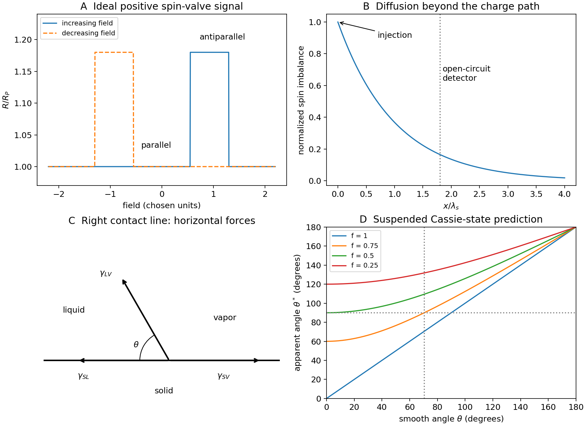

<h1 id="section-a-ii/15/i/solution">Solution</h1>

↑ **Parent:** [I](../i.md)

Sweep the in-plane [magnetic field](../../../../../../magnetic-field-split.md) approximately along the wires' easy axes. At large negative field, both [magnetizations](../../../../../../magnetization.md) are parallel. If the wires reverse at different positive coercive fields, an antiparallel interval separates this state from the final parallel positive-field state. In the usual positive [giant magnetoresistance](../../../../../../giant-magnetoresistance.md) case, **the antiparallel interval has higher resistance**; the reverse sweep gives a mirrored interval and a [hysteresis](../../../../../../hysteresis.md) loop.

An ideal angular model is

$$
R(\phi)=R_P+\frac{\Delta R}{2}(1-\cos\phi),\qquad \Delta R=R_{AP}-R_P>0.
$$

Spin-dependent injection and scattering favor transmission through similarly aligned electrodes. The [two-current resistor model](../../../../../../two-current-resistor-model.md) represents this using unequal majority- and minority-spin resistances. Both layers can reverse, hence [pseudo spin valve](../../../../../../pseudo-spin-valve.md), rather than an absolutely pinned reference layer.

The different thicknesses can produce different switching properties, but **thickness alone does not identify which electrode reverses first**. Measure their coercive fields. The local resistance also contains Cu, contact and Py [anisotropic magnetoresistance](../../../../../../anisotropic-magnetoresistance.md) contributions. Rotation scans and individual-wire controls distinguish them. Py/Cu experiments showed that local contact-related signals can exceed the spin-valve contribution, motivating nonlocal detection.[2003, abstract and local/nonlocal measurement comparison](../../../../../../spin-injection-and-spin-accumulation-in-all-metal-mesoscopic-spin-valves-by-f-j-jedema-and-others.md)

**[Figure 1](#section-a-ii/15/i/image-ideal-spin-valve-switching-and-surface-energy-balances-for-wetting). Ideal spin-valve switching and surface-energy balances for wetting**. Original chosen switching curves, force diagram and composite-wetting curve. Switching fields and signal heights are illustrative rather than measured.

## ↑ Ancestors (11)

1. [I](../i.md)
2. [15](../../15.md)
3. [Section A(ii)](../../../section-a-ii.md)
4. [Paper 2](../../../../paper-2-split.md)
5. [2020](../../../../split.md)
6. [Past exam of the MPhil in micro- and nanotechnology enterprise course of the University of Cambridge](../../../../../split.md)
7. [MPhil in micro- and nanotechnology enterprise course of the University of Cambridge](../../../../../../mphil-in-micro-and-nanotechnology-enterprise-course-of-the-university-of-cambridge.md)
8. [Course of the University of Cambridge](../../../../../../course-of-the-university-of-cambridge.md)
9. [University of Cambridge](../../../../../../university-of-cambridge-split.md)
10. [List of universities](../../../../../../list-of-universities.md)
11. [Codex Wiki](../../../../../../split.md)
