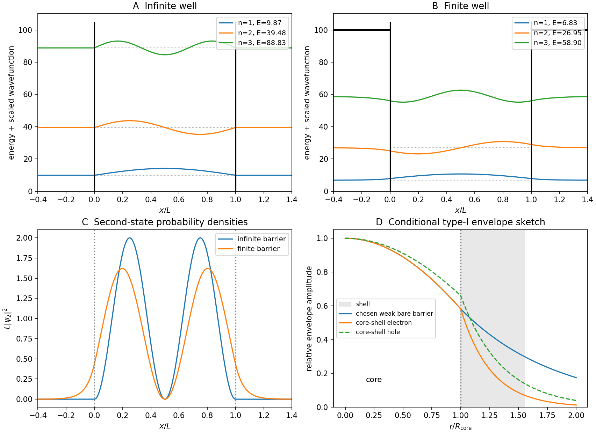

<h1 id="section-a-ii/16/ii/solution">Solution</h1>

↑ **Parent:** [Ii](../ii.md)

Choose zero potential for $0<x<L$. In an [infinite square well](../../../../../../infinite-square-well.md),

$$
\psi_n(x)=\sqrt{\frac2L}\sin\frac{n\pi x}{L},\qquad
E_n=\frac{n^2\pi^2\hbar^2}{2mL^2}.
$$

The first three levels have ratios **$1:4:9$**, with zero, one and two interior nodes; the [wavefunctions](../../../../../../wave-function-split.md) vanish outside.

For a [finite square well](../../../../../../finite-square-well.md) with exterior potential $V_0$, bound states have $0<E<V_0$, sinusoidal interiors and tails with $\kappa=\sqrt{2m(V_0-E)}/\hbar$. Matching [wavefunction](../../../../../../wave-function-split.md) and derivative for equal masses gives

$$
k\tan(kL/2)=\kappa\ \text{(even)},\qquad
-k\cot(kL/2)=\kappa\ \text{(odd)},\qquad
k=\sqrt{2mE}/\hbar,
$$

when parity is taken about the well center. Corresponding energies fall below the infinite-barrier values, and the [wavefunctions](../../../../../../wave-function-split.md) spread beyond the walls. There are finitely many bound states; a shallow well need not possess three. States above $V_0$ form a scattering continuum.

**[Figure 2](#section-a-ii/16/ii/image-wavefunctions-probability-densities-and-core-shell-confinement). Wavefunctions, probability densities and core-shell confinement**. Original normalized infinite- and finite-well calculations with a chosen dimensionless barrier, plus qualitative type-I envelope sketches. The envelope panel is not a two-particle probability density or material-specific fit.

## ↑ Ancestors (11)

1. [Ii](../ii.md)
2. [16](../../16.md)
3. [Section A(ii)](../../../section-a-ii.md)
4. [Paper 2](../../../../paper-2-split.md)
5. [2020](../../../../split.md)
6. [Past exam of the MPhil in micro- and nanotechnology enterprise course of the University of Cambridge](../../../../../split.md)
7. [MPhil in micro- and nanotechnology enterprise course of the University of Cambridge](../../../../../../mphil-in-micro-and-nanotechnology-enterprise-course-of-the-university-of-cambridge.md)
8. [Course of the University of Cambridge](../../../../../../course-of-the-university-of-cambridge.md)
9. [University of Cambridge](../../../../../../university-of-cambridge-split.md)
10. [List of universities](../../../../../../list-of-universities.md)
11. [Codex Wiki](../../../../../../split.md)
