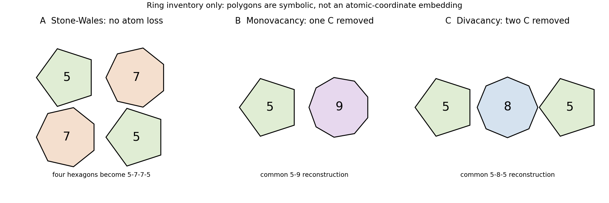

<h1 id="section-b/19/ii/solution">Solution</h1>

↑ **Parent:** [Ii](../ii.md)

Three point-defect structures are **a [Stone-Wales defect](../../../../../../stone-wales-defect.md), a reconstructed [graphene monovacancy](../../../../../../graphene-monovacancy.md) and a reconstructed [graphene divacancy](../../../../../../graphene-divacancy.md)**. The original sketch gives ring inventories rather than fitted atomic coordinates.

A [Stone-Wales defect](../../../../../../stone-wales-defect.md) rotates one C–C bond, converting four hexagons into a 5–7–7–5 group without changing the number of atoms. A [graphene monovacancy](../../../../../../graphene-monovacancy.md) removes one carbon; a common reconstruction gives a 5–9 group with residual under-coordination. A [graphene divacancy](../../../../../../graphene-divacancy.md) removes two adjacent carbons; a 5–8–5 reconstruction can eliminate dangling bonds. Other divacancy reconstructions exist, so atom loss does not uniquely select one topology.

Irradiation, energetic processing, etching and incomplete growth can create vacancies; thermally or beam-activated bond rearrangement can change their structures. Electron microscopy itself can create defects, so compare exposures before attributing a time sequence to unperturbed material.

Pentagons favor positive curvature and heptagons negative curvature. Such defects can bend tubes, help form caps or junctions, or change a local wrapping relationship. They scatter carriers and alter the local [density of states](../../../../../../density-of-states.md); vacancies can add localized states and chemical reactivity. Whether a clean [band gap](../../../../../../band-gap.md) appears depends on defect identity, concentration and arrangement, not merely on the presence of a defect.

**[Figure 3](#section-b/19/ii/image-carbon-point-defect-ring-inventories). Carbon point-defect ring inventories**. Original topology summaries of a Stone-Wales rearrangement and vacancy reconstructions. Atom deficits and nonhexagonal ring counts are explicit; the polygons do not represent energy-minimized atomic coordinates.

## ↑ Ancestors (11)

1. [Ii](../ii.md)
2. [19](../../19.md)
3. [Section B](../../../section-b.md)
4. [Paper 2](../../../../paper-2-split.md)
5. [2020](../../../../split.md)
6. [Past exam of the MPhil in micro- and nanotechnology enterprise course of the University of Cambridge](../../../../../split.md)
7. [MPhil in micro- and nanotechnology enterprise course of the University of Cambridge](../../../../../../mphil-in-micro-and-nanotechnology-enterprise-course-of-the-university-of-cambridge.md)
8. [Course of the University of Cambridge](../../../../../../course-of-the-university-of-cambridge.md)
9. [University of Cambridge](../../../../../../university-of-cambridge-split.md)
10. [List of universities](../../../../../../list-of-universities.md)
11. [Codex Wiki](../../../../../../split.md)
