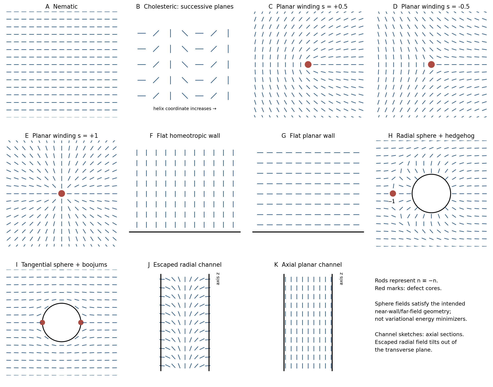

<h1 id="section-b/22/i/a/solution">Solution</h1>

↑ **Parent:** [A](../a.md)

A [liquid crystal](../../../../../../../liquid-crystal.md) flows while retaining partial molecular order. A [nematic liquid crystal](../../../../../../../nematic-liquid-crystal.md) has long-range orientational order but no crystal-like positional lattice. Its local mean axis is the [nematic director](../../../../../../../nematic-director.md) $\mathbf n$, with $\mathbf n\equiv-\mathbf n$ for an ordinary apolar nematic. Order leads to anisotropic optical and dielectric response and an elastic cost for director distortions.

**Nematic order selects an axis, not a common molecular head direction or density-layer stack.** The original sketch uses short rods as a coarse-grained orientation map.

**[Figure 5](#section-b/22/i/a/image-liquid-crystal-order-defects-anchoring-and-cylindrical-confinement). Liquid-crystal order, defects, anchoring and cylindrical confinement**. Original director sketches. Rods have no arrowheads. Sphere profiles are illustrative boundary-compatible fields, not elastic-energy minimizers. Channel panels are axial sections; the homeotropic profile escapes toward the pore axis.

## ↑ Ancestors (12)

1. [A](../a.md)
2. [I](../../i.md)
3. [22](../../../22.md)
4. [Section B](../../../../section-b.md)
5. [Paper 2](../../../../../paper-2-split.md)
6. [2020](../../../../../split.md)
7. [Past exam of the MPhil in micro- and nanotechnology enterprise course of the University of Cambridge](../../../../../../split.md)
8. [MPhil in micro- and nanotechnology enterprise course of the University of Cambridge](../../../../../../../mphil-in-micro-and-nanotechnology-enterprise-course-of-the-university-of-cambridge.md)
9. [Course of the University of Cambridge](../../../../../../../course-of-the-university-of-cambridge.md)
10. [University of Cambridge](../../../../../../../university-of-cambridge-split.md)
11. [List of universities](../../../../../../../list-of-universities.md)
12. [Codex Wiki](../../../../../../../split.md)
