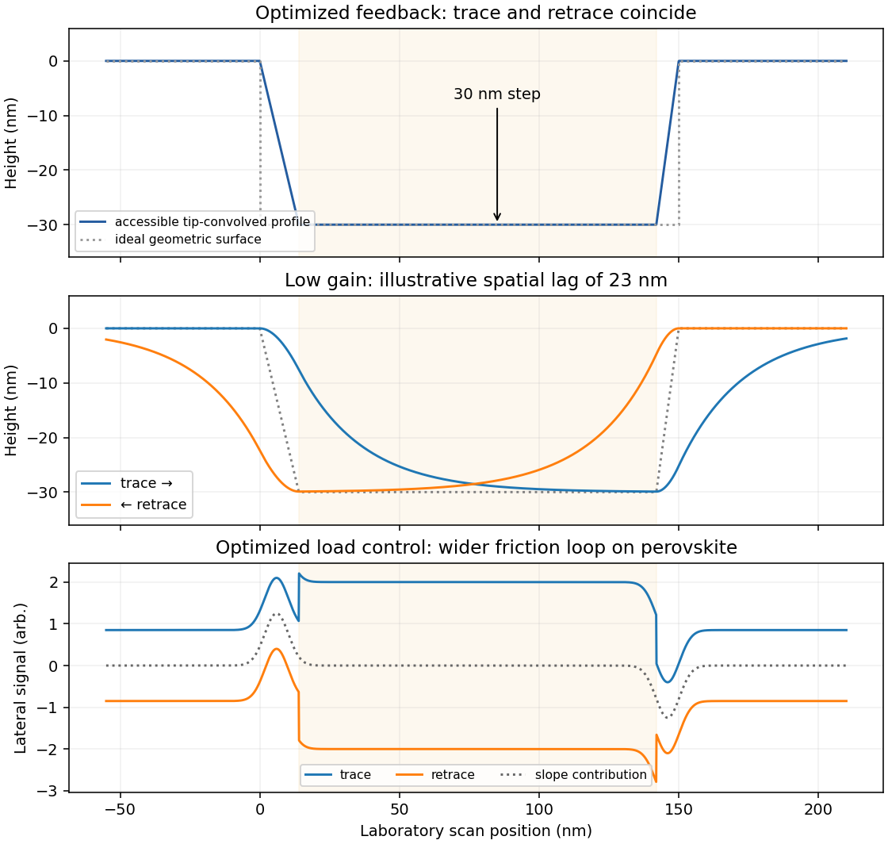

<h1 id="1/i/solution">Solution</h1>

↑ **Parent:** [I](../i.md)

**The recorded profile has approximately 30 nm deep, flat-bottomed depressions with broadened, sloping edges.** The full-height regions are the inorganic surface; the lower plateaux are the infiltrated [perovskite structure](../../../../../perovskite-structure.md). With adequate [feedback control](../../../../../closed-loop-control.md), [imaging trace and retrace](../../../../../imaging-trace-and-retrace.md) should agree when plotted against the same laboratory position.

The tip has a finite opening angle. Its flank contacts a pore rim before its apex can follow an ideal vertical wall, so [tip convolution](../../../../../tip-convolution.md) makes a narrow depression appear narrower and its sidewall less steep. For a flank angle $\alpha$ measured from the vertical, the horizontal distance needed to descend a height $h$ is $h\tan\alpha$. Along the [cantilever](../../../../../cantilever.md), the nominal front and back values give

$$
\boxed{30\tan25^\circ\simeq14.0\ \mathrm{nm},\qquad
30\tan15^\circ\simeq8.0\ \mathrm{nm}.}
$$

Thus the two edges can have different apparent slopes. Across the [cantilever](../../../../../cantilever.md), the nominal side angle instead gives about $12.4$ nm on each side. The scan orientation relative to the [cantilever](../../../../../cantilever.md) must therefore be specified before choosing the relevant pair of slopes.

Even a 100 nm wide pore leaves ample room for the tip apex to reach a flat bottom: in the along-cantilever idealization its bottom plateau is about $100-14-8=78$ nm wide. A 200 nm pore gives about 178 nm. The tip height is far greater than the 30 nm step, so it does not prevent access. An unreported finite apex radius adds edge rounding; its size cannot be inferred from the listed flank angles.

**[Figure 1](#1/i/image-original-model-of-tip-convolution-feedback-lag-and-friction-loop-contrast). Original model of tip convolution, feedback lag and friction-loop contrast**.

## ↑ Ancestors (10)

1. [I](../i.md)
2. [1](../../1.md)
3. [Paper 1](../../../paper-1-split.md)
4. [2021](../../../split.md)
5. [Past exam of the MPhil in micro- and nanotechnology enterprise course of the University of Cambridge](../../../../split.md)
6. [MPhil in micro- and nanotechnology enterprise course of the University of Cambridge](../../../../../mphil-in-micro-and-nanotechnology-enterprise-course-of-the-university-of-cambridge.md)
7. [Course of the University of Cambridge](../../../../../course-of-the-university-of-cambridge.md)
8. [University of Cambridge](../../../../../university-of-cambridge-split.md)
9. [List of universities](../../../../../list-of-universities.md)
10. [Codex Wiki](../../../../../split.md)
