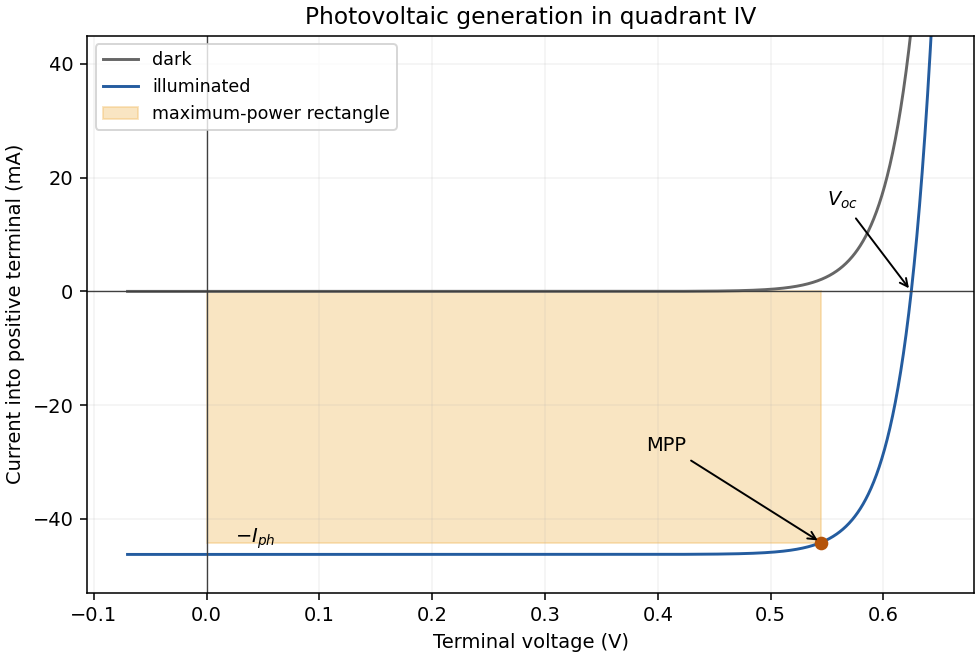

<h1 id="12/i/a/solution">Solution</h1>

↑ **Parent:** [A](../a.md)

Absorbed [photons](../../../../../../photon.md) with [energy](../../../../../../energy-split.md) at least the [band gap](../../../../../../band-gap.md) generate [electron](../../../../../../electron.md)–hole pairs. The built-in field of the [p-n junction](../../../../../../p-n-junction.md) separates carriers generated in or reaching the [depletion region](../../../../../../depletion-region.md); [minority carriers](../../../../../../minority-carrier.md) generated nearby can diffuse into that collection region. Selective contacts carry [electrons](../../../../../../electron.md) and holes into an external circuit before they recombine.

Define positive [electric current](../../../../../../electric-current.md) into the positive-voltage terminal. In the ideal illuminated-diode model,

$$
I(V)=I_0\left[\exp\!\left(\frac{qV}{n k_BT}\right)-1\right]-I_{\rm ph}.
$$

The dark curve has $I_{\rm ph}=0$; illumination shifts it downward. At short circuit $I\simeq-I_{\rm ph}$; at open circuit $I=0$ and $V=V_{\rm oc}$. Between them the illuminated cell lies in **quadrant IV** and supplies [power](../../../../../../power.md) $P_{\rm out}=-VI>0$. The [maximum power point](../../../../../../maximum-power-point.md) maximizes the area of the rectangle with sides $V$ and $-I$:

$$
\boxed{\frac{d(-VI)}{dV}=0\quad\Longleftrightarrow\quad I+V\frac{dI}{dV}=0}.
$$

It is neither the open-circuit point nor the short-circuit point, both of which supply zero [power](../../../../../../power.md).

**[Figure 4](#12/i/a/image-dark-and-illuminated-diode-curves-and-the-photovoltaic-maximum-power-point). Dark and illuminated diode curves and the photovoltaic maximum power point**.

## ↑ Ancestors (11)

1. [A](../a.md)
2. [I](../../i.md)
3. [12](../../../12.md)
4. [Paper 1](../../../../paper-1-split.md)
5. [2021](../../../../split.md)
6. [Past exam of the MPhil in micro- and nanotechnology enterprise course of the University of Cambridge](../../../../../split.md)
7. [MPhil in micro- and nanotechnology enterprise course of the University of Cambridge](../../../../../../mphil-in-micro-and-nanotechnology-enterprise-course-of-the-university-of-cambridge.md)
8. [Course of the University of Cambridge](../../../../../../course-of-the-university-of-cambridge.md)
9. [University of Cambridge](../../../../../../university-of-cambridge-split.md)
10. [List of universities](../../../../../../list-of-universities.md)
11. [Codex Wiki](../../../../../../split.md)
