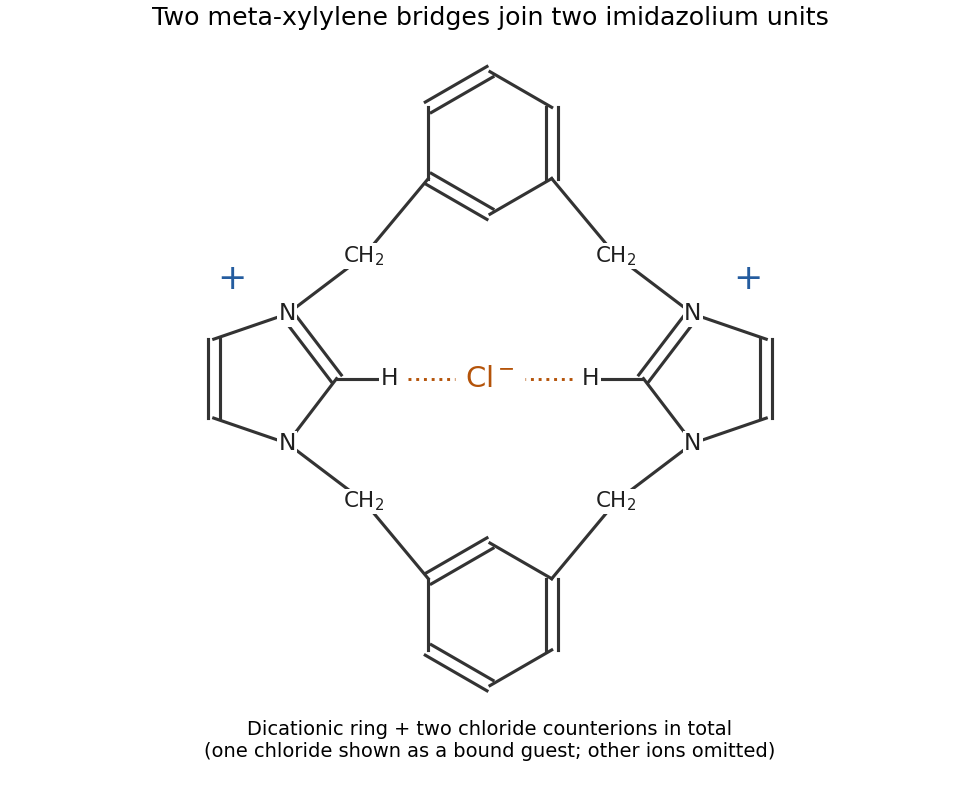

<h1 id="5/iii/solution">Solution</h1>

↑ **Parent:** [Iii](../iii.md)

Each [imidazole](../../../../../imidazole.md) already has one nitrogen substituted. Its remaining pyridine-like nitrogen attacks a benzylic [carbon](../../../../../carbon.md) bearing chlorine in an $S_\mathrm N2$ reaction, expelling [chloride](../../../../../chloride.md) and producing an [imidazolium](../../../../../imidazolium.md) center. Repetition at the other end closes the ring. The expected product is therefore **a dicationic bis-imidazolium [macrocycle](../../../../../macrocycle.md)**, in which two meta-xylylene bridges connect the two [imidazolium](../../../../../imidazolium.md) rings. Both nitrogens of each [imidazolium](../../../../../imidazolium.md) are alkylated; the aryl rings remain intact.

A compact way to specify its connectivity is to traverse the ring:

$$
\mathrm{m\!\!-!C_6H_4-CH_2-N(imidazolium)-CH_2-
 m\!\!-!C_6H_4-CH_2-N(imidazolium)-CH_2-}\quad\text{back to the first aryl group}.
$$

Here each indicated [imidazolium](../../../../../imidazolium.md) connects its two substituents through its two different ring nitrogen atoms, rather than through a single nitrogen.

[chloride](../../../../../chloride.md) acts as an **[anion](../../../../../anion.md) template**: association with the positively charged intermediates and the inward-facing [imidazolium](../../../../../imidazolium.md) CH donors brings the reacting ends together, favoring cyclization over intermolecular oligomerization. Tetrabutylammonium is a spectator counterion, not a covalent part of the product. The two substitutions produce two [chloride](../../../../../chloride.md) counterions for the dication; template [chloride](../../../../../chloride.md) can also occupy the cavity, with the remaining [ions](../../../../../ion.md) in solution. The schematic below specifies connectivity and charge without reproducing the source drawing.

**[Figure 2](#5/iii/image-connectivity-of-the-chloride-templated-bis-imidazolium-macrocycle). Connectivity of the chloride-templated bis-imidazolium macrocycle**.

## ↑ Ancestors (10)

1. [Iii](../iii.md)
2. [5](../../5.md)
3. [Paper 1](../../../paper-1-split.md)
4. [2021](../../../split.md)
5. [Past exam of the MPhil in micro- and nanotechnology enterprise course of the University of Cambridge](../../../../split.md)
6. [MPhil in micro- and nanotechnology enterprise course of the University of Cambridge](../../../../../mphil-in-micro-and-nanotechnology-enterprise-course-of-the-university-of-cambridge.md)
7. [Course of the University of Cambridge](../../../../../course-of-the-university-of-cambridge.md)
8. [University of Cambridge](../../../../../university-of-cambridge-split.md)
9. [List of universities](../../../../../list-of-universities.md)
10. [Codex Wiki](../../../../../split.md)
