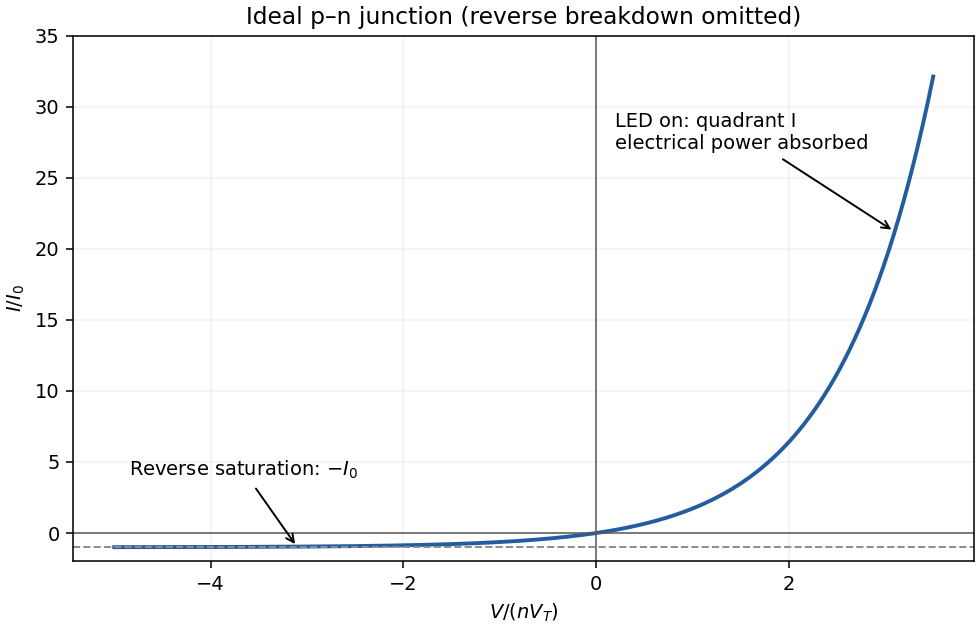

<h1 id="9/ii/a/solution">Solution</h1>

↑ **Parent:** [A](../a.md)

With conventional [electric current](../../../../../../electric-current.md) defined into the positive terminal, an ideal junction has

$$
I=I_0\left[\exp\!\left(\frac{qV}{n k_BT}\right)-1\right].
$$

The reverse-bias branch tends to **$-I_0$** before breakdown. In [forward bias](../../../../../../forward-bias.md) the [electric current](../../../../../../electric-current.md) rises exponentially; a visibly sharp “turn-on” is a convenient operating description rather than a discontinuity in the equation. A powered [LED](../../../../../../light-emitting-diode.md) emits in **quadrant I**, where $V>0$, $I>0$ and the device absorbs electrical [power](../../../../../../power.md) $VI$. Strong reverse breakdown lies outside the ideal curve below.

**[Figure 3](#9/ii/a/image-ideal-diode-characteristic-with-reverse-saturation-and-forward-led-operation). Ideal diode characteristic with reverse saturation and forward LED operation**.

## ↑ Ancestors (11)

1. [A](../a.md)
2. [Ii](../../ii.md)
3. [9](../../../9.md)
4. [Paper 1](../../../../paper-1-split.md)
5. [2021](../../../../split.md)
6. [Past exam of the MPhil in micro- and nanotechnology enterprise course of the University of Cambridge](../../../../../split.md)
7. [MPhil in micro- and nanotechnology enterprise course of the University of Cambridge](../../../../../../mphil-in-micro-and-nanotechnology-enterprise-course-of-the-university-of-cambridge.md)
8. [Course of the University of Cambridge](../../../../../../course-of-the-university-of-cambridge.md)
9. [University of Cambridge](../../../../../../university-of-cambridge-split.md)
10. [List of universities](../../../../../../list-of-universities.md)
11. [Codex Wiki](../../../../../../split.md)
