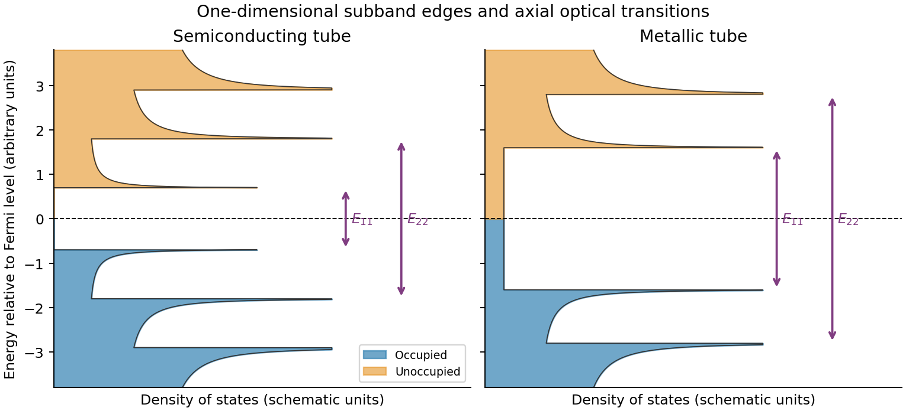

# Paper 2

↑ **Parent:** [2021](../2021.md)

Original archive: [Cambridge FOI 2024/50 released ZIP](https://www.whatdotheyknow.com/request/mphil_in_micro_and_nanotechnolog_5/response/2556540/attach/2/FOI%202024%2050%20Dai%20materials.zip?cookie_passthrough=1). The original is the member `NanoMPhil Paper 2 2021.pdf`, physical pages 1–13.

**Table of contents**

- [Section A(i)](#section-a-i)
  - [13](#section-a-i/13)
    - [i](#section-a-i/13/i)
      - [Solution](#section-a-i/13/i/solution)
    - [ii](#section-a-i/13/ii)
      - [Solution](#section-a-i/13/ii/solution)
    - [iii](#section-a-i/13/iii)
      - [Solution](#section-a-i/13/iii/solution)
  - [14](#section-a-i/14)
    - [i](#section-a-i/14/i)
      - [Solution](#section-a-i/14/i/solution)
    - [ii](#section-a-i/14/ii)
      - [Solution](#section-a-i/14/ii/solution)
    - [iii](#section-a-i/14/iii)
      - [Solution](#section-a-i/14/iii/solution)
    - [iv](#section-a-i/14/iv)
      - [Solution](#section-a-i/14/iv/solution)
- [Section A(ii)](#section-a-ii)
  - [15](#section-a-ii/15)
    - [i](#section-a-ii/15/i)
      - [Solution](#section-a-ii/15/i/solution)
    - [ii](#section-a-ii/15/ii)
      - [Solution](#section-a-ii/15/ii/solution)
    - [iii](#section-a-ii/15/iii)
      - [Solution](#section-a-ii/15/iii/solution)
  - [16](#section-a-ii/16)
    - [i](#section-a-ii/16/i)
      - [Solution](#section-a-ii/16/i/solution)
    - [ii](#section-a-ii/16/ii)
      - [Solution](#section-a-ii/16/ii/solution)
    - [iii](#section-a-ii/16/iii)
      - [Solution](#section-a-ii/16/iii/solution)
- [Section A(iii)](#section-a-iii)
  - [17](#section-a-iii/17)
    - [i](#section-a-iii/17/i)
      - [a](#section-a-iii/17/i/a)
        - [Solution](#section-a-iii/17/i/a/solution)
      - [b](#section-a-iii/17/i/b)
        - [Solution](#section-a-iii/17/i/b/solution)
      - [c](#section-a-iii/17/i/c)
        - [Solution](#section-a-iii/17/i/c/solution)
    - [ii](#section-a-iii/17/ii)
      - [Solution](#section-a-iii/17/ii/solution)
    - [iii](#section-a-iii/17/iii)
      - [Solution](#section-a-iii/17/iii/solution)
  - [18](#section-a-iii/18)
    - [i](#section-a-iii/18/i)
      - [Solution](#section-a-iii/18/i/solution)
    - [ii](#section-a-iii/18/ii)
      - [Solution](#section-a-iii/18/ii/solution)
    - [iii](#section-a-iii/18/iii)
      - [Solution](#section-a-iii/18/iii/solution)
    - [iv](#section-a-iii/18/iv)
      - [Solution](#section-a-iii/18/iv/solution)
- [Section B](#section-b)
  - [19](#section-b/19)
    - [i](#section-b/19/i)
      - [Solution](#section-b/19/i/solution)
    - [ii](#section-b/19/ii)
      - [Solution](#section-b/19/ii/solution)
    - [iii](#section-b/19/iii)
      - [a](#section-b/19/iii/a)
        - [Solution](#section-b/19/iii/a/solution)
      - [b](#section-b/19/iii/b)
        - [Solution](#section-b/19/iii/b/solution)
      - [c](#section-b/19/iii/c)
        - [Solution](#section-b/19/iii/c/solution)
  - [20](#section-b/20)
    - [i](#section-b/20/i)
      - [Solution](#section-b/20/i/solution)
    - [ii](#section-b/20/ii)
      - [Solution](#section-b/20/ii/solution)
    - [iii](#section-b/20/iii)
      - [Solution](#section-b/20/iii/solution)
    - [iv](#section-b/20/iv)
      - [a](#section-b/20/iv/a)
        - [Solution](#section-b/20/iv/a/solution)
      - [b](#section-b/20/iv/b)
        - [Solution](#section-b/20/iv/b/solution)
      - [c](#section-b/20/iv/c)
        - [Solution](#section-b/20/iv/c/solution)
    - [v](#section-b/20/v)
      - [Solution](#section-b/20/v/solution)
    - [vi](#section-b/20/vi)
      - [Solution](#section-b/20/vi/solution)
  - [21](#section-b/21)
    - [i](#section-b/21/i)
      - [a](#section-b/21/i/a)
        - [Solution](#section-b/21/i/a/solution)
      - [b](#section-b/21/i/b)
        - [Solution](#section-b/21/i/b/solution)
      - [c](#section-b/21/i/c)
        - [Solution](#section-b/21/i/c/solution)
    - [ii](#section-b/21/ii)
      - [Solution](#section-b/21/ii/solution)
    - [iii](#section-b/21/iii)
      - [Solution](#section-b/21/iii/solution)
  - [22](#section-b/22)
    - [i](#section-b/22/i)
      - [Solution](#section-b/22/i/solution)
    - [ii](#section-b/22/ii)
      - [Solution](#section-b/22/ii/solution)
    - [iii](#section-b/22/iii)
      - [Solution](#section-b/22/iii/solution)
    - [iv](#section-b/22/iv)
      - [Solution](#section-b/22/iv/solution)
    - [v](#section-b/22/v)
      - [Solution](#section-b/22/v/solution)
    - [vi](#section-b/22/vi)
      - [Solution](#section-b/22/vi/solution)
    - [vii](#section-b/22/vii)
      - [Solution](#section-b/22/vii/solution)

<h2 id="section-a-i">Section A(i)</h2>

↑ **Parent:** [Paper 2](paper-2.md)

<h3 id="section-a-i/13">13</h3>

↑ **Parent:** [Section A(i)](#section-a-i)

<h4 id="section-a-i/13/i">i</h4>

↑ **Parent:** [13](#section-a-i/13)

<h5 id="section-a-i/13/i/solution">Solution</h5>

↑ **Parent:** [I](#section-a-i/13/i)

Rolling [graphene](../../chemical-substance.md#graphene) into a [single-walled carbon nanotube](../../chemical-substance.md#single-walled-carbon-nanotube) quantizes the circumferential [wave vector](../../elasticity-physics.md#wavevector), leaving a set of one-dimensional longitudinal subbands. At each subband edge the [group velocity](../../dispersion-relation.md#group-velocity) tends to zero, producing a [Van Hove singularity](../../quantum-ideal-gas-statistics.md#van-hove-singularity) in the [density of states](../../quantum-ideal-gas-statistics.md#density-of-states). For a simple gapped Dirac subband, the contribution scales as $|E|/\sqrt{E^2-\Delta_j^2}$ outside its edge. At low [temperature](../../temperature.md) the valence states below the [Fermi level](../../quantum-ideal-gas-statistics.md#fermi-level) are occupied and the conduction states above it are empty. A semiconducting tube has a gap; an ideal metallic tube has gapless channels as well as higher-subband singularities.

For light polarized along the tube, the strongest allowed interband transitions connect corresponding subbands while approximately conserving axial [wave vector](../../elasticity-physics.md#wavevector) and circumferential [angular momentum](../../momentum.md#angular-momentum). The large [joint density of states](../../quantum-ideal-gas-statistics.md#joint-density-of-states) makes distinct absorption resonances, conventionally labelled $E_{11},E_{22},\ldots$. Strong [electron](../../physics.md#electron)–hole interactions produce bound [excitons](../../quantum-mechanics.md#exciton), so the observed optical resonances differ from the noninteracting band separations. Defects, doping, bundling and [dielectric screening](../../quantum-mechanics.md#dielectric-screening) change peak energies and [oscillator strengths](../../quantum-mechanics.md#oscillator-strength). The original schematic below depicts the subband-edge structure, not measured spectra.

**[Figure 1](#section-a-i/13/i/image-original-schematic-occupied-and-unoccupied-nanotube-densities-of-states-and-allowed-optical-transitions). Original schematic occupied and unoccupied nanotube densities of states and allowed optical transitions**.

<h4 id="section-a-i/13/ii">ii</h4>

↑ **Parent:** [13](#section-a-i/13)

<h5 id="section-a-i/13/ii/solution">Solution</h5>

↑ **Parent:** [Ii](#section-a-i/13/ii)

With the [graphene](../../chemical-substance.md#graphene) lattice-vector length $a=0.246\ \mathrm{nm}$, the [carbon nanotube chiral vector](../../chemical-substance.md#carbon-nanotube-chiral-vector) is $\mathbf C_h=n\mathbf a_1+m\mathbf a_2$. The vectors meet at $60^\circ$, giving

$$
C=a\sqrt{n^2+nm+m^2},\qquad d=\frac C\pi,\qquad
\theta=\tan^{-1}\!\left(\frac{\sqrt3\,m}{2n+m}\right).
$$

Here $C$ is circumference, $d$ diameter, and the [carbon nanotube chiral angle](../../chemical-substance.md#carbon-nanotube-chiral-angle) $\theta$ is measured from the zigzag direction. [Nanotube zone folding](../../chemical-substance.md#nanotube-zone-folding) gives a nominal metallic tube when $n-m\equiv0\pmod3$ and a semiconducting tube otherwise. Evaluating all the supplied indices gives the following derived results:

$$
\begin{array}{c|rrr|c}
(n,m)&d\ (\mathrm{nm})&C\ (\mathrm{nm})&\theta\ ({}^\circ)&\text{type}\\\hline
(5,4)&0.6116&1.9213&26.33&\mathrm S\\
(6,4)&0.6826&2.1446&23.41&\mathrm S\\
(7,3)&0.6960&2.1865&17.00&\mathrm S\\
(6,5)&0.7470&2.3467&27.00&\mathrm S\\
(8,3)&0.7712&2.4228&15.30&\mathrm S\\
(10,0)&0.7830&2.4600&0.00&\mathrm S\\
(9,2)&0.7947&2.4966&9.83&\mathrm S\\
(7,5)&0.8175&2.5683&24.50&\mathrm S\\
(8,4)&0.8287&2.6034&19.11&\mathrm S\\
(7,6)&0.8824&2.7723&27.46&\mathrm S\\
(11,1)&0.9030&2.8370&4.31&\mathrm S
\end{array}
$$

**All eleven listed tubes are semiconducting in the zone-folding classification.** Curvature can open small gaps in some nominally metallic non-armchair tubes, but none of these indices falls in that nominal metallic class.

Diameter gives a useful inverse-size trend in transition energies, and the full chiral indices constrain the [electronic band structure](../../bloch-s-theorem.md#electronic-band-structure) much more strongly. They do not by themselves give the perceived solution colour through a simple geometrical rule: one needs the visible [absorption spectrum](../../physics.md#absorption-spectrum), transition strengths and widths, [exciton](../../quantum-mechanics.md#exciton)/environment shifts, [concentration](../../mathematical-physics.md#concentration), optical path and illumination. The observed transmitted colour is complementary to the absorbed spectrum, not a direct label for the [band gap](../../bloch-s-theorem.md#band-gap). Structure-assigned excitation–emission measurements provide an experimental connection between chiral structure and optical transitions.[Science 298 (2002), pp. 2361–2366, structure assignment of semiconducting-tube optical transitions](../../physics-bibliography.md#structure-assigned-optical-spectra-of-single-walled-carbon-nanotubes-by-sergei-m-bachilo-and-others)

<h4 id="section-a-i/13/iii">iii</h4>

↑ **Parent:** [13](#section-a-i/13)

<h5 id="section-a-i/13/iii/solution">Solution</h5>

↑ **Parent:** [Iii](#section-a-i/13/iii)

One application is a **semiconducting nanotube transistor array**. Removing metallic tubes prevents conducting bridges that would bypass gate control; a narrow chirality distribution also narrows the spread of [band gaps](../../bloch-s-theorem.md#band-gap) and switching behaviour. High [charge carrier mobility](../../electric-charge.md#charge-carrier-mobility) and thin flexible channels are attractive, but [contact resistance](../../electric-charge.md#contact-resistance), tube alignment, residual metallic contamination, [dielectric](../../permittivity.md#dielectric) traps and the cost/yield of sorting still limit uniform large-area circuits.

A second is a **wavelength-selective near-infrared [photodetector](../../optical-instrument.md#photodetector) or emitter**. A selected chirality concentrates absorption and emission around its characteristic [nanotube optical transitions](../../chemical-substance.md#nanotube-optical-transition), avoiding the broad mixed-tube response. Optical selectivity can be tailored by choosing the species. Limitations include low absolute emission yield, dark [exciton](../../quantum-mechanics.md#exciton) states, contact-related recombination, environmental spectral shifts and quenching by bundles or metallic contaminants. Optical and electrical characterization after device processing is needed; the sorting label alone does not guarantee device performance.

<h3 id="section-a-i/14">14</h3>

↑ **Parent:** [Section A(i)](#section-a-i)

<h4 id="section-a-i/14/i">i</h4>

↑ **Parent:** [14](#section-a-i/14)

<h5 id="section-a-i/14/i/solution">Solution</h5>

↑ **Parent:** [I](#section-a-i/14/i)

Prepare size-characterized gold-particle ensembles, heat them on a calibrated in-situ [electron diffraction](../../quantum-scattering.md#electron-diffraction) stage, and follow the loss of sharp fcc [diffraction](../../quantum-scattering.md#diffraction) features and appearance of liquid-like diffuse scattering. Measure the [particle size distribution](../../mixture.md#particle-size-distribution) rather than treating a polydisperse ensemble as one diameter. Temperature-dependent weakening of a [diffraction](../../quantum-scattering.md#diffraction) peak alone is insufficient: thermal vibrations, particle motion, coalescence, evaporation and beam damage can also reduce intensity. Low-dose repeats, heating/cooling runs, size checks before and after heating, a bulk-like reference and support-dependent controls help distinguish [melting](../../critical-phenomenon.md#melting) from those effects. [Electron diffraction](../../quantum-scattering.md#electron-diffraction) measurements on [gold](../../chemical-substance.md#gold) particles down to about 2 nm are a classic demonstration.[Physical Review A 13 (1976), pp. 2287–2298, abstract: scanning diffraction and size-distribution analysis](../../physics-bibliography.md#size-effect-on-the-melting-temperature-of-gold-particles-by-ph-buffat-and-j-p-borel)

The physical origin is the large interface contribution to [free energy](../../thermodynamic-potential.md#thermodynamic-free-energy) at small radius. A curved solid–liquid interface raises the solid's [thermodynamic equilibrium](../../thermodynamics.md#thermodynamic-equilibrium) [chemical potential](../../chemical-potential.md) relative to the flat-interface case, so coexistence occurs below the bulk [melting](../../critical-phenomenon.md#melting) [temperature](../../temperature.md). Reduced coordination and surface disorder provide a microscopic interpretation, but the quantitative continuum relation is a [free energy](../../thermodynamic-potential.md#thermodynamic-free-energy) balance, not simply a claim that every surface atom has a universal lower [melting](../../critical-phenomenon.md#melting) point.

<h4 id="section-a-i/14/ii">ii</h4>

↑ **Parent:** [14](#section-a-i/14)

<h5 id="section-a-i/14/ii/solution">Solution</h5>

↑ **Parent:** [Ii](#section-a-i/14/ii)

Let $g_l-g_s$ be the liquid-minus-solid [free energy](../../thermodynamic-potential.md#thermodynamic-free-energy) density at the same [temperature](../../temperature.md). Near the bulk coexistence [temperature](../../temperature.md) $T_m$, linearization gives

$$
g_l-g_s\simeq\Delta s_V(T_m-T)
=\frac{\Delta H_V}{T_m}\Delta T.
$$

For a sphere, an interface displacement changes area and volume with $dA/dV=2/r$. Equality of the bulk driving force and the capillary cost at a curved solid–liquid interface therefore gives $g_l-g_s=2\gamma/r^*$. Equivalently, differentiating $4\pi r^2\gamma-(4\pi/3)r^3(g_l-g_s)$ gives the same stationary radius. Combining the expressions yields

$$
\boxed{\Delta T=\frac{2\gamma T_m}{r^*\Delta H_V}.}
$$

This form of the [Gibbs-Thomson effect](../../surface-tension.md#gibbs-thomson-relation) assumes isotropic interfacial energy, a spherical interface, bulk-like [latent heat](../../thermodynamic-potential.md#latent-heat) per volume and a near-coexistence [free energy](../../thermodynamic-potential.md#thermodynamic-free-energy) expansion. More detailed free-particle models must distinguish solid–vapor, liquid–vapor and solid–liquid energies.

<h4 id="section-a-i/14/iii">iii</h4>

↑ **Parent:** [14](#section-a-i/14)

<h5 id="section-a-i/14/iii/solution">Solution</h5>

↑ **Parent:** [Iii](#section-a-i/14/iii)

The radius is half the diameter, $r^*=1.5\times10^{-9}\ \mathrm m$, and the [latent heat](../../thermodynamic-potential.md#latent-heat) density is $1.25\times10^9\ \mathrm{J\,m^{-3}}$. Hence

$$
\Delta T=\frac{2(0.3)(1337)}{(1.5\times10^{-9})(1.25\times10^9)}=427.84\ \mathrm K,
\qquad\boxed{T_m(3\ \mathrm{nm})\simeq909\ \mathrm K.}
$$

Using the diameter directly in the radius formula would underestimate the depression by a factor of two. The result is the stipulated continuum-model estimate; at only a few nanometres atomistic structure and support effects can matter substantially.

<h4 id="section-a-i/14/iv">iv</h4>

↑ **Parent:** [14](#section-a-i/14)

<h5 id="section-a-i/14/iv/solution">Solution</h5>

↑ **Parent:** [Iv](#section-a-i/14/iv)

In terms of diameter $d$, the model is

$$
T_m(d)=1337\left(1-\frac{0.96\ \mathrm{nm}}d\right)\ \mathrm K.
$$

Thus **[melting](../../critical-phenomenon.md#melting) [temperature](../../temperature.md) rises toward the bulk value as diameter increases**, with a depression proportional to $1/d$. The analytic sketch below includes the calculated point. It deliberately does not extrapolate the continuum expression down to a zero or negative [melting](../../critical-phenomenon.md#melting) [temperature](../../temperature.md).

Facet-dependent energies, non-spherical shapes, size-dependent interfacial energies and [latent heat](../../thermodynamic-potential.md#latent-heat), structural changes or magic cluster sizes can modify the trend. [Premelting](../../geophysics.md#premelting) can broaden the transition. A substrate or encapsulating matrix changes interface energetics and can stabilize or destabilize the solid. [Ligands](../../protein.md#ligand-biochemistry), impurities, [strain](../../continuum-mechanics.md#strain), [particle size distribution](../../mixture.md#particle-size-distribution)s, coalescence during heating and nonequilibrium [temperature](../../temperature.md)/beam effects can shift the measured transition. These possibilities motivate separate thermal, structural and size controls rather than a fit to diameter alone.

**[Figure 2](#section-a-i/14/iv/image-original-gibbs-thomson-model-curve-for-gold-with-the-three-nanometre-estimate-marked). Original Gibbs-Thomson model curve for gold with the three-nanometre estimate marked**.

<h2 id="section-a-ii">Section A(ii)</h2>

↑ **Parent:** [Paper 2](paper-2.md)

<h3 id="section-a-ii/15">15</h3>

↑ **Parent:** [Section A(ii)](#section-a-ii)

<h4 id="section-a-ii/15/i">i</h4>

↑ **Parent:** [15](#section-a-ii/15)

<h5 id="section-a-ii/15/i/solution">Solution</h5>

↑ **Parent:** [I](#section-a-ii/15/i)

The map shows **[Coulomb blockade](../../quantum-mechanics.md#coulomb-blockade) with discrete single-electron charging**: low-current diamonds separate charge-stable regions from finite-bias transport windows. A small conducting island or [quantum dot](../../semiconductor.md#quantum-dot) must be tunnel-coupled to source and drain, with a gate shifting its [electrochemical potential](../../chemical-potential.md#electrochemical-potential). Charging prevents sequential transport until an island addition/removal energy enters the [bias voltage](../../electric-field.md#bias-voltage) window.

The tunnel resistances should substantially exceed the [resistance quantum](../../electric-charge.md#resistance-quantum) $h/e^2\simeq25.8\ \mathrm{k\Omega}$, preventing charge fluctuations from washing out integer island occupancy, while still permitting a measurable current. [Temperature](../../temperature.md) and tunnel broadening must be small compared with the addition-energy scale. Here the smaller diamonds imply $e^2/C_\Sigma\simeq2.5\ \mathrm{meV}$, so $k_BT\ll2.5\ \mathrm{meV}$, or $T\ll29\ \mathrm K$; resolving the inferred 1 meV orbital structure requires the stricter scale $T\ll12\ \mathrm K$. Stray [capacitance](../../electromagnetism.md#capacitance) and unintended multiple islands can complicate this simple interpretation.

<h4 id="section-a-ii/15/ii">ii</h4>

↑ **Parent:** [15](#section-a-ii/15)

<h5 id="section-a-ii/15/ii/solution">Solution</h5>

↑ **Parent:** [Ii](#section-a-ii/15/ii)

Assume the usual one-lead-biased measurement, $V_s=V_{sd}$ with drain grounded and the gate referred to that ground; the printed map does not separately specify the wiring. This assumption is needed to assign individual source/drain capacitances. In this [Coulomb diamond capacitance extraction](../../quantum-mechanics.md#coulomb-diamond-capacitance-extraction), the smaller zero-bias gate intervals are 5 mV wide. In the [constant interaction model](../../quantum-mechanics.md#constant-interaction-model) with no orbital gap between those additions,

$$
C_g=\frac e{\Delta V_g}=\frac{1.602\times10^{-19}}{5\times10^{-3}}
=32.04\ \mathrm{aF}.
$$

An upper diamond tip lies at gate 123.75 mV between the zero-bias vertices 120 and 125 mV and at bias 2.50 mV. Its positive and negative edge slopes are therefore $s_+=2.50/3.75=2/3$ and $s_-=-2.50/1.25=-2$. Reservoir alignment gives

$$
s_-=-\frac{C_g}{C_s},\qquad
s_+=\frac{C_g}{C_\Sigma-C_s}=\frac{C_g}{C_g+C_d}.
$$

The [gate capacitance](../../electromagnetism.md#gate-capacitance) is not negligible in the second denominator. Consequently

$$
\boxed{C_s\simeq16.0\ \mathrm{aF},\quad C_d\simeq16.0\ \mathrm{aF},\quad
C_g\simeq32.0\ \mathrm{aF},\quad C_\Sigma\simeq64.1\ \mathrm{aF}.}
$$

The consistency check is $e^2/C_\Sigma=2.50\ \mathrm{meV}$, matching the smaller tip's bias energy. The conventional electrostatic [charging energy](../../quantum-mechanics.md#charging-energy) $E_C=e^2/(2C_\Sigma)$ is 1.25 meV; it is half the [charging energy](../../quantum-mechanics.md#charging-energy) contribution to the [addition energy](../../semiconductor.md#addition-energy). A different applied-bias convention changes the slope formulas, so the convention must accompany the extraction.

<h4 id="section-a-ii/15/iii">iii</h4>

↑ **Parent:** [15](#section-a-ii/15)

<h5 id="section-a-ii/15/iii/solution">Solution</h5>

↑ **Parent:** [Iii](#section-a-ii/15/iii)

The [addition energy](../../semiconductor.md#addition-energy) has both charging and orbital terms,

$$
E_{\rm add}(N)=\frac{e^2}{C_\Sigma}+\epsilon_{N+1}-\epsilon_N.
$$

The larger diamonds indicate [quantum dot shell closure](../../semiconductor.md#quantum-dot-shell-closure) after **2, 6 and 12 [electrons](../../physics.md#electron)**. A [two-dimensional isotropic harmonic oscillator](../../quantum-mechanics.md#two-dimensional-isotropic-harmonic-oscillator) confinement, $V(x,y)=m^*\omega_0^2(x^2+y^2)/2$, explains that sequence: shell $q=n_x+n_y$ has $q+1$ orbital states and capacity $2(q+1)$ after [spin degeneracy](../../statistical-physics.md#spin-degeneracy). The cumulative capacities are $(q+1)(q+2)=2,6,12,20,\ldots$. Within a degenerate shell, the extra orbital term vanishes to this approximation; crossing a shell boundary costs an extra $\hbar\omega_0$.

The [gate capacitance](../../electromagnetism.md#gate-capacitance) lever arm is $\alpha_g=C_g/C_\Sigma=1/2$. Large and small gate widths differ by $7-5=2\ \mathrm{mV}$, so **$\hbar\omega_0\simeq e\alpha_g(2\ \mathrm{mV})=1.0\ \mathrm{meV}$**. Equivalently the tip energies differ by $3.5-2.5=1.0\ \mathrm{meV}$. Confinement anisotropy, exchange and disorder would split the ideal degeneracies; the diagram supports approximate shell symmetry rather than proving a perfectly parabolic potential.

**[Figure 3](#section-a-ii/15/iii/image-original-spin-degenerate-two-dimensional-oscillator-shell-capacities-and-closed-shell-electron-counts). Original spin-degenerate two-dimensional oscillator shell capacities and closed-shell electron counts**.

<h3 id="section-a-ii/16">16</h3>

↑ **Parent:** [Section A(ii)](#section-a-ii)

<h4 id="section-a-ii/16/i">i</h4>

↑ **Parent:** [16](#section-a-ii/16)

<h5 id="section-a-ii/16/i/solution">Solution</h5>

↑ **Parent:** [I](#section-a-ii/16/i)

For an isolated easy-axis [ferromagnet](../../electromagnetism.md#ferromagnet) undergoing coherent reversal, the ideal low-temperature loop is approximately rectangular, switching between $\pm M_s$ at $\pm H_c$. It has remanent [Magnetization](../../electromagnetism.md#magnetization) and a large response near switching. An ideal compensated [antiferromagnet](../../electromagnetism.md#antiferromagnetism) has essentially no [remanence](../../electromagnetism.md#remanent-magnetization) and a small, approximately reversible linear net [Magnetization](../../electromagnetism.md#magnetization) $M=\chi_{\rm AF}H$ at fields far below its exchange/spin-flop scales. Strong antiferromagnetic exchange makes substantial canting costly, so its low-field [magnetic susceptibility](../../statistical-physics.md#magnetic-susceptibility) is small relative to the [ferromagnet](../../electromagnetism.md#ferromagnet)'s unsaturated switching response.

This comparison does not say the [ferromagnet](../../electromagnetism.md#ferromagnet) has a larger differential slope at every field: on its saturated branches $dM/dH$ can also be small. Nor does it rule out spin-flop transitions at much larger fields, outside the sketched range. The original plot uses arbitrary normalized scales.

**[Figure 4](#section-a-ii/16/i/image-original-isolated-ferromagnet-and-antiferromagnet-responses-and-a-field-cooled-shifted-bilayer-loop). Original isolated-ferromagnet and antiferromagnet responses, and a field-cooled shifted bilayer loop**.

<h4 id="section-a-ii/16/ii">ii</h4>

↑ **Parent:** [16](#section-a-ii/16)

<h5 id="section-a-ii/16/ii/solution">Solution</h5>

↑ **Parent:** [Ii](#section-a-ii/16/ii)

Heat the bilayer into a window **$T_N<T<T_c$**, apply an in-plane [magnetic field](../../magnetic-field.md) sufficient to align the [ferromagnet](../../electromagnetism.md#ferromagnet), and cool through the [antiferromagnet](../../electromagnetism.md#antiferromagnetism)'s ordering/blocking range while retaining the field. The [ferromagnet](../../electromagnetism.md#ferromagnet) supplies a preferred interfacial spin direction as the [antiferromagnet](../../electromagnetism.md#antiferromagnetism) orders. Sufficient antiferromagnetic anisotropy then pins part of the interfacial spin configuration, producing [unidirectional magnetic anisotropy](../../electromagnetism.md#unidirectional-magnetic-anisotropy) rather than merely [uniaxial magnetic anisotropy](../../electromagnetism.md#uniaxial-magnetic-anisotropy) in the [ferromagnet](../../electromagnetism.md#ferromagnet).

Measure a full major [hysteresis](../../critical-phenomenon.md#hysteresis) loop after removing the cooling field, and compare with the isolated [ferromagnet](../../electromagnetism.md#ferromagnet), a zero-field-cooled bilayer and the result of reversing the cooling-field direction. Those controls separate a true loop-centre shift from a changed coercive width, minor-loop artefacts or trapped applied field. The effect requires appropriate interfacial exchange and stable pinning; an ideally compensated or freely rotating interface need not produce a large bias. Exchange anisotropy in coupled ferromagnetic/antiferromagnetic material was demonstrated in the classic experiment below.[Physical Review 102 (1956), pp. 1413–1414](../../physics-bibliography.md#new-magnetic-anisotropy-by-w-h-meiklejohn-and-c-p-bean)

<h4 id="section-a-ii/16/iii">iii</h4>

↑ **Parent:** [16](#section-a-ii/16)

<h5 id="section-a-ii/16/iii/solution">Solution</h5>

↑ **Parent:** [Iii](#section-a-ii/16/iii)

Write the descending and ascending switching fields as $H_-$ and $H_+$. The [exchange bias](../../electromagnetism.md#exchange-bias) loop centre and [magnetic coercivity](../../critical-phenomenon.md#magnetic-coercivity) half-width are

$$
\boxed{H_E=\frac{H_++H_-}{2},\qquad H_c=\frac{H_+-H_-}{2}.}
$$

With [exchange bias](../../electromagnetism.md#exchange-bias), a field-cooled bilayer has $H_E\ne0$, often a shift opposite to the cooling field for the conventional negative-bias case shown in the diagram. The sign is not universal; it depends on interfacial coupling and preparation. A simple rigid-pinning estimate is $H_E\sim-J_{\rm int}/(\mu_0M_st_F)$.

Cooling farther below the blocking range usually strengthens antiferromagnetic anisotropy and suppresses thermal relaxation, so the magnitude of the shift and often the coercive width grow. Close to or above the blocking [temperature](../../temperature.md) the shift disappears; the blocking [temperature](../../temperature.md) can be below $T_N$. Repeated cycling can rearrange interfacial spins and reduce the bias, and the two reversal branches can acquire different shapes. Thus increasing low-temperature asymmetry is a common tendency, not a guaranteed monotonic law for every interface.

<h2 id="section-a-iii">Section A(iii)</h2>

↑ **Parent:** [Paper 2](paper-2.md)

<h3 id="section-a-iii/17">17</h3>

↑ **Parent:** [Section A(iii)](#section-a-iii)

<h4 id="section-a-iii/17/i">i</h4>

↑ **Parent:** [17](#section-a-iii/17)

<h5 id="section-a-iii/17/i/a">a</h5>

↑ **Parent:** [I](#section-a-iii/17/i)

<h6 id="section-a-iii/17/i/a/solution">Solution</h6>

↑ **Parent:** [A](#section-a-iii/17/i/a)

**TODO: user-deferred biology subquestion.** This part is outside the current nonbiology scope.

<h5 id="section-a-iii/17/i/b">b</h5>

↑ **Parent:** [I](#section-a-iii/17/i)

<h6 id="section-a-iii/17/i/b/solution">Solution</h6>

↑ **Parent:** [B](#section-a-iii/17/i/b)

**TODO: user-deferred biology subquestion.** This part is outside the current nonbiology scope.

<h5 id="section-a-iii/17/i/c">c</h5>

↑ **Parent:** [I](#section-a-iii/17/i)

<h6 id="section-a-iii/17/i/c/solution">Solution</h6>

↑ **Parent:** [C](#section-a-iii/17/i/c)

**TODO: user-deferred biology subquestion.** This part is outside the current nonbiology scope.

<h4 id="section-a-iii/17/ii">ii</h4>

↑ **Parent:** [17](#section-a-iii/17)

<h5 id="section-a-iii/17/ii/solution">Solution</h5>

↑ **Parent:** [Ii](#section-a-iii/17/ii)

**TODO: user-deferred biology subquestion.** This part is outside the current nonbiology scope.

<h4 id="section-a-iii/17/iii">iii</h4>

↑ **Parent:** [17](#section-a-iii/17)

<h5 id="section-a-iii/17/iii/solution">Solution</h5>

↑ **Parent:** [Iii](#section-a-iii/17/iii)

**TODO: user-deferred biology subquestion.** This part is outside the current nonbiology scope.

<h3 id="section-a-iii/18">18</h3>

↑ **Parent:** [Section A(iii)](#section-a-iii)

<h4 id="section-a-iii/18/i">i</h4>

↑ **Parent:** [18](#section-a-iii/18)

<h5 id="section-a-iii/18/i/solution">Solution</h5>

↑ **Parent:** [I](#section-a-iii/18/i)

For this [self-assembly](../../engineering.md#self-assembly) into a [colloidal crystal](../../mixture.md#colloidal-crystal), four useful elements are **building blocks, interactions, environment and reversible dynamics**. The building blocks here are nearly monodisperse [polymer](../../polymer.md) spheres; their shape and size distribution constrain the accessible packing. Their interactions include [excluded volume](../../statistical-physics.md#excluded-volume), [Van der Waals forces](../../force.md#van-der-waals-force) and electrostatic or [steric stabilization](../../mixture.md#steric-stabilization), which set the [free energy](../../thermodynamic-potential.md#thermodynamic-free-energy) landscape. The aqueous environment supplies [temperature](../../temperature.md), [viscosity](../../dynamic-viscosity.md), [ionic strength](../../mixture.md#ionic-strength), confinement and [concentration](../../mathematical-physics.md#concentration) controls. Finally, [Brownian motion](../../brownian-motion.md) and rotation must let particles encounter one another and rearrange or detach from incorrect contacts. Attractions that bind every collision irreversibly favour an amorphous aggregate rather than an annealed [colloidal crystal](../../mixture.md#colloidal-crystal). These four categories include both thermodynamic selection and the transport/kinetic access needed to realize it.

<h4 id="section-a-iii/18/ii">ii</h4>

↑ **Parent:** [18](#section-a-iii/18)

<h5 id="section-a-iii/18/ii/solution">Solution</h5>

↑ **Parent:** [Ii](#section-a-iii/18/ii)

A useful microscopic screening estimate compares [thermal energy](../../thermodynamics.md#thermal-energy) with the buoyant gravitational [potential energy](../../energy.md#potential-energy) over one particle radius. Write $\Delta\rho=50\ \mathrm{kg\,m^{-3}}$ and $m_b=(4\pi/3)a^3\Delta\rho$. The [sedimentation length](../../mixture.md#sedimentation-length) is $\ell_g=k_BT/(m_bg)$, and the [gravitational Peclet number](../../mixture.md#gravitational-peclet-number) is

$$
\mathrm{Pe}_g=\frac{m_bga}{k_BT}
=\frac{4\pi\Delta\rho ga^4}{3k_BT}.
$$

Using $T=298\ \mathrm K$ and requiring $\mathrm{Pe}_g\lesssim1$ gives

$$
\boxed{a\lesssim\left(\frac{3k_BT}{4\pi\Delta\rho g}\right)^{1/4}
=1.19\ \mathrm{\mu m},\qquad d\lesssim2.4\ \mathrm{\mu m}.}
$$

Equivalently, combining [Stokes law](../../stokes-flow.md#stokes-s-law) speed $v_s=2\Delta\rho ga^2/(9\eta)$ and [diffusion coefficient](../../brownian-motion.md#diffusion-coefficient) $D=k_BT/(6\pi\eta a)$ gives $v_sa/D=\mathrm{Pe}_g$. [Buoyancy](../../fluid-mechanics.md#buoyancy), not the full [polystyrene](../../polymer.md#polystyrene) density, is essential to the estimate. Taking a diameter rather than radius as the comparison length changes the numerical cutoff by an order-one factor.

There is **no universal largest particle that stays uniformly suspended indefinitely**. If uniformity over a vessel height $H$ is required, use $\ell_g\gtrsim H$, not merely $\ell_g\gtrsim a$. For example $H=1\ \mathrm{cm}$ gives a much smaller radius, about 58 nm. Observation time, density matching, convection, particle [polydispersity](../../mixture.md#polydispersity) and shape also matter. Independent of [sedimentation](../../suspension-chemistry.md#sedimentation), electrostatic/steric barriers must prevent aggregation; low [ionic strength](../../mixture.md#ionic-strength), suitable surface chemistry and clean [solvent](../../mixture.md#solvent) can be as important as size.

<h4 id="section-a-iii/18/iii">iii</h4>

↑ **Parent:** [18](#section-a-iii/18)

<h5 id="section-a-iii/18/iii/solution">Solution</h5>

↑ **Parent:** [Iii](#section-a-iii/18/iii)

Increase [particle volume fraction](../../suspension-chemistry.md#particle-volume-fraction) slowly by controlled evaporation or gentle [concentration](../../mathematical-physics.md#concentration) until ordering becomes favourable, while preserving sufficient colloidal repulsion to prevent irreversible sticking. Hard-sphere-like monodisperse suspensions can crystallize by packing [entropy](../../entropy.md); weak, reversible attractions can also favour ordered assembly if they allow defect correction. A controlled drying front or patterned surface may guide the orientation, and gentle [sedimentation](../../suspension-chemistry.md#sedimentation) can create a [concentration](../../mathematical-physics.md#concentration) gradient that crosses the ordering range.

The practical requirement is **slow structural change relative to [Brownian motion](../../brownian-motion.md)**, with uniform [temperature](../../temperature.md), well-characterized [ionic strength](../../mixture.md#ionic-strength) and a narrow size distribution. An abrupt salt addition or rapid drying can remove the repulsive barrier and trap aggregates instead of growing a [crystal](../../thermodynamics.md#crystal). Scattering or microscopy should distinguish crystalline peaks/order from merely increased turbidity.

<h4 id="section-a-iii/18/iv">iv</h4>

↑ **Parent:** [18](#section-a-iii/18)

<h5 id="section-a-iii/18/iv/solution">Solution</h5>

↑ **Parent:** [Iv](#section-a-iii/18/iv)

[Flocculation](../../mixture.md#flocculation) indicates that the attraction/kinetic balance has changed: [electrolyte](../../electrochemistry.md#electrolyte) may screen a double-layer barrier; [pH](../../acid-base-chemistry.md#ph) may reduce surface charge; multivalent ions can promote aggregation; added [polymer](../../polymer.md) can bridge particles or cause [depletion force](../../mixture.md#depletion-force); [poor solvent](../../mixture.md#poor-solvent) conditions can collapse stabilizing layers. Rapid evaporation concentrates both particles and salts and can force contacts faster than they anneal. Aggregates then sediment much faster because their effective buoyant size has grown.

Check [ionic strength](../../mixture.md#ionic-strength), [pH](../../acid-base-chemistry.md#ph), surface charge and the [particle size distribution](../../mixture.md#particle-size-distribution) before and during assembly. Dialyse or reduce salt where appropriate, restore surface charge, add a nonbridging [steric stabilization](../../mixture.md#steric-stabilization) with a compatible [solvent](../../mixture.md#solvent), and slow the [concentration](../../mathematical-physics.md#concentration) step. Compare untreated and deliberately salt-screened controls. Restoring repulsion after irreversible aggregation may not redisperse the particles, so prevention is preferable to assuming all settled material can be recovered.

## Section B

↑ **Parent:** [Paper 2](paper-2.md)

<h3 id="section-b/19">19</h3>

↑ **Parent:** [Section B](#section-b)

<h4 id="section-b/19/i">i</h4>

↑ **Parent:** [19](#section-b/19)

<h5 id="section-b/19/i/solution">Solution</h5>

↑ **Parent:** [I](#section-b/19/i)

Three suitable examples are **[cubes](../../euclidean-geometry.md#cube) bounded mainly by $\{100\}$ [facets](../../convex-set.md#facet), [octahedra](../../euclidean-geometry.md#octahedron) bounded by $\{111\}$ [facets](../../convex-set.md#facet), and [truncated octahedra](../../euclidean-geometry.md#truncated-octahedron) bounded by both $\{111\}$ and $\{100\}$ [facets](../../convex-set.md#facet)**. These are crystallographically distinct shapes rather than three arbitrary rounded particle outlines.

At fixed volume the [thermodynamic equilibrium](../../thermodynamics.md#thermodynamic-equilibrium) shape minimizes $G_{\rm surf}=\sum_i\gamma_iA_i$, with an edge/corner correction when particles are very small. In the [Wulff construction](../../thermodynamics.md#wulff-construction), [facet](../../convex-set.md#facet) support-plane distances scale as their interfacial free energies. [Silver](../../chemical-substance.md#silver)'s clean low-index energies, selective [adsorption](../../physical-chemistry.md#adsorption) of [ligands](../../protein.md#ligand-biochemistry) or ions, [solvent](../../mixture.md#solvent) [chemical potential](../../chemical-potential.md) and possible support contact alter those energies. [Crystal twinning](../../physical-chemistry.md#crystal-twinning) and elastic [strain](../../continuum-mechanics.md#strain) can add further costs or stabilize multiply twinned forms. A face with slow attachment kinetics can also survive during growth even when that morphology is not the [thermodynamic equilibrium](../../thermodynamics.md#thermodynamic-equilibrium) Wulff shape. [Homogeneous nucleation](../../critical-phenomenon.md#homogeneous-nucleation) describes where nuclei form; it does not guarantee an [thermodynamic equilibrium](../../thermodynamics.md#thermodynamic-equilibrium) final shape.

<h4 id="section-b/19/ii">ii</h4>

↑ **Parent:** [19](#section-b/19)

<h5 id="section-b/19/ii/solution">Solution</h5>

↑ **Parent:** [Ii](#section-b/19/ii)

In a [polyol process](../../engineering.md#polyol-process), a hot polyol such as [ethylene glycol](../../chemical-substance.md#ethylene-glycol) acts as [solvent](../../mixture.md#solvent) and reductant for a [silver](../../chemical-substance.md#silver) precursor. [Nucleation](../../critical-phenomenon.md#nucleation) creates seeds; controlled [reduction](../../chemical-reaction.md#reduction-chemistry) supplies atoms for their subsequent growth, while [polyvinylpyrrolidone](../../polymer.md#polyvinylpyrrolidone) [adsorption](../../physical-chemistry.md#adsorption) and seed [crystal twinning](../../physical-chemistry.md#crystal-twinning) favour anisotropic growth. For the common [silver nanowire](../../engineering.md#silver-nanowire) route, a fivefold-twinned seed can develop into a pentagonal wire with predominantly $\{100\}$ side faces and growth at less-passivated ends. Cross-sectional microscopy and [diffraction](../../quantum-scattering.md#diffraction) of microtomed wires provide evidence for that twinned structure rather than an inference from a long outline alone.[Nano Letters 3 (2003), pp. 955–960, pentagonal cross sections and fivefold twinning](../../physics-bibliography.md#polyol-synthesis-of-uniform-silver-nanowires-a-plausible-growth-mechanism-and-the-supporting-evidence-by-yugang-sun-and-others)

The [aspect ratio](../../physics.md#aspect-ratio) depends on seed population and twin survival, relative end/side growth rates, precursor feed and [reduction](../../chemical-reaction.md#reduction-chemistry) rate, [PVP](../../polymer.md#polyvinylpyrrolidone) coverage, [temperature](../../temperature.md), trace halides, dissolved oxygen and growth time. High [aspect ratio](../../physics.md#aspect-ratio) requires a suitable population of twinned seeds, suppression of competing particle [nucleation](../../critical-phenomenon.md#nucleation) and continued atom supply while sidewall thickening is restrained. These variables must be controlled together; adding more capping [polymer](../../polymer.md) alone is not a universal recipe. Advantages are solution processing, substantial yield and tunable dimensions without an etched hard template. Disadvantages include sensitive batch reproducibility, particle by-products, residual insulating [ligand](../../protein.md#ligand-biochemistry), purification, oxidation/tarnish and [nanowire junction resistance](../../engineering.md#nanowire-junction-resistance) in later films. Compare seed/capping/halide controls using microscopy and size distributions, not only solution colour.

<h4 id="section-b/19/iii">iii</h4>

↑ **Parent:** [19](#section-b/19)

<h5 id="section-b/19/iii/a">a</h5>

↑ **Parent:** [Iii](#section-b/19/iii)

<h6 id="section-b/19/iii/a/solution">Solution</h6>

↑ **Parent:** [A](#section-b/19/iii/a)

A transparent metallic network must span the patterned electrode with many redundant current paths while obscuring little area. For random rods, number density times squared wire length is a useful [percolation](../../percolation-theory.md) measure; greater [aspect ratio](../../physics.md#aspect-ratio) generally reaches a connected network at lower coverage. Conductivity also depends on intrinsic metal resistivity, wire cross section, orientation, length distribution, wire–wire [contact resistance](../../electric-charge.md#contact-resistance) and the number of junctions along each spanning path. Insulating capping layers can make [nanowire junction resistance](../../engineering.md#nanowire-junction-resistance) dominate even when the individual wires are excellent conductors.

Near the connectivity threshold, small density changes or wire breaks produce large resistance changes. For a narrow stripe, finite-size effects and orientation matter: a macroscopic sheet-average [percolation](../../percolation-theory.md) result does not ensure a reliable 100 µm-wide path. Optical performance depends on coverage, metal extinction, wire diameter, aggregation, [optical haze](../../radiometry.md#optical-haze), substrate transmission and any binder. Increasing wire density lowers resistance but usually lowers transmission. [Welding](../../engineering.md#welding), pressing or suitable embedding can improve contacts with less additional optical coverage than simply adding metal.[Nature Materials 11 (2012), pp. 241–249, junction-localized welding mechanism](../../physics-bibliography.md#self-limited-plasmonic-welding-of-silver-nanowire-junctions-by-erik-c-garnett-and-others)

The stripe has $L/W=250$ squares, so its end-to-end resistance is $R=250R_\square$; **the stated sheet-resistance limit requires a stripe resistance below 5 kΩ**, not 20 Ω. The sketch below separates sparse connectivity, redundant paths and junction quality.

**[Figure 5](#section-b/19/iii/a/image-original-network-schematics-distinguishing-connectivity-optical-coverage-and-wire-junction-resistance). Original network schematics distinguishing connectivity, optical coverage and wire-junction resistance**.

<h5 id="section-b/19/iii/b">b</h5>

↑ **Parent:** [Iii](#section-b/19/iii)

<h6 id="section-b/19/iii/b/solution">Solution</h6>

↑ **Parent:** [B](#section-b/19/iii/b)

Three credible architectures are **a welded [silver nanowire](../../engineering.md#silver-nanowire) network; a thin [silver nanowire](../../engineering.md#silver-nanowire) network with a [conducting polymer](../../polymer.md#conducting-polymer) overcoat; and a nanocrystalline [silver](../../chemical-substance.md#silver) grid formed from [nanoparticle ink](../../engineering.md#nanoparticle-ink)**. [Silver](../../chemical-substance.md#silver) provides low intrinsic resistivity. A sparse long-wire network can be both flexible and highly transmitting if its junctions are well connected. A thin, optically weak [conducting polymer](../../polymer.md#conducting-polymer) overcoat can bridge junctions and smooth the surface, provided its added absorption and moisture sensitivity are controlled. A fine grid offers a more directly designed optical/electrical trade-off and does not rely on operating near random [percolation](../../percolation-theory.md).

For a quantitative grid feasibility screen, take pitch $p=5\ \mathrm{\mu m}$, line width $w=100\ \mathrm{nm}$ and metal thickness $t=200\ \mathrm{nm}$. An opaque-line square-grid estimate gives $T_{\rm grid}\simeq(1-w/p)^2=0.9604$. With a transmitting [polymer](../../polymer.md) substrate of 0.95, the combined estimate is 0.912. The [sheet resistance](../../electric-charge.md#sheet-resistance) is approximately $R_\square=\rho_{\rm eff}p/(wt)$. Even an effective [silver](../../chemical-substance.md#silver) resistivity four times $1.6\times10^{-8}\ \Omega\,\mathrm m$ gives **$R_\square\simeq16\ \Omega$**, with a coating thinner than 400 nm. There are about 20 mesh periods across the stripe, making the finite-width design more credible than a pitch comparable with its whole width.

These are feasible material/process choices, not guaranteed specifications for every film carrying those names. For the two [nanowire](../../engineering.md#nanowire) architectures, choose wire dimensions, loading and junction treatment to pass the same finished-stripe measurements; the hybrid's optical budget must include its overcoat. Measure transmission at 550 nm with its reference stated, [sheet resistance](../../electric-charge.md#sheet-resistance), profile thickness, bend-cycle stability and pattern continuity. Bare nanotube or [graphene](../../chemical-substance.md#graphene) networks should not be assumed to meet this demanding resistance–transmission combination without additional metallic conduction or other demonstrated improvement.

<h5 id="section-b/19/iii/c">c</h5>

↑ **Parent:** [Iii](#section-b/19/iii)

<h6 id="section-b/19/iii/c/solution">Solution</h6>

↑ **Parent:** [C](#section-b/19/iii/c)

For the [silver nanowire](../../engineering.md#silver-nanowire) network, synthesize or source long, narrow wires, remove excess [ligand](../../protein.md#ligand-biochemistry) without causing aggregation, formulate a stable coating ink and coat the flexible web by a scalable method such as [slot-die coating](../../engineering.md#slot-die-coating) or [gravure printing](../../engineering.md#gravure-printing). Dry below the substrate's damage [temperature](../../temperature.md), then press or locally weld junctions and embed or cap the network if required. Define 100 µm stripes by masked coating, a printing-compatible patterned [wetting](../../surface-tension.md#wetting) layer, or post-coating [laser ablation](../../laser.md#laser-ablation); provide robust end contacts and remove stray bridges between adjacent stripes. Roll processing offers throughput, but [coffee-ring effect](../../critical-phenomenon.md#coffee-ring-effect), wire alignment, random weak links and ablation damage require inline optical/electrical inspection. Verify that the local junction treatment improves resistance without simply darkening the whole film.

For the [silver](../../chemical-substance.md#silver) nanoparticle-derived grid, use a repeatable [nanoimprint lithography](../../engineering.md#nanoimprint-lithography) to form a fine mesh inside the outer 25 mm by 100 µm stripe pattern. Fill the channels with a [silver](../../chemical-substance.md#silver) [nanoparticle ink](../../engineering.md#nanoparticle-ink), remove excess from the transparent openings, and consolidate the metal by substrate-compatible chemical, photonic or low-temperature thermal [sintering](../../engineering.md#sintering). Transfer or embed the grid into the [polymer](../../polymer.md) surface and add electrical pads. The quantitative design in part (b) sets target pitch, line width and thickness; the large-scale process must maintain those dimensions and a continuous metal cross section. A master enables repeated replication and deterministic open area, but tooling cost, incomplete filling, residual metal in windows, shrinkage cracks, imperfect [sintering](../../engineering.md#sintering) and adhesion are important limitations. Test the finished patterned stripes, rather than relying on a large unpatterned test coupon alone.

<h3 id="section-b/20">20</h3>

↑ **Parent:** [Section B](#section-b)

<h4 id="section-b/20/i">i</h4>

↑ **Parent:** [20](#section-b/20)

<h5 id="section-b/20/i/solution">Solution</h5>

↑ **Parent:** [I](#section-b/20/i)

A [two-dimensional electron gas](../../quantum-ideal-gas-statistics.md#two-dimensional-electron-gas) is confined into discrete subbands perpendicular to an interface while retaining nearly free motion in its plane. It is not a literal zero-thickness [electron](../../physics.md#electron) sheet. In a [GaAs](../../chemical-substance.md#gallium-arsenide)/[AlGaAs](../../chemical-substance.md#aluminium-gallium-arsenide) [semiconductor heterostructure](../../semiconductor.md#semiconductor-heterostructure), the [band offset](../../semiconductor.md#band-offset) and self-consistent [band bending](../../semiconductor.md#band-bending) confine [electrons](../../physics.md#electron) on the [GaAs](../../chemical-substance.md#gallium-arsenide) side. Donors in [AlGaAs](../../chemical-substance.md#aluminium-gallium-arsenide) can supply [electrons](../../physics.md#electron) while an undoped spacer separates them from the ionized dopants, reducing impurity scattering. This modulation-doping arrangement yields a high-mobility channel, with the lowest confinement subband occupied when the confinement spacing exceeds the Fermi and thermal scales. Gates tune the density or locally deplete the channel into constrictions. Low-temperature Hall and longitudinal measurements test the resulting sheet density and transport quality.

<h4 id="section-b/20/ii">ii</h4>

↑ **Parent:** [20](#section-b/20)

<h5 id="section-b/20/ii/solution">Solution</h5>

↑ **Parent:** [Ii](#section-b/20/ii)

Use the magnitudes of the single-electron-band Drude Hall relation and longitudinal sheet resistivity:

$$
|\rho_{xy}|=\frac{B}{n_se},\qquad \rho_{xx}=\frac1{n_se\mu}.
$$

The given values are two-dimensional resistivities, so no sample thickness is inserted. Thus

$$
\boxed{n_s=\frac1{(1.602\times10^{-19})(2083)}
=2.997\times10^{15}\ \mathrm{m^{-2}}=2.997\times10^{11}\ \mathrm{cm^{-2}},}
$$

$$
\boxed{\mu=\frac{|\rho_{xy}|}{B\rho_{xx}}=\frac{2083}{0.6}
=3.472\times10^3\ \mathrm{m^2\,V^{-1}s^{-1}}
=3.472\times10^7\ \mathrm{cm^2\,V^{-1}s^{-1}}.}
$$

The carrier sign follows from a specified Hall-voltage orientation; these calculations use positive magnitudes. A parallel conducting layer, several occupied subbands or a quantized Hall plateau would require a different interpretation of a single-field measurement.

<h4 id="section-b/20/iii">iii</h4>

↑ **Parent:** [20](#section-b/20)

<h5 id="section-b/20/iii/solution">Solution</h5>

↑ **Parent:** [Iii](#section-b/20/iii)

For a parabolic [two-dimensional electron gas](../../quantum-ideal-gas-statistics.md#two-dimensional-electron-gas) with one valley and two spin states, the [density of states](../../quantum-ideal-gas-statistics.md#density-of-states) per area is $g_{2D}=m^*/(\pi\hbar^2)$. Integrating from the subband edge to the zero-temperature [Fermi energy](../../quantum-ideal-gas-statistics.md#fermi-energy) gives $n_s=g_{2D}E_F$, hence

$$
\boxed{E_F=\frac{\pi\hbar^2n_s}{m^*}=1.716\times10^{-21}\ \mathrm J
=10.71\ \mathrm{meV}.}
$$

Here $m^*=0.067(9.109\times10^{-31})=6.103\times10^{-32}\ \mathrm{kg}$, and the energy is measured from the occupied subband bottom. Equivalently $k_F=\sqrt{2\pi n_s}=1.3722\times10^8\ \mathrm{m^{-1}}$. Therefore

$$
\boxed{v_F=\frac{\hbar k_F}{m^*}=\sqrt{\frac{2E_F}{m^*}}
=2.371\times10^5\ \mathrm{m\,s^{-1}}.}
$$

The spin factor is already included in $g_{2D}$; counting it again would halve the energy incorrectly.

<h4 id="section-b/20/iv">iv</h4>

↑ **Parent:** [20](#section-b/20)

<h5 id="section-b/20/iv/a">a</h5>

↑ **Parent:** [Iv](#section-b/20/iv)

<h6 id="section-b/20/iv/a/solution">Solution</h6>

↑ **Parent:** [A](#section-b/20/iv/a)

This is **[transverse magnetic focusing](../../quantum-ideal-gas-statistics.md#transverse-magnetic-focusing)**. The depleted gates form reflecting boundaries and two constrictions. A narrow [quantum point contact](../../quantum-ideal-gas-statistics.md#quantum-point-contact) collimates carriers into cyclotron trajectories with [cyclotron radius](../../relativistic-electromagnetism.md#cyclotron-radius) $r_c=m^*v_F/(e|B|)=\hbar k_F/(e|B|)$. When an integer number of semicircular skipping arcs links the two openings, the collector couples particularly strongly to the injector population. A floating voltage contact then changes its [electrochemical potential](../../chemical-potential.md#electrochemical-potential) to satisfy zero net current, producing a peak in the measured nonlocal voltage. Sweeping the field changes the arc diameter, moving the focused population into or away from the collector.

The connection condition is $L=2jr_c$ for integer $j\ge1$, with the higher orders requiring specular reflections. The effect needs [ballistic electron transport](../../electric-charge.md#ballistic-electron-transport), sufficiently narrow openings and a smooth boundary. [Electron phase coherence](../../density-matrix.md#electron-phase-coherence) can add interference structure, but the basic geometrical focusing condition is semiclassical.[Physical Review B 39 (1989), pp. 8556–8575, focusing geometry and peak structure](../../physics-bibliography.md#coherent-electron-focusing-with-quantum-point-contacts-in-a-two-dimensional-electron-gas-by-h-van-houten-and-others)

There is a polarity qualification in the printed geometry. The [electron](../../physics.md#electron) charge is negative: for a field out of the page, an [electron](../../physics.md#electron) launched upward through the left opening bends left, not toward the right opening. A direct left-opening-to-right-opening focusing path in the upper region therefore requires the field into the page; the printed outward field supports the reverse connection. Reversing conventional current reverses the occupation perturbation and voltage sign, but does not reverse the curvature of an individual [electron](../../physics.md#electron). Thus the standard injector-to-collector explanation describes the focusing mechanism, while the asserted signed voltage increase requires a consistent field/lead convention. The calculated results below are peak-field magnitudes; taking outward field positive gives negative fields for direct left-to-right electron injection.

**[Figure 6](#section-b/20/iv/a/image-original-semicircular-connections-for-three-focusing-orders-trajectories-are-shown-without-carrier-direction-arrows). Original semicircular connections for three focusing orders; trajectories are shown without carrier-direction arrows**.

<h5 id="section-b/20/iv/b">b</h5>

↑ **Parent:** [Iv](#section-b/20/iv)

<h6 id="section-b/20/iv/b/solution">Solution</h6>

↑ **Parent:** [B](#section-b/20/iv/b)

Substituting $r_c=\hbar k_F/(e|B|)$ into $L=2jr_c$ gives

$$
B_j=\frac{2j\hbar k_F}{eL},\qquad L=10^{-6}\ \mathrm m.
$$

Using the density-derived Fermi [wave vector](../../elasticity-physics.md#wavevector) gives the first three peak magnitudes

$$
\boxed{|B_1|=0.1807\ \mathrm T,\qquad |B_2|=0.3613\ \mathrm T,\qquad |B_3|=0.5420\ \mathrm T.}
$$

The equally spaced sequence follows from the number of reflected half-orbits, not from successive quantum Hall fillings. The field polarity selecting a given injector–collector orientation follows from the [Lorentz force](../../relativistic-electromagnetism.md#lorentz-force) direction.

<h5 id="section-b/20/iv/c">c</h5>

↑ **Parent:** [Iv](#section-b/20/iv)

<h6 id="section-b/20/iv/c/solution">Solution</h6>

↑ **Parent:** [C](#section-b/20/iv/c)

The transport [mean free path](../../ideal-gas.md#mean-free-path) is $\ell=v_F\tau_{\rm tr}$, while $\mu=e\tau_{\rm tr}/m^*$. Eliminating the scattering time gives $\ell=\mu\hbar k_F/e$. The usual [ballistic focusing mobility criterion](../../quantum-ideal-gas-statistics.md#ballistic-focusing-mobility-criterion) $\ell\gtrsim L$ therefore gives

$$
\boxed{\mu_{\rm min}\sim\frac{eL}{\hbar k_F}=11.1\ \mathrm{m^2\,V^{-1}s^{-1}}
=1.11\times10^5\ \mathrm{cm^2\,V^{-1}s^{-1}}.}
$$

A more geometrically faithful first-peak survival criterion uses the semicircular path length $s=\pi L/2$, giving $\mu\gtrsim17.4\ \mathrm{m^2\,V^{-1}s^{-1}}$. There is no sharp universal visibility threshold: clearly resolved peaks favour $\ell\gg s$, small aperture broadening and [specular reflection](../../optics.md#specular-reflection). The mobility inferred in part (ii) corresponds to $\ell\simeq314\ \mathrm{\mu m}$, comfortably above both estimates. Higher-order peaks can still be reduced by boundary roughness even when bulk mobility is high.

<h4 id="section-b/20/v">v</h4>

↑ **Parent:** [20](#section-b/20)

<h5 id="section-b/20/v/solution">Solution</h5>

↑ **Parent:** [V](#section-b/20/v)

Treat the top gate as a [parallel-plate capacitor](../../electromagnetism.md#parallel-plate-capacitor), neglecting fringing and assuming its voltage change couples to the 2DEG without a dominant trap or series-capacitance correction. Its [capacitance](../../electromagnetism.md#capacitance) per area and induced [electron](../../physics.md#electron) density are

$$
\frac CA=\frac{\epsilon_0\epsilon_r}{d}=1.15102\times10^{-3}\ \mathrm{F\,m^{-2}},\qquad
\Delta n_s=\frac{\epsilon_0\epsilon_r\Delta V}{ed}
=1.43698\times10^{15}\ \mathrm{m^{-2}}.
$$

In this [top-gate density tuning](../../quantum-ideal-gas-statistics.md#top-gate-density-tuning), a positive gate change increases the [electron](../../physics.md#electron) density in this model, giving $n_s'=4.43371\times10^{15}\ \mathrm{m^{-2}}$. Since $B_j\propto k_F\propto\sqrt{n_s}$,

$$
\boxed{|B'_1|=0.2197\ \mathrm T,\qquad |B'_2|=0.4395\ \mathrm T,\qquad |B'_3|=0.6592\ \mathrm T.}
$$

The fields rise by a factor $\sqrt{n_s'/n_s}=1.2163$, not by the density ratio itself. Finite [quantum capacitance](../../electromagnetism.md#quantum-capacitance) is a small correction here: the one-subband value $e^2m^*/(\pi\hbar^2)$ is much larger than the stated geometric [capacitance](../../electromagnetism.md#capacitance) per area.

<h4 id="section-b/20/vi">vi</h4>

↑ **Parent:** [20](#section-b/20)

<h5 id="section-b/20/vi/solution">Solution</h5>

↑ **Parent:** [Vi](#section-b/20/vi)

The highest-field plateau is labelled $R_H/(h/e^2)=1$, so it is the **$\nu=1$ plateau** in the [filling factor](../../quantum-theory.md#filling-factor-quantum-hall-effect), with the longitudinal resistivity returning to approximately zero after the transition near **10 T**. The odd integer indicates a resolved spin branch at these fields; assuming a permanent twofold [spin degeneracy](../../statistical-physics.md#spin-degeneracy) for every orbital [Landau level](../../quantum-theory.md#landau-level) would misidentify the plotted sequence.

For a nominal exactly filled $\nu=1$ state at a chosen field $B_*$, the density target is $n_*=eB_*/h$. Combining this with the same gate capacitor model gives the required gate-voltage change relative to the original ungated-density reference:

$$
\boxed{\Delta V_g(B_*)=\frac{ed}{\epsilon_0\epsilon_r}
\left(\frac{eB_*}{h}-n_s\right).}
$$

Taking $B_*\simeq10\ \mathrm T$ as the graph's onset-scale estimate gives $n_*=2.418\times10^{15}\ \mathrm{m^{-2}}$ and

$$
\boxed{\Delta V_g\simeq-0.0806\ \mathrm V.}
$$

Relative to the positive 0.2 V setting in part (v), this is an additional change of approximately **$-0.281\ \mathrm V$**. An absolute laboratory gate voltage cannot be obtained without its initial offset or threshold; the calculated quantities are voltage changes.

There is a graphical/model qualification: a [quantum Hall plateau](../../relativistic-electromagnetism.md#quantum-hall-plateau) occupies a finite field interval, and its onset is not an exact statement that $n_s=eB/h$ at that edge. The plot identifies $\nu=1$ from about 10 T onward but does not specify a unique plateau-centre field or the gate setting at which the trace was recorded. The boxed formula gives the result for any selected target field. For comparison, the nominal exact-filling fields are 12.39 T at the original density and 18.34 T at the unchanged positive 0.2 V density. Thus the graph must not be combined silently with the latter density as if its $\nu=1$ onset uniquely fixed the same gate bias.

<h3 id="section-b/21">21</h3>

↑ **Parent:** [Section B](#section-b)

<h4 id="section-b/21/i">i</h4>

↑ **Parent:** [21](#section-b/21)

<h5 id="section-b/21/i/a">a</h5>

↑ **Parent:** [I](#section-b/21/i)

<h6 id="section-b/21/i/a/solution">Solution</h6>

↑ **Parent:** [A](#section-b/21/i/a)

**TODO: user-deferred biology subquestion.** This part is outside the current nonbiology scope.

<h5 id="section-b/21/i/b">b</h5>

↑ **Parent:** [I](#section-b/21/i)

<h6 id="section-b/21/i/b/solution">Solution</h6>

↑ **Parent:** [B](#section-b/21/i/b)

**TODO: user-deferred biology subquestion.** This part is outside the current nonbiology scope.

<h5 id="section-b/21/i/c">c</h5>

↑ **Parent:** [I](#section-b/21/i)

<h6 id="section-b/21/i/c/solution">Solution</h6>

↑ **Parent:** [C](#section-b/21/i/c)

**TODO: user-deferred biology subquestion.** This part is outside the current nonbiology scope.

<h4 id="section-b/21/ii">ii</h4>

↑ **Parent:** [21](#section-b/21)

<h5 id="section-b/21/ii/solution">Solution</h5>

↑ **Parent:** [Ii](#section-b/21/ii)

**TODO: user-deferred biology subquestion.** This part is outside the current nonbiology scope.

<h4 id="section-b/21/iii">iii</h4>

↑ **Parent:** [21](#section-b/21)

<h5 id="section-b/21/iii/solution">Solution</h5>

↑ **Parent:** [Iii](#section-b/21/iii)

**TODO: user-deferred biology subquestion.** This part is outside the current nonbiology scope.

<h3 id="section-b/22">22</h3>

↑ **Parent:** [Section B](#section-b)

<h4 id="section-b/22/i">i</h4>

↑ **Parent:** [22](#section-b/22)

<h5 id="section-b/22/i/solution">Solution</h5>

↑ **Parent:** [I](#section-b/22/i)

[Brownian motion](../../brownian-motion.md) is the irregular thermal displacement produced by fluctuating molecular forces from the surrounding liquid. In the overdamped regime its long-time displacement is diffusive, with [mean squared displacement](../../brownian-motion.md#mean-squared-displacement) proportional to time. It brings nanoscale building blocks into contact and lets them sample orientations and escape weak incorrect contacts. Interparticle forces bias this exploration toward lower-free-energy structures; [thermal motion](../../kinetic-theory.md#thermal-motion) alone does not select a particular [crystal](../../thermodynamics.md#crystal). Strong irreversible attraction, high [viscosity](../../dynamic-viscosity.md) or glassy arrest can stop the defect correction needed for successful [self-assembly](../../engineering.md#self-assembly).

<h4 id="section-b/22/ii">ii</h4>

↑ **Parent:** [22](#section-b/22)

<h5 id="section-b/22/ii/solution">Solution</h5>

↑ **Parent:** [Ii](#section-b/22/ii)

For a no-slip spherical particle in a [Newtonian fluid](../../viscous-fluid-flow.md#newtonian-fluid) at low [Reynolds number](../../dynamic-viscosity.md#reynolds-number), [Stokes law](../../stokes-flow.md#stokes-s-law) gives $\zeta=6\pi\eta a$. The [fluctuation-dissipation theorem](../../quantum-field-theory.md#fluctuation-dissipation-theorem) then gives the [Stokes–Einstein relation](../../stokes-flow.md#stokes-einstein-relation) $D=k_BT/\zeta$. Using the conventional [radial Brownian displacement](../../brownian-motion.md#radial-brownian-displacement) in three dimensions,

$$
\boxed{d_{\rm rms}=\sqrt{\langle|\Delta\mathbf r|^2\rangle}
=\sqrt{6Dt}=\sqrt{\frac{k_BTt}{\pi\eta a}}.}
$$

Here $k_B$ is the [Boltzmann constant](../../thermodynamics.md#boltzmann-constant), $T$ absolute [temperature](../../temperature.md), $\eta$ [dynamic viscosity](../../dynamic-viscosity.md), $a$ particle radius and $t$ elapsed time. Larger thermal forcing raises [diffusion](../../thermodynamics.md#diffusion); larger viscous drag reduces it. The formula requires times long relative to momentum relaxation and neglects walls, interactions and external drift.

The word “average” needs a statistic: the vector mean is zero, while the mean radial displacement for Gaussian three-dimensional [diffusion](../../thermodynamics.md#diffusion) is $\langle|\Delta\mathbf r|\rangle=4\sqrt{Dt/\pi}$, not $\sqrt{6Dt}$. Both scale as $t^{1/2}$. Neither is the total length of a microscopic random path.

<h4 id="section-b/22/iii">iii</h4>

↑ **Parent:** [22](#section-b/22)

<h5 id="section-b/22/iii/solution">Solution</h5>

↑ **Parent:** [Iii](#section-b/22/iii)

In the imposed [free-draining polymer friction](../../polymer.md#free-draining-polymer-friction) model, the drag coefficients of the $N$ [monomers](../../polymer.md#monomer) add, giving $\zeta_1=N(6\pi\eta a)$ and $D_1=k_BT/(6\pi\eta aN)$. Taking the same three-dimensional centre-of-mass RMS convention as part (ii),

$$
\boxed{d_1=\sqrt{6D_1t}=\sqrt{\frac{k_BTt}{\pi\eta aN}}.}
$$

The [polymer](../../polymer.md) is a one-dimensional connected contour, but that alone does not restrict its [centre of mass](../../classical-mechanics.md#center-of-mass) to one spatial axis. If the intended coordinate is instead literal one-dimensional curvilinear motion along an entanglement tube, its RMS contour displacement is $\sqrt{2D_1t}=\sqrt{k_BTt/(3\pi\eta aN)}$. That is a different coordinate and should not be compared with a three-dimensional displacement without stating the conversion/model.

Additive local drag is the free-draining [Rouse model](../../polymer.md#rouse-model) approximation. It neglects long-range solvent-mediated [hydrodynamic interactions](../../stokes-flow.md#hydrodynamic-interaction) and is not a complete theory of an entangled chain. In a tube/[reptation](../../polymer.md#reptation) description, curvilinear [diffusion](../../thermodynamics.md#diffusion) can scale as $N^{-1}$ while long-time spatial centre-of-mass [diffusion](../../thermodynamics.md#diffusion) scales as $N^{-2}$ after the chain renews its tube. Conversely a dilute unentangled coil can exhibit [Zimm model](../../polymer.md#zimm-model) hydrodynamic coupling. [Monomer](../../polymer.md#monomer) motion, centre-of-mass motion and contour sliding therefore cannot all be identified with the same displacement law.

<h4 id="section-b/22/iv">iv</h4>

↑ **Parent:** [22](#section-b/22)

<h5 id="section-b/22/iv/solution">Solution</h5>

↑ **Parent:** [Iv](#section-b/22/iv)

At the theta condition, effective [excluded volume](../../statistical-physics.md#excluded-volume) approximately cancel and a freely jointed [ideal chain](../../mathematical-biology.md#ideal-chain) has $\langle R^2\rangle=Nb^2$. With the stipulated segment length $b=2a$,

$$
\boxed{R_{\rm rms,\theta}=2a\sqrt N.}
$$

In a [good solvent](../../mixture.md#good-solvent) repulsive [excluded volume](../../statistical-physics.md#excluded-volume) swells the coil, giving $R\sim bN^\nu$ with $\nu\simeq0.588$ in three dimensions, or the [Flory approximation](../../polymer.md#flory-approximation) $\nu=3/5$. In a [poor solvent](../../mixture.md#poor-solvent) effective segment attraction favours a compact globule, whose linear size scales as $bN^{1/3}$ at roughly fixed internal density. The latter are scaling laws with model-dependent prefactors. A real chemical [monomer](../../polymer.md#monomer) need not be a statistical [Kuhn length](../../mathematical-biology.md#kuhn-length); using $2a$ as the independent segment length is part of this question's idealized model.

<h4 id="section-b/22/v">v</h4>

↑ **Parent:** [22](#section-b/22)

<h5 id="section-b/22/v/solution">Solution</h5>

↑ **Parent:** [V](#section-b/22/v)

For the stipulated [effective-sphere polymer drag](../../mixture.md#effective-sphere-polymer-drag), the radius is the end-to-end RMS distance, $R=2a\sqrt N$, rather than the single-monomer radius. Its [Stokes law](../../stokes-flow.md#stokes-s-law) and translational [diffusion coefficient](../../brownian-motion.md#diffusion-coefficient) are

$$
\zeta_2=6\pi\eta R=12\pi\eta a\sqrt N,\qquad
D_2=\frac{k_BT}{12\pi\eta a\sqrt N}.
$$

Under the same three-dimensional RMS convention as used above,

$$
\boxed{d_2=\sqrt{6D_2t}=\sqrt{\frac{k_BTt}{2\pi\eta a\sqrt N}},\qquad
\frac{d_2}{d_1}=\frac{N^{1/4}}{\sqrt2}.}
$$

Thus for sufficiently long chains ($N>4$), this model gives a larger displacement than independent [monomer](../../polymer.md#monomer) drag: [solvent](../../mixture.md#solvent) motion couples the parts of a coil, reducing its effective friction relative to $N$ isolated moving beads. The $D\propto N^{-1/2}$ theta-solvent scaling is consistent with the dilute-coil hydrodynamic scaling underlying the [Zimm model](../../polymer.md#zimm-model), but treating a permeable fluctuating coil as a solid sphere with radius exactly $R_{\rm rms}$ gives only an order-one hydrodynamic approximation. The [hydrodynamic radius](../../mixture.md#hydrodynamic-radius) and end-to-end radius are not generally equal. Neither model by itself restores the long-time constraints of a truly entangled solution.

If the one-dimensional contour statistic in part (iii) is used literally, the comparison of this three-dimensional $d_2$ with that contour RMS is $\sqrt{3/2}\,N^{1/4}$; it compares different coordinates. Using mean radial displacements in both three-dimensional models instead changes both prefactors equally and leaves their ratio unchanged.

**[Figure 7](#section-b/22/v/image-original-idealized-polymer-size-and-translational-diffusion-scalings-under-explicitly-different-drag-models). Original idealized polymer size and translational-diffusion scalings under explicitly different drag models**.

<h4 id="section-b/22/vi">vi</h4>

↑ **Parent:** [22](#section-b/22)

<h5 id="section-b/22/vi/solution">Solution</h5>

↑ **Parent:** [Vi](#section-b/22/vi)

The [Flory interaction parameter](../../mixture.md#flory-interaction-parameter) $\chi_{AB}$ measures the effective [free energy](../../thermodynamic-potential.md#thermodynamic-free-energy) penalty for unlike A–B contacts relative to like contacts, and $N$ is the total number of statistical segments per chain. Their product is the segregation strength: contact-energy preference competes with the [conformational entropy](../../protein.md#conformational-entropy) cost of separating covalently joined blocks. $N$ does not grow during [solvent](../../mixture.md#solvent) evaporation. For an approximately nonselective [solvent](../../mixture.md#solvent), increasing [polymer](../../polymer.md) [concentration](../../mathematical-physics.md#concentration) instead increases the effective importance of A–B contacts, so a roughly fixed-composition path moves from weak toward stronger effective segregation.

The diagram's labels are **DIS: disordered; S: [block-copolymer sphere phase](../../critical-phenomenon.md#block-copolymer-sphere-phase); H: [hexagonal cylinder block-copolymer phase](../../critical-phenomenon.md#hexagonal-cylinder-block-copolymer-phase); G: [double gyroid](../../critical-phenomenon.md#double-gyroid); L: [lamellar microphase](../../critical-phenomenon.md#lamellar-microphase)**. At $f_A=0.15$, A is the minority component and B forms the continuous matrix. Reading the supplied diagram vertically at this composition gives disorder initially, a sphere region when segregation first becomes sufficient, and a cylinder region if sufficiently strong segregation is reached within the displayed range. The thin gyroid and central lamellar regions are not the [thermodynamic equilibrium](../../thermodynamics.md#thermodynamic-equilibrium) path at this composition. The dry endpoint cannot be fixed numerically without the final $\chi_{AB}N$ value. The cited theoretical calculation determines [thermodynamic equilibrium](../../thermodynamics.md#thermodynamic-equilibrium) phase stability, not a universal evaporation trajectory.[Macromolecules 39 (2006), pp. 2449–2451, equilibrium diblock phase stability](../../physics-bibliography.md#stability-of-the-gyroid-phase-in-diblock-copolymers-at-strong-segregation-by-eric-w-cochran-and-others)

Crucially, at least one block is glassy at room [temperature](../../temperature.md). [Solvent](../../mixture.md#solvent) can initially plasticize it, but [solvent](../../mixture.md#solvent) loss can raise its effective glass-transition [temperature](../../temperature.md) above the processing [temperature](../../temperature.md). Chain relaxation then becomes too slow to equilibrate. Even slow evaporation can therefore freeze disorder, spheres, cylinders or another transient morphology before the [thermodynamic equilibrium](../../thermodynamics.md#thermodynamic-equilibrium) dry state is reached. [Solvent](../../mixture.md#solvent) [concentration](../../mathematical-physics.md#concentration), [annealing](../../engineering.md#annealing-materials-science) time and segmental mobility must be followed alongside the [phase diagram](../../thermodynamic-potential.md#phase-diagram).

<h4 id="section-b/22/vii">vii</h4>

↑ **Parent:** [22](#section-b/22)

<h5 id="section-b/22/vii/solution">Solution</h5>

↑ **Parent:** [Vii](#section-b/22/vii)

One explanation is **[block-copolymer kinetic trapping](../../polymer.md#block-copolymer-kinetic-trapping)**. A solvent-swollen transient sheet structure can be immobilized when a block vitrifies during drying; accurately measured block fractions do not guarantee [thermodynamic equilibrium](../../thermodynamics.md#thermodynamic-equilibrium). Thermal [annealing](../../engineering.md#annealing-materials-science) above the relevant [glass transition](../../chemical-substance.md#glass-transition), or a controlled nonselective solvent-vapour anneal followed by structural characterization, can test whether the sheets relax toward the bulk composition-appropriate morphology.

A second is **surface or confinement selection of [lamellar microphase](../../critical-phenomenon.md#lamellar-microphase)**. The diagram describes a bulk reference model. A thin film, preferential [wetting](../../surface-tension.md#wetting) at the substrate/free surface or a commensurate confining thickness adds interfacial and geometrical [free energy](../../thermodynamic-potential.md#thermodynamic-free-energy) terms that can favour layered arrangements even at an asymmetric global fraction. Unequal layer thicknesses can accommodate $f_A=0.15$; equal block fractions are not required for every layered metastable or confined structure. Varying film thickness and surface chemistry, and comparing bulk-like and confined samples after adequate [annealing](../../engineering.md#annealing-materials-science), distinguishes this explanation from kinetic arrest. Strong conformational asymmetry is another possible departure from the reference model, but an incorrect measured composition need not be invoked.

## ↑ Ancestors (7)

1. [2021](../2021.md)
2. [Past exam of the MPhil in micro- and nanotechnology enterprise course of the University of Cambridge](../../past-exam-of-the-mphil-in-micro-and-nanotechnology-enterprise-course-of-the-university-of-cambridge.md)
3. [MPhil in micro- and nanotechnology enterprise course of the University of Cambridge](../../university-of-cambridge.md#mphil-in-micro-and-nanotechnology-enterprise-course-of-the-university-of-cambridge)
4. [Course of the University of Cambridge](../../university-of-cambridge.md#course-of-the-university-of-cambridge)
5. [University of Cambridge](../../university-of-cambridge.md)
6. [List of universities](../../README.md#list-of-universities)
7. [Codex Wiki](../../README.md)
