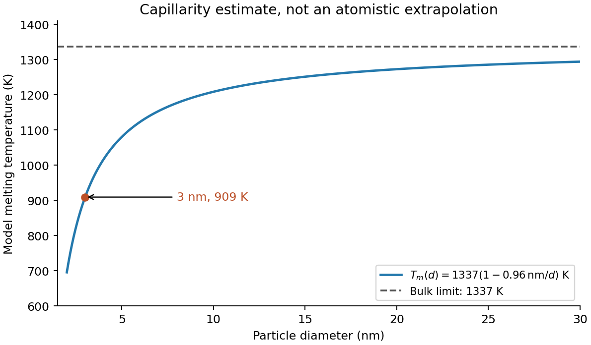

<h1 id="section-a-i/14/iv/solution">Solution</h1>

↑ **Parent:** [Iv](../iv.md)

In terms of diameter $d$, the model is

$$
T_m(d)=1337\left(1-\frac{0.96\ \mathrm{nm}}d\right)\ \mathrm K.
$$

Thus **[melting](../../../../../../melting.md) [temperature](../../../../../../temperature-split.md) rises toward the bulk value as diameter increases**, with a depression proportional to $1/d$. The analytic sketch below includes the calculated point. It deliberately does not extrapolate the continuum expression down to a zero or negative [melting](../../../../../../melting.md) [temperature](../../../../../../temperature-split.md).

Facet-dependent energies, non-spherical shapes, size-dependent interfacial energies and [latent heat](../../../../../../latent-heat.md), structural changes or magic cluster sizes can modify the trend. [Premelting](../../../../../../premelting.md) can broaden the transition. A substrate or encapsulating matrix changes interface energetics and can stabilize or destabilize the solid. [Ligands](../../../../../../ligand-biochemistry.md), impurities, [strain](../../../../../../strain.md), [particle size distribution](../../../../../../particle-size-distribution.md)s, coalescence during heating and nonequilibrium [temperature](../../../../../../temperature-split.md)/beam effects can shift the measured transition. These possibilities motivate separate thermal, structural and size controls rather than a fit to diameter alone.

**[Figure 2](#section-a-i/14/iv/image-original-gibbs-thomson-model-curve-for-gold-with-the-three-nanometre-estimate-marked). Original Gibbs-Thomson model curve for gold with the three-nanometre estimate marked**.

## ↑ Ancestors (11)

1. [Iv](../iv.md)
2. [14](../../14.md)
3. [Section A(i)](../../../section-a-i.md)
4. [Paper 2](../../../../paper-2-split.md)
5. [2021](../../../../split.md)
6. [Past exam of the MPhil in micro- and nanotechnology enterprise course of the University of Cambridge](../../../../../split.md)
7. [MPhil in micro- and nanotechnology enterprise course of the University of Cambridge](../../../../../../mphil-in-micro-and-nanotechnology-enterprise-course-of-the-university-of-cambridge.md)
8. [Course of the University of Cambridge](../../../../../../course-of-the-university-of-cambridge.md)
9. [University of Cambridge](../../../../../../university-of-cambridge-split.md)
10. [List of universities](../../../../../../list-of-universities.md)
11. [Codex Wiki](../../../../../../split.md)
