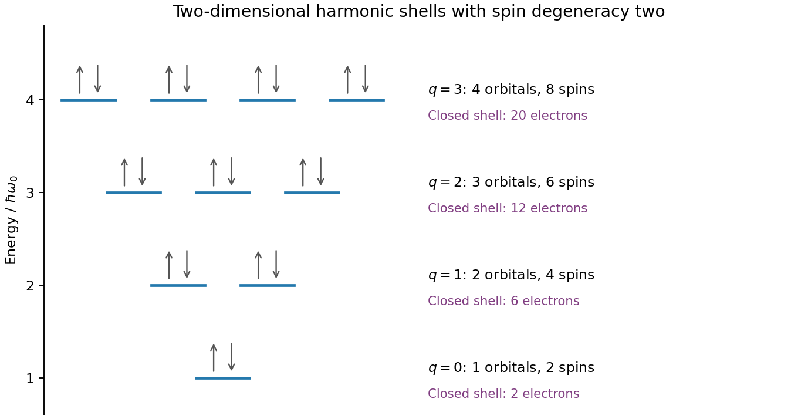

<h1 id="section-a-ii/15/iii/solution">Solution</h1>

↑ **Parent:** [Iii](../iii.md)

The [addition energy](../../../../../../addition-energy.md) has both charging and orbital terms,

$$
E_{\rm add}(N)=\frac{e^2}{C_\Sigma}+\epsilon_{N+1}-\epsilon_N.
$$

The larger diamonds indicate [quantum dot shell closure](../../../../../../quantum-dot-shell-closure.md) after **2, 6 and 12 [electrons](../../../../../../electron.md)**. A [two-dimensional isotropic harmonic oscillator](../../../../../../two-dimensional-isotropic-harmonic-oscillator.md) confinement, $V(x,y)=m^*\omega_0^2(x^2+y^2)/2$, explains that sequence: shell $q=n_x+n_y$ has $q+1$ orbital states and capacity $2(q+1)$ after [spin degeneracy](../../../../../../spin-degeneracy.md). The cumulative capacities are $(q+1)(q+2)=2,6,12,20,\ldots$. Within a degenerate shell, the extra orbital term vanishes to this approximation; crossing a shell boundary costs an extra $\hbar\omega_0$.

The [gate capacitance](../../../../../../gate-capacitance.md) lever arm is $\alpha_g=C_g/C_\Sigma=1/2$. Large and small gate widths differ by $7-5=2\ \mathrm{mV}$, so **$\hbar\omega_0\simeq e\alpha_g(2\ \mathrm{mV})=1.0\ \mathrm{meV}$**. Equivalently the tip energies differ by $3.5-2.5=1.0\ \mathrm{meV}$. Confinement anisotropy, exchange and disorder would split the ideal degeneracies; the diagram supports approximate shell symmetry rather than proving a perfectly parabolic potential.

**[Figure 3](#section-a-ii/15/iii/image-original-spin-degenerate-two-dimensional-oscillator-shell-capacities-and-closed-shell-electron-counts). Original spin-degenerate two-dimensional oscillator shell capacities and closed-shell electron counts**.

## ↑ Ancestors (11)

1. [Iii](../iii.md)
2. [15](../../15.md)
3. [Section A(ii)](../../../section-a-ii.md)
4. [Paper 2](../../../../paper-2-split.md)
5. [2021](../../../../split.md)
6. [Past exam of the MPhil in micro- and nanotechnology enterprise course of the University of Cambridge](../../../../../split.md)
7. [MPhil in micro- and nanotechnology enterprise course of the University of Cambridge](../../../../../../mphil-in-micro-and-nanotechnology-enterprise-course-of-the-university-of-cambridge.md)
8. [Course of the University of Cambridge](../../../../../../course-of-the-university-of-cambridge.md)
9. [University of Cambridge](../../../../../../university-of-cambridge-split.md)
10. [List of universities](../../../../../../list-of-universities.md)
11. [Codex Wiki](../../../../../../split.md)
