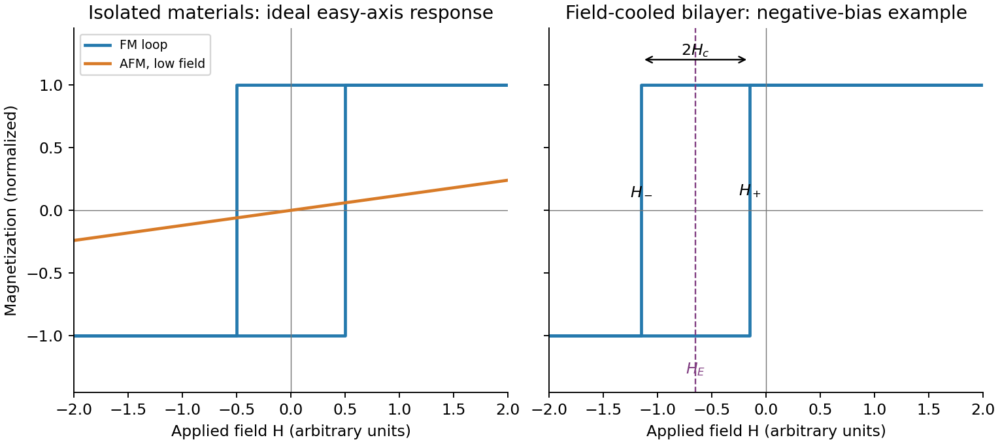

<h1 id="section-a-ii/16/i/solution">Solution</h1>

↑ **Parent:** [I](../i.md)

For an isolated easy-axis [ferromagnet](../../../../../../ferromagnet.md) undergoing coherent reversal, the ideal low-temperature loop is approximately rectangular, switching between $\pm M_s$ at $\pm H_c$. It has remanent [Magnetization](../../../../../../magnetization.md) and a large response near switching. An ideal compensated [antiferromagnet](../../../../../../antiferromagnetism.md) has essentially no [remanence](../../../../../../remanent-magnetization.md) and a small, approximately reversible linear net [Magnetization](../../../../../../magnetization.md) $M=\chi_{\rm AF}H$ at fields far below its exchange/spin-flop scales. Strong antiferromagnetic exchange makes substantial canting costly, so its low-field [magnetic susceptibility](../../../../../../magnetic-susceptibility.md) is small relative to the [ferromagnet](../../../../../../ferromagnet.md)'s unsaturated switching response.

This comparison does not say the [ferromagnet](../../../../../../ferromagnet.md) has a larger differential slope at every field: on its saturated branches $dM/dH$ can also be small. Nor does it rule out spin-flop transitions at much larger fields, outside the sketched range. The original plot uses arbitrary normalized scales.

**[Figure 4](#section-a-ii/16/i/image-original-isolated-ferromagnet-and-antiferromagnet-responses-and-a-field-cooled-shifted-bilayer-loop). Original isolated-ferromagnet and antiferromagnet responses, and a field-cooled shifted bilayer loop**.

## ↑ Ancestors (11)

1. [I](../i.md)
2. [16](../../16.md)
3. [Section A(ii)](../../../section-a-ii.md)
4. [Paper 2](../../../../paper-2-split.md)
5. [2021](../../../../split.md)
6. [Past exam of the MPhil in micro- and nanotechnology enterprise course of the University of Cambridge](../../../../../split.md)
7. [MPhil in micro- and nanotechnology enterprise course of the University of Cambridge](../../../../../../mphil-in-micro-and-nanotechnology-enterprise-course-of-the-university-of-cambridge.md)
8. [Course of the University of Cambridge](../../../../../../course-of-the-university-of-cambridge.md)
9. [University of Cambridge](../../../../../../university-of-cambridge-split.md)
10. [List of universities](../../../../../../list-of-universities.md)
11. [Codex Wiki](../../../../../../split.md)
