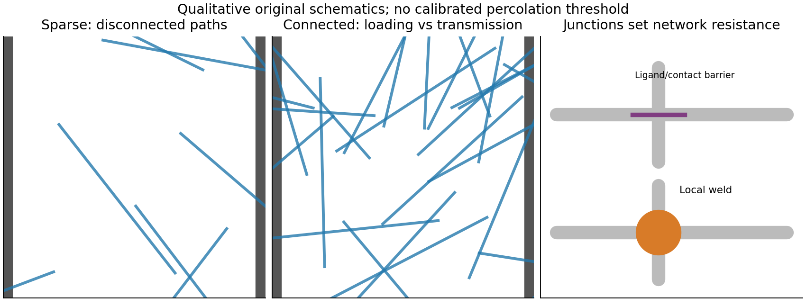

<h1 id="section-b/19/iii/a/solution">Solution</h1>

↑ **Parent:** [A](../a.md)

A transparent metallic network must span the patterned electrode with many redundant current paths while obscuring little area. For random rods, number density times squared wire length is a useful [percolation](../../../../../../../percolation-theory-split.md) measure; greater [aspect ratio](../../../../../../../aspect-ratio.md) generally reaches a connected network at lower coverage. Conductivity also depends on intrinsic metal resistivity, wire cross section, orientation, length distribution, wire–wire [contact resistance](../../../../../../../contact-resistance.md) and the number of junctions along each spanning path. Insulating capping layers can make [nanowire junction resistance](../../../../../../../nanowire-junction-resistance.md) dominate even when the individual wires are excellent conductors.

Near the connectivity threshold, small density changes or wire breaks produce large resistance changes. For a narrow stripe, finite-size effects and orientation matter: a macroscopic sheet-average [percolation](../../../../../../../percolation-theory-split.md) result does not ensure a reliable 100 µm-wide path. Optical performance depends on coverage, metal extinction, wire diameter, aggregation, [optical haze](../../../../../../../optical-haze.md), substrate transmission and any binder. Increasing wire density lowers resistance but usually lowers transmission. [Welding](../../../../../../../welding.md), pressing or suitable embedding can improve contacts with less additional optical coverage than simply adding metal.[Nature Materials 11 (2012), pp. 241–249, junction-localized welding mechanism](../../../../../../../self-limited-plasmonic-welding-of-silver-nanowire-junctions-by-erik-c-garnett-and-others.md)

The stripe has $L/W=250$ squares, so its end-to-end resistance is $R=250R_\square$; **the stated sheet-resistance limit requires a stripe resistance below 5 kΩ**, not 20 Ω. The sketch below separates sparse connectivity, redundant paths and junction quality.

**[Figure 5](#section-b/19/iii/a/image-original-network-schematics-distinguishing-connectivity-optical-coverage-and-wire-junction-resistance). Original network schematics distinguishing connectivity, optical coverage and wire-junction resistance**.

## ↑ Ancestors (12)

1. [A](../a.md)
2. [Iii](../../iii.md)
3. [19](../../../19.md)
4. [Section B](../../../../section-b.md)
5. [Paper 2](../../../../../paper-2-split.md)
6. [2021](../../../../../split.md)
7. [Past exam of the MPhil in micro- and nanotechnology enterprise course of the University of Cambridge](../../../../../../split.md)
8. [MPhil in micro- and nanotechnology enterprise course of the University of Cambridge](../../../../../../../mphil-in-micro-and-nanotechnology-enterprise-course-of-the-university-of-cambridge.md)
9. [Course of the University of Cambridge](../../../../../../../course-of-the-university-of-cambridge.md)
10. [University of Cambridge](../../../../../../../university-of-cambridge-split.md)
11. [List of universities](../../../../../../../list-of-universities.md)
12. [Codex Wiki](../../../../../../../split.md)
