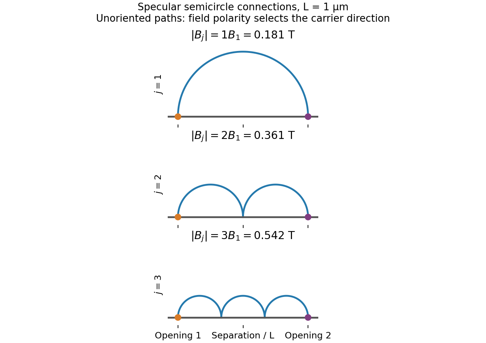

<h1 id="section-b/20/iv/a/solution">Solution</h1>

↑ **Parent:** [A](../a.md)

This is **[transverse magnetic focusing](../../../../../../../transverse-magnetic-focusing.md)**. The depleted gates form reflecting boundaries and two constrictions. A narrow [quantum point contact](../../../../../../../quantum-point-contact.md) collimates carriers into cyclotron trajectories with [cyclotron radius](../../../../../../../cyclotron-radius.md) $r_c=m^*v_F/(e|B|)=\hbar k_F/(e|B|)$. When an integer number of semicircular skipping arcs links the two openings, the collector couples particularly strongly to the injector population. A floating voltage contact then changes its [electrochemical potential](../../../../../../../electrochemical-potential.md) to satisfy zero net current, producing a peak in the measured nonlocal voltage. Sweeping the field changes the arc diameter, moving the focused population into or away from the collector.

The connection condition is $L=2jr_c$ for integer $j\ge1$, with the higher orders requiring specular reflections. The effect needs [ballistic electron transport](../../../../../../../ballistic-electron-transport.md), sufficiently narrow openings and a smooth boundary. [Electron phase coherence](../../../../../../../electron-phase-coherence.md) can add interference structure, but the basic geometrical focusing condition is semiclassical.[Physical Review B 39 (1989), pp. 8556–8575, focusing geometry and peak structure](../../../../../../../coherent-electron-focusing-with-quantum-point-contacts-in-a-two-dimensional-electron-gas-by-h-van-houten-and-others.md)

There is a polarity qualification in the printed geometry. The [electron](../../../../../../../electron.md) charge is negative: for a field out of the page, an [electron](../../../../../../../electron.md) launched upward through the left opening bends left, not toward the right opening. A direct left-opening-to-right-opening focusing path in the upper region therefore requires the field into the page; the printed outward field supports the reverse connection. Reversing conventional current reverses the occupation perturbation and voltage sign, but does not reverse the curvature of an individual [electron](../../../../../../../electron.md). Thus the standard injector-to-collector explanation describes the focusing mechanism, while the asserted signed voltage increase requires a consistent field/lead convention. The calculated results below are peak-field magnitudes; taking outward field positive gives negative fields for direct left-to-right electron injection.

**[Figure 6](#section-b/20/iv/a/image-original-semicircular-connections-for-three-focusing-orders-trajectories-are-shown-without-carrier-direction-arrows). Original semicircular connections for three focusing orders; trajectories are shown without carrier-direction arrows**.

## ↑ Ancestors (12)

1. [A](../a.md)
2. [Iv](../../iv.md)
3. [20](../../../20.md)
4. [Section B](../../../../section-b.md)
5. [Paper 2](../../../../../paper-2-split.md)
6. [2021](../../../../../split.md)
7. [Past exam of the MPhil in micro- and nanotechnology enterprise course of the University of Cambridge](../../../../../../split.md)
8. [MPhil in micro- and nanotechnology enterprise course of the University of Cambridge](../../../../../../../mphil-in-micro-and-nanotechnology-enterprise-course-of-the-university-of-cambridge.md)
9. [Course of the University of Cambridge](../../../../../../../course-of-the-university-of-cambridge.md)
10. [University of Cambridge](../../../../../../../university-of-cambridge-split.md)
11. [List of universities](../../../../../../../list-of-universities.md)
12. [Codex Wiki](../../../../../../../split.md)
