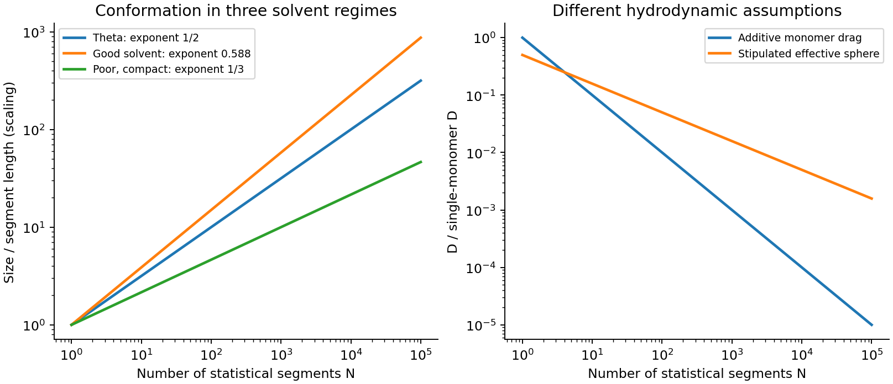

<h1 id="section-b/22/v/solution">Solution</h1>

↑ **Parent:** [V](../v.md)

For the stipulated [effective-sphere polymer drag](../../../../../../effective-sphere-polymer-drag.md), the radius is the end-to-end RMS distance, $R=2a\sqrt N$, rather than the single-monomer radius. Its [Stokes law](../../../../../../stokes-s-law.md) and translational [diffusion coefficient](../../../../../../diffusion-coefficient.md) are

$$
\zeta_2=6\pi\eta R=12\pi\eta a\sqrt N,\qquad
D_2=\frac{k_BT}{12\pi\eta a\sqrt N}.
$$

Under the same three-dimensional RMS convention as used above,

$$
\boxed{d_2=\sqrt{6D_2t}=\sqrt{\frac{k_BTt}{2\pi\eta a\sqrt N}},\qquad
\frac{d_2}{d_1}=\frac{N^{1/4}}{\sqrt2}.}
$$

Thus for sufficiently long chains ($N>4$), this model gives a larger displacement than independent [monomer](../../../../../../monomer.md) drag: [solvent](../../../../../../solvent.md) motion couples the parts of a coil, reducing its effective friction relative to $N$ isolated moving beads. The $D\propto N^{-1/2}$ theta-solvent scaling is consistent with the dilute-coil hydrodynamic scaling underlying the [Zimm model](../../../../../../zimm-model.md), but treating a permeable fluctuating coil as a solid sphere with radius exactly $R_{\rm rms}$ gives only an order-one hydrodynamic approximation. The [hydrodynamic radius](../../../../../../hydrodynamic-radius.md) and end-to-end radius are not generally equal. Neither model by itself restores the long-time constraints of a truly entangled solution.

If the one-dimensional contour statistic in part (iii) is used literally, the comparison of this three-dimensional $d_2$ with that contour RMS is $\sqrt{3/2}\,N^{1/4}$; it compares different coordinates. Using mean radial displacements in both three-dimensional models instead changes both prefactors equally and leaves their ratio unchanged.

**[Figure 7](#section-b/22/v/image-original-idealized-polymer-size-and-translational-diffusion-scalings-under-explicitly-different-drag-models). Original idealized polymer size and translational-diffusion scalings under explicitly different drag models**.

## ↑ Ancestors (11)

1. [V](../v.md)
2. [22](../../22.md)
3. [Section B](../../../section-b.md)
4. [Paper 2](../../../../paper-2-split.md)
5. [2021](../../../../split.md)
6. [Past exam of the MPhil in micro- and nanotechnology enterprise course of the University of Cambridge](../../../../../split.md)
7. [MPhil in micro- and nanotechnology enterprise course of the University of Cambridge](../../../../../../mphil-in-micro-and-nanotechnology-enterprise-course-of-the-university-of-cambridge.md)
8. [Course of the University of Cambridge](../../../../../../course-of-the-university-of-cambridge.md)
9. [University of Cambridge](../../../../../../university-of-cambridge-split.md)
10. [List of universities](../../../../../../list-of-universities.md)
11. [Codex Wiki](../../../../../../split.md)
