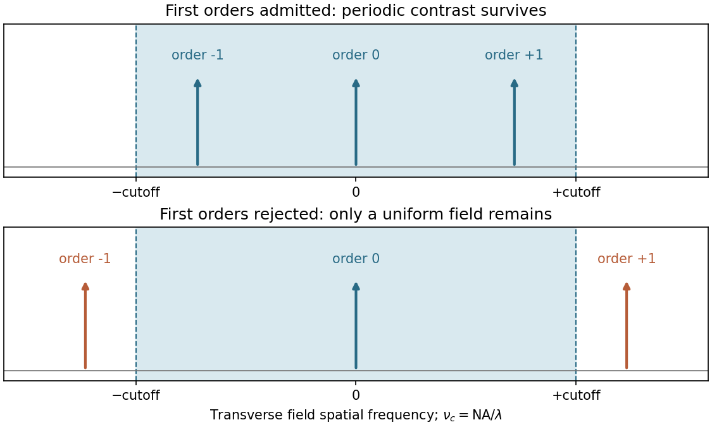
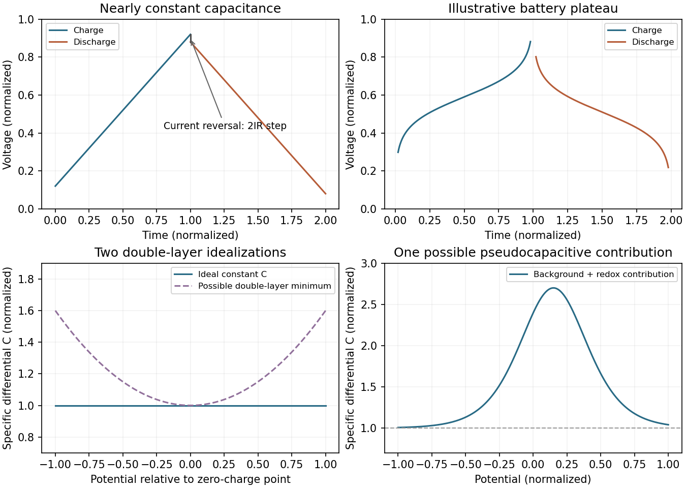
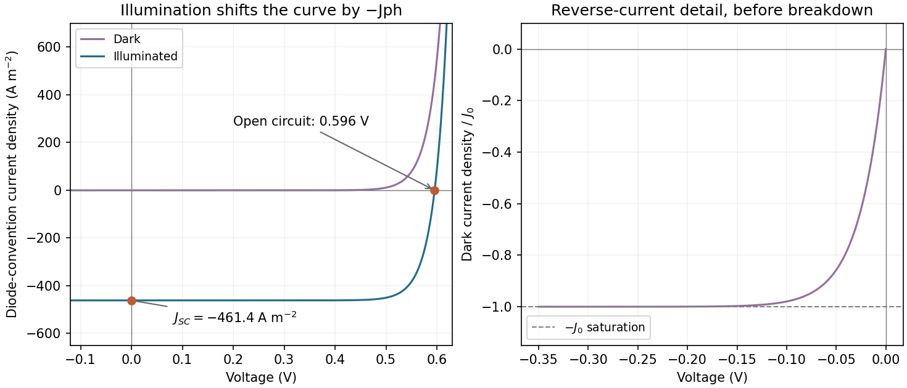
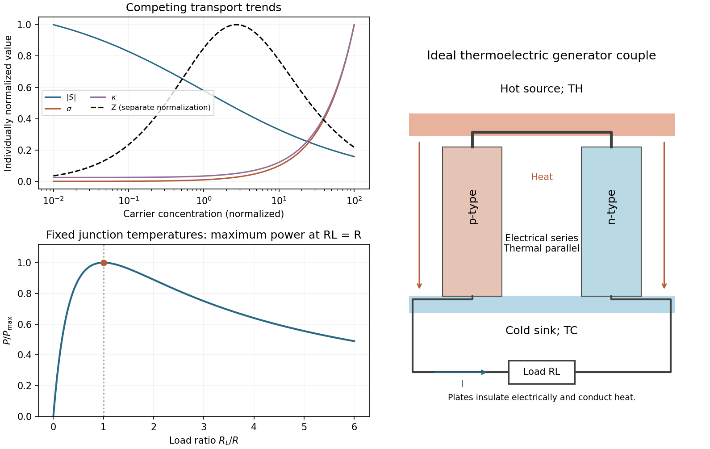

# Paper 1

↑ **Parent:** [2022](../2022.md)

[Original download archive](https://www.whatdotheyknow.com/request/mphil_in_micro_and_nanotechnolog_5/response/2556540/attach/2/FOI%202024%2050%20Dai%20materials.zip?cookie_passthrough=1)

Source: NanoMPhil Paper 1 2022.pdf, physical pages 1–16 of that ZIP member; questions occupy pages 3–16.

**Table of contents**

- [Section A(i)](#section-a-i)
  - [1](#section-a-i/1)
    - [i](#section-a-i/1/i)
      - [Solution](#section-a-i/1/i/solution)
    - [ii](#section-a-i/1/ii)
      - [a](#section-a-i/1/ii/a)
        - [Solution](#section-a-i/1/ii/a/solution)
      - [b](#section-a-i/1/ii/b)
        - [Solution](#section-a-i/1/ii/b/solution)
      - [c](#section-a-i/1/ii/c)
        - [Solution](#section-a-i/1/ii/c/solution)
  - [2](#section-a-i/2)
    - [i](#section-a-i/2/i)
      - [Solution](#section-a-i/2/i/solution)
    - [ii](#section-a-i/2/ii)
      - [Solution](#section-a-i/2/ii/solution)
    - [iii](#section-a-i/2/iii)
      - [Solution](#section-a-i/2/iii/solution)
- [Section A(ii)](#section-a-ii)
  - [3](#section-a-ii/3)
    - [i](#section-a-ii/3/i)
      - [Solution](#section-a-ii/3/i/solution)
    - [ii](#section-a-ii/3/ii)
      - [Solution](#section-a-ii/3/ii/solution)
    - [iii](#section-a-ii/3/iii)
      - [Solution](#section-a-ii/3/iii/solution)
    - [iv](#section-a-ii/3/iv)
      - [Solution](#section-a-ii/3/iv/solution)
  - [4](#section-a-ii/4)
    - [i](#section-a-ii/4/i)
      - [Solution](#section-a-ii/4/i/solution)
    - [ii](#section-a-ii/4/ii)
      - [Solution](#section-a-ii/4/ii/solution)
    - [iii](#section-a-ii/4/iii)
      - [Solution](#section-a-ii/4/iii/solution)
- [Section A(iii)](#section-a-iii)
  - [5](#section-a-iii/5)
    - [i](#section-a-iii/5/i)
      - [Solution](#section-a-iii/5/i/solution)
    - [ii](#section-a-iii/5/ii)
      - [Solution](#section-a-iii/5/ii/solution)
    - [iii](#section-a-iii/5/iii)
      - [Solution](#section-a-iii/5/iii/solution)
    - [iv](#section-a-iii/5/iv)
      - [Solution](#section-a-iii/5/iv/solution)
  - [6](#section-a-iii/6)
    - [i](#section-a-iii/6/i)
      - [Solution](#section-a-iii/6/i/solution)
    - [ii](#section-a-iii/6/ii)
      - [Solution](#section-a-iii/6/ii/solution)
  - [7](#section-a-iii/7)
    - [i](#section-a-iii/7/i)
      - [Solution](#section-a-iii/7/i/solution)
    - [ii](#section-a-iii/7/ii)
      - [Solution](#section-a-iii/7/ii/solution)
    - [iii](#section-a-iii/7/iii)
      - [Solution](#section-a-iii/7/iii/solution)
    - [iv](#section-a-iii/7/iv)
      - [Solution](#section-a-iii/7/iv/solution)
- [Section B](#section-b)
  - [8](#section-b/8)
    - [i](#section-b/8/i)
      - [Solution](#section-b/8/i/solution)
    - [ii](#section-b/8/ii)
      - [a](#section-b/8/ii/a)
        - [Solution](#section-b/8/ii/a/solution)
      - [b](#section-b/8/ii/b)
        - [Solution](#section-b/8/ii/b/solution)
      - [c](#section-b/8/ii/c)
        - [Solution](#section-b/8/ii/c/solution)
      - [d](#section-b/8/ii/d)
        - [Solution](#section-b/8/ii/d/solution)
    - [iii](#section-b/8/iii)
      - [Solution](#section-b/8/iii/solution)
    - [iv](#section-b/8/iv)
      - [Solution](#section-b/8/iv/solution)
    - [v](#section-b/8/v)
      - [Solution](#section-b/8/v/solution)
  - [9](#section-b/9)
    - [i](#section-b/9/i)
      - [a](#section-b/9/i/a)
        - [Solution](#section-b/9/i/a/solution)
      - [b](#section-b/9/i/b)
        - [Solution](#section-b/9/i/b/solution)
      - [c](#section-b/9/i/c)
        - [Solution](#section-b/9/i/c/solution)
    - [ii](#section-b/9/ii)
      - [Solution](#section-b/9/ii/solution)
    - [iii](#section-b/9/iii)
      - [Solution](#section-b/9/iii/solution)
    - [iv](#section-b/9/iv)
      - [Solution](#section-b/9/iv/solution)
    - [v](#section-b/9/v)
      - [Solution](#section-b/9/v/solution)
  - [10](#section-b/10)
    - [i](#section-b/10/i)
      - [Solution](#section-b/10/i/solution)
    - [ii](#section-b/10/ii)
      - [Solution](#section-b/10/ii/solution)
    - [iii](#section-b/10/iii)
      - [Solution](#section-b/10/iii/solution)
    - [iv](#section-b/10/iv)
      - [Solution](#section-b/10/iv/solution)
    - [v](#section-b/10/v)
      - [Solution](#section-b/10/v/solution)
    - [vi](#section-b/10/vi)
      - [Solution](#section-b/10/vi/solution)
    - [vii](#section-b/10/vii)
      - [Solution](#section-b/10/vii/solution)
  - [11](#section-b/11)
    - [i](#section-b/11/i)
      - [a](#section-b/11/i/a)
        - [Solution](#section-b/11/i/a/solution)
      - [b](#section-b/11/i/b)
        - [Solution](#section-b/11/i/b/solution)
      - [c](#section-b/11/i/c)
        - [Solution](#section-b/11/i/c/solution)
    - [ii](#section-b/11/ii)
      - [a](#section-b/11/ii/a)
        - [Solution](#section-b/11/ii/a/solution)
      - [b](#section-b/11/ii/b)
        - [Solution](#section-b/11/ii/b/solution)
      - [c](#section-b/11/ii/c)
        - [Solution](#section-b/11/ii/c/solution)
    - [iii](#section-b/11/iii)
      - [Solution](#section-b/11/iii/solution)
  - [12](#section-b/12)
    - [i](#section-b/12/i)
      - [Solution](#section-b/12/i/solution)
    - [ii](#section-b/12/ii)
      - [Solution](#section-b/12/ii/solution)
    - [iii](#section-b/12/iii)
      - [a](#section-b/12/iii/a)
        - [Solution](#section-b/12/iii/a/solution)
      - [b](#section-b/12/iii/b)
        - [Solution](#section-b/12/iii/b/solution)
      - [c](#section-b/12/iii/c)
        - [Solution](#section-b/12/iii/c/solution)
      - [d](#section-b/12/iii/d)
        - [Solution](#section-b/12/iii/d/solution)
    - [iv](#section-b/12/iv)
      - [Solution](#section-b/12/iv/solution)

<h2 id="section-a-i">Section A(i)</h2>

↑ **Parent:** [Paper 1](paper-1.md)

<h3 id="section-a-i/1">1</h3>

↑ **Parent:** [Section A(i)](#section-a-i)

<h4 id="section-a-i/1/i">i</h4>

↑ **Parent:** [1](#section-a-i/1)

<h5 id="section-a-i/1/i/solution">Solution</h5>

↑ **Parent:** [I](#section-a-i/1/i)

[Diffraction contrast](../../optics.md#diffraction-contrast) arises because [elastic scattering](../../quantum-scattering.md#elastic-scattering) transfers transmitted [electron](../../physics.md#electron) intensity between the direct beam and [Bragg diffraction](../../quantum-scattering.md#bragg-diffraction) beams. A local change in [crystal orientation](../../physical-chemistry.md#crystal-orientation), [strain](../../continuum-mechanics.md#strain) or thickness changes that transfer. An [objective aperture](../../optics.md#objective-aperture) selecting the direct beam makes strongly diffracting regions relatively dark in [bright-field transmission electron microscopy](../../optics.md#bright-field-transmission-electron-microscopy); selecting a diffracted beam reverses the selection in [dark-field transmission electron microscopy](../../optics.md#dark-field-transmission-electron-microscopy). This is a change in scattering conditions, not necessarily a change in chemical composition.

Three characteristic effects are **bend contours, thickness fringes and dislocation contrast**. [Bend contours](../../optics.md#bend-contour) follow positions where a gently curved crystal meets a particular [Bragg diffraction](../../quantum-scattering.md#bragg-diffraction) condition. [Thickness fringes](../../optics.md#thickness-fringe) arise from thickness-dependent exchange of intensity between coupled transmitted and diffracted waves. A [dislocation](../../physical-chemistry.md#dislocation) distorts nearby planes, changing their diffraction condition and producing localized contrast; changing the diffraction vector can suppress particular dislocations. [Moiré fringes](../../physical-optics.md#moire-fringe) from overlapping lattices provide another acceptable example, but their coarse spacing is a beat spacing rather than an atomic spacing.

<h4 id="section-a-i/1/ii">ii</h4>

↑ **Parent:** [1](#section-a-i/1)

<h5 id="section-a-i/1/ii/a">a</h5>

↑ **Parent:** [Ii](#section-a-i/1/ii)

<h6 id="section-a-i/1/ii/a/solution">Solution</h6>

↑ **Parent:** [A](#section-a-i/1/ii/a)

**Use conventional [bright-field transmission electron microscopy](../../optics.md#bright-field-transmission-electron-microscopy), with nearly parallel illumination, a suitably small [objective aperture](../../optics.md#objective-aperture) and low magnification covering the whole cross-section.** More strongly scattering material sends more intensity outside the selected central beam and therefore looks darker. Tilt crystalline layers away from strong [Bragg diffraction](../../quantum-scattering.md#bragg-diffraction) conditions to reduce [diffraction contrast](../../optics.md#diffraction-contrast), and use a near-focus image so that [electron phase contrast](../../optics.md#electron-phase-contrast) does not dominate.

The nominally uniform $150\,\mathrm{nm}$ thickness helps separate composition from thickness variations, but does not make the contrast purely compositional: density, atomic number and multiple scattering still matter. Choose an accelerating voltage sufficient to transmit this thickness, commonly $200$–$300\,\mathrm{kV}$ for a robust inorganic film, subject to its damage limit. [High-angle annular dark-field imaging](../../optics.md#high-angle-annular-dark-field-imaging) in [scanning transmission electron microscopy](../../optics.md#scanning-transmission-electron-microscopy) is a useful alternative for approximately monotonic mass-thickness contrast, but is a different acquisition mode and still requires thickness and detector-angle control.

<h5 id="section-a-i/1/ii/b">b</h5>

↑ **Parent:** [Ii](#section-a-i/1/ii)

<h6 id="section-a-i/1/ii/b/solution">Solution</h6>

↑ **Parent:** [B](#section-a-i/1/ii/b)

**Use a low-dose, dose-efficient acquisition rather than assuming that a lower accelerating voltage is always gentler.** Focus and align on a sacrificial neighbouring region, blank the beam between exposures, illuminate only when recording and use an efficient detector. A broad, low-current-density [transmission electron microscopy](../../optics.md#transmission-electron-microscopy) exposure can avoid a high instantaneous local dose; scanning can also work if probe current, dwell time and repeated visits are controlled.

[Radiolysis](../../biology.md#radiolysis) starts with [inelastic scattering](../../quantum-scattering.md#inelastic-scattering) and ionization. For an appropriate thin specimen, increasing the electron energy can reduce the inelastic interaction probability and energy deposition per incident electron, so a relatively high voltage can help. However, increasing voltage can also activate [knock-on displacement](../../biology.md#knock-on-displacement). The optimum therefore depends on the material and the amount of useful information obtained per damaging event; $150\,\mathrm{nm}$ alone does not determine it. Cooling may reduce diffusion-driven chemical changes but does not eliminate primary ionization. An experimental study of nonbiological layered polymer films explicitly found that the voltage choice must balance damage with image signal.[2022, accelerating-voltage comparison and discussion of the inelastic scattering cross-section](../../physics-bibliography.md#optimal-acceleration-voltage-for-near-atomic-resolution-imaging-of-layer-stacked-2d-polymer-thin-films-by-baokun-liang-and-others)

<h5 id="section-a-i/1/ii/c">c</h5>

↑ **Parent:** [Ii](#section-a-i/1/ii)

<h6 id="section-a-i/1/ii/c/solution">Solution</h6>

↑ **Parent:** [C](#section-a-i/1/ii/c)

**Use [high-resolution transmission electron microscopy](../../optics.md#high-resolution-transmission-electron-microscopy) with a coherent, well-aligned beam and an objective aperture admitting the direct beam and the spatial frequencies required at the interface.** Orient a crystalline region near a suitable [zone axis](../../physical-chemistry.md#zone-axis) so that useful lattice fringes are excited; minimize drift, vibration and astigmatism. Choose defocus and aberration correction to transfer the target frequencies, rather than treating the image as a direct map of atoms at arbitrary defocus.

An aberration-corrected [scanning transmission electron microscopy](../../optics.md#scanning-transmission-electron-microscopy) probe with [high-angle annular dark-field imaging](../../optics.md#high-angle-annular-dark-field-imaging) can instead resolve an interface with more directly interpretable atomic-number contrast. A nominal $150\,\mathrm{nm}$ thickness may be too great for clean atomic-resolution interpretation: thin the interface further if necessary, finish [focused ion beam milling](../../engineering.md#focused-ion-beam-milling) at lower ion energy to reduce damaged surface layers, and check for curtaining and implantation. The best mode depends on crystallinity and damage sensitivity; an amorphous interface calls for resolving its boundary and composition rather than inventing lattice fringes.

<h3 id="section-a-i/2">2</h3>

↑ **Parent:** [Section A(i)](#section-a-i)

<h4 id="section-a-i/2/i">i</h4>

↑ **Parent:** [2](#section-a-i/2)

<h5 id="section-a-i/2/i/solution">Solution</h5>

↑ **Parent:** [I](#section-a-i/2/i)

In [piezoresponse force microscopy](../../engineering.md#piezoresponse-force-microscopy), a conducting [atomic force microscopy](../../engineering.md#atomic-force-microscopy) tip contacts a sample with a counter-electrode. Apply $V(t)=V_{\rm dc}+V_{\rm ac}\cos\omega t$. The [converse piezoelectric effect](../../quantum-mechanics.md#converse-piezoelectric-effect) produces an oscillatory displacement, approximately $u_\omega=d_{\rm eff}V_{\rm ac}$. Contact with the moving surface bends the cantilever, and a [lock-in amplifier](../../electrical-circuit.md#lock-in-amplifier) records the displacement amplitude and phase relative to the drive.

For opposite out-of-plane [ferroelectric domains](../../engineering.md#ferroelectric-domain), the effective piezoelectric coefficient changes sign. Their vertical response therefore differs by approximately **$180^\circ$ in phase**. Equivalent antiparallel domains can have similar amplitudes, while cancellation or reduced response near a wall can produce an amplitude minimum. Phase identifies the relative response sign; an uncalibrated detector phase is not an absolute polarization direction.

Use a small drive below the switching threshold while imaging, a stable contact force and a well-characterized contact resonance. Electrostatic forces, contact stiffness and surface charging can also create signals at the drive frequency; observing contrast alone is insufficient evidence for polarization switching.[2002, electromechanical and electrostatic contrast regimes](../../physics-bibliography.md#imaging-mechanism-of-piezoresponse-force-microscopy-of-ferroelectric-surfaces-by-sergei-v-kalinin-and-dawn-a-bonnell)

<h4 id="section-a-i/2/ii">ii</h4>

↑ **Parent:** [2](#section-a-i/2)

<h5 id="section-a-i/2/ii/solution">Solution</h5>

↑ **Parent:** [Ii](#section-a-i/2/ii)

**Measure cantilever torsion with the lateral channel of a four-quadrant optical detector.** An in-plane surface displacement perpendicular to the cantilever axis twists the cantilever. The reflected laser spot moves sideways, so the left-minus-right detector signal, demodulated at $\omega$ by a [lock-in amplifier](../../electrical-circuit.md#lock-in-amplifier), gives the amplitude and phase of the lateral piezoresponse. The top-minus-bottom signal primarily records bending.

Displacement along the cantilever axis can instead cause buckling and leak into the nominally vertical channel. Rotate the specimen by $90^\circ$ and repeat the measurement to sample the other in-plane component; use a reference specimen and sensitivity calibration before converting a voltage into displacement or force. A torsional spring constant and lever-arm calibration are additionally needed for an actual lateral-force value. Thus **lateral piezoresponse is not automatically a calibrated force measurement**.

<h4 id="section-a-i/2/iii">iii</h4>

↑ **Parent:** [2](#section-a-i/2)

<h5 id="section-a-i/2/iii/solution">Solution</h5>

↑ **Parent:** [Iii](#section-a-i/2/iii)

A surface slope converts some vertical displacement into lateral motion of the tip and changes the normal contact geometry. Roughness also changes friction, contact area and local contact stiffness, and can mix cantilever bending, buckling and torsion. A lateral image that follows a height gradient can therefore appear even when the relevant in-plane polarization component is absent.

Record topography and both [piezoresponse force microscopy](../../engineering.md#piezoresponse-force-microscopy) channels simultaneously, and compare the lateral signal with the local slope rather than height alone. Reverse the scan direction to identify frictional contributions, rotate the sample relative to the cantilever, and compare the vector transformation expected for an in-plane response with the geometrical cross-talk. Repeat on a smoother region or a polished specimen, at controlled force and drive amplitude. Track contact resonance or compare sufficiently far from it so that local stiffness does not masquerade as a change in response.

A useful control is a nonpiezoelectric surface of similar roughness. Electrically switching a domain while leaving its topography unchanged provides a further comparison when feasible. **No single trace–retrace test proves the absence of cross-talk**: genuine in-plane response and slope-induced signals can both transform under rotation, so several controls must agree.

<h2 id="section-a-ii">Section A(ii)</h2>

↑ **Parent:** [Paper 1](paper-1.md)

<h3 id="section-a-ii/3">3</h3>

↑ **Parent:** [Section A(ii)](#section-a-ii)

<h4 id="section-a-ii/3/i">i</h4>

↑ **Parent:** [3](#section-a-ii/3)

<h5 id="section-a-ii/3/i/solution">Solution</h5>

↑ **Parent:** [I](#section-a-ii/3/i)

Read the straight-line extrapolation on the logarithmic dose axis, rather than the rounded shoulder of the measured curve. The retention and clearing intercepts are approximately $D_0=10$ and $D_{100}=50\,\mathrm{mJ\,cm^{-2}}$. Thus the [photoresist contrast](../../engineering.md#photoresist-contrast) is

$$
\boxed{\gamma=\frac{1}{\log_{10}(50/10)}=1.43.}
$$

Here the subscripts denote the two dose thresholds used in the supplied definition. The physical positive-resist curve decreases with exposure; $D_{100}$ is the higher clearing dose in that definition, not a statement that the film retains its full thickness there. Graphical intercepts justify roughly two significant figures.

<h4 id="section-a-ii/3/ii">ii</h4>

↑ **Parent:** [3](#section-a-ii/3)

<h5 id="section-a-ii/3/ii/solution">Solution</h5>

↑ **Parent:** [Ii](#section-a-ii/3/ii)

Use [exposure dose](../../engineering.md#exposure-dose) $D(x)=I(x)\tau$, with $\mathrm{mW}\times\mathrm s=\mathrm{mJ}$. At approximately $x=1.0$ and $3.0\,\mu\mathrm m$, the positive resist just starts to thin. The intensity there is about $5\,\mathrm{mW\,cm^{-2}}$, so

$$
\boxed{\tau=\frac{D_0}{I}=\frac{10\,\mathrm{mJ\,cm^{-2}}}{5\,\mathrm{mW\,cm^{-2}}}=2.0\,\mathrm s.}
$$

As a consistency check, the fully cleared region begins at approximately $x=1.5$ and ends at $2.5\,\mu\mathrm m$, where the intensity is about $25\,\mathrm{mW\,cm^{-2}}$. Multiplying by $2\,\mathrm s$ gives the clearing dose $50\,\mathrm{mJ\,cm^{-2}}$ at both edges.

<h4 id="section-a-ii/3/iii">iii</h4>

↑ **Parent:** [3](#section-a-ii/3)

<h5 id="section-a-ii/3/iii/solution">Solution</h5>

↑ **Parent:** [Iii](#section-a-ii/3/iii)

A fully clear opening requires the higher clearing threshold, not merely the onset of thinning. At $\tau=20\,\mathrm s$,

$$
I_{\rm clear}=\frac{D_{100}}{\tau}=\frac{50}{20}=2.5\,\mathrm{mW\,cm^{-2}}.
$$

The intensity curve crosses this level at about $x=0.25$ and $3.75\,\mu\mathrm m$. Therefore the clear opening is approximately

$$
\boxed{w\simeq3.75-0.25=3.5\,\mu\mathrm m.}
$$

The longer exposure widens the opening because even the relatively dim image tails now accumulate enough [exposure dose](../../engineering.md#exposure-dose) to clear the positive [photoresist](../../engineering.md#photoresist). The edge readings are approximate; interpolating a plotted curve does not support nanometre precision.

<h4 id="section-a-ii/3/iv">iv</h4>

↑ **Parent:** [3](#section-a-ii/3)

<h5 id="section-a-ii/3/iv/solution">Solution</h5>

↑ **Parent:** [Iv](#section-a-ii/3/iv)

A **[negative photoresist](../../engineering.md#negative-photoresist) is removed at low dose and retained at high dose**. Its remaining-thickness curve rises from zero above a gel or retention threshold and approaches one above a larger full-retention threshold. A useful schematic model is

$$
f_-(D)=\begin{cases}
0&D\leq D_a,\\
\dfrac{\ln(D/D_a)}{\ln(D_b/D_a)}&D_a<D<D_b,\\
1&D\geq D_b.
\end{cases}
$$

The developed profile is $t(x)/t_0=f_-[\tau I(x)]$. A central intensity maximum therefore leaves a central ridge, with cleared regions towards the darker sides. **Halving exposure narrows and can lower the retained ridge; doubling it broadens the ridge and can raise its shoulders.** A saturated central plateau cannot become thicker than the original film in this simple model. If the half-dose peak is below $D_a$, no ridge survives; if it lies between $D_a$ and $D_b$, the centre survives only partially.

The negative-resist thresholds are not supplied, so there is no unique numerical profile or linewidth. The original schematic below declares its own illustrative thresholds and intensity function; it explains the dose mapping without treating a positive-resist curve as measured negative-resist data.

**[Figure 1](#section-a-ii/3/iv/image-negative-resist-dose-mapping-and-the-effect-of-exposure-time). Negative-resist dose mapping and the effect of exposure time**. Original illustrative model with declared retention thresholds. The intensity is a smooth test function rather than a copy of the examination graph; the numerical edge readings in the preceding parts come from the original PDF.

<h3 id="section-a-ii/4">4</h3>

↑ **Parent:** [Section A(ii)](#section-a-ii)

<h4 id="section-a-ii/4/i">i</h4>

↑ **Parent:** [4](#section-a-ii/4)

<h5 id="section-a-ii/4/i/solution">Solution</h5>

↑ **Parent:** [I](#section-a-ii/4/i)

Take the ArF wavelength as $\lambda=193\,\mathrm{nm}$ and assume an **on-axis coherent illuminator**. A grating of period $P$ has diffraction orders with transverse spatial frequencies $m/P$. To reproduce amplitude modulation, the pupil must pass the zero order and at least the first spatial-frequency components. For symmetric on-axis illumination this requires $1/P<\mathrm{NA}/\lambda$.

For equal lines and spaces, the printed feature width is the half-pitch $w=P/2$. The ideal limiting values are therefore

$$
\boxed{w_{\min}=\frac{\lambda}{2\mathrm{NA}}=\frac{193}{1.2}=161\,\mathrm{nm}},\qquad
\boxed{P_{\min}=322\,\mathrm{nm}}.
$$

These are limiting values approached from within the pupil, with adequate mask contrast and a suitable resist; a weakly modulated mask need not supply sufficient image contrast. They are not the Rayleigh separation of two incoherent point objects. Off-axis coherent illumination can shift the admitted orders and changes this particular geometry.

<h4 id="section-a-ii/4/ii">ii</h4>

↑ **Parent:** [4](#section-a-ii/4)

<h5 id="section-a-ii/4/ii/solution">Solution</h5>

↑ **Parent:** [Ii](#section-a-ii/4/ii)

The projection lens maps the mask's angular spectrum into its back focal plane: within scalar Fourier optics this is the **[Fraunhofer diffraction](../../physical-optics.md#fraunhofer-diffraction) or spatial-Fourier plane**. A periodic mask produces discrete diffraction orders, separated by $1/P$ in object-side spatial frequency after accounting for projection magnification. The finite [numerical aperture](../../point-spread-function.md#numerical-aperture) bounds the transverse wave vectors admitted by the lens, so the pupil is a spatial-frequency filter.

For an ideal on-axis coherent system,

$$
\widetilde U_{\rm image}(\nu_x,\nu_y)=P(\nu_x,\nu_y)\widetilde U_{\rm mask}(\nu_x,\nu_y),
\qquad |\boldsymbol\nu|<\frac{\mathrm{NA}}{\lambda}.
$$

A second Fourier transformation forms the image, and the recorded intensity is $|U_{\rm image}|^2$. If only the zero order passes, the field is uniform and the line pattern disappears. Passing zero and first orders restores a periodic modulation; passing more orders sharpens the edges. Thus the loss of fine structure is explained by rejected diffraction orders, not by a geometrical inability to draw narrow lines. The field-transfer cutoff differs from the twice-as-large incoherent intensity-transfer cutoff.[coherent and incoherent transfer: pupil filtering and intensity formation](../../physics-bibliography.md#advanced-optical-imaging-incoherent-imaging-by-delft-university-of-technology)

**[Figure 2](#section-a-ii/4/ii/image-coherent-grating-orders-admitted-or-rejected-by-a-finite-pupil). Coherent grating orders admitted or rejected by a finite pupil**.

<h4 id="section-a-ii/4/iii">iii</h4>

↑ **Parent:** [4](#section-a-ii/4)

<h5 id="section-a-ii/4/iii/solution">Solution</h5>

↑ **Parent:** [Iii](#section-a-ii/4/iii)

Increasing the angular acceptance can collect higher spatial frequencies, but rays at large angles and away from the optical axis are harder to bring to the same focus. [Spherical aberration](../../geometrical-optics.md#spherical-aberration), coma, astigmatism and field curvature can degrade contrast across a large exposure field. The [depth of focus](../../engineering.md#depth-of-focus) also decreases approximately as $\lambda/\mathrm{NA}^2$, making wafer height errors more important. A larger geometrical aperture is therefore not automatically better over the whole wafer field.

**[Immersion lithography](../../engineering.md#immersion-lithography) raises $\mathrm{NA}=n\sin\theta$ by increasing the refractive index of the medium between the final lens and wafer.** A suitable UV-transparent liquid permits a larger numerical aperture without increasing the ray angle by the same factor, easing the purely geometrical demand on the lens. Lens design and focus control remain necessary; immersion does not abolish aberrations. The liquid must also be compatible with the resist and free of bubbles and contamination, and absorption at $193\,\mathrm{nm}$ must be low.

<h2 id="section-a-iii">Section A(iii)</h2>

↑ **Parent:** [Paper 1](paper-1.md)

<h3 id="section-a-iii/5">5</h3>

↑ **Parent:** [Section A(iii)](#section-a-iii)

<h4 id="section-a-iii/5/i">i</h4>

↑ **Parent:** [5](#section-a-iii/5)

<h5 id="section-a-iii/5/i/solution">Solution</h5>

↑ **Parent:** [I](#section-a-iii/5/i)

Use consistent units for the [Gibbs free energy](../../thermodynamic-potential.md#gibbs-free-energy):

$$
\Delta G^\circ=\Delta H^\circ-T\Delta S^\circ
=-15.0-300(0.020)=-21.0\,\mathrm{kJ\,mol^{-1}}.
$$

Then $\Delta G^\circ=-RT\ln K$ gives

$$
\boxed{K=\exp\!\left[\frac{21000}{8.314(300)}\right]=4.53\times10^3.}
$$

This is a dimensionless thermodynamic [equilibrium constant](../../chemical-potential.md#equilibrium-constant) defined through activities. For an ideal dilute $1:1$ association, the numerical concentration association constant is about $4.53\times10^3\,\mathrm{M^{-1}}$ when concentrations use the $1\,\mathrm M$ standard state. Both favourable enthalpy and positive entropy favour association here; association need not always have a negative entropy change because solvent release can outweigh the loss of translational freedom.

<h4 id="section-a-iii/5/ii">ii</h4>

↑ **Parent:** [5](#section-a-iii/5)

<h5 id="section-a-iii/5/ii/solution">Solution</h5>

↑ **Parent:** [Ii](#section-a-iii/5/ii)

[Cyclodextrins](../../chemistry.md#cyclodextrin) are truncated-cone-shaped hosts that form [host–guest complexes](../../chemistry.md#host-guest-complex). Their hydroxyl-rich exterior interacts favourably with water, while the internal cavity is relatively nonpolar and can accommodate a suitably sized organic guest. The six-, seven- and eight-unit rings have different cavity sizes, so shape and size selectivity matter. Binding can involve [London dispersion forces](../../force.md#london-dispersion-force), displacement of cavity water and changes in solvation; no covalent modification of the guest is necessary.

An odorous organic guest can be included in the cavity, decreasing its free concentration and hence its tendency to enter the vapour phase. The same inclusion chemistry can increase the apparent aqueous solubility of a poorly soluble compound, and reversible association allows release when conditions or concentrations change. In a separation, guests with different association constants partition differently between free and bound states; a suitably immobilized host can therefore act as a selective stationary phase.

**The unifying mechanism is reversible molecular inclusion in a size-selective cavity.** These are chemical explanations of binding and partitioning. Biological action, therapeutic efficacy and physiological delivery mechanisms are outside the present nonbiology scope.

<h4 id="section-a-iii/5/iii">iii</h4>

↑ **Parent:** [5](#section-a-iii/5)

<h5 id="section-a-iii/5/iii/solution">Solution</h5>

↑ **Parent:** [Iii](#section-a-iii/5/iii)

**The gas-phase attraction is a [cation–π interaction](../../chemistry.md#cation-pi-interaction).** The positively charged ion interacts with benzene's electron distribution and polarizes the aromatic molecule. An orientation above the ring face allows stabilization without a conventional covalent bond. A modest association constant reflects the balance of that attraction against the entropy cost of joining two independent species, at the stated gas-phase standard state.

In water, a small ion such as $\mathrm{Li^+}$ is strongly solvated. Forming a direct benzene complex requires rearranging or losing favourable ion–water contacts; benzene is also solvated, and the solvent screens electrostatic interactions. The relevant solution free energy therefore includes **desolvation and solvent reorganization**, not just the attractive energy of the isolated pair. The gas-phase association constant cannot be transferred to water without changing this thermodynamic cycle and the standard states. The interaction is not forbidden in solution, but it need not give appreciable direct complexation under the specified conditions.

<h4 id="section-a-iii/5/iv">iv</h4>

↑ **Parent:** [5](#section-a-iii/5)

<h5 id="section-a-iii/5/iv/solution">Solution</h5>

↑ **Parent:** [Iv](#section-a-iii/5/iv)

The receptor is a [triazolophane](../../chemistry.md#triazolophane) with a relatively rigid central cavity. Its inward-facing triazole and phenylene C–H groups act cooperatively as [hydrogen bond donors](../../chemical-bond.md#hydrogen-bond-donor) to an anion. The supplied preference is **$\mathrm{Cl^-}>\mathrm{Br^-}\gg\mathrm{F^-}>\mathrm{I^-}$**, so it is not a simple ranking by charge density or basicity.

Chloride has the best fit for several favourable C–H···anion contacts simultaneously; bromide is close enough in size to retain strong binding. Fluoride is too small to engage the whole donor array optimally, and its desolvation penalty can further oppose binding in solution. Iodide is too large for the cavity and cannot sit in the same favourable geometry. [Molecular preorganization](../../chemistry.md#molecular-preorganization) reduces the conformational penalty for binding a matched guest, but makes the cavity less adaptable to mismatched ones.

The exact solvent is not specified in this question, so a quantitative hydration argument would be unwarranted. The structure and observed nonmonotonic order support **size complementarity plus cooperative C–H hydrogen bonding**, with solvation modifying the measured constants. The original receptor study experimentally demonstrated halide size selectivity and tunability through the phenylene substituents.[2008, halide-binding investigations and cavity-size comparison](../../chemistry-bibliography.md#strong-size-selective-and-electronically-tunable-c-h-halide-binding-with-steric-control-over-aggregation-from-synthetically-modular-shape-persistent-triazolophanes-by-yongjun-li-and-amar-h-flood)

<h3 id="section-a-iii/6">6</h3>

↑ **Parent:** [Section A(iii)](#section-a-iii)

<h4 id="section-a-iii/6/i">i</h4>

↑ **Parent:** [6](#section-a-iii/6)

<h5 id="section-a-iii/6/i/solution">Solution</h5>

↑ **Parent:** [I](#section-a-iii/6/i)

Take unit activity of each dissolved metal ion, unit activity of each metal, $p_{\mathrm H_2}=1\,\mathrm{bar}$ and $T=298\,\mathrm K$. The hydrogen-electrode [Nernst equation](../../electrochemistry.md#nernst-equation) gives

$$
E_{\mathrm H^+/\mathrm H_2}=-\frac{RT\ln10}{F}\mathrm{pH}
=-0.059117\,\mathrm{pH}\quad\mathrm V.
$$

Thus $E_H=-0.05912\,\mathrm V$ at pH 1 and $-0.82764\,\mathrm V$ at pH 14. For corrosion coupled to hydrogen evolution,

$$
\mathrm M+z\mathrm H^+\longrightarrow\mathrm M^{z+}+\frac z2\mathrm H_2,
\qquad E_{\rm cell}=E_H-E_M^\circ,\qquad\Delta G=-zFE_{\rm cell}.
$$

For alkaline solution the same electron balance can be written $\mathrm M+z\mathrm H_2O\to\mathrm M^{z+}+z\mathrm{OH^-}+(z/2)\mathrm H_2$, before allowing for metal-ion hydrolysis or complexation. Using $z=2$ for zinc and lead, and $z=1$ for lithium, the results per mole of metal are

$$
\begin{array}{c|rr|rr}
&\mathrm{pH}=1&\mathrm{pH}=1&\mathrm{pH}=14&\mathrm{pH}=14\\
\text{metal}&E_{\rm cell}\ (\mathrm V)&\Delta G\ (\mathrm{kJ\,mol^{-1}})&E_{\rm cell}\ (\mathrm V)&\Delta G\ (\mathrm{kJ\,mol^{-1}})\\\hline
\mathrm{Zn}&0.7009&-135.3&-0.06764&+13.05\\
\mathrm{Pb}&0.07088&-13.68&-0.6976&+134.6\\
\mathrm{Li}&3.0409&-293.4&2.2724&-219.3
\end{array}
$$

**Lithium is strongly unstable against hydrogen evolution in both media in this model.** The positive alkaline values for zinc and lead apply to the stipulated unit-activity free-ion products; they are not complete predictions of alkaline corrosion once hydroxide precipitation and complexation change the product chemical potentials.

<h4 id="section-a-iii/6/ii">ii</h4>

↑ **Parent:** [6](#section-a-iii/6)

<h5 id="section-a-iii/6/ii/solution">Solution</h5>

↑ **Parent:** [Ii](#section-a-iii/6/ii)

**A useful aqueous [anode](../../electrochemistry.md#anode) must deliver the desired oxidation current while limiting parasitic corrosion and hydrogen evolution.** [Thermodynamics](../../thermodynamics.md) sets the driving force, while [activation overpotential](../../electrochemistry.md#activation-overpotential), surface films and mass transport control the rate.

For [zinc](../../chemical-substance.md#zinc), the acid calculation favours dissolution with hydrogen evolution, but a substantial kinetic barrier to hydrogen evolution on a clean zinc surface can slow this loss. Impurities and catalytic inclusions can increase it. In alkaline electrolyte, zinc can be useful in batteries, but the unit-activity $\mathrm{Zn^{2+}}$ calculation is incomplete: soluble zincate and zinc oxide or hydroxide alter the relevant equilibrium. A surface film can protect against corrosion or obstruct useful discharge, depending on its conductivity and transport properties.

For [lead](../../chemical-substance.md#lead), acid corrosion has a much smaller driving force in the stipulated model, and slow hydrogen kinetics can permit practical use. The electrolyte anion matters: a lead sulfate layer in a lead–acid system has a different role from arbitrary soluble lead salts. In alkaline media, hydroxide formation, soluble complexes and [passivation](../../electrochemistry.md#passivation) again need consideration before drawing a practical conclusion from the free-ion potential.

**Metallic [lithium](../../chemical-substance.md#lithium) is unsuitable as an exposed anode in an ordinary aqueous electrolyte.** Its strongly favourable reaction with water overwhelms the argument for simply relying on a hydrogen overpotential. A lithium-ion host electrode is a different material and must be judged by its own operating potential and interfacial chemistry.

<h3 id="section-a-iii/7">7</h3>

↑ **Parent:** [Section A(iii)](#section-a-iii)

<h4 id="section-a-iii/7/i">i</h4>

↑ **Parent:** [7](#section-a-iii/7)

<h5 id="section-a-iii/7/i/solution">Solution</h5>

↑ **Parent:** [I](#section-a-iii/7/i)

A conventional [capacitor](../../electromagnetism.md#capacitor) stores separated electronic charge across a dielectric, with capacitance set approximately by $C=\varepsilon A/d$. An [electric double-layer capacitor](../../electromagnetism.md#electric-double-layer-capacitor) stores charge at the interface between a porous electronic conductor and an ionic [electrolyte](../../electrochemistry.md#electrolyte). Electrolyte counterions screen charge on the electrode over a very small interfacial separation, and a porous electrode provides a large accessible area. The separator prevents an electronic short while permitting ionic transport; the two electrode interfaces form series capacitances.

**[Pseudocapacitance](../../electromagnetism.md#pseudocapacitance) is charge storage by fast, reversible Faradaic processes that give a capacitor-like relation between stored charge and potential over a useful range.** Examples include surface redox and suitably rapid insertion processes. It is distinct from purely electrostatic double-layer charging. Merely observing a redox peak does not establish pseudocapacitive behaviour: a slow two-phase battery reaction can remain battery-like even when its electrode is nanostructured.

<h4 id="section-a-iii/7/ii">ii</h4>

↑ **Parent:** [7](#section-a-iii/7)

<h5 id="section-a-iii/7/ii/solution">Solution</h5>

↑ **Parent:** [Ii](#section-a-iii/7/ii)

For constant current and nearly constant capacitance,

$$
I=C\frac{dV}{dt},\qquad V(t)=V(0)\pm\frac{|I|}{C}t.
$$

An ideal [supercapacitor](../../electromagnetism.md#supercapacitor) therefore has **approximately linear charge and discharge ramps**, making a triangular voltage–time trace. Series resistance adds an immediate voltage step when current starts and a step of magnitude $2|I|R_s$ when it reverses directly from $+I$ to $-I$. Leakage and voltage-dependent capacitance introduce curvature.

A secondary [battery](../../electrical-circuit.md#electric-battery) instead follows electrode chemical potentials as its state of charge changes; many chemistries have broad plateaus or sloping plateaus, with polarization separating the charge and discharge curves. This distinction is typical rather than universal: some batteries have steeply sloping profiles, while strongly potential-dependent pseudocapacitive materials can depart substantially from a triangle.

**[Figure 3](#section-a-iii/7/ii/image-idealized-supercapacitor-and-battery-responses-with-capacitance-potential-alternatives). Idealized supercapacitor and battery responses, with capacitance–potential alternatives**. Original schematic curves; the lower panels distinguish a constant differential capacitance, a double-layer minimum and a localized redox contribution. They are alternative models, not a universal measured curve.

<h4 id="section-a-iii/7/iii">iii</h4>

↑ **Parent:** [7](#section-a-iii/7)

<h5 id="section-a-iii/7/iii/solution">Solution</h5>

↑ **Parent:** [Iii](#section-a-iii/7/iii)

Define mass-specific differential [capacitance](../../electromagnetism.md#capacitance), or [specific capacitance](../../electromagnetism.md#specific-capacitance), by

$$
\boxed{C_{\rm sp}(V)=\frac1m\frac{dQ}{dV}},\qquad [C_{\rm sp}]=\mathrm{F\,g^{-1}}.
$$

State whether $m$ is one electrode's active mass, both electrodes' active mass or the entire device mass; these conventions are not interchangeable. An average capacitance inferred from a finite voltage interval is $\Delta Q/(m\Delta V)$ and need not equal the local derivative.

**A nearly ideal double-layer [supercapacitor](../../electromagnetism.md#supercapacitor) has an approximately flat capacitance over its stable operating window**, so stored charge rises nearly linearly with potential. Real electrodes need not be flat: dilute-electrolyte double-layer models can give a minimum near the potential of zero charge, while concentrated electrolytes, finite ion size and pore confinement can produce bell-shaped or double-peaked curves. [Pseudocapacitance](../../electromagnetism.md#pseudocapacitance) can add broad potential-dependent contributions near a redox transition. The sketch above therefore labels several possible behaviours instead of asserting a universal monotonic trend. Constant-potential simulations have directly found transitions between double-peaked and bell-shaped differential-capacitance curves as interfacial interactions change.[2022, constant-potential molecular-dynamics results](../../chemistry-bibliography.md#insight-into-the-camel-to-bell-transition-of-differential-capacitance-in-ionic-liquid-based-supercapacitors-by-zhongdong-gan-and-yanlei-wang)

<h4 id="section-a-iii/7/iv">iv</h4>

↑ **Parent:** [7](#section-a-iii/7)

<h5 id="section-a-iii/7/iv/solution">Solution</h5>

↑ **Parent:** [Iv](#section-a-iii/7/iv)

**Porous carbon emphasizes power and cycle life.** Activated carbon, graphene-derived structures and nanotubes can provide high accessible area, electronic conduction and relatively reversible double-layer charging. Cost and stability can be favourable. However, inaccessible micropores, tortuous ionic paths, poor packing density and surface functional groups can reduce useful rate performance or volumetric energy density. Area measured by gas adsorption is not automatically accessible to electrolyte ions.

**Metal oxides can add substantial redox charge storage.** A suitable oxide offers high [pseudocapacitance](../../electromagnetism.md#pseudocapacitance), but its electronic conductivity, ion-transport distance and electrochemical stability can limit power. Some high-performing compositions are expensive or contain scarce elements. Structural changes and dissolution can shorten life. Conductive composites and thin active layers help, but adding inactive support dilutes device-level energy storage.

**Conducting polymers combine redox activity with electronic conduction and flexible processing.** Their oxidation state and counterion population change during charging. Repeated ion and solvent uptake causes swelling and shrinkage, which can crack or delaminate an electrode and shorten cycle life. Conductivity is also state-dependent, and potential windows are constrained by overoxidation or reduction. A practical comparison must include both electrodes, electrolyte, packaging and the usable voltage: $E\simeq CV^2/2$ makes voltage stability as important as a large gravimetric capacitance.

## Section B

↑ **Parent:** [Paper 1](paper-1.md)

<h3 id="section-b/8">8</h3>

↑ **Parent:** [Section B](#section-b)

<h4 id="section-b/8/i">i</h4>

↑ **Parent:** [8](#section-b/8)

<h5 id="section-b/8/i/solution">Solution</h5>

↑ **Parent:** [I](#section-b/8/i)

**TODO — user-deferred biology.** This part explicitly concerns virus-particle imaging. It is preserved in the numbering tree and left unsolved under the requested nonbiology scope.

<h4 id="section-b/8/ii">ii</h4>

↑ **Parent:** [8](#section-b/8)

<h5 id="section-b/8/ii/a">a</h5>

↑ **Parent:** [Ii](#section-b/8/ii)

<h6 id="section-b/8/ii/a/solution">Solution</h6>

↑ **Parent:** [A](#section-b/8/ii/a)

**TODO — user-deferred biology.** This part explicitly concerns virus-particle imaging. It is preserved in the numbering tree and left unsolved under the requested nonbiology scope.

<h5 id="section-b/8/ii/b">b</h5>

↑ **Parent:** [Ii](#section-b/8/ii)

<h6 id="section-b/8/ii/b/solution">Solution</h6>

↑ **Parent:** [B](#section-b/8/ii/b)

**TODO — user-deferred biology.** This part explicitly concerns virus-particle imaging. It is preserved in the numbering tree and left unsolved under the requested nonbiology scope.

<h5 id="section-b/8/ii/c">c</h5>

↑ **Parent:** [Ii](#section-b/8/ii)

<h6 id="section-b/8/ii/c/solution">Solution</h6>

↑ **Parent:** [C](#section-b/8/ii/c)

**TODO — user-deferred biology.** This part explicitly concerns virus-particle imaging. It is preserved in the numbering tree and left unsolved under the requested nonbiology scope.

<h5 id="section-b/8/ii/d">d</h5>

↑ **Parent:** [Ii](#section-b/8/ii)

<h6 id="section-b/8/ii/d/solution">Solution</h6>

↑ **Parent:** [D](#section-b/8/ii/d)

**TODO — user-deferred biology.** This part explicitly concerns virus-particle imaging. It is preserved in the numbering tree and left unsolved under the requested nonbiology scope.

<h4 id="section-b/8/iii">iii</h4>

↑ **Parent:** [8](#section-b/8)

<h5 id="section-b/8/iii/solution">Solution</h5>

↑ **Parent:** [Iii](#section-b/8/iii)

**TODO — user-deferred biology.** This part explicitly concerns virus-particle imaging. It is preserved in the numbering tree and left unsolved under the requested nonbiology scope.

<h4 id="section-b/8/iv">iv</h4>

↑ **Parent:** [8](#section-b/8)

<h5 id="section-b/8/iv/solution">Solution</h5>

↑ **Parent:** [Iv](#section-b/8/iv)

**TODO — user-deferred biology.** This part explicitly concerns virus-particle imaging. It is preserved in the numbering tree and left unsolved under the requested nonbiology scope.

<h4 id="section-b/8/v">v</h4>

↑ **Parent:** [8](#section-b/8)

<h5 id="section-b/8/v/solution">Solution</h5>

↑ **Parent:** [V](#section-b/8/v)

**TODO — user-deferred biology.** This part explicitly concerns virus-particle imaging. It is preserved in the numbering tree and left unsolved under the requested nonbiology scope.

<h3 id="section-b/9">9</h3>

↑ **Parent:** [Section B](#section-b)

<h4 id="section-b/9/i">i</h4>

↑ **Parent:** [9](#section-b/9)

<h5 id="section-b/9/i/a">a</h5>

↑ **Parent:** [I](#section-b/9/i)

<h6 id="section-b/9/i/a/solution">Solution</h6>

↑ **Parent:** [A](#section-b/9/i/a)

**Use anisotropic alkaline wet etching of a suitably oriented crystalline [silicon](../../chemical-substance.md#silicon) wafer.** A KOH- or TMAH-based process etches crystallographic planes at different rates, leaving slow-etching $\{111\}$ facets as a pyramidal texture on a $\{100\}$ wafer. The facets redirect reflected light towards neighbouring surfaces, increasing the chance of absorption rather than specular escape.

Choose conditions that give a uniform texture without excessive removal or contamination, and clean the wafer before forming the junction. This mechanism depends on crystallinity: a multicrystalline or differently oriented wafer may need another texture process. The drawing alone does not establish the wafer orientation, so the standard pyramidal-texture method carries that explicit assumption.

<h5 id="section-b/9/i/b">b</h5>

↑ **Parent:** [I](#section-b/9/i)

<h6 id="section-b/9/i/b/solution">Solution</h6>

↑ **Parent:** [B](#section-b/9/i/b)

**Diffuse a donor such as [phosphorus](../../chemical-substance.md#phosphorus) into the textured p-type surface, then control the thermal drive-in to form the shallow n-type emitter.** A phosphorus-containing vapour source can supply the donor over the exposed area. Diffusion and activation create an n-on-p [p-n junction](../../semiconductor.md#p-n-junction); remove the phosphorus-rich surface glass and isolate the rear and wafer edges as required to avoid shunts.

An alternative is [ion implantation](../../semiconductor.md#ion-implantation) followed by an activation and damage-repair anneal. The diffusion route is particularly convenient for large-area coverage of a textured wafer. The indicated roughly $1\,\mu\mathrm m$ layer is a depth target for process control, not an instruction to grow an undoped film and assume that it becomes n-type.

<h5 id="section-b/9/i/c">c</h5>

↑ **Parent:** [I](#section-b/9/i)

<h6 id="section-b/9/i/c/solution">Solution</h6>

↑ **Parent:** [C](#section-b/9/i/c)

**Deposit hydrogenated [silicon nitride](../../chemical-substance.md#silicon-nitride) by [plasma-enhanced chemical vapor deposition](../../engineering.md#plasma-enhanced-chemical-vapor-deposition).** A plasma activates a silicon-containing precursor and a nitrogen source, enabling a conformal thin film at a lower substrate temperature than a purely thermal process. Tune gas composition, power and time to control thickness, refractive index, stress and hydrogen content.

The film serves as an [antireflection coating](../../physical-optics.md#antireflection-coating) and can also provide chemical and field-effect [surface passivation](../../semiconductor.md#surface-passivation). As a simple optical check, a quarter-wave thickness is $d\simeq\lambda_{\rm design}/(4n)$; $d\simeq75\,\mathrm{nm}$ and $n\simeq2$ correspond to a design wavelength near $600\,\mathrm{nm}$. The textured surface and broadband illumination require a fuller optical optimization, so this check is an order-of-magnitude explanation rather than an exact reflectance calculation.

<h4 id="section-b/9/ii">ii</h4>

↑ **Parent:** [9](#section-b/9)

<h5 id="section-b/9/ii/solution">Solution</h5>

↑ **Parent:** [Ii](#section-b/9/ii)

**X is an aluminium-doped $p^+$ [back surface field](../../quantum-mechanics.md#back-surface-field) region.** Annealing alloys the rear [aluminium](../../chemical-substance.md#aluminium) with [silicon](../../chemical-substance.md#silicon); on cooling, silicon regrowth adjacent to the contact incorporates aluminium as an acceptor. This creates a more heavily p-type region between the p-type base and rear metal contact.

The resulting $p/p^+$ doping gradient creates a field that reduces the minority-electron population near the recombination-active rear metal interface. It therefore reduces rear-surface recombination and improves collection of photogenerated carriers. Heavy doping also helps form a low-resistance majority-carrier contact. This is a rear isotype doping transition, not the front n–p junction and not an electrically insulating blocking layer.

<h4 id="section-b/9/iii">iii</h4>

↑ **Parent:** [9](#section-b/9)

<h5 id="section-b/9/iii/solution">Solution</h5>

↑ **Parent:** [Iii](#section-b/9/iii)

In **[physical vapor deposition](../../engineering.md#physical-vapor-deposition)**, material is physically released from a source and transported to the substrate, where it condenses. Three examples are thermal [evaporative deposition](../../engineering.md#evaporative-deposition), electron-beam evaporation and [sputtering](../../engineering.md#sputtering). Their angular distributions, source heating and energetic bombardment differ, even though all belong to the physical-deposition family.

In **[chemical vapor deposition](../../engineering.md#chemical-vapor-deposition)**, volatile reactants undergo chemical reactions that produce a solid film at or near the substrate, with gaseous products removed. Examples are atmospheric-pressure thermal CVD, low-pressure CVD and [plasma-enhanced chemical vapor deposition](../../engineering.md#plasma-enhanced-chemical-vapor-deposition). These are three established process variants, distinguished by pressure and activation method. Surface chemistry, precursor delivery and temperature determine growth, rather than condensation alone.

[Atomic layer deposition](../../engineering.md#atomic-layer-deposition) is a related cyclic surface-reaction method, but need not be counted as a separate conventional CVD example to satisfy the requested three. Reactive sputtering can involve chemistry, so the boundary is best explained by the dominant source and transport mechanism rather than by claiming that a PVD chamber can contain no chemical reactions.

<h4 id="section-b/9/iv">iv</h4>

↑ **Parent:** [9](#section-b/9)

<h5 id="section-b/9/iv/solution">Solution</h5>

↑ **Parent:** [Iv](#section-b/9/iv)

Choose conventional diode current as positive in forward bias. The ideal dark and illuminated current densities are

$$
J_{\rm dark}=J_0\left(e^{qV/k_BT}-1\right),\qquad
J_{\rm light}=J_0\left(e^{qV/k_BT}-1\right)-J_{\rm ph}.
$$

The **dark reverse-bias asymptote is $-J_0$** before breakdown. Illumination shifts the curve down by $J_{\rm ph}$: the short-circuit point is $(0,-J_{\rm ph})$, and the open-circuit point is $(V_{\rm oc},0)$. The power-generating region has positive voltage and negative diode-convention current. A plot using positive delivered current would flip the vertical sign; its physical intercepts are the same.

**[Figure 4](#section-b/9/iv/image-ideal-dark-and-illuminated-silicon-cell-current-voltage-characteristics). Ideal dark and illuminated silicon-cell current–voltage characteristics**. Original calculation using the supplied photon flux and saturation current at an explicitly assumed 298 K. A separate reverse-bias panel resolves the tiny dark saturation current; there is no breakdown term in this model.

<h4 id="section-b/9/v">v</h4>

↑ **Parent:** [9](#section-b/9)

<h5 id="section-b/9/v/solution">Solution</h5>

↑ **Parent:** [V](#section-b/9/v)

Assume one collected electron per absorbed photon, ideality factor one and $T=298\,\mathrm K$. The question does not specify temperature, so the result should also be understood through its temperature-dependent formula. The photocurrent density is

$$
J_{\rm ph}=q\Phi=(1.60218\times10^{-19})(2.88\times10^{21})
=461.43\,\mathrm{A\,m^{-2}}.
$$

At open circuit the diode current balances that photocurrent:

$$
\boxed{V_{\rm oc}=\frac{k_BT}{q}\ln\left(1+\frac{J_{\rm ph}}{J_0}\right)
=0.596\,\mathrm V\quad (298\,\mathrm K).}
$$

Using $300\,\mathrm K$ gives approximately $0.600\,\mathrm V$. These are current densities, so no device area is needed. Incomplete collection would replace $J_{\rm ph}$ by the collected current and reduce this estimate.

Without texturing, more incident photons generally escape by reflection, so the absorbed flux and $J_{\rm ph}$ decrease. Holding $J_0$ and temperature fixed, the voltage falls **logarithmically**: if absorption is multiplied by $f<1$ and $J_{\rm ph}\gg J_0$, then $\Delta V_{\rm oc}\simeq(k_BT/q)\ln f$. A real texture also changes surface area and recombination, so an unchanged $J_0$ is an assumption rather than a guarantee.

<h3 id="section-b/10">10</h3>

↑ **Parent:** [Section B](#section-b)

<h4 id="section-b/10/i">i</h4>

↑ **Parent:** [10](#section-b/10)

<h5 id="section-b/10/i/solution">Solution</h5>

↑ **Parent:** [I](#section-b/10/i)

**C2 is favoured by [kinetic control](../../chemical-kinetics.md#kinetic-control); C1 is favoured by [thermodynamic control](../../chemical-kinetics.md#thermodynamic-control).** Starting from the central reactant well, the path towards C2 has the smaller activation barrier, so it normally forms faster at low temperature or short reaction time, assuming comparable prefactors. C1 lies lower in energy and is the more stable product on the drawn energy scale.

Raising temperature can make the larger barrier accessible and permit equilibration through reverse reactions. If products interconvert and entropy contributions do not reverse the energy ordering, the equilibrium mixture then favours C1. It would be incorrect to say that high temperature alone guarantees C1: an irreversible reaction may remain kinetically controlled, and the figure does not provide the full temperature-dependent free energies. The useful distinction is **rate selection before equilibration versus relative free energy after equilibration**.

<h4 id="section-b/10/ii">ii</h4>

↑ **Parent:** [10](#section-b/10)

<h5 id="section-b/10/ii/solution">Solution</h5>

↑ **Parent:** [Ii](#section-b/10/ii)

**Remove the gaseous coproduct as it forms**, for example by a controlled inert-gas sweep or reduced pressure compatible with the solvent and apparatus. Lowering its partial pressure reduces its chemical potential. For the decomposition equilibrium,

$$
Q=\frac{a_F(p_G/p^\circ)}{a_D},
$$

so removing G lowers the [reaction quotient](../../chemical-potential.md#reaction-quotient) and drives net conversion towards F until equilibrium is re-established. As D is consumed, reversible conversion from E can replenish it, allowing the coupled network to feed F.

Removing or selectively precipitating F can have a similar effect if feasible. Heating may increase the rate, but its effect on equilibrium requires the reaction enthalpy; a catalyst accelerates equilibration without changing the equilibrium constant. The gas-removal argument works because it changes product activity, not because it changes the identity of the catalyst.

<h4 id="section-b/10/iii">iii</h4>

↑ **Parent:** [10](#section-b/10)

<h5 id="section-b/10/iii/solution">Solution</h5>

↑ **Parent:** [Iii](#section-b/10/iii)

Two neutral [carboxylic acids](../../chemical-substance.md#carboxylic-acid) can form a [carboxylic acid dimer](../../chemical-substance.md#carboxylic-acid-dimer) with **two reciprocal O–H···O=C [hydrogen bonds](../../chemical-bond.md#hydrogen-bond)**. In water, each acid group already makes favourable solvent contacts. Association must displace some of those contacts and loses translational freedom, so the extra stabilization of the dimer may be small. Any ionized carboxylate population also cannot form the same neutral two-donor [carboxylic acid dimer](../../chemical-substance.md#carboxylic-acid-dimer).

A nonpolar, weakly hydrogen-bond-accepting solvent such as dry [toluene](../../chemical-substance.md#toluene) or a compatible hydrocarbon generally favours this dimerization relative to water, provided the acid dissolves. The solvent competes less strongly for the donor and acceptor sites. Dilution still disfavors the dimer because $K=[(\mathrm{HA})_2]/[\mathrm{HA}]^2$: the dimer fraction depends on concentration even in a favourable solvent. Thus trace dimer in the aqueous sample is not evidence that the acid lacks hydrogen-bonding ability.

<h4 id="section-b/10/iv">iv</h4>

↑ **Parent:** [10](#section-b/10)

<h5 id="section-b/10/iv/solution">Solution</h5>

↑ **Parent:** [Iv](#section-b/10/iv)

**Reversible imine formation and disulfide exchange** provide two suitable [dynamic covalent chemistry](../../chemistry.md#dynamic-covalent-chemistry) reactions.

An [aldehyde](../../chemical-substance.md#aldehyde) and a primary [amine](../../chemical-substance.md#amine) can reversibly form an [imine](../../chemistry.md#imine) with loss of water:

$$
\mathrm{RCHO+H_2NR'\rightleftharpoons RCH{=}NR'+H_2O}.
$$

Multifunctional components can build rings or cages. Acid catalysis, solvent and water activity must permit both formation and hydrolysis or exchange, so that initially incorrect connections can rearrange.

For [disulfide exchange](../../chemistry.md#disulfide-exchange), a thiolate attacks a disulfide and substitutes one sulfur-containing fragment:

$$
\mathrm{R'S^-+RSSR\rightleftharpoons R'SSR+RS^-}.
$$

Suitable pH, redox conditions and exchange kinetics let a library of connectivities equilibrate. A template that stabilizes one assembly can shift the library towards it. **Reversibility under the actual conditions is essential**: calling a covalent reaction “dynamic” does not make a kinetically trapped product mixture equilibrate.

<h4 id="section-b/10/v">v</h4>

↑ **Parent:** [10](#section-b/10)

<h5 id="section-b/10/v/solution">Solution</h5>

↑ **Parent:** [V](#section-b/10/v)

The two terminal alkenes undergo [olefin metathesis](../../chemistry.md#olefin-metathesis). Their terminal methylene groups combine to give **U = [ethene](../../polymer.md#ethylene)**, $\mathrm{CH_2{=}CH_2}$. Connecting the two internal alkene carbons of the same molecule gives **Z, the unsaturated [crown ether](../../chemistry.md#crown-ether) macrocycle**. Following the drawn chain gives four oxygens, six carbons in the three internal ethylene links, two O-adjacent methylenes at the ends and two alkene carbons: **a 14-membered ring containing four oxygens**.

The ring connectivity is specified completely by the cyclic sequence

$$
\operatorname{cyclo}\!\left[\mathrm{CH{=}CH-CH_2-O-CH_2CH_2-O-CH_2CH_2-O-CH_2CH_2-O-CH_2}\right].
$$

The final methylene reconnects to the first alkene carbon. The examination does not fix alkene stereochemistry, so a single E/Z assignment is not required.

At high concentration, intermolecular encounters compete strongly with ring closure, giving **Y, an unsaturated polyether formed by [acyclic diene metathesis polymerization](../../chemistry.md#acyclic-diene-metathesis-polymerization)**. Its repeat connectivity can be written

$$
\left[\mathrm{-CH{=}CH-CH_2-O-CH_2CH_2-O-CH_2CH_2-O-CH_2CH_2-O-CH_2-}\right]_n.
$$

For a finite linear chain, terminal groups depend on conversion and work-up; its internal repeat is the relevant structural answer. Reduced pressure removes ethene and promotes metathesis conversion, while dilution reduces bimolecular chain growth relative to intramolecular closure. These competing routes are documented by the original authors' chemical study.[1997, macrocycle formation and competing unsaturated-polyether formation](../../chemistry-bibliography.md#template-directed-ring-closing-metathesis-synthesis-and-polymerization-of-unsaturated-crown-ether-analogs-by-michael-j-marsella-and-others)

**[Figure 5](#section-b/10/v/image-original-connectivity-diagrams-for-the-ring-closed-product-and-unsaturated-polyether-repeat). Original connectivity diagrams for the ring-closed product and unsaturated-polyether repeat**. Four oxygen atoms and ten carbon atoms occur in the macrocycle; no alkene stereochemistry is assigned. This is a newly drawn product explanation, not a source-figure copy.

<h4 id="section-b/10/vi">vi</h4>

↑ **Parent:** [10](#section-b/10)

<h5 id="section-b/10/vi/solution">Solution</h5>

↑ **Parent:** [Vi](#section-b/10/vi)

**The cation acts as a noncovalent template.** Coordination to the ether oxygens folds the open chain into conformations with its two alkene ends close together. This increases their effective local concentration and reduces the conformational search needed for [ring-closing metathesis](../../chemistry.md#ring-closing-metathesis). The bound cyclic product is also stabilized relative to unbound alternatives, which can favour it in a reversible reaction network.

A well-matched ion therefore suppresses competing intermolecular connections and increases the isolated or analytical macrocycle yield. It need not become covalently incorporated into Z; it can be removed by changing the binding conditions during work-up. Nor is it necessarily the metathesis catalyst: the ruthenium complex performs bond reorganization, whereas the cation primarily changes preorganization and relative stability. A yield increase alone does not separate a kinetic templating effect from a thermodynamic one, and both can contribute.

<h4 id="section-b/10/vii">vii</h4>

↑ **Parent:** [10](#section-b/10)

<h5 id="section-b/10/vii/solution">Solution</h5>

↑ **Parent:** [Vii](#section-b/10/vii)

The chemically supported assignment is

$$
\boxed{M_1^+=\mathrm{Li^+},\qquad M_2^+=\mathrm{Na^+},\qquad M_3^+=\mathrm{K^+}.}
$$

The four oxygen donors can converge around the small lithium ion to organize the alkene ends efficiently. The larger sodium and potassium ions are less well matched to this particular folded four-oxygen binding environment, with potassium giving the weakest enhancement in the stated comparison. This is a match between donor geometry, solvation and cation size, not a universal rule that lithium templates every crown ether best.

The primary chemical record supports the identity assignment: the inventors' Table 1 reports a strong lithium enhancement for the 14-membered product, with much smaller effects from sodium and potassium. It lists the potassium yield as $36\%$, whereas this examination gives $32\%$; that discrepancy should not be hidden by treating the exam numbers as a verbatim reproduction. The ion assignment follows the structure and the documented templating comparison, rather than the numerical yield alone.[US6080826A, Table 1 and discussion of the 14-membered ring: Li, Na and K comparison](../../chemistry-bibliography.md#template-directed-ring-closing-metathesis-and-ring-opening-metathesis-polymerization-of-functionalized-dienes-by-robert-h-grubbs-and-others)

<h3 id="section-b/11">11</h3>

↑ **Parent:** [Section B](#section-b)

<h4 id="section-b/11/i">i</h4>

↑ **Parent:** [11](#section-b/11)

<h5 id="section-b/11/i/a">a</h5>

↑ **Parent:** [I](#section-b/11/i)

<h6 id="section-b/11/i/a/solution">Solution</h6>

↑ **Parent:** [A](#section-b/11/i/a)

**An organic liquid electrolyte gives good wetting and relatively high room-temperature ionic conductivity.** A dissolved lithium salt supplies mobile ions, while a suitable solvent mixture supports operation beyond the narrow water-stability window. The liquid infiltrates a porous electrode and accommodates modest dimensional changes, helping lower interfacial resistance.

The disadvantages include flammability or combustibility, leakage, solvent volatility and interfacial decomposition outside the stable potential range. A [solid electrolyte interphase](../../electrochemistry.md#solid-electrolyte-interphase) can passivate the negative electrode, but its formation consumes lithium and electrolyte and its continued growth increases resistance. An electronically insulating separator remains essential. Ionic conductivity alone does not guarantee safety or a large lithium-ion transference number, and low temperature can sharply increase resistance.

<h5 id="section-b/11/i/b">b</h5>

↑ **Parent:** [I](#section-b/11/i)

<h6 id="section-b/11/i/b/solution">Solution</h6>

↑ **Parent:** [B](#section-b/11/i/b)

**A solid polymer electrolyte is flexible, lightweight and potentially easier to make into a thin continuous separator.** It can reduce free-liquid leakage and give compliant contact with a rough electrode. Ether-containing polymers, for example, coordinate lithium ions; ionic motion can be coupled to segmental motion of the polymer chains.

Many such polymers have inadequate conductivity at room temperature because crystallinity and restricted chain motion impede ion transport. Heating, adding plasticizer or reducing crystallinity can improve conductivity, but may sacrifice mechanical stiffness or reintroduce liquid-like hazards. Oxidative stability and compatibility with lithium-rich negative electrodes also constrain the usable voltage range. A soft polymer film is not automatically a complete barrier to lithium filament penetration; defects and local current concentration remain important.

<h5 id="section-b/11/i/c">c</h5>

↑ **Parent:** [I](#section-b/11/i)

<h6 id="section-b/11/i/c/solution">Solution</h6>

↑ **Parent:** [C](#section-b/11/i/c)

**A ceramic oxide electrolyte can be nonvolatile, nonflammable and mechanically stiff**, with some compositions supporting useful lithium-ion conductivity. A dense, electronically insulating layer can serve as both electrolyte and separator, reducing the amount of flammable liquid.

Its principal difficulties are brittle fracture, processing temperature, grain-boundary resistance and imperfect solid–solid contact. Rigid surfaces do not automatically conform to porous electrodes, and cycling-induced volume changes can create gaps and concentrated current paths. Chemical or electrochemical reactions at either interface may produce a resistive interphase even when the bulk ceramic is stable. Thin dense fabrication, suitable protective interlayers and controlled pressure can help, but add manufacturing complexity and inactive mass. Mechanical stiffness alone does not guarantee immunity to short circuits along pores or grain boundaries.

<h4 id="section-b/11/ii">ii</h4>

↑ **Parent:** [11](#section-b/11)

<h5 id="section-b/11/ii/a">a</h5>

↑ **Parent:** [Ii](#section-b/11/ii)

<h6 id="section-b/11/ii/a/solution">Solution</h6>

↑ **Parent:** [A](#section-b/11/ii/a)

During discharge, the graphite-based electrode is the **[anode](../../electrochemistry.md#anode)**, where lithium is deintercalated and electrons are released; the cobalt-oxide electrode is the **[cathode](../../electrochemistry.md#cathode)**, where lithium and electrons are inserted. Adding the stated half-reactions gives

$$
\mathrm{LiC_6+CoO_2\longrightarrow C_6+LiCoO_2}.
$$

The supplied potentials are not, strictly, the potentials of those two insertion reactions. Approximating the negative-electrode potential by $\mathrm{Li^+/Li}$ and using the proton-coupled cobalt reduction as a proxy for the positive electrode gives the intended rough estimate

$$
\boxed{E_{\rm cell}\simeq(+1.1)-(-3.10)=4.2\,\mathrm V.}
$$

**This is a proxy estimate, not an exact thermodynamic derivation for the specified lithium-ion cell.** The graphite insertion chemical potential differs from lithium metal, and lithium insertion into $\mathrm{CoO_2}$ is not the supplied proton-insertion reaction. Actual voltage depends on lithium composition, activities and the nonaqueous electrolyte; the source's aqueous notation does not make a practical graphite–cobalt-oxide cell an aqueous battery. Exact insertion potentials or free energies would be needed for a more rigorous calculation.

<h5 id="section-b/11/ii/b">b</h5>

↑ **Parent:** [Ii](#section-b/11/ii)

<h6 id="section-b/11/ii/b/solution">Solution</h6>

↑ **Parent:** [B](#section-b/11/ii/b)

One mole of the overall discharge reaction transfers one mole of electrons. Count **both active electrode reactants**, including the graphite host:

$$
M_{\rm active}=M_{\mathrm{LiC_6}}+M_{\mathrm{CoO_2}}
=6.94+6(12.01)+58.93+2(16.00)=169.93\,\mathrm{g\,mol^{-1}}.
$$

Using the preceding constant-voltage approximation,

$$
W=FE\simeq(96500)(4.2)=405300\,\mathrm{J\,mol^{-1}}
=112.58\,\mathrm{Wh\,mol^{-1}},
$$

so the ideal active-material [specific energy](../../energy.md#specific-energy) is

$$
\boxed{\varepsilon_{\rm sp}\simeq\frac{112.58}{0.16993}=663\,\mathrm{Wh\,kg^{-1}}.}
$$

This assumes complete one-electron utilization and the proxy $4.2\,\mathrm V$ throughout discharge. It is not a packaged-cell value or a cathode-only value. A varying equilibrium voltage requires integrating $\int V\,dQ$; using a maximum voltage as a constant average overestimates the delivered energy.

<h5 id="section-b/11/ii/c">c</h5>

↑ **Parent:** [Ii](#section-b/11/ii)

<h6 id="section-b/11/ii/c/solution">Solution</h6>

↑ **Parent:** [C](#section-b/11/ii/c)

The ideal estimate divides fully utilized electrochemical energy by active reactant mass alone. A real cell also contains electrolyte, separator, binder, conductive additive, current collectors, tabs, casing and safety components. Electrode balancing requires excess capacity on one side, and useful discharge does not generally span complete cobalt-oxide delithiation and a constant $4.2\,\mathrm V$. Ohmic, kinetic and concentration losses lower the loaded voltage. These effects can readily bring the cell-level value well below the **$663\,\mathrm{Wh\,kg^{-1}}$ active-material proxy**.

Improvements include higher-capacity host materials, stable higher-average-voltage positive electrodes, thinner inactive layers, lighter current collectors and packaging, and better utilization at practical electrode thickness. Each has a trade-off: very thick coatings impede ionic transport, more energetic electrodes may be less stable, and reducing the negative-electrode safety margin can promote lithium plating. Improving active-material capacity helps only if the added support, electrolyte and safety requirements do not consume the gain.

<h4 id="section-b/11/iii">iii</h4>

↑ **Parent:** [11](#section-b/11)

<h5 id="section-b/11/iii/solution">Solution</h5>

↑ **Parent:** [Iii](#section-b/11/iii)

A lithium–oxygen system can have **much greater theoretical active-material [specific energy](../../energy.md#specific-energy)** because it avoids the heavy transition-metal host and carbon host of the preceding insertion cell. Oxygen can be taken from the surroundings, but a mass comparison must say whether that oxygen is counted.

The peroxide reaction transfers two electrons per $\mathrm{Li_2O_2}$ unit. If oxygen is counted, the reactant mass per two electrons is

$$
M=2(6.94)+32.00=45.88\,\mathrm{g\,mol^{-1}},
$$

compared with $2(169.93)=339.86\,\mathrm g$ for two electrons in the idealized lithium-ion reaction. At the same average voltage, the active-material specific energy would therefore be larger by $339.86/45.88\simeq7.4$. If only stored lithium is counted, the ideal mass advantage is larger still, but this excludes the oxygen and is not a like-for-like closed-cell mass basis.

The source supplies no lithium-peroxide formation free energy or oxygen-electrode potential, so it does **not** determine an absolute lithium–oxygen voltage or specific energy. Real devices require an oxygen electrode, gas-management and electrolyte; insulating discharge products, parasitic reactions, charging overpotential and mass transport reduce the practical advantage. The question's reaction is chemical oxygen reduction, not a biological energy pathway.

<h3 id="section-b/12">12</h3>

↑ **Parent:** [Section B](#section-b)

<h4 id="section-b/12/i">i</h4>

↑ **Parent:** [12](#section-b/12)

<h5 id="section-b/12/i/solution">Solution</h5>

↑ **Parent:** [I](#section-b/12/i)

For one homogeneous thermoelectric material, the dimensional [thermoelectric figure of merit](../../thermoelectric-effect.md#thermoelectric-figure-of-merit) is

$$
\boxed{Z=\frac{S^2\sigma}{\kappa}=\frac{S^2}{\rho\kappa}},\qquad[Z]=\mathrm{K^{-1}}.
$$

The dimensionless quantity is $ZT$. The [Seebeck coefficient](../../thermoelectric-effect.md#seebeck-coefficient) $S$ measures the open-circuit voltage response to a temperature difference and reflects the energy asymmetry of charge-carrier transport. The [electrical conductivity](../../electric-charge.md#electrical-conductivity) $\sigma$ depends on carrier density and mobility and sets electrical loss; $\rho=1/\sigma$. The [thermal conductivity](../../heat.md#thermal-conductivity) is $\kappa=\kappa_e+\kappa_l$, with contributions from carriers and [phonons](../../quantum-ideal-gas-statistics.md#phonon), and represents unwanted heat leakage.

Increasing carrier concentration usually raises $\sigma$ while reducing $|S|$ once transport becomes strongly degenerate. The electronic part of $\kappa$ also tends to rise, approximately through the [Wiedemann-Franz law](../../heat.md#wiedemann-franz-law) where applicable. This competition produces an intermediate optimum, commonly in **heavily doped [semiconductors](../../semiconductor.md)**, rather than in a very resistive insulator or an ordinary high-carrier-density metal. The optimum depends on band structure and scattering; the schematic is not a universal measured concentration curve.

**[Figure 6](#section-b/12/i/image-thermoelectric-carrier-trade-offs-a-generator-couple-and-load-matching). Thermoelectric carrier trade-offs, a generator couple and load matching**. Original normalized carrier-property curves, a circuit schematic and the calculated dimensionless load-power curve. The carrier curves illustrate competing trends and do not assert material-specific measurements.

<h4 id="section-b/12/ii">ii</h4>

↑ **Parent:** [12](#section-b/12)

<h5 id="section-b/12/ii/solution">Solution</h5>

↑ **Parent:** [Ii](#section-b/12/ii)

A generator couple has a p-type and an n-type thermoelement joined electrically at the hot face, with their other ends connected through a load at the cold face. The legs are **electrically in series and thermally in parallel**. Electrically insulating, thermally conducting plates couple them to the hot source and cold sink; metal interconnects carry current. The [Seebeck effect](../../thermoelectric-effect.md#seebeck-effect) provides an open-circuit electromotive force $\mathcal E=\alpha_{np}\Delta T$, where the magnitude of $\alpha_{np}$ is the difference between the two leg Seebeck coefficients.

For fixed junction temperatures, constant properties and internal resistance $R$,

$$
P_L=I^2R_L=\frac{(\alpha_{np}\Delta T)^2R_L}{(R+R_L)^2}.
$$

Differentiate with respect to load resistance:

$$
\frac{dP_L}{dR_L}=(\alpha_{np}\Delta T)^2\frac{R-R_L}{(R+R_L)^3}.
$$

The derivative changes from positive to negative at $R_L=R$, so

$$
\boxed{R_L=R,\qquad I_{P_{\max}}=\frac{\alpha_{np}\Delta T}{2R},\qquad P_{\max}=\frac{(\alpha_{np}\Delta T)^2}{4R}.}
$$

The load voltage is then half the open-circuit voltage. The heat source and sink must sustain the temperature difference; an isolated hot object cools as energy is extracted. **Maximum power and maximum conversion efficiency are different operating points**: the efficiency-optimal load is generally larger than $R$.

<h4 id="section-b/12/iii">iii</h4>

↑ **Parent:** [12](#section-b/12)

<h5 id="section-b/12/iii/a">a</h5>

↑ **Parent:** [Iii](#section-b/12/iii)

<h6 id="section-b/12/iii/a/solution">Solution</h6>

↑ **Parent:** [A](#section-b/12/iii/a)

For the [thermoelectric couple figure of merit](../../thermoelectric-effect.md#thermoelectric-couple-figure-of-merit), the coefficient $\alpha_{np}$ denotes a **pair difference**, whereas the table gives one value each for resistivity and thermal conductivity without saying whether they are per-leg or effective pair values. To keep the factors consistent, first take both legs to have the listed $\rho$ and $\kappa$, and equal $A,L$ as stated. Then

$$
R=2\rho L/A,\qquad K=2\kappa A/L,\qquad
\boxed{Z_{\rm pair}=\frac{\alpha_{np}^2}{RK}=\frac{\alpha_{np}^2}{4\rho\kappa}=3.83\times10^{-4}\,\mathrm{K^{-1}}.}
$$

This is identical to treating each symmetric leg as having Seebeck-coefficient magnitude $\alpha_{np}/2$. The mean temperature is $\overline T=(523.15+323.15)/2=423.15\,\mathrm K$, giving $Z_{\rm pair}\overline T=0.162$.

If the examination instead intends its $\rho$ and $\kappa$ as already combined effective pair coefficients in $R=\rho L/A$ and $K=\kappa A/L$, the alternative convention gives **$Z=1.53\times10^{-3}\,\mathrm{K^{-1}}$**, with $Z\overline T=0.649$. That convention must be declared; using the full pair Seebeck difference with individual-leg $\rho,\kappa$ while omitting both factors of two would overestimate the device figure of merit by four.

<h5 id="section-b/12/iii/b">b</h5>

↑ **Parent:** [Iii](#section-b/12/iii)

<h6 id="section-b/12/iii/b/solution">Solution</h6>

↑ **Parent:** [B](#section-b/12/iii/b)

Use absolute temperatures $T_H=523.15\,\mathrm K$, $T_C=323.15\,\mathrm K$ and $\overline T=423.15\,\mathrm K$. With the explicit identical-per-leg interpretation from the preceding part,

$$
\sqrt{1+Z\overline T}=\sqrt{1+0.1622}=1.0781,
$$

and the stated ideal efficiency expression gives

$$
\boxed{\eta_{\max}=\frac{200}{523.15}\frac{1.0781-1}{1.0781+323.15/523.15}=0.0176\simeq1.76\%.}
$$

With the alternative already-combined pair convention, $Z\overline T=0.6488$ instead gives **$\eta_{\max}\simeq5.71\%$**. Both lie below the [Carnot efficiency](../../second-law-of-thermodynamics.md#carnot-efficiency) $1-T_C/T_H=38.2\%$. These are constant-property ideal conversion efficiencies, neglecting contact resistance, parasitic heat paths and temperature dependence. They are not the efficiency specifically at the maximum-power load.

<h5 id="section-b/12/iii/c">c</h5>

↑ **Parent:** [Iii](#section-b/12/iii)

<h6 id="section-b/12/iii/c/solution">Solution</h6>

↑ **Parent:** [C](#section-b/12/iii/c)

The temperature difference is $200\,\mathrm K$, so the pair open-circuit voltage is

$$
\mathcal E=(336\times10^{-6})(200)=0.0672\,\mathrm V.
$$

For two identical legs with the stated per-leg geometry,

$$
R=2\frac{\rho L}{A}=2\frac{(3.12\times10^{-5})(4.6\times10^{-3})}{12\times10^{-6}}
=0.02392\,\Omega.
$$

At matched load $R_L=R$,

$$
\boxed{I=\frac{0.0672}{2(0.02392)}=1.40\,\mathrm A},\qquad
\boxed{P_{\max}=\frac{0.0672^2}{4(0.02392)}=0.0472\,\mathrm W.}
$$

The load voltage is $0.0336\,\mathrm V$, and multiplying it by the current reproduces the power. If $\rho$ instead denotes an already combined pair resistivity, $R=0.01196\,\Omega$, giving **$I=2.81\,\mathrm A$ and $P_{\max}=0.0944\,\mathrm W$**. These alternatives follow the same convention distinction as the figure-of-merit calculation; they should not be mixed.

<h5 id="section-b/12/iii/d">d</h5>

↑ **Parent:** [Iii](#section-b/12/iii)

<h6 id="section-b/12/iii/d/solution">Solution</h6>

↑ **Parent:** [D](#section-b/12/iii/d)

For $N$ identical couples connected electrically in series, the open-circuit voltage is $N\mathcal E$ and the internal resistance is $NR$. At the module's matched load $R_{L,\rm module}=NR$,

$$
P_{\max,\rm module}=\frac{(N\mathcal E)^2}{4NR}=NP_{\max,\rm couple}.
$$

Maintaining the stated temperature difference across every couple therefore requires

$$
\boxed{N=\left\lceil\frac{3}{0.047197}\right\rceil=64\text{ couples}}
$$

under the identical-per-leg interpretation. Sixty-four ideal couples supply about $3.02\,\mathrm W$; sixty-three supply about $2.97\,\mathrm W$. The alternative already-combined pair-resistance convention gives **32 couples**, each producing approximately $0.0944\,\mathrm W$.

The module is thermally parallel: adding couples increases the heat flow that must be supplied and rejected. The count assumes that source and sink keep the actual leg junctions at the stated temperatures and that interconnect losses are negligible. Connecting the couples does not multiply the maintained temperature difference.

<h4 id="section-b/12/iv">iv</h4>

↑ **Parent:** [12](#section-b/12)

<h5 id="section-b/12/iv/solution">Solution</h5>

↑ **Parent:** [Iv](#section-b/12/iv)

**Nanowires can increase $Z$ by reducing lattice heat conduction more strongly than they degrade useful electronic transport.** A wire diameter comparable to important phonon mean free paths introduces boundary scattering and reduces the lattice part of [thermal conductivity](../../heat.md#thermal-conductivity). Interfaces, surface roughness and suitable nanostructure can suppress long-mean-free-path phonons while preserving shorter-mean-free-path carrier transport.

Electronic confinement or energy-dependent scattering can also change the [Seebeck coefficient](../../thermoelectric-effect.md#seebeck-coefficient) and [thermoelectric power factor](../../thermoelectric-effect.md#thermoelectric-power-factor), but neither improvement is automatic. Surface depletion, disorder and contact resistance may instead reduce [electrical conductivity](../../electric-charge.md#electrical-conductivity); a smaller wire is not necessarily better. The necessary comparison is the complete ratio $S^2\sigma/(\kappa_e+\kappa_l)$ over the operating temperature range. The experimentally established benefit of nanostructuring is especially clear when it suppresses phonon heat conduction while retaining a useful power factor.[2008, nanostructured-alloy thermal-conductivity and figure-of-merit measurements](../../physics-bibliography.md#high-thermoelectric-performance-of-nanostructured-bismuth-antimony-telluride-bulk-alloys-by-bed-poudel-and-others)

## ↑ Ancestors (7)

1. [2022](../2022.md)
2. [Past exam of the MPhil in micro- and nanotechnology enterprise course of the University of Cambridge](../../past-exam-of-the-mphil-in-micro-and-nanotechnology-enterprise-course-of-the-university-of-cambridge.md)
3. [MPhil in micro- and nanotechnology enterprise course of the University of Cambridge](../../university-of-cambridge.md#mphil-in-micro-and-nanotechnology-enterprise-course-of-the-university-of-cambridge)
4. [Course of the University of Cambridge](../../university-of-cambridge.md#course-of-the-university-of-cambridge)
5. [University of Cambridge](../../university-of-cambridge.md)
6. [List of universities](../../README.md#list-of-universities)
7. [Codex Wiki](../../README.md)
