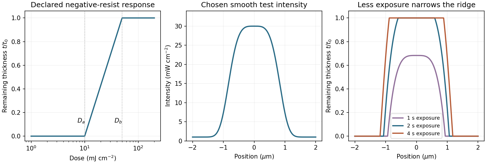

<h1 id="section-a-ii/3/iv/solution">Solution</h1>

↑ **Parent:** [Iv](../iv.md)

A **[negative photoresist](../../../../../../negative-photoresist.md) is removed at low dose and retained at high dose**. Its remaining-thickness curve rises from zero above a gel or retention threshold and approaches one above a larger full-retention threshold. A useful schematic model is

$$
f_-(D)=\begin{cases}
0&D\leq D_a,\\
\dfrac{\ln(D/D_a)}{\ln(D_b/D_a)}&D_a<D<D_b,\\
1&D\geq D_b.
\end{cases}
$$

The developed profile is $t(x)/t_0=f_-[\tau I(x)]$. A central intensity maximum therefore leaves a central ridge, with cleared regions towards the darker sides. **Halving exposure narrows and can lower the retained ridge; doubling it broadens the ridge and can raise its shoulders.** A saturated central plateau cannot become thicker than the original film in this simple model. If the half-dose peak is below $D_a$, no ridge survives; if it lies between $D_a$ and $D_b$, the centre survives only partially.

The negative-resist thresholds are not supplied, so there is no unique numerical profile or linewidth. The original schematic below declares its own illustrative thresholds and intensity function; it explains the dose mapping without treating a positive-resist curve as measured negative-resist data.

**[Figure 1](#section-a-ii/3/iv/image-negative-resist-dose-mapping-and-the-effect-of-exposure-time). Negative-resist dose mapping and the effect of exposure time**. Original illustrative model with declared retention thresholds. The intensity is a smooth test function rather than a copy of the examination graph; the numerical edge readings in the preceding parts come from the original PDF.

## ↑ Ancestors (11)

1. [Iv](../iv.md)
2. [3](../../3.md)
3. [Section A(ii)](../../../section-a-ii.md)
4. [Paper 1](../../../../paper-1-split.md)
5. [2022](../../../../split.md)
6. [Past exam of the MPhil in micro- and nanotechnology enterprise course of the University of Cambridge](../../../../../split.md)
7. [MPhil in micro- and nanotechnology enterprise course of the University of Cambridge](../../../../../../mphil-in-micro-and-nanotechnology-enterprise-course-of-the-university-of-cambridge.md)
8. [Course of the University of Cambridge](../../../../../../course-of-the-university-of-cambridge.md)
9. [University of Cambridge](../../../../../../university-of-cambridge-split.md)
10. [List of universities](../../../../../../list-of-universities.md)
11. [Codex Wiki](../../../../../../split.md)
