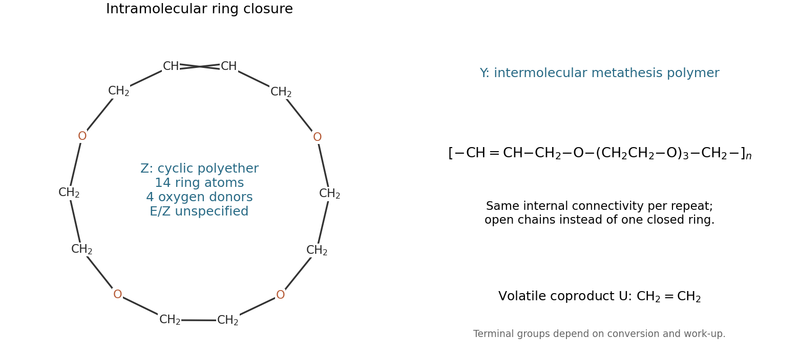

<h1 id="section-b/10/v/solution">Solution</h1>

↑ **Parent:** [V](../v.md)

The two terminal alkenes undergo [olefin metathesis](../../../../../../olefin-metathesis.md). Their terminal methylene groups combine to give **U = [ethene](../../../../../../ethylene.md)**, $\mathrm{CH_2{=}CH_2}$. Connecting the two internal alkene carbons of the same molecule gives **Z, the unsaturated [crown ether](../../../../../../crown-ether.md) macrocycle**. Following the drawn chain gives four oxygens, six carbons in the three internal ethylene links, two O-adjacent methylenes at the ends and two alkene carbons: **a 14-membered ring containing four oxygens**.

The ring connectivity is specified completely by the cyclic sequence

$$
\operatorname{cyclo}\!\left[\mathrm{CH{=}CH-CH_2-O-CH_2CH_2-O-CH_2CH_2-O-CH_2CH_2-O-CH_2}\right].
$$

The final methylene reconnects to the first alkene carbon. The examination does not fix alkene stereochemistry, so a single E/Z assignment is not required.

At high concentration, intermolecular encounters compete strongly with ring closure, giving **Y, an unsaturated polyether formed by [acyclic diene metathesis polymerization](../../../../../../acyclic-diene-metathesis-polymerization.md)**. Its repeat connectivity can be written

$$
\left[\mathrm{-CH{=}CH-CH_2-O-CH_2CH_2-O-CH_2CH_2-O-CH_2CH_2-O-CH_2-}\right]_n.
$$

For a finite linear chain, terminal groups depend on conversion and work-up; its internal repeat is the relevant structural answer. Reduced pressure removes ethene and promotes metathesis conversion, while dilution reduces bimolecular chain growth relative to intramolecular closure. These competing routes are documented by the original authors' chemical study.[1997, macrocycle formation and competing unsaturated-polyether formation](../../../../../../template-directed-ring-closing-metathesis-synthesis-and-polymerization-of-unsaturated-crown-ether-analogs-by-michael-j-marsella-and-others.md)

**[Figure 5](#section-b/10/v/image-original-connectivity-diagrams-for-the-ring-closed-product-and-unsaturated-polyether-repeat). Original connectivity diagrams for the ring-closed product and unsaturated-polyether repeat**. Four oxygen atoms and ten carbon atoms occur in the macrocycle; no alkene stereochemistry is assigned. This is a newly drawn product explanation, not a source-figure copy.

## ↑ Ancestors (11)

1. [V](../v.md)
2. [10](../../10.md)
3. [Section B](../../../section-b.md)
4. [Paper 1](../../../../paper-1-split.md)
5. [2022](../../../../split.md)
6. [Past exam of the MPhil in micro- and nanotechnology enterprise course of the University of Cambridge](../../../../../split.md)
7. [MPhil in micro- and nanotechnology enterprise course of the University of Cambridge](../../../../../../mphil-in-micro-and-nanotechnology-enterprise-course-of-the-university-of-cambridge.md)
8. [Course of the University of Cambridge](../../../../../../course-of-the-university-of-cambridge.md)
9. [University of Cambridge](../../../../../../university-of-cambridge-split.md)
10. [List of universities](../../../../../../list-of-universities.md)
11. [Codex Wiki](../../../../../../split.md)
