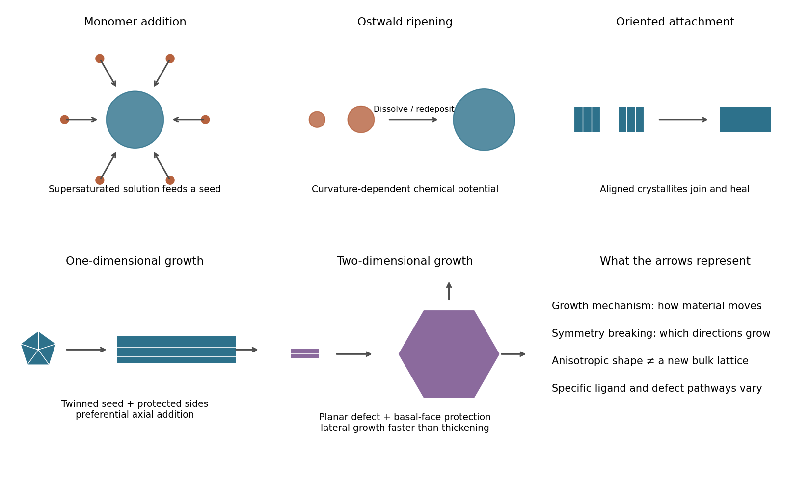

<h1 id="section-a-i/13/i/solution">Solution</h1>

↑ **Parent:** [I](../i.md)

Three useful growth mechanisms are **monomer addition, [Ostwald ripening](../../../../../../ostwald-ripening.md) and [oriented attachment](../../../../../../oriented-attachment.md)**. They can occur sequentially or compete; they are not necessarily three distinct experimental recipes.

In [monomer-addition crystal growth](../../../../../../monomer-addition-crystal-growth.md), dissolved atoms, ions or molecular growth units attach to an existing [nanocrystal](../../../../../../nanocrystal.md). [Supersaturation](../../../../../../supersaturation.md) provides a chemical-potential driving force, approximately $\Delta\mu=k_BT\ln(c/c_{\rm eq})$ for an ideal solution. Transport through solution and incorporation at steps or facets determine the rate. Growth consumes the excess solute without requiring collisions between whole crystals.

In [Ostwald ripening](../../../../../../ostwald-ripening.md), smaller crystals dissolve while larger ones grow through solution. Curvature raises the surface contribution to chemical potential, approximately $\mu(r)=\mu_\infty+2\gamma\Omega/r$ for a sphere with surface free energy $\gamma$ and atomic volume $\Omega$. Dissolved material therefore moves from high-curvature particles to lower-curvature ones, reducing total interfacial free energy.

In [oriented attachment](../../../../../../oriented-attachment.md), whole crystallites align compatible lattice planes and join. Removing exposed surface and forming a coherent interface lowers free energy; rotation, ligand removal and interface healing can be rate limiting. Misalignment can leave twins or other defects. Simple aggregation without crystallographic registration is related particle attachment, but is not necessarily oriented attachment.

**[Figure 1](#section-a-i/13/i/image-solution-growth-pathways-and-routes-from-fcc-seeds-to-anisotropic-nanostructures). Solution growth pathways and routes from fcc seeds to anisotropic nanostructures**. Original conceptual diagrams of three growth mechanisms and symmetry-breaking routes to a wire or plate. Shapes and arrows illustrate mechanisms, not copied microscopy data or an asserted unique growth sequence.

## ↑ Ancestors (11)

1. [I](../i.md)
2. [13](../../13.md)
3. [Section A(i)](../../../section-a-i.md)
4. [Paper 2](../../../../paper-2-split.md)
5. [2022](../../../../split.md)
6. [Past exam of the MPhil in micro- and nanotechnology enterprise course of the University of Cambridge](../../../../../split.md)
7. [MPhil in micro- and nanotechnology enterprise course of the University of Cambridge](../../../../../../mphil-in-micro-and-nanotechnology-enterprise-course-of-the-university-of-cambridge.md)
8. [Course of the University of Cambridge](../../../../../../course-of-the-university-of-cambridge.md)
9. [University of Cambridge](../../../../../../university-of-cambridge-split.md)
10. [List of universities](../../../../../../list-of-universities.md)
11. [Codex Wiki](../../../../../../split.md)
