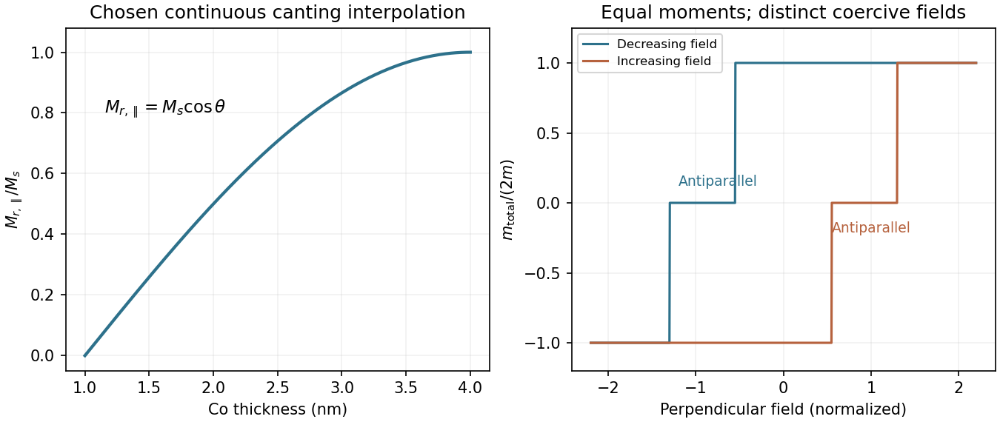

<h1 id="section-a-ii/15/i/solution">Solution</h1>

↑ **Parent:** [I](../i.md)

For a uniformly magnetized bilayer that relaxes to one of its easy directions after a saturating in-plane field, the in-plane remanent component is

$$
\boxed{M_{r,\parallel}=M_s\cos\theta(t_{\rm Co}).}
$$

It is therefore approximately zero when the easy axis is perpendicular at the thin-Co end, and increases towards $M_s$ as the easy axis rotates into the plane. The graph should show an increasing crossover between about $1$ and $4\,\mathrm{nm}$, but **the source does not specify its exact shape**. A straight line is not a consequence of the two endpoint orientations.

The trend reflects competition between interface-driven perpendicular [magnetic anisotropy](../../../../../../magnetic-anisotropy.md) and volume or demagnetizing contributions favouring in-plane magnetization. An illustrative effective anisotropy is $K_{\rm eff}=K_v+K_s^{\rm eff}/t_{\rm Co}-\mu_0M_s^2/2$, with sign convention chosen so positive $K_{\rm eff}$ favours the normal. A continuous rotation can require higher-order anisotropy terms; the simple sign change alone need not produce a smooth canting interval.

The relation assumes a well-defined remanent direction and no complete cancellation by domains. A vibrating-sample magnetometer measures total moment: if the result is reported without dividing by magnetic volume, the moment per area additionally scales as $t_{\rm Co}M_s\cos\theta$.

**[Figure 2](#section-a-ii/15/i/image-illustrative-remanence-crossover-and-independent-two-layer-magnetic-switching). Illustrative remanence crossover and independent two-layer magnetic switching**. The remanence interpolation is a chosen schematic, not fitted data. The hysteresis loop assumes equal magnetic moments, distinct coercivities and independent abrupt reversal.

## ↑ Ancestors (11)

1. [I](../i.md)
2. [15](../../15.md)
3. [Section A(ii)](../../../section-a-ii.md)
4. [Paper 2](../../../../paper-2-split.md)
5. [2022](../../../../split.md)
6. [Past exam of the MPhil in micro- and nanotechnology enterprise course of the University of Cambridge](../../../../../split.md)
7. [MPhil in micro- and nanotechnology enterprise course of the University of Cambridge](../../../../../../mphil-in-micro-and-nanotechnology-enterprise-course-of-the-university-of-cambridge.md)
8. [Course of the University of Cambridge](../../../../../../course-of-the-university-of-cambridge.md)
9. [University of Cambridge](../../../../../../university-of-cambridge-split.md)
10. [List of universities](../../../../../../list-of-universities.md)
11. [Codex Wiki](../../../../../../split.md)
