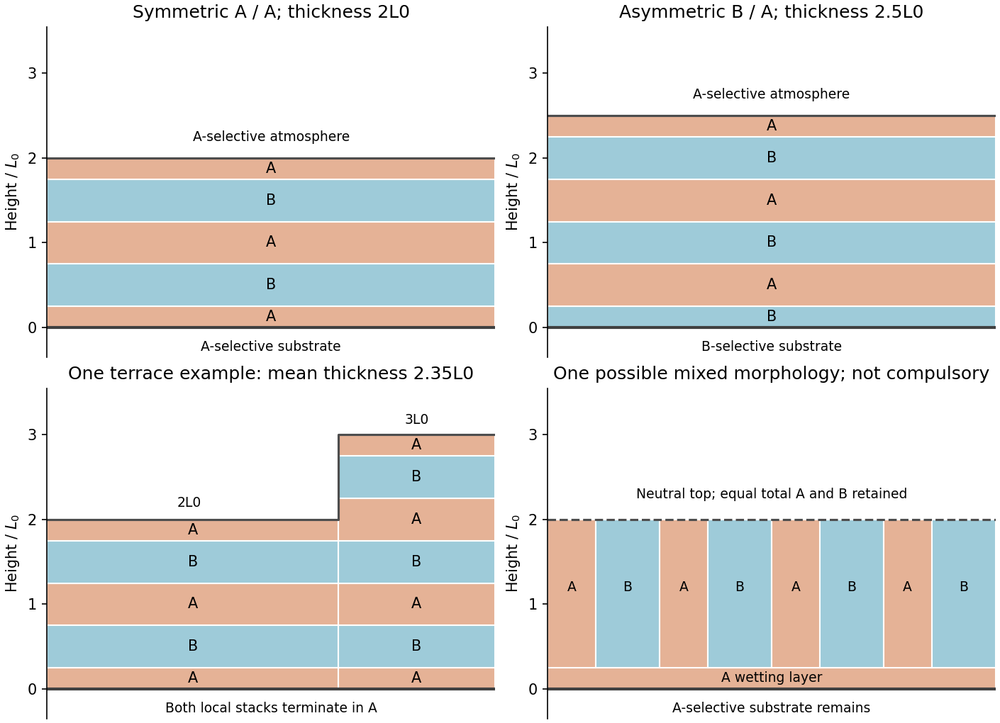

<h1 id="section-a-iii/18/ii/solution">Solution</h1>

↑ **Parent:** [Ii](../ii.md)

Symmetric wetting and an A-preferring substrate imply an **A-preferring free surface as well**. Parallel lamellae satisfy both preferences. For equal-width A and B domains, a thickness $2L_0$ contains two repeats, with terminal A half-domains:

$$
\boxed{\mathrm{A}_{L_0/4}\mid\mathrm{B}_{L_0/2}\mid\mathrm{A}_{L_0/2}\mid\mathrm{B}_{L_0/2}\mid\mathrm{A}_{L_0/4}.}
$$

The sequence is written from substrate to atmosphere. Its total thickness is $2L_0$, the total A and B thicknesses are each $L_0$, and both interfaces contact A. A diagram using five full half-period domains would instead give $2.5L_0$ and would not match the stated thickness.

The quarter-period end domains place an A-domain centre at each boundary in this ideal symmetric-lamella model. Real surface reconstruction and non-equal block fractions can change their detailed widths without changing the key requirement of identical terminations.

**[Figure 3](#section-a-iii/18/ii/image-lamellar-terminations-thickness-terraces-and-a-single-neutral-boundary). Lamellar terminations, thickness terraces and a single neutral boundary**. Original idealized equal-block diagrams. The neutral-top panel is one admissible mixed arrangement, not a unique prediction; the bottom surface still prefers A.

## ↑ Ancestors (11)

1. [Ii](../ii.md)
2. [18](../../18.md)
3. [Section A(iii)](../../../section-a-iii.md)
4. [Paper 2](../../../../paper-2-split.md)
5. [2022](../../../../split.md)
6. [Past exam of the MPhil in micro- and nanotechnology enterprise course of the University of Cambridge](../../../../../split.md)
7. [MPhil in micro- and nanotechnology enterprise course of the University of Cambridge](../../../../../../mphil-in-micro-and-nanotechnology-enterprise-course-of-the-university-of-cambridge.md)
8. [Course of the University of Cambridge](../../../../../../course-of-the-university-of-cambridge.md)
9. [University of Cambridge](../../../../../../university-of-cambridge-split.md)
10. [List of universities](../../../../../../list-of-universities.md)
11. [Codex Wiki](../../../../../../split.md)
