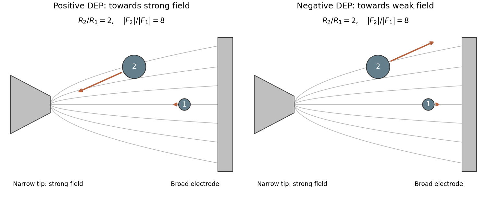

<h1 id="section-a-iii/19/iii/solution">Solution</h1>

↑ **Parent:** [Iii](../iii.md)

The narrow electrode tip concentrates field lines and produces the strong-field region. **For positive dielectrophoresis, both particles move towards that region; for negative dielectrophoresis, both move away.** Particle 1 is approximately on the central symmetry line, so its arrow is approximately horizontal. Particle 2 lies above it, so a qualitative gradient arrow points towards or away from the high-field tip rather than simply following its local field line.

The source drawing makes particle 2 approximately twice the radius of particle 1. With the explicitly stipulated equal gradient magnitudes and identical material,

$$
\boxed{\frac{|F_2|}{|F_1|}=\left(\frac{R_2}{R_1}\right)^3\simeq8.}
$$

Accordingly, the second force arrow should be much longer in either sign case. The exact ratio should remain expressed through the drawn radius ratio because the figure supplies no calibrated particle dimensions. Exact off-axis force directions would require solving the electrode boundary-value problem; the drawing supports a qualitative strong-field/weak-field distinction.

**[Figure 4](#section-a-iii/19/iii/image-positive-and-negative-dielectrophoresis-near-a-field-concentrating-electrode). Positive and negative dielectrophoresis near a field-concentrating electrode**. Original electrode and particle schematic. The large-to-small radius ratio is two, the equal-gradient force-arrow ratio is eight, and the field curves are qualitative guides rather than a numerical electrostatic solution.

## ↑ Ancestors (11)

1. [Iii](../iii.md)
2. [19](../../19.md)
3. [Section A(iii)](../../../section-a-iii.md)
4. [Paper 2](../../../../paper-2-split.md)
5. [2022](../../../../split.md)
6. [Past exam of the MPhil in micro- and nanotechnology enterprise course of the University of Cambridge](../../../../../split.md)
7. [MPhil in micro- and nanotechnology enterprise course of the University of Cambridge](../../../../../../mphil-in-micro-and-nanotechnology-enterprise-course-of-the-university-of-cambridge.md)
8. [Course of the University of Cambridge](../../../../../../course-of-the-university-of-cambridge.md)
9. [University of Cambridge](../../../../../../university-of-cambridge-split.md)
10. [List of universities](../../../../../../list-of-universities.md)
11. [Codex Wiki](../../../../../../split.md)
