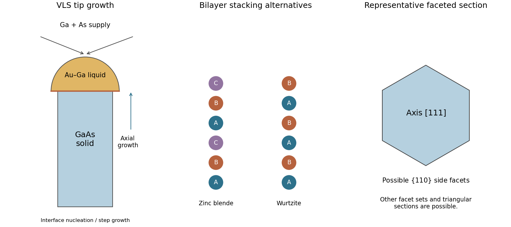

<h1 id="section-b/20/i/solution">Solution</h1>

↑ **Parent:** [I](../i.md)

**An Au-containing seed absorbs gallium and forms a liquid Au–Ga alloy under the selected growth conditions.** The supplied binary diagram indicates which temperature and Ga fraction lie in the liquid field; alloying allows a liquid catalyst at temperatures far below the melting point of pure Au. Vapour precursors supply Ga and As, which enter or react through the droplet and precipitate GaAs at the liquid–solid interface when the growth chemical potentials make incorporation favourable.

The droplet remains near the wire tip as interface nucleation and step propagation extend the [nanowire](../../../../../../nanowire.md). Its footprint helps select the wire diameter, though sidewall growth can change the final profile. The catalyst is a reservoir and reaction interface, not a stoichiometric constituent consumed once per GaAs unit.

Low As concentration makes the Au–Ga diagram a useful first approximation to catalyst state, but **does not mean that arsenic supply or chemical potential is irrelevant**. A binary phase diagram alone cannot calculate supersaturation with respect to ternary GaAs formation, and nanoscale interfacial energies can shift phase boundaries. In situ composition measurements have directly distinguished substantial Ga content from the very small As content of Au-seeded catalyst droplets.[2019, catalyst spectroscopy and comparison with Au–Ga–As phase calculations](../../../../../../in-situ-analysis-of-catalyst-composition-during-gold-catalyzed-gaas-nanowire-growth-by-carina-b-maliakkal-and-others.md)

**[Figure 5](#section-b/20/i/image-vls-growth-crystallographic-stacking-choices-and-a-representative-faceted-wire-section). VLS growth, crystallographic stacking choices and a representative faceted wire section**. Original mechanism schematic and idealized cross-section. No source phase diagram is reproduced; the cross-section assumes a common $[111]$ zinc-blende growth direction and is not a unique consequence of the bulk crystal label.

## ↑ Ancestors (11)

1. [I](../i.md)
2. [20](../../20.md)
3. [Section B](../../../section-b.md)
4. [Paper 2](../../../../paper-2-split.md)
5. [2022](../../../../split.md)
6. [Past exam of the MPhil in micro- and nanotechnology enterprise course of the University of Cambridge](../../../../../split.md)
7. [MPhil in micro- and nanotechnology enterprise course of the University of Cambridge](../../../../../../mphil-in-micro-and-nanotechnology-enterprise-course-of-the-university-of-cambridge.md)
8. [Course of the University of Cambridge](../../../../../../course-of-the-university-of-cambridge.md)
9. [University of Cambridge](../../../../../../university-of-cambridge-split.md)
10. [List of universities](../../../../../../list-of-universities.md)
11. [Codex Wiki](../../../../../../split.md)
