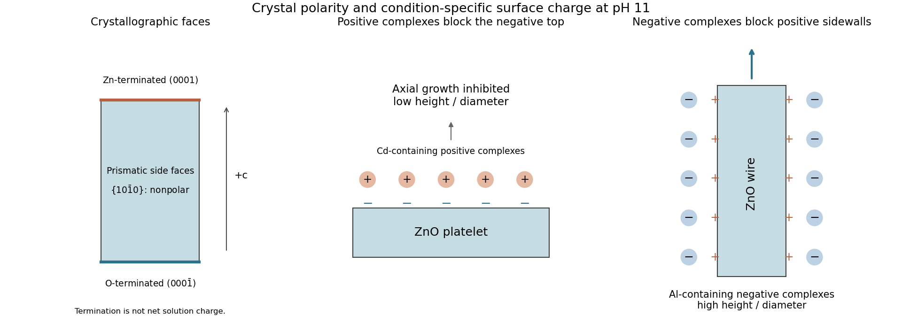

<h1 id="section-b/20/v/solution">Solution</h1>

↑ **Parent:** [V](../v.md)

A c-axis [wurtzite](../../../../../../wurtzite.md) ZnO wire has crystallographically polar basal ends, conventionally Zn-terminated $(0001)$ and O-terminated $(000\bar1)$, and approximately nonpolar prismatic side facets such as $\{10\bar10\}$. **Crystallographic polarity is not identical to net surface charge in a growth solution**: protonation, adsorbates and ionic speciation can change the latter.

For [face-selective electrostatic growth inhibition](../../../../../../face-selective-electrostatic-growth-inhibition.md), an oppositely charged additive adsorbs preferentially to a particular face and obstructs incorporation there. Blocking the axial end lowers axial growth relative to radial growth and yields a smaller aspect ratio; blocking sidewalls suppresses radial growth and favours long thin wires.

A primary hydrothermal experiment at pH 11 found negatively charged basal top surfaces and positively charged sidewalls. Positively charged Cd-containing complexes inhibited the top and favoured platelets; negatively charged Al-containing complexes inhibited sidewalls and favoured large aspect ratios. These signs are condition-specific, not fixed by the formal Zn/O termination alone.[2011, Fig. 1 and pH-dependent complex-ion and surface-charge discussion](../../../../../../face-selective-electrostatic-control-of-hydrothermal-zinc-oxide-nanowire-synthesis-by-jaebum-joo-and-others.md)

**[Figure 6](#section-b/20/v/image-facet-selective-adsorption-changes-axial-and-radial-zno-growth). Facet-selective adsorption changes axial and radial ZnO growth**. Original facet-termination diagram and schematic of the cited pH-11 effective surface-charge example. The signs in the adsorption panels denote solution-condition-dependent surface charge, not a universal assignment of charge to crystallographic facets.

## ↑ Ancestors (11)

1. [V](../v.md)
2. [20](../../20.md)
3. [Section B](../../../section-b.md)
4. [Paper 2](../../../../paper-2-split.md)
5. [2022](../../../../split.md)
6. [Past exam of the MPhil in micro- and nanotechnology enterprise course of the University of Cambridge](../../../../../split.md)
7. [MPhil in micro- and nanotechnology enterprise course of the University of Cambridge](../../../../../../mphil-in-micro-and-nanotechnology-enterprise-course-of-the-university-of-cambridge.md)
8. [Course of the University of Cambridge](../../../../../../course-of-the-university-of-cambridge.md)
9. [University of Cambridge](../../../../../../university-of-cambridge-split.md)
10. [List of universities](../../../../../../list-of-universities.md)
11. [Codex Wiki](../../../../../../split.md)
