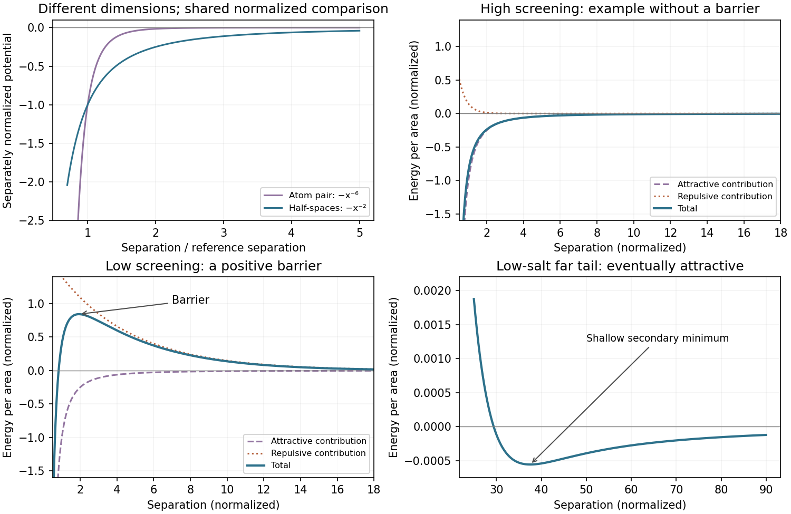

<h1 id="section-b/23/ii/solution">Solution</h1>

↑ **Parent:** [Ii](../ii.md)

The microscopic pair potential falls as $-r^{-6}$, whereas integrating over two half-spaces gives an interaction **energy per area** $W(d)=-A_H/(12\pi d^2)$. The plate attraction therefore decays much more slowly with distance because many pairs contribute. The quantities have different dimensions, so the shared sketch uses separately normalized energies at a reference separation rather than pretending that joules and joules per square metre are directly comparable.

The attractive pressure is

$$
\boxed{\frac FA=-\frac{dW}{dd}=-\frac{A_H}{6\pi d^3}.}
$$

At $d=100\,\mathrm{nm}$ and the supplied effective $A_H$,

$$
\boxed{F/A=-\frac{2.5\times10^{-19}}{6\pi(10^{-7})^3}
=-13.3\,\mathrm{Pa}.}
$$

The minus sign denotes decreasing separation. **A total force cannot be calculated without the interacting area**: for area $A$ in square metres, $F\simeq-(13.3\,\mathrm{N\,m^{-2}})A$. This uses the supplied nonretarded half-space model; finite film thickness, geometry and retardation at larger distances can change it.

**[Figure 7](#section-b/23/ii/image-normalized-hamaker-distance-laws-and-illustrative-salt-dependent-dlvo-barriers). Normalized Hamaker distance laws and illustrative salt-dependent DLVO barriers**. Original analytic models. Microscopic energy and plate energy per area are normalized separately. DLVO examples hold an explicitly chosen repulsive amplitude fixed while changing screening length; they are not fits to a specified surface chemistry.

## ↑ Ancestors (11)

1. [Ii](../ii.md)
2. [23](../../23.md)
3. [Section B](../../../section-b.md)
4. [Paper 2](../../../../paper-2-split.md)
5. [2022](../../../../split.md)
6. [Past exam of the MPhil in micro- and nanotechnology enterprise course of the University of Cambridge](../../../../../split.md)
7. [MPhil in micro- and nanotechnology enterprise course of the University of Cambridge](../../../../../../mphil-in-micro-and-nanotechnology-enterprise-course-of-the-university-of-cambridge.md)
8. [Course of the University of Cambridge](../../../../../../course-of-the-university-of-cambridge.md)
9. [University of Cambridge](../../../../../../university-of-cambridge-split.md)
10. [List of universities](../../../../../../list-of-universities.md)
11. [Codex Wiki](../../../../../../split.md)
