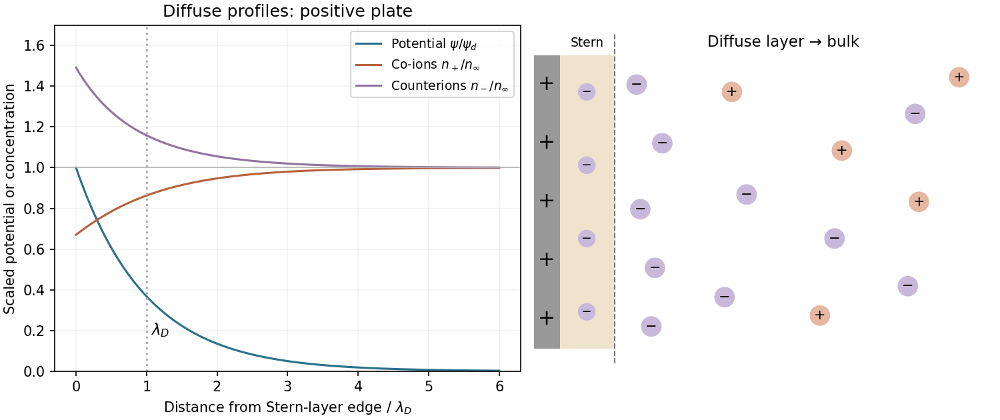

<h1 id="section-b/23/iii/solution">Solution</h1>

↑ **Parent:** [Iii](../iii.md)

Choose a **positively charged plate** to match the question's labels $n_+$ for co-ions and $n_-$ for counterions. Let $x=0$ denote the outer edge of its compact [Stern layer](../../../../../../stern-layer.md), and set the bulk potential to zero.

In the weak-potential [Debye–Hückel approximation](../../../../../../debye-huckel-approximation.md), the diffuse-layer potential is

$$
\boxed{\psi_{\rm ES}(x)=\psi_d e^{-\kappa_Dx}},\qquad \psi_d>0,
\qquad \lambda_D=\kappa_D^{-1}.
$$

The key length is the [Debye–Hückel screening length](../../../../../../debye-huckel-screening-length.md). For a symmetric monovalent electrolyte, the [Boltzmann distribution](../../../../../../boltzmann-distribution.md) gives

$$
\boxed{n_+(x)=n_\infty e^{-e\psi_{\rm ES}(x)/(k_BT)}},\qquad
\boxed{n_-(x)=n_\infty e^{+e\psi_{\rm ES}(x)/(k_BT)}}.
$$

Positive co-ions are depleted near the positive plate, while negative counterions accumulate. Both approach the same bulk density as the potential decays. Attraction and repulsion by the surface compete with mixing entropy, so diffuse ions do not simply collapse into one plane. The compact Stern layer represents finite closest approach and specifically associated charge; the diffuse continuum begins outside it. For large potentials the linear exponential potential needs the nonlinear [Poisson-Boltzmann equation](../../../../../../poisson-boltzmann-equation.md), though the far-field screening scale remains the same in this simple electrolyte.

**[Figure 8](#section-b/23/iii/image-positive-surface-compact-stern-layer-and-screened-diffuse-ion-distributions). Positive surface, compact Stern layer and screened diffuse-ion distributions**. Original weak-potential model. Counterions are negative and co-ions positive; reversing the surface sign exchanges their roles. Curves are scaled and are not measured ion profiles.

## ↑ Ancestors (11)

1. [Iii](../iii.md)
2. [23](../../23.md)
3. [Section B](../../../section-b.md)
4. [Paper 2](../../../../paper-2-split.md)
5. [2022](../../../../split.md)
6. [Past exam of the MPhil in micro- and nanotechnology enterprise course of the University of Cambridge](../../../../../split.md)
7. [MPhil in micro- and nanotechnology enterprise course of the University of Cambridge](../../../../../../mphil-in-micro-and-nanotechnology-enterprise-course-of-the-university-of-cambridge.md)
8. [Course of the University of Cambridge](../../../../../../course-of-the-university-of-cambridge.md)
9. [University of Cambridge](../../../../../../university-of-cambridge-split.md)
10. [List of universities](../../../../../../list-of-universities.md)
11. [Codex Wiki](../../../../../../split.md)
