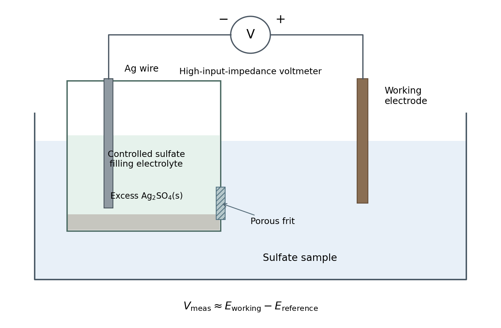
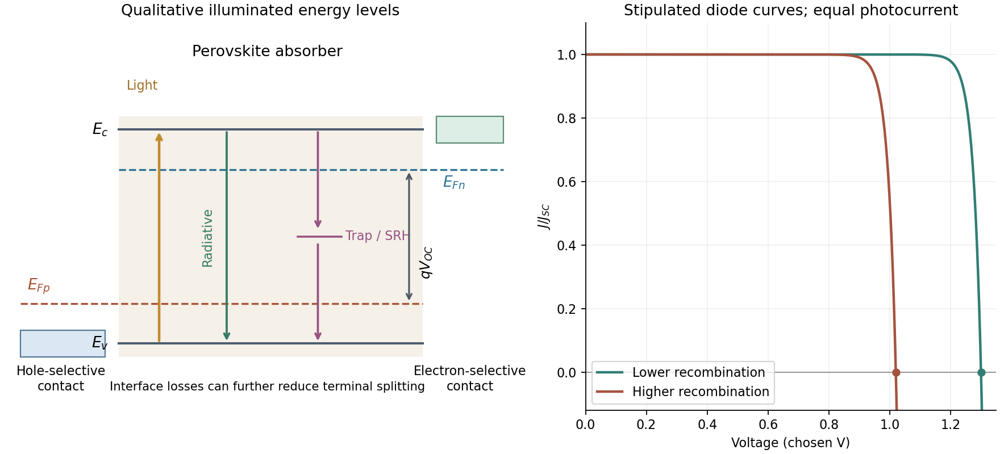
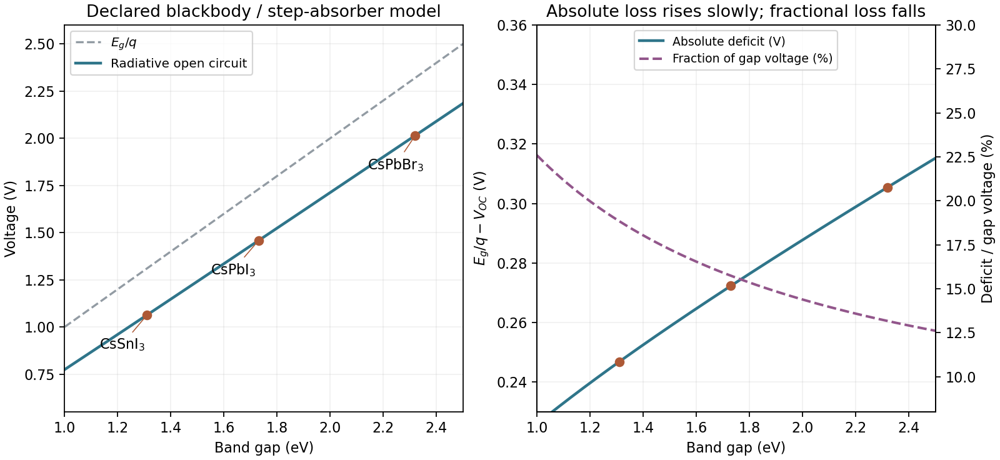

# Paper 1

↑ **Parent:** [2023](../2023.md)

[Original download archive; NanoMPhil Paper 1 2023.pdf](https://www.whatdotheyknow.com/request/mphil_in_micro_and_nanotechnolog_5/response/2556540/attach/2/FOI%202024%2050%20Dai%20materials.zip?cookie_passthrough=1)

**Table of contents**

- [Section A(i)](#section-a-i)
  - [1](#section-a-i/1)
    - [i](#section-a-i/1/i)
      - [Solution](#section-a-i/1/i/solution)
    - [ii](#section-a-i/1/ii)
      - [Solution](#section-a-i/1/ii/solution)
    - [iii](#section-a-i/1/iii)
      - [Solution](#section-a-i/1/iii/solution)
    - [iv](#section-a-i/1/iv)
      - [Solution](#section-a-i/1/iv/solution)
  - [2](#section-a-i/2)
    - [i](#section-a-i/2/i)
      - [a](#section-a-i/2/i/a)
        - [Solution](#section-a-i/2/i/a/solution)
      - [b](#section-a-i/2/i/b)
        - [Solution](#section-a-i/2/i/b/solution)
      - [c](#section-a-i/2/i/c)
        - [Solution](#section-a-i/2/i/c/solution)
    - [ii](#section-a-i/2/ii)
      - [a](#section-a-i/2/ii/a)
        - [Solution](#section-a-i/2/ii/a/solution)
      - [b](#section-a-i/2/ii/b)
        - [Solution](#section-a-i/2/ii/b/solution)
      - [c](#section-a-i/2/ii/c)
        - [Solution](#section-a-i/2/ii/c/solution)
    - [iii](#section-a-i/2/iii)
      - [Solution](#section-a-i/2/iii/solution)
- [Section A(ii)](#section-a-ii)
  - [3](#section-a-ii/3)
    - [i](#section-a-ii/3/i)
      - [Solution](#section-a-ii/3/i/solution)
    - [ii](#section-a-ii/3/ii)
      - [Solution](#section-a-ii/3/ii/solution)
    - [iii](#section-a-ii/3/iii)
      - [Solution](#section-a-ii/3/iii/solution)
  - [4](#section-a-ii/4)
    - [i](#section-a-ii/4/i)
      - [Solution](#section-a-ii/4/i/solution)
    - [ii](#section-a-ii/4/ii)
      - [Solution](#section-a-ii/4/ii/solution)
    - [iii](#section-a-ii/4/iii)
      - [Solution](#section-a-ii/4/iii/solution)
    - [iv](#section-a-ii/4/iv)
      - [Solution](#section-a-ii/4/iv/solution)
- [Section A(iii)](#section-a-iii)
  - [5](#section-a-iii/5)
    - [i](#section-a-iii/5/i)
      - [a](#section-a-iii/5/i/a)
        - [Solution](#section-a-iii/5/i/a/solution)
      - [b](#section-a-iii/5/i/b)
        - [Solution](#section-a-iii/5/i/b/solution)
    - [ii](#section-a-iii/5/ii)
      - [a](#section-a-iii/5/ii/a)
        - [Solution](#section-a-iii/5/ii/a/solution)
      - [b](#section-a-iii/5/ii/b)
        - [Solution](#section-a-iii/5/ii/b/solution)
    - [iii](#section-a-iii/5/iii)
      - [Solution](#section-a-iii/5/iii/solution)
  - [6](#section-a-iii/6)
    - [i](#section-a-iii/6/i)
      - [Solution](#section-a-iii/6/i/solution)
    - [ii](#section-a-iii/6/ii)
      - [Solution](#section-a-iii/6/ii/solution)
    - [iii](#section-a-iii/6/iii)
      - [Solution](#section-a-iii/6/iii/solution)
  - [7](#section-a-iii/7)
    - [i](#section-a-iii/7/i)
      - [Solution](#section-a-iii/7/i/solution)
    - [ii](#section-a-iii/7/ii)
      - [Solution](#section-a-iii/7/ii/solution)
- [Section B](#section-b)
  - [8](#section-b/8)
    - [i](#section-b/8/i)
      - [Solution](#section-b/8/i/solution)
    - [ii](#section-b/8/ii)
      - [a](#section-b/8/ii/a)
        - [Solution](#section-b/8/ii/a/solution)
      - [b](#section-b/8/ii/b)
        - [Solution](#section-b/8/ii/b/solution)
    - [iii](#section-b/8/iii)
      - [Solution](#section-b/8/iii/solution)
  - [9](#section-b/9)
    - [i](#section-b/9/i)
      - [Solution](#section-b/9/i/solution)
    - [ii](#section-b/9/ii)
      - [Solution](#section-b/9/ii/solution)
    - [iii](#section-b/9/iii)
      - [Solution](#section-b/9/iii/solution)
    - [iv](#section-b/9/iv)
      - [Solution](#section-b/9/iv/solution)
    - [v](#section-b/9/v)
      - [Solution](#section-b/9/v/solution)
    - [vi](#section-b/9/vi)
      - [Solution](#section-b/9/vi/solution)
  - [10](#section-b/10)
    - [i](#section-b/10/i)
      - [a](#section-b/10/i/a)
        - [Solution](#section-b/10/i/a/solution)
      - [b](#section-b/10/i/b)
        - [Solution](#section-b/10/i/b/solution)
      - [c](#section-b/10/i/c)
        - [Solution](#section-b/10/i/c/solution)
    - [ii](#section-b/10/ii)
      - [a](#section-b/10/ii/a)
        - [Solution](#section-b/10/ii/a/solution)
      - [b](#section-b/10/ii/b)
        - [Solution](#section-b/10/ii/b/solution)
      - [c](#section-b/10/ii/c)
        - [Solution](#section-b/10/ii/c/solution)
      - [d](#section-b/10/ii/d)
        - [Solution](#section-b/10/ii/d/solution)
  - [11](#section-b/11)
    - [i](#section-b/11/i)
      - [Solution](#section-b/11/i/solution)
    - [ii](#section-b/11/ii)
      - [Solution](#section-b/11/ii/solution)
    - [iii](#section-b/11/iii)
      - [Solution](#section-b/11/iii/solution)
    - [iv](#section-b/11/iv)
      - [Solution](#section-b/11/iv/solution)
    - [v](#section-b/11/v)
      - [Solution](#section-b/11/v/solution)
    - [vi](#section-b/11/vi)
      - [Solution](#section-b/11/vi/solution)
  - [12](#section-b/12)
    - [i](#section-b/12/i)
      - [Solution](#section-b/12/i/solution)
    - [ii](#section-b/12/ii)
      - [Solution](#section-b/12/ii/solution)
    - [iii](#section-b/12/iii)
      - [Solution](#section-b/12/iii/solution)

<h2 id="section-a-i">Section A(i)</h2>

↑ **Parent:** [Paper 1](paper-1.md)

<h3 id="section-a-i/1">1</h3>

↑ **Parent:** [Section A(i)](#section-a-i)

<h4 id="section-a-i/1/i">i</h4>

↑ **Parent:** [1](#section-a-i/1)

<h5 id="section-a-i/1/i/solution">Solution</h5>

↑ **Parent:** [I](#section-a-i/1/i)

[Moiré fringes](../../physical-optics.md#moire-fringe) arise when two overlapping periodic structures contribute closely spaced [reciprocal lattice vectors](../../quantum-scattering.md#reciprocal-lattice-vector) to the [transmission electron microscopy](../../optics.md#transmission-electron-microscopy) image. Their relative [phase](../../wave.md#phase-waves) varies slowly across the image, producing a coarse modulation with a period much larger than either atomic spacing. The structures may have different lattice spacings, a small relative [rotation](../../riemannian-geometry.md#rotation-mathematics), or both. The modulation is an [interference](../../physical-optics.md#interference-wave-propagation) or beat phenomenon; its spacing is not itself a new atomic-plane spacing. Its orientation is perpendicular to the difference vector of the two contributing projected reciprocal-lattice vectors.

<h4 id="section-a-i/1/ii">ii</h4>

↑ **Parent:** [1](#section-a-i/1)

<h5 id="section-a-i/1/ii/solution">Solution</h5>

↑ **Parent:** [Ii](#section-a-i/1/ii)

Let the relevant projected [reciprocal lattice vectors](../../quantum-scattering.md#reciprocal-lattice-vector) have magnitudes $g_1=1/d_1$ and $g_2=1/d_2$, with angle $\theta$ between them. Subtracting their phases gives the slow spatial modulation $2\pi(\mathbf g_1-\mathbf g_2)\cdot\mathbf r$. The [moiré fringe spacing formula](../../physical-optics.md#moire-fringe-spacing-formula) is therefore

$$
\boxed{D=\frac1{|\mathbf g_1-\mathbf g_2|}=\frac{d_1d_2}{\sqrt{d_1^2+d_2^2-2d_1d_2\cos\theta}}.}
$$

For parallel planes, $\theta=0$ and $D=d_1d_2/|d_1-d_2|$. For equal spacings, $D=d/[2|\sin(\theta/2)|]\simeq d/|\theta|$ at a small angle measured in [radians](../../geometry-and-topology.md#radian). The apparent divergence as both mismatch and [rotation](../../riemannian-geometry.md#rotation-mathematics) vanish means that there is no finite beat period; it does not predict an infinite number of visible fringes.

<h4 id="section-a-i/1/iii">iii</h4>

↑ **Parent:** [1](#section-a-i/1)

<h5 id="section-a-i/1/iii/solution">Solution</h5>

↑ **Parent:** [Iii](#section-a-i/1/iii)

For each spacing pair, the largest geometrical period occurs with parallel projected reciprocal vectors. The closest pair is $d_{\rm Cu}=0.208\,\mathrm{nm}$ and $d_{\rm substrate}=0.212\,\mathrm{nm}$, giving

$$
\boxed{D_{\max}=\frac{0.208\times0.212}{0.212-0.208}\,\mathrm{nm}=11.024\,\mathrm{nm}\simeq11.0\,\mathrm{nm}.}
$$

However, the [crystal](../../thermodynamics.md#crystal) is only $10\,\mathrm{nm}$ across. It contains at most $10/11.024\simeq0.91$ of this period, so **the largest formal period cannot appear as a repeated fringe train inside one [crystal](../../thermodynamics.md#crystal)**. It can instead give a broad variation of contrast. A period of order the particle diameter is the largest directly sampled scale, and even that is poorly constrained by one particle.

The distinction matters if “see” means a complete repeat. Of the exactly parallel spacing pairs, the largest other period is approximately $2.09\,\mathrm{nm}$ from the $0.208$ and $0.231\,\mathrm{nm}$ pair. If relative [rotation](../../riemannian-geometry.md#rotation-mathematics) is continuously variable, the closest pair can instead be rotated slightly to shorten its period below $10\,\mathrm{nm}$, so $2.09\,\mathrm{nm}$ is not a universal maximum visible period for arbitrary orientations.

<h4 id="section-a-i/1/iv">iv</h4>

↑ **Parent:** [1](#section-a-i/1)

<h5 id="section-a-i/1/iv/solution">Solution</h5>

↑ **Parent:** [Iv](#section-a-i/1/iv)

A coarse fringe in a [high-resolution transmission electron microscopy](../../optics.md#high-resolution-transmission-electron-microscopy) image need not directly identify the lattice spacing of a new [phase](../../wave.md#phase-waves). Check whether overlapping [crystals](../../thermodynamics.md#crystal), a particle and its substrate, or differently oriented domains can produce the corresponding [moiré fringe](../../physical-optics.md#moire-fringe). Compare the underlying reciprocal-space peaks and their difference, use the particle boundary to constrain how many periods are actually sampled, and examine neighbouring or differently oriented regions. For the closest pair here, fitting a periodicity from less than one complete period is particularly unreliable. Distinguishing lattice contrast from a beat envelope prevents misidentifying a [phase](../../wave.md#phase-waves) or over-interpreting local strain.

<h3 id="section-a-i/2">2</h3>

↑ **Parent:** [Section A(i)](#section-a-i)

<h4 id="section-a-i/2/i">i</h4>

↑ **Parent:** [2](#section-a-i/2)

<h5 id="section-a-i/2/i/a">a</h5>

↑ **Parent:** [I](#section-a-i/2/i)

<h6 id="section-a-i/2/i/a/solution">Solution</h6>

↑ **Parent:** [A](#section-a-i/2/i/a)

With suitable [atomic force microscopy](../../engineering.md#atomic-force-microscopy) feedback gains, the trace follows the accessible surface while maintaining the chosen oscillation-amplitude setpoint. The measured trench is narrower than the accessible opening because the finite tip encounters an edge before its apex reaches that edge's true lateral position. For an ideal tip flank angle $\alpha=15^\circ$ relative to the tip axis and height change $h=1.3\,\mu\mathrm m$, the geometrical setback is $h\tan\alpha\simeq0.35\,\mu\mathrm m$ per side.

The conventional tapered tip cannot recover the underside of the overhang, even when feedback is perfect: the first contact with the upper edge or shank limits access. This geometrical envelope must be distinguished from errors caused by feedback dynamics. The stated tip height is sufficient for the vertical range; it does not remove the lateral-access problem.

**[Figure 1](#section-a-i/2/i/a/image-illustrative-afm-trace-geometry-and-the-effects-of-insufficient-or-excessive-feedback-gain). Illustrative AFM trace geometry and the effects of insufficient or excessive feedback gain**.

<h5 id="section-a-i/2/i/b">b</h5>

↑ **Parent:** [I](#section-a-i/2/i)

<h6 id="section-a-i/2/i/b/solution">Solution</h6>

↑ **Parent:** [B](#section-a-i/2/i/b)

With gains too low for the scan speed, the vertical response lags the surface. On entering the depression during the left-to-right trace, the tip descends too slowly and the recorded edge rounds or extends into the trench. On climbing out, the tip can approach or contact the rising feature before the controller lifts it sufficiently, again distorting the edge. Thus the error depends on scan direction and can differ between trace and retrace. Slower scanning can reduce this [bandwidth](../../electrical-engineering.md#bandwidth-signal-processing) limitation, but it does not correct the geometrical inability to probe an overhang.

<h5 id="section-a-i/2/i/c">c</h5>

↑ **Parent:** [I](#section-a-i/2/i)

<h6 id="section-a-i/2/i/c/solution">Solution</h6>

↑ **Parent:** [C](#section-a-i/2/i/c)

Excessive feedback gain can make the closed loop underdamped or unstable. Edge transitions then produce overshoot, ringing or oscillatory streaks in the recorded height. The apparent structure is a controller response rather than a real series of surface ridges. The exact [amplitude](../../wave.md#wave-amplitude) and frequency depend on the actuator, cantilever, loop delay and controller settings; without those data one can sketch the qualitative ringing but cannot predict a unique quantitative trace.

<h4 id="section-a-i/2/ii">ii</h4>

↑ **Parent:** [2](#section-a-i/2)

<h5 id="section-a-i/2/ii/a">a</h5>

↑ **Parent:** [Ii](#section-a-i/2/ii)

<h6 id="section-a-i/2/ii/a/solution">Solution</h6>

↑ **Parent:** [A](#section-a-i/2/ii/a)

In [tapping-mode atomic force microscopy](../../engineering.md#tapping-mode-atomic-force-microscopy), the cantilever is driven near a [resonance](../../dynamical-systems.md#resonance) and its [oscillation](../../wave.md#oscillation) [amplitude](../../wave.md#wave-amplitude) is monitored. Tip-surface interaction changes that [amplitude](../../wave.md#wave-amplitude). A controller compares it with a chosen setpoint and moves the vertical piezoelectric actuator to reduce the error. The recorded actuator [displacement](../../classical-mechanics.md#displacement) supplies the topography channel. A smaller [amplitude](../../wave.md#wave-amplitude) during approach commonly triggers withdrawal and an increased [amplitude](../../wave.md#wave-amplitude) during separation triggers approach, with the actual feedback sign set by the instrument's operating convention. Correct tracking requires enough response [bandwidth](../../electrical-engineering.md#bandwidth-signal-processing) without destabilizing the loop.

<h5 id="section-a-i/2/ii/b">b</h5>

↑ **Parent:** [Ii](#section-a-i/2/ii)

<h6 id="section-a-i/2/ii/b/solution">Solution</h6>

↑ **Parent:** [B](#section-a-i/2/ii/b)

A conventional tapping tip tapers toward its apex, so its shank contacts an overhanging feature before its apex can probe underneath it. [Critical-dimension atomic force microscopy](../../engineering.md#critical-dimension-atomic-force-microscopy) instead uses a calibrated flared or laterally extended tip, with a relatively narrow neck and side-sensitive control. The lateral extension can contact a reentrant sidewall while the neck clears the upper edge. The measured profile still includes the tip's finite shape and must be interpreted with a tip calibration; changing the tip does not automatically eliminate all [convolution](../../fourier-analysis.md#convolution) errors.[Flared tips and bidirectional sidewall sensing](../../physics-bibliography.md#effects-of-lateral-tip-control-in-cd-afm-width-metrology-by-ronald-g-dixson-and-others)

<h5 id="section-a-i/2/ii/c">c</h5>

↑ **Parent:** [Ii](#section-a-i/2/ii)

<h6 id="section-a-i/2/ii/c/solution">Solution</h6>

↑ **Parent:** [C](#section-a-i/2/ii/c)

**Lateral [oscillation](../../wave.md#oscillation) or dithering** is added to the vertical [oscillation](../../wave.md#oscillation). It provides a tip-sidewall interaction signal that can drive lateral feedback while the vertical channel maintains height control. This is how a suitable flared tip can track steep or reentrant walls. Treating the additional signal as merely a larger vertical tapping [amplitude](../../wave.md#wave-amplitude) would not supply the required sidewall sensing.[Lateral-dither contribution to the effective tip envelope](../../physics-bibliography.md#effects-of-lateral-tip-control-in-cd-afm-width-metrology-by-ronald-g-dixson-and-others)

<h4 id="section-a-i/2/iii">iii</h4>

↑ **Parent:** [2](#section-a-i/2)

<h5 id="section-a-i/2/iii/solution">Solution</h5>

↑ **Parent:** [Iii](#section-a-i/2/iii)

An attached particle changes the effective tip shape, potentially creating a second contact apex. The image can then show duplicated or broadened copies of surface features, shifted edge positions and altered apparent roughness: a [double-tip artefact](../../engineering.md#double-tip-artefact) or more general [AFM tip-convolution artefact](../../engineering.md#afm-tip-convolution-artefact). Detachment can produce a sudden line-to-line change in that image kernel, so a region may abruptly recover a sharper profile. A change that follows the probe state or scan history should not be interpreted as a real reconstruction of the semiconductor surface.

<h2 id="section-a-ii">Section A(ii)</h2>

↑ **Parent:** [Paper 1](paper-1.md)

<h3 id="section-a-ii/3">3</h3>

↑ **Parent:** [Section A(ii)](#section-a-ii)

<h4 id="section-a-ii/3/i">i</h4>

↑ **Parent:** [3](#section-a-ii/3)

<h5 id="section-a-ii/3/i/solution">Solution</h5>

↑ **Parent:** [I](#section-a-ii/3/i)

For a positive [photoresist](../../engineering.md#photoresist), let $D_r$ be the largest dose retaining the nominal film and $D_c$ the clearing dose. With the conventional [photoresist contrast](../../engineering.md#photoresist-contrast) definition,

$$
\gamma=\left[\log_{10}(D_c/D_r)\right]^{-1},\qquad r=\frac{D_c}{D_r}=10^{1/\gamma}.
$$

For a sinusoidal aerial image, the bright-to-dark dose ratio is $(1+C)/(1-C)$, where $C$ is the [Michelson contrast](../../point-spread-function.md#michelson-contrast). A dose window that clears bright regions while retaining dark regions requires

$$
\frac{1+C}{1-C}\geq r,\qquad
\boxed{C_{\min}=\frac{10^{1/\gamma}-1}{10^{1/\gamma}+1}}.
$$

This assumes a fully modulated input pattern and that the plotted [modulation transfer function](../../point-spread-function.md#modulation-transfer-function) gives the aerial-image contrast. It is a dose-window criterion, not a statement that the resist creates optical information absent from the image.[§2.6.1, equation 2.6: logarithmic resist-dose contrast](../../physics-bibliography.md#contrast-and-important-properties-by-heinrich-kirchauer)

The two thresholds are approximately

$$
\gamma=1.05:\ C_{\min}=0.799,\qquad
\gamma=3.72:\ C_{\min}=0.300.
$$

Reading their intersections with the supplied curve gives, to graphical accuracy,

$$
\boxed{\nu_{\max}\simeq0.40\nu_0\quad\text{and}\quad0.60\nu_0}
$$

for the lower- and higher-contrast resists respectively. These are the results independent of the dimensional frequency convention. Their minimum full periods are $P=1/\nu$, and equal line/space widths are half those periods:

$$
\boxed{P_{\min}\simeq\frac{2.50}{\nu_0},\ \frac{1.67}{\nu_0};\qquad
w_{\min}\simeq\frac{1.25}{\nu_0},\ \frac{0.833}{\nu_0}}.
$$

An ArF [excimer laser](../../laser.md#excimer-laser) uses $\lambda\simeq193\,\mathrm{nm}$. A numerical length requires specifying what the caption's “Rayleigh limit” means. Taking it literally as the reciprocal of the [Rayleigh criterion](../../point-spread-function.md#rayleigh-criterion) point separation gives

$$
R_R=\frac{0.61\lambda}{\mathrm{NA}}=294.3\,\mathrm{nm},\qquad \nu_0=1/R_R,
$$

$$
\boxed{P_{\min}\simeq736,\ 491\,\mathrm{nm};\qquad
w_{\min}\simeq368,\ 245\,\mathrm{nm}}.
$$

If instead the graph uses the common **incoherent-cutoff normalization** $\nu_0=2\mathrm{NA}/\lambda$, the widths are **$302\,\mathrm{nm}$ and $201\,\mathrm{nm}$**, with periods twice those values. The caption does not explicitly provide an equation for $\nu_0$ or define whether “feature size” means period or half-pitch, so these conventions must not be silently mixed. The higher-contrast resist resolves the higher normalized frequency in either convention.

<h4 id="section-a-ii/3/ii">ii</h4>

↑ **Parent:** [3](#section-a-ii/3)

<h5 id="section-a-ii/3/ii/solution">Solution</h5>

↑ **Parent:** [Ii](#section-a-ii/3/ii)

An **on-axis point illuminator increases spatial coherence**. It is not a point object, and it does not remove [diffraction](../../quantum-scattering.md#diffraction). For an ideal aberration-free pupil, [coherent imaging](../../point-spread-function.md#coherent-imaging) is linear in field amplitude and has cutoff

$$
\boxed{\nu_c=\frac{\mathrm{NA}}{\lambda}}.
$$

For a real amplitude grating $U(x)=a[1+m\cos(2\pi\nu x)]$, with $0\leq m\leq1$ and all three field orders inside this pupil, the intensity contrast is $C=2m/(1+m^2)$. Flat coherent field transfer preserves this contrast; weak input modulation does not itself meet a high resist contrast threshold. Assume a sufficiently high-contrast amplitude mask: for example, $m=1$ gives $C=1$, exceeding both resist thresholds. Under this assumption, both resists have the same limiting equal-line/space width

$$
\boxed{w_c=\frac1{2\nu_c}=\frac{\lambda}{2\mathrm{NA}}
=241\,\mathrm{nm}},\qquad P_c=483\,\mathrm{nm}.
$$

This is an approach to the cutoff from below; finite dose latitude, aberrations and a real binary mask can make usable resolution worse. A general coherent intensity image cannot be obtained by applying an incoherent intensity MTF unchanged: $I=|h*U|^2$, rather than $I=|h|^2*|U|^2$.[coherent/incoherent comparison: field cutoff versus the twice-as-wide incoherent intensity cutoff](../../physics-bibliography.md#advanced-optical-imaging-incoherent-imaging-by-delft-university-of-technology)

With $\nu_0=2\mathrm{NA}/\lambda$, this coherent cutoff is $0.5\nu_0$: the low-contrast resist improves from roughly $302$ to $241\,\mathrm{nm}$, while the high-contrast resist worsens from roughly $201$ to $241\,\mathrm{nm}$. Coherence improves contrast within its passband but reduces the ultimate bandwidth relative to incoherent illumination.

With the literal Rayleigh-spacing normalization $\nu_0=1/R_R$, the same physical cutoff is instead $0.61\nu_0$, not $0.5\nu_0$. The corresponding widths from the preceding part would improve from roughly $368$ and $245\,\mathrm{nm}$ toward $241\,\mathrm{nm}$. **The cutoff in physical units is unambiguous under the stated ideal on-axis model; the claimed direction and size of a change inferred from the plotted normalized axis depend on its definition.** Off-axis illumination, partial coherence and arbitrary phase objects require a fuller imaging model.

<h4 id="section-a-ii/3/iii">iii</h4>

↑ **Parent:** [3](#section-a-ii/3)

<h5 id="section-a-ii/3/iii/solution">Solution</h5>

↑ **Parent:** [Iii](#section-a-ii/3/iii)

[Depth of focus](../../engineering.md#depth-of-focus) is the axial tolerance over which the projected pattern remains acceptable. Wafer topography, resist thickness, wafer tilt and focus-setting errors can move part of the film outside that range, reducing contrast and changing printed linewidth. Increasing numerical aperture can improve lateral resolution while reducing this axial process window.

Using the supplied coefficient in the conventional expression,

$$
\boxed{\mathrm{DOF}=k_2\frac{\lambda}{\mathrm{NA}^2}
=0.5\frac{193\,\mathrm{nm}}{0.4^2}
=603\,\mathrm{nm}\simeq0.60\,\mu\mathrm m}.
$$

This is the range assigned to DOF by that convention. Whether an instrument reports a full allowable interval or a one-sided defocus tolerance must be stated separately; an additional factor of two cannot be inferred from the numerical coefficient alone.

<h3 id="section-a-ii/4">4</h3>

↑ **Parent:** [Section A(ii)](#section-a-ii)

<h4 id="section-a-ii/4/i">i</h4>

↑ **Parent:** [4](#section-a-ii/4)

<h5 id="section-a-ii/4/i/solution">Solution</h5>

↑ **Parent:** [I](#section-a-ii/4/i)

A simple [chemical vapor deposition](../../engineering.md#chemical-vapor-deposition) model separates transport through a gas boundary layer, with coefficient $h_m$, from surface reaction, with coefficient $k_s$:

$$
J=h_m(C_b-C_s)=k_sC_s,\qquad
\boxed{J=\frac{h_mk_s}{h_m+k_s}C_b}.
$$

For $k_s\gg h_m$, growth is [mass-transfer-limited deposition](../../engineering.md#mass-transfer-limited-deposition). A typical cold-wall, flowing reactor heats the substrate strongly while keeping most chamber walls cooler. A shaped inlet, controlled flow and tilted or rotating susceptor help control boundary-layer thickness and precursor depletion. The essential design problem is delivering a similar flux everywhere; heating a surface still further gives little benefit once delivery limits growth.

For $k_s\ll h_m$, growth is [reaction-limited deposition](../../engineering.md#reaction-limited-deposition). A hot-wall, low-pressure batch tube can hold many wafers in a nearly uniform-temperature zone. Faster gas transport makes surface concentrations more uniform, while slow chemistry reduces consumption before precursors reach downstream surfaces. Temperature uniformity is particularly important because surface rates can depend strongly on temperature.

These are illustrative architectures, not a rule that wall type alone determines the regime. Temperature, pressure, flow and precursor chemistry jointly set $k_s/h_m$.

**[Figure 2](#section-a-ii/4/i/image-transport-and-surface-reaction-impose-different-cvd-design-constraints). Transport and surface reaction impose different CVD design constraints**. Original qualitative reactor sketches. A flowing cold-wall reactor emphasizes delivery across a boundary layer; a heated low-pressure tube emphasizes uniform surface temperature. The drawings do not prescribe a particular precursor chemistry or operating recipe.

<h4 id="section-a-ii/4/ii">ii</h4>

↑ **Parent:** [4](#section-a-ii/4)

<h5 id="section-a-ii/4/ii/solution">Solution</h5>

↑ **Parent:** [Ii](#section-a-ii/4/ii)

At fixed reactant partial pressures and temperature, their ideal-gas bulk concentrations $C_i=p_i/(RT)$ remain approximately fixed. Lowering total pressure means removing diluent rather than automatically lowering the reactant concentration.

In the continuum molecular-diffusion regime, gas diffusivities scale approximately as $D\propto1/P_{\rm total}$. Delivery through a comparable boundary layer is therefore faster, increasing $h_m$ relative to $k_s$. **The system tends toward reaction-limited operation**, where concentration differences between substrate locations are smaller. This commonly improves thickness uniformity and access to recessed surfaces.

The qualification is important: changing pressure can also change flow velocity and the boundary layer, gas-phase chemistry and precursor depletion. In narrow structures at low pressure, Knudsen transport limits the simple $1/P$ improvement. Improved transport does not correct a large substrate-temperature gradient in a strongly temperature-sensitive reaction-limited process.

<h4 id="section-a-ii/4/iii">iii</h4>

↑ **Parent:** [4](#section-a-ii/4)

<h5 id="section-a-ii/4/iii/solution">Solution</h5>

↑ **Parent:** [Iii](#section-a-ii/4/iii)

In [evaporative deposition](../../engineering.md#evaporative-deposition), atoms travel mainly along straight trajectories from a compact source. For an ideal cosine-emitting source below a parallel wafer, a point at lateral radius $r$ and source separation $H$ receives approximately

$$
F(r)\propto\frac{\cos\theta_s\cos\theta_w}{R^2}
=\frac{H^2}{(H^2+r^2)^2}.
$$

Consequently $F(r)/F(0)=[1+(r/H)^2]^{-2}$. Increasing $H$ makes arrival angles and distances more similar across a fixed wafer, improving uniformity. But the central flux falls as $H^{-2}$ for a fixed source output, so the deposition rate decreases and less evaporated material is collected.

Rotation averages azimuthal variations, and source shaping or multiple sources can help, but simple rotation does not remove a radial flux gradient. Raising source output can partly compensate at the cost of source heating, consumption and possible material limitations. The trade-off follows from geometry rather than an intrinsic prohibition on simultaneously optimizing a more elaborate system.

<h4 id="section-a-ii/4/iv">iv</h4>

↑ **Parent:** [4](#section-a-ii/4)

<h5 id="section-a-ii/4/iv/solution">Solution</h5>

↑ **Parent:** [Iv](#section-a-ii/4/iv)

**Zero [step coverage](../../engineering.md#step-coverage)** means that a sidewall or hidden surface receives essentially no film even though a horizontal reference surface is coated. **[Deposition shadowing](../../engineering.md#deposition-shadowing)** occurs when an upper edge intercepts trajectories that would otherwise reach a lower region. A directional high-vacuum evaporant flux can therefore coat a feature top while leaving vertical or reentrant walls uncoated.

[Sputtering](../../engineering.md#sputtering) generally releases material from an extended target with a broad angular distribution; gas collisions can further redistribute arrival directions. More oblique trajectories can reach sidewalls, so the extreme zero-coverage behavior of an ideal collimated evaporant beam is reduced.

The absolute claim that these effects never occur in sputtering is too strong. Low-pressure directional sputtering and high-aspect-ratio or reentrant features can still exhibit shadowing and poor coverage. Broader incidence improves access; it does not make a physical deposition process universally conformal.

<h2 id="section-a-iii">Section A(iii)</h2>

↑ **Parent:** [Paper 1](paper-1.md)

<h3 id="section-a-iii/5">5</h3>

↑ **Parent:** [Section A(iii)](#section-a-iii)

<h4 id="section-a-iii/5/i">i</h4>

↑ **Parent:** [5](#section-a-iii/5)

<h5 id="section-a-iii/5/i/a">a</h5>

↑ **Parent:** [I](#section-a-iii/5/i)

<h6 id="section-a-iii/5/i/a/solution">Solution</h6>

↑ **Parent:** [A](#section-a-iii/5/i/a)

The oxygen atom has **$1s^2\,2s^2\,2p^4$**. Each oxygen contributes six valence electrons, so the molecular diagram contains twelve. Taking the internuclear direction as $z$, the relevant ordering for oxygen is

$$
\sigma_g(2s)<\sigma_u^*(2s)<\sigma_g(2p_z)
<\pi_u(2p_x)=\pi_u(2p_y)
<\pi_g^*(2p_x)=\pi_g^*(2p_y)<\sigma_u^*(2p_z).
$$

The valence occupation is

$$
\boxed{[\sigma_g(2s)]^2[\sigma_u^*(2s)]^2
[\sigma_g(2p_z)]^2[\pi_u(2p_x)]^2[\pi_u(2p_y)]^2
[\pi_g^*(2p_x)]^1[\pi_g^*(2p_y)]^1}.
$$

The final two electrons occupy the degenerate antibonding orbitals singly with parallel spin, following [Hund's rules](../../chemistry.md#hund-s-rules). Thus oxygen has two unpaired electrons and is paramagnetic. The $1s$ core orbitals are deliberately omitted from the valence-only [molecular orbital diagram](../../chemistry.md#molecular-orbital-diagram).

**[Figure 3](#section-a-iii/5/i/a/image-valence-molecular-orbital-occupation-of-ground-state-oxygen). Valence molecular-orbital occupation of ground-state oxygen**. Original qualitative energy-level diagram with both oxygen atomic-orbital sets and all valence molecular orbitals. Energies and separations are illustrative; arrows indicate electron occupation. The two singly occupied antibonding pi orbitals explain the triplet ground state.

<h5 id="section-a-iii/5/i/b">b</h5>

↑ **Parent:** [I](#section-a-iii/5/i)

<h6 id="section-a-iii/5/i/b/solution">Solution</h6>

↑ **Parent:** [B](#section-a-iii/5/i/b)

For oxygen, eight valence electrons occupy bonding orbitals and four occupy antibonding orbitals. Its [bond order](../../chemistry.md#bond-order) is

$$
B(\mathrm O_2)=\tfrac12(8-4)=2.
$$

The additional electron in [superoxide](../../molecule.md#superoxide) enters a $\pi_g^*(2p)$ [antibonding orbital](../../chemistry.md#antibonding-orbital), giving

$$
\boxed{B(\mathrm O_2^-)=\tfrac12(8-5)=1.5}.
$$

Reduced bond order weakens and lengthens the bond, consistent with the longer bond in superoxide. The diagram explains the direction of the change; it does not predict the two numerical bond lengths without a quantitative electronic-structure calculation.

<h4 id="section-a-iii/5/ii">ii</h4>

↑ **Parent:** [5](#section-a-iii/5)

<h5 id="section-a-iii/5/ii/a">a</h5>

↑ **Parent:** [Ii](#section-a-iii/5/ii)

<h6 id="section-a-iii/5/ii/a/solution">Solution</h6>

↑ **Parent:** [A](#section-a-iii/5/ii/a)

The stabilizing outer groups should be compatible with the solvent, while the thiol-derived sulfur anchors the [ligand shell](../../engineering.md#ligand-shell) to the [gold nanoparticle](../../engineering.md#gold-nanoparticle).

| Solvent | Thiol number | Reason |
| --- | --- | --- |
| Acidic water | **1** | The terminal amine is protonated, favoring hydration and electrostatic repulsion between similarly charged particles. |
| Basic water | **2** | The carboxylic acid becomes carboxylate, giving a hydrated negatively charged outer group. |
| Hexane | **4** | The long hydrocarbon tail is well solvated by a hydrocarbon solvent and can provide steric protection. |
| Perfluorohexane | **5** | The fluorinated tail is compatible with the fluorous solvent, unlike a conventional hydrocarbon shell. |
| Toluene | **3** | The aromatic-containing ligand is compatible with the aromatic organic solvent. |

These choices concern [colloidal stability](../../mixture.md#colloidal-stability), not merely whether a free ligand dissolves. Coverage, chain packing and particle separation also matter. In the aqueous cases, high electrolyte concentrations can screen electrostatic repulsion, so ionization alone does not guarantee stability at every acid or base concentration.

<h5 id="section-a-iii/5/ii/b">b</h5>

↑ **Parent:** [Ii](#section-a-iii/5/ii)

<h6 id="section-a-iii/5/ii/b/solution">Solution</h6>

↑ **Parent:** [B](#section-a-iii/5/ii/b)

The expected order from **most to least acidic** is

$$
\boxed{(4)>(5)>(3)>(1)>(2)}.
$$

HI is stronger than HCl because the H–I bond is weaker and the larger iodide ion accommodates negative charge well. In water both strong acids are substantially leveled to hydronium; their intrinsic ordering should not be mistaken for a large difference in the acidity of equal-concentration fully dissociated aqueous solutions.

Removing the marked proton alpha to the nitro group in (3) gives a resonance-stabilized nitronate, with charge distributed onto oxygen. It is far more favorable than forming the unactivated carbon anions in (1) or (2).

The marked aromatic C–H in (1) is more acidic than the alkane C–H in (2). The resulting aryl carbon lone pair has greater s character than an alkyl carbanion's, and chlorine also exerts an inductive effect. The aryl anion's lone pair is not simply delocalized through the aromatic pi system in the same way as a phenoxide ion. The specified proton positions are essential: this is not an ordering of arbitrary hydrogens on the molecules.

<h4 id="section-a-iii/5/iii">iii</h4>

↑ **Parent:** [5](#section-a-iii/5)

<h5 id="section-a-iii/5/iii/solution">Solution</h5>

↑ **Parent:** [Iii](#section-a-iii/5/iii)

**The left-hand open quinoid dianion is pink/purple; the right-hand closed lactone is colorless.** In the colored form, a longer conjugated electronic system extends through the quinoid framework. The resulting lower-energy electronic transitions can absorb visible light, producing the observed complementary color.

The closed lactone contains a tetrahedral central carbon that interrupts conjugation between the aromatic fragments. Its remaining electronic transitions are mainly at higher energy, so the molecule does not strongly absorb visible wavelengths. It still absorbs ultraviolet light: colorless does not mean absence of electronic transitions.

The explanation concerns the two drawn forms of [phenolphthalein](../../chemical-substance.md#phenolphthalein). It does not assert that a single colored form remains dominant at arbitrarily high pH; additional equilibria can alter the spectrum outside the usual indicator range.

<h3 id="section-a-iii/6">6</h3>

↑ **Parent:** [Section A(iii)](#section-a-iii)

<h4 id="section-a-iii/6/i">i</h4>

↑ **Parent:** [6](#section-a-iii/6)

<h5 id="section-a-iii/6/i/solution">Solution</h5>

↑ **Parent:** [I](#section-a-iii/6/i)

A [reference electrode](../../acid-base-chemistry.md#reference-electrode) should provide a stable, reproducible potential from a well-defined reversible equilibrium, with fixed relevant activities. It should pass negligible measuring current, resist contamination and drift, and avoid changing the sulfate sample through incompatible ions or reactions.

**Silver is suitable** when coupled to a sparingly soluble silver salt and a controlled filling electrolyte; a [silver sulfate reference electrode](../../acid-base-chemistry.md#silver-sulfate-reference-electrode) avoids introducing chloride into a sulfate system. **Mercury is also electrochemically suitable** in a mercury/mercurous-sulfate reference system, although its toxicity and handling requirements make silver attractive where practical.

**Sodium is unsuitable** because it reacts with water rather than maintaining a quiet metal/ion reference equilibrium. **Calcium and strontium are likewise too reactive** in water. **Magnesium is not a dependable reference simply because it sometimes reacts slowly:** corrosion, oxide/hydroxide films and mixed potentials make its open-circuit potential dependent on surface history and solution conditions. A relatively inert-looking surface is not equivalent to a reproducible reversible electrode.

Even a suitable reference is not just an arbitrary piece of metal immersed in the sample. The metal, equilibrium salt, controlled electrolyte and liquid junction together define the reference system.

<h4 id="section-a-iii/6/ii">ii</h4>

↑ **Parent:** [6](#section-a-iii/6)

<h5 id="section-a-iii/6/ii/solution">Solution</h5>

↑ **Parent:** [Ii](#section-a-iii/6/ii)

Use a silver wire or strip in contact with excess solid silver sulfate, immersed in a sulfate filling solution of known, stable activity. A porous frit connects the filling solution ionically to the sample while limiting bulk mixing. The reference housing should maintain the salt/electrolyte composition rather than letting the sample directly determine it.

Connect the unknown working electrode to the positive input and the silver reference to the negative input of a high-input-impedance voltmeter. The frit or sulfate-compatible [salt bridge](../../electrochemistry.md#salt-bridge) completes the ionic circuit. At negligible measuring current,

$$
V_{\rm meas}\simeq E_{\rm working}-E_{\rm reference}+E_{\rm junction}.
$$

A stable, small junction contribution is desirable. The reference electrode should not carry the counterelectrode current in a driven experiment: a separate counterelectrode is used when current is passed.

**[Figure 4](#section-a-iii/6/ii/image-a-sulfate-compatible-silver-reference-measures-a-potential-difference-with-negligible-current). A sulfate-compatible silver reference measures a potential difference with negligible current**. Original circuit schematic. Silver, excess silver sulfate and controlled sulfate electrolyte define the reference compartment; the frit provides ionic contact. The voltmeter polarity fixes the sign of the measured working-minus-reference potential.

<h4 id="section-a-iii/6/iii">iii</h4>

↑ **Parent:** [6](#section-a-iii/6)

<h5 id="section-a-iii/6/iii/solution">Solution</h5>

↑ **Parent:** [Iii](#section-a-iii/6/iii)

The equilibrium written in the reduction direction is

$$
\boxed{\mathrm{Ag_2SO_4(s)+2e^-\rightleftharpoons2Ag(s)+SO_4^{2-}(aq)}}.
$$

With pure-solid activities set to one, the [Nernst equation](../../electrochemistry.md#nernst-equation) gives

$$
\boxed{E_{\rm ref}=E^\circ_{\rm Ag_2SO_4/Ag}
-\frac{RT}{2F}\ln a_{\rm SO_4^{2-}}}.
$$

Maintaining sulfate activity fixes the reference potential; protonation to bisulfate in strongly acidic filling solutions must be included in specifying that activity.

Calibrate against, or use a reliable tabulated potential relative to, the [standard hydrogen electrode](../../acid-base-chemistry.md#standard-hydrogen-electrode) for the **same filling solution and temperature**. With the voltmeter sign specified above and a corrected or negligible junction potential,

$$
\boxed{E_{\rm working\ vs\ SHE}=V_{\rm meas}+E_{\rm ref\ vs\ SHE}}.
$$

There is no universal numerical offset for every silver reference: silver/silver-chloride, silver/silver-sulfate and different sulfate filling solutions define different potentials.

<h3 id="section-a-iii/7">7</h3>

↑ **Parent:** [Section A(iii)](#section-a-iii)

<h4 id="section-a-iii/7/i">i</h4>

↑ **Parent:** [7](#section-a-iii/7)

<h5 id="section-a-iii/7/i/solution">Solution</h5>

↑ **Parent:** [I](#section-a-iii/7/i)

At fixed discharge current, delivered voltage can be represented as

$$
V=E_{\rm eq}(Q)-IR-\eta_{\rm act}-\eta_{\rm conc}-\eta_{\rm phase},
$$

where $Q$ is discharged charge and the terms denote distinct physical losses. A typical trace has an initial drop from open circuit, an approximately flat useful region and a final decline toward cutoff. Its exact shape depends on the cell chemistry and current; not every battery has an equally flat plateau.

Four distinguishable contributions are:

- **[Ohmic polarization](../../electrochemistry.md#ohmic-polarization):** electronic, ionic and contact resistance cause a rapid $IR$ drop on applying current. This need not wait for a concentration gradient to develop.
- **[Activation overpotential](../../electrochemistry.md#activation-overpotential):** finite electrode-reaction kinetics require a departure from equilibrium to sustain charge transfer. It is important when the exchange current is small.
- **[Concentration overpotential](../../electrochemistry.md#concentration-overpotential):** electrolyte transport and diffusion within active particles can deplete reactants or accumulate products near reaction sites. These losses often grow near the end of discharge or at high current.
- **[Phase-transformation polarization](../../electrochemistry.md#phase-transformation-polarization):** nucleation and growth of a new phase can require extra driving force, produce an initial voltage dip or cause hysteresis. It is especially relevant to conversion and two-phase electrodes, rather than a universal independent loss in every chemistry.

Terminology sometimes groups solid-state transport or phase-change effects differently. The important distinction is the mechanism, not counting the same diffusion loss under two names. A falling equilibrium voltage as composition changes is also not, by itself, polarization.

**[Figure 5](#section-a-iii/7/i/image-an-illustrative-discharge-voltage-combines-equilibrium-changes-and-distinct-losses). An illustrative discharge voltage combines equilibrium changes and distinct losses**. Original stipulated model, not battery measurements. The loss components show an instantaneous resistive contribution, activation loss, a transient nucleation-related contribution and increasing late-discharge transport loss. The equilibrium curve is plotted separately.

<h4 id="section-a-iii/7/ii">ii</h4>

↑ **Parent:** [7](#section-a-iii/7)

<h5 id="section-a-iii/7/ii/solution">Solution</h5>

↑ **Parent:** [Ii](#section-a-iii/7/ii)

**The hydrogen fuel cell is the more likely high-power choice at low temperature, for otherwise comparable electrodes, oxidant supply and device design.** Similar equilibrium oxidation potentials imply similar thermodynamic voltage opportunities; they do not imply similar current densities.

Hydrogen oxidation on an appropriate catalyst is relatively facile. Ammonia oxidation requires multiple bond-breaking and nitrogen-coupling steps; adsorbed intermediates can occupy catalytic sites and inhibit continued reaction. A larger anodic [activation overpotential](../../electrochemistry.md#activation-overpotential) and slower turnover reduce the useful current and operating voltage of a low-temperature ammonia cell.

Since areal power is $P/A=jV(j)$, a cell retaining substantial voltage at a larger current density can deliver more power even when its equilibrium voltage is similar. Ammonia's favorable storage characteristics are a separate system-level consideration; a comparison of power cannot be made by counting the electrons per fuel molecule alone. This is a kinetic expectation, not a universal numerical ranking independent of catalysts, temperature and transport.

## Section B

↑ **Parent:** [Paper 1](paper-1.md)

<h3 id="section-b/8">8</h3>

↑ **Parent:** [Section B](#section-b)

<h4 id="section-b/8/i">i</h4>

↑ **Parent:** [8](#section-b/8)

<h5 id="section-b/8/i/solution">Solution</h5>

↑ **Parent:** [I](#section-b/8/i)

An incident SEM probe undergoes elastic deflections by atomic potentials and inelastic interactions that excite or ionize the specimen. Repeated scattering generates an interaction volume wider and deeper than the incident probe. The measured resolution depends both on where a signal is generated and on whether it can escape.

| Signal | Origin and representative spatial scale |
| --- | --- |
| [Secondary electrons](../../physics.md#secondary-electron) | Low-energy electrons escape mainly from the upper few nanometers. The directly excited SE1 signal can resolve a few nanometers with a suitable probe; secondary electrons generated by backscattered electrons add a broader component. |
| [Backscattered electrons](../../physics.md#backscattered-electron) | Incident electrons escaping after mainly elastic scattering sample a larger volume. Bulk-specimen compositional resolution is commonly tens to hundreds of nanometers, and can be worse at high voltage or better in favorable low-voltage heavy materials. |
| Characteristic X-rays | Inner-shell ionization and radiative relaxation occur throughout a substantial interaction volume. Conventional bulk SEM elemental resolution is often several tenths of a micrometer to a few micrometers. |
| Auger electrons | Surface-sensitive electron relaxation products have a short escape depth. Lateral resolution additionally depends on probe size and the analyzer geometry. |
| Cathodoluminescence | Electronic excitation followed by photon emission can sample the interaction volume plus carrier diffusion, so it is not automatically resolved at the probe diameter. |

Transmitted electrons from a sufficiently thin specimen can instead support [scanning transmission electron microscopy](../../optics.md#scanning-transmission-electron-microscopy). The values above are orders of magnitude, not intrinsic constants of the signal: beam energy, atomic number, specimen thickness, probe size and detector geometry all matter. The spatial origin explains why a fine topographic SEM image does not guarantee equally fine X-ray mapping.

<h4 id="section-b/8/ii">ii</h4>

↑ **Parent:** [8](#section-b/8)

<h5 id="section-b/8/ii/a">a</h5>

↑ **Parent:** [Ii](#section-b/8/ii)

<h6 id="section-b/8/ii/a/solution">Solution</h6>

↑ **Parent:** [A](#section-b/8/ii/a)

Prepare a dilute dispersion of separated nanoparticles on an electron-transparent support, for example a thin carbon film on an electron-microscopy grid. A sparse deposited aliquot can be dried and the grid mounted over an open transmission aperture in the holder. The beam path must not be blocked by a bulk substrate.

Dilution and a thin, clean support reduce overlap, multiple scattering and background. Remove excess soluble residue where compatible with the particle surface chemistry, and ensure the support and mounting provide adequate electrical conduction. The desired object is an isolated, vacuum-compatible particle layer, rather than a thick dried droplet or an opaque slab.

<h5 id="section-b/8/ii/b">b</h5>

↑ **Parent:** [Ii](#section-b/8/ii)

<h6 id="section-b/8/ii/b/solution">Solution</h6>

↑ **Parent:** [B](#section-b/8/ii/b)

Use a sufficiently high SEM acceleration voltage to transmit through the particle/support combination and provide useful diffracted intensity; operation near the high-voltage end of the SEM range is a reasonable starting point. The supplied wavelength is used directly for the camera-length calculation, rather than assigning a precise voltage from an approximate wavelength relation.

Choose the smallest beam current consistent with usable counting statistics, because the stated source-size contribution obeys

$$
d_0=\frac{2\sqrt{i}}{\pi\sqrt{\beta}\alpha}.
$$

Higher gun brightness permits more current at the same small probe. A relatively short working distance can give a larger convergence semiangle and reduce this term. In the specified fixed lens-to-detector geometry, shortening working distance also increases the specimen-to-detector camera length, reducing the detector's collection angles.

The objective aperture should be optimized, not made arbitrarily large: increasing $\alpha$ reduces the source-size and diffraction contributions, but spherical/chromatic aberrations and angular broadening eventually worsen the probe or diffraction selectivity. A suitable aperture balances those effects while keeping the chosen diffraction rings within the annulus. Adjust specimen height to meet that angular condition, focus and align at the operating voltage, and control drift and contamination.

Low convergence favors angular discrimination of diffraction, whereas high convergence can favor probe size. The optimum therefore depends on whether spatial detail or sharply selected [Bragg diffraction](../../quantum-scattering.md#bragg-diffraction) contrast is the limiting requirement.

<h4 id="section-b/8/iii">iii</h4>

↑ **Parent:** [8](#section-b/8)

<h5 id="section-b/8/iii/solution">Solution</h5>

↑ **Parent:** [Iii](#section-b/8/iii)

For a face-centered cubic lattice, allowed reflections have indices all odd or all even. The first two are **$\{111\}$ and $\{200\}$**, with

$$
d_{111}=\frac{a}{\sqrt3}=0.23556\,\mathrm{nm},\qquad
d_{200}=\frac a2=0.20400\,\mathrm{nm}.
$$

For first-order [Bragg diffraction](../../quantum-scattering.md#bragg-diffraction), $2d\sin\theta=\lambda$. The detector intercepts the beam at the full scattering angle $2\theta$, giving

$$
r=L\tan(2\theta)\simeq L\frac{\lambda}{d}.
$$

The inner detector radius supplies the minimum length for each ring:

$$
L_{\min,111}\simeq\frac{2.7\,\mathrm{mm}\times0.23556}{0.007053}
=90.2\,\mathrm{mm},
$$

$$
L_{\min,200}\simeq\frac{2.7\,\mathrm{mm}\times0.20400}{0.007053}
=78.1\,\mathrm{mm}.
$$

Thus **both rings reach the annulus when $L\gtrsim90.2\,\mathrm{mm}$**. At this minimum the 200 ring is at roughly $3.12\,\mathrm{mm}$, well inside the $10\,\mathrm{mm}$ outer radius. Both remain within the detector for approximately

$$
\boxed{90.2\,\mathrm{mm}\lesssim L\lesssim289\,\mathrm{mm}}.
$$

Equality at the inner edge gives vanishing acceptance for an ideal infinitely narrow ring, so practical operation requires a small margin. The calculation concerns ring positions; individual nanoparticle orientation and the finite probe convergence also affect observed diffraction contrast. Using the Bragg angle instead of the full scattering angle would introduce an erroneous factor of about two.

<h3 id="section-b/9">9</h3>

↑ **Parent:** [Section B](#section-b)

<h4 id="section-b/9/i">i</h4>

↑ **Parent:** [9](#section-b/9)

<h5 id="section-b/9/i/solution">Solution</h5>

↑ **Parent:** [I](#section-b/9/i)

**[Molecular beam epitaxy](../../engineering.md#molecular-beam-epitaxy)** is a suitable research-scale choice. Independently controlled elemental beams and shutters allow abrupt composition changes, controlled silicon donor incorporation and thin spacer layers. Growth can proceed sequentially from the GaAs substrate through the undoped GaAs, undoped AlGaAs spacer, doped AlGaAs supply layer and highly doped GaAs cap.

A clean crystalline surface and controlled substrate temperature support epitaxial interfaces; separating the donor layer from the channel is [modulation doping](../../semiconductor.md#modulation-doping). Metalorganic vapor-phase epitaxy can also grow such structures, but MBE's controllable research-scale layer sequence is a strong match to the stated task. Merely depositing the right total elemental amounts would not guarantee the required crystallinity and interface abruptness.

<h4 id="section-b/9/ii">ii</h4>

↑ **Parent:** [9](#section-b/9)

<h5 id="section-b/9/ii/solution">Solution</h5>

↑ **Parent:** [Ii](#section-b/9/ii)

A suitable sequence is

$$
\boxed{D\ \longrightarrow\ C\ \longrightarrow\ F\ \longrightarrow\ A\ \longrightarrow\ B\ \longrightarrow\ E}.
$$

First pattern the source/drain resist, then deposit and lift off the corresponding metal. Anneal these contacts to produce the low-resistance source/drain interfaces. Remove the exposed cap layer before gate lithography, leaving the cap beneath the contact metal; this uses the contact pads as an etch mask, with suitable protection where required. Finally define and deposit the gate onto exposed AlGaAs and lift off.

The key dependencies are that source/drain metal lands on the n+ cap, the gate lands on AlGaAs after cap removal, and the contact anneal precedes formation of the sensitive Schottky gate. A gate-recess variant can put gate lithography before the local cap etch if that resist is deliberately used as its mask, but it must additionally specify how unwanted conducting cap elsewhere is removed or isolated. The sequence above directly matches the cap remaining only beneath the source/drain contacts in the diagram.

<h4 id="section-b/9/iii">iii</h4>

↑ **Parent:** [9](#section-b/9)

<h5 id="section-b/9/iii/solution">Solution</h5>

↑ **Parent:** [Iii](#section-b/9/iii)

**Choose process B**, the citric-acid/peroxide wet etch. Its GaAs-to-AlGaAs [etch selectivity](../../engineering.md#etch-selectivity) is $200/1=200$, giving strong protection of the underlying barrier and a controllable removal rate for the thin cap.

For comparison, A has selectivity one and therefore no useful etch stop. It is also extremely fast: a nominal $20\,\mathrm{nm}$ GaAs layer would be removed in only $0.048\,\mathrm s$. C has selectivity $1000/20=50$, useful but inferior to B, and clears the same cap in about $1.2\,\mathrm s$. D has selectivity four, clears the cap in about $0.060\,\mathrm s$ and additionally risks plasma-induced surface damage or altered interface properties.

B clears the nominal cap in about $6\,\mathrm s$. Its slower underlying etch permits a more forgiving endpoint or modest overetch, although actual rates must be checked for the relevant composition and conditions. Wet-etch lateral undercut and contact-metal compatibility still matter; selectivity alone does not make every mask geometry acceptable.

<h4 id="section-b/9/iv">iv</h4>

↑ **Parent:** [9](#section-b/9)

<h5 id="section-b/9/iv/solution">Solution</h5>

↑ **Parent:** [Iv](#section-b/9/iv)

Higher donor concentration moves the semiconductor [Fermi level](../../quantum-ideal-gas-statistics.md#fermi-level) toward the conduction band, reducing the semiconductor work function $\Phi_s=\chi+(E_c-E_F)$ when these quantities are expressed as energies. Equilibration with the metal aligns electrochemical potentials and creates band bending.

For an ideal n-type Schottky interface the barrier energy $\Phi_{Bn}=\Phi_m-\chi$ is not automatically reduced merely by raising doping. The decisive change is the narrower depletion region:

$$
W\simeq\sqrt{\frac{2\varepsilon_s V_{\rm bi}}{qN_D}}.
$$

Large $N_D$ allows electrons to tunnel through the thin barrier, reducing the contact resistance and promoting an approximately [Ohmic contact](../../semiconductor.md#ohmic-contact). Contact annealing can further modify the local interface and doping. This allows low-resistance source/drain injection while preserving a more rectifying gate contact; real interface-state pinning can modify the ideal work-function picture.

<h4 id="section-b/9/v">v</h4>

↑ **Parent:** [9](#section-b/9)

<h5 id="section-b/9/v/solution">Solution</h5>

↑ **Parent:** [V](#section-b/9/v)

Use equal-width rectangular contact windows in a row with several different edge-to-edge spacings. For positive-resist **lift-off**, the future metal pads correspond to clear windows in an otherwise chrome-covered mask: exposure removes resist there, and the unexposed background retains resist beneath unwanted metal.

For ordinary ohmic [transmission line contact measurement](../../semiconductor.md#transmission-line-contact-measurement), a conducting strip or isolated mesa of width $W$ connects adjacent pads. Measure several spacings $d$ so that

$$
R(d)=2R_c+R_\square\frac dW.
$$

The intercept separates two contact contributions from the sheet-resistance slope. Large enough pad length relative to the transfer length is needed for the simplest contact-resistivity extraction.

Prepare separate arrays on the appropriate surfaces: annealed source/drain metal on the n+ cap, and gate metal on cap-removed AlGaAs. A Schottky gate is nonlinear, so its interface cannot be assigned an ohmic zero-bias contact resistivity merely by fitting the same straight line. Use bias-dependent current–voltage or differential-contact analysis, accounting for the two rectifying contacts.

**[Figure 6](#section-b/9/v/image-positive-resist-lift-off-mask-and-variable-spacing-contact-array). Positive-resist lift-off mask and variable-spacing contact array**. Original schematic. Pale windows in the dark chrome background define future metal pads. The resulting equal-width pads have different edge spacings. Ohmic TLM analysis and bias-dependent analysis of a Schottky contact require distinct electrical models.

<h4 id="section-b/9/vi">vi</h4>

↑ **Parent:** [9](#section-b/9)

<h5 id="section-b/9/vi/solution">Solution</h5>

↑ **Parent:** [Vi](#section-b/9/vi)

Starting from the clean wafer, dehydrate it and use an appropriate adhesion treatment if required. Spin coat the positive resist to obtain a uniform film, then soft bake to remove solvent and stabilize handling. Align the mask and expose the clear pad windows. Develop away the exposed resist, rinse and dry, leaving openings at future metal locations.

Inspect the openings and clear residual resist gently if needed. Perform a compatible surface preparation immediately before metallization so that an unintended oxide or contaminant film does not dominate the contact. Deposit metal with a resist profile and film thickness that leave an accessible discontinuity at the resist edge; an undercut or suitable lift-off stack helps prevent continuous sidewall coating.

Dissolve the sacrificial resist and lift off metal above it, leaving the pads on the exposed semiconductor. Rinse, dry and inspect for residues or bridges. For source/drain test contacts, apply the intended contact anneal; for gate test contacts, preserve the intended Schottky interface. An aggressive final resist hard bake or a fully conformal bridging metal film can defeat lift-off, so these are not automatic extra steps.

<h3 id="section-b/10">10</h3>

↑ **Parent:** [Section B](#section-b)

<h4 id="section-b/10/i">i</h4>

↑ **Parent:** [10](#section-b/10)

<h5 id="section-b/10/i/a">a</h5>

↑ **Parent:** [I](#section-b/10/i)

<h6 id="section-b/10/i/a/solution">Solution</h6>

↑ **Parent:** [A](#section-b/10/i/a)

The surface carboxylic acid is less reactive toward direct [nucleophilic acyl substitution](../../chemical-reaction.md#nucleophilic-acyl-substitution): hydroxide is a poor leaving group, and an amine initially tends to form an ammonium carboxylate salt. An alcohol also does not normally give rapid, quantitative ester formation merely by mixing with the acid.

Conversion to an [acyl chloride](../../chemical-substance.md#acyl-chloride) activates the carbonyl and provides chloride as a substantially better leaving group. Amine or alcohol attack can then form a tetrahedral intermediate followed by elimination and proton transfer, giving the grafted amide or ester. Other coupling or esterification methods are possible; acid-chloride activation supplies the efficient route used in this scheme. Surface functionalization with the corresponding alkylamine and diol was demonstrated in the underlying carbon-material study.[Carbon 47 (2009), pp. 622–628; covalent alkylamine and diol surface grafting](../../physics-bibliography.md#controlled-dispersion-of-carbon-nanospheres-through-surface-functionalization-by-margaret-j-sobkowicz-and-others)

<h5 id="section-b/10/i/b">b</h5>

↑ **Parent:** [I](#section-b/10/i)

<h6 id="section-b/10/i/b/solution">Solution</h6>

↑ **Parent:** [B](#section-b/10/i/b)

**CNS-DDA contains an [amide](../../chemical-substance.md#amide) linkage**, $\mathrm{surface{-}C(O){-}NH{-}C_{12}H_{25}}$. The amine nitrogen becomes bonded to the surface carbonyl carbon.

**CNS-EG contains an [ester](../../chemical-substance.md#ester) linkage**, $\mathrm{surface{-}C(O){-}O{-}CH_2CH_2OH}$. One alcohol group forms the ester while the other remains an outer hydroxyl group. The latter is not an ether linkage at the surface carbonyl.

<h5 id="section-b/10/i/c">c</h5>

↑ **Parent:** [I](#section-b/10/i)

<h6 id="section-b/10/i/c/solution">Solution</h6>

↑ **Parent:** [C](#section-b/10/i/c)

**Centrifuge the dispersion**, separate the particle-rich sediment from the supernatant, wash the particles with a compatible solvent and repeat separation as necessary to remove soluble reagents and byproducts. Use conditions appropriate to the actual particle size and colloidal stability; the aim is particle separation rather than chemical decomposition.

A suitable membrane filtration process is another possibility if its pore size retains the particles. Simple solvent evaporation alone would leave soluble impurities together with the product, so it is not a selective isolation method.

<h4 id="section-b/10/ii">ii</h4>

↑ **Parent:** [10](#section-b/10)

<h5 id="section-b/10/ii/a">a</h5>

↑ **Parent:** [Ii](#section-b/10/ii)

<h6 id="section-b/10/ii/a/solution">Solution</h6>

↑ **Parent:** [A](#section-b/10/ii/a)

The products are

$$
\boxed{\mathrm B=HC{\equiv}C{-}C(CH_3)_2{-}OCH_2CH_3},
$$

$$
\boxed{\mathrm D=3{-}ClC_6H_4{-}CH_2{-}OCH_2CH_3}.
$$

B retains the terminal alkyne and replaces the tertiary propargylic chlorine with ethoxy. D replaces the benzylic chlorine while retaining the aromatic chlorine; its meta arrangement follows from the drawn starting material, rather than from four aromatic protons alone.

| Product | Proton shift / ppm | Assignment |
| --- | --- | --- |
| B | 1.21, 3H triplet | Ethoxy terminal methyl, coupled to the adjacent two protons. |
| B | 1.46, 6H singlet | Two equivalent methyl groups on the substituted carbon, with no neighboring proton to split them. |
| B | 2.66, 1H singlet | Terminal alkyne proton. |
| B | 3.59, 2H quartet | Ethoxy methylene next to oxygen, coupled to its methyl group. |
| D | 1.18, 3H triplet; 3.58, 2H quartet | The ethoxy group, with a common approximately 7 Hz coupling. |
| D | 4.80, 2H singlet | Benzylic methylene attached to oxygen, with no vicinal aliphatic proton. |
| D | Two aromatic multiplet regions, 4H total | The four remaining ring protons of the disubstituted aromatic ring. |

For B, the strong $3300\,\mathrm{cm^{-1}}$ band is the terminal sp C–H stretch, the $2950\,\mathrm{cm^{-1}}$ band is aliphatic C–H stretching, and the weak $2100\,\mathrm{cm^{-1}}$ band is the alkyne stretch. The terminal proton and alkyne band together distinguish this from an alcohol interpretation of the high-frequency absorption.

For D, $3050\,\mathrm{cm^{-1}}$ is aromatic C–H stretching, $2950\,\mathrm{cm^{-1}}$ is aliphatic C–H stretching, and the $1600$ and $1580\,\mathrm{cm^{-1}}$ bands are aromatic skeletal stretches. The listed spectrum is a selected peak list, so omission of a C–O band is not evidence that the ether bond is absent.

**[Figure 7](#section-b/10/ii/a/image-derived-ether-products-and-the-competing-elimination-product). Derived ether products and the competing elimination product**. Original skeletal drawings of B, D and F. B and D retain the unsaturation indicated by the spectral data; F is the conjugated enyne formed by loss of hydrogen chloride from the tertiary propargylic substrate.

<h5 id="section-b/10/ii/b">b</h5>

↑ **Parent:** [Ii](#section-b/10/ii)

<h6 id="section-b/10/ii/b/solution">Solution</h6>

↑ **Parent:** [B](#section-b/10/ii/b)

For Reaction 1, doubling substrate concentration doubles the rate, while doubling ethanol concentration leaves it unchanged. Thus

$$
\boxed{v_1=k_1[\mathrm A]},\qquad \boxed{\text{Reaction 1: }S_\mathrm N1}.
$$

Rate-limiting ionization of the tertiary propargylic chloride gives a carbocation stabilized by substitution and propargylic/allenylic resonance. The crowded reaction center disfavors backside attack, while neutral ethanol is a weaker nucleophile than ethoxide. Ethanol capture and deprotonation occur after the rate-determining step.

For Reaction 2, independently doubling either reactant doubles the rate, and doubling both gives a fourfold increase:

$$
\boxed{v_2=k_2[\mathrm C][\mathrm{EtO^-}]},\qquad
\boxed{\text{Reaction 2: }S_\mathrm N2}.
$$

The benzylic carbon is primary and accessible, and the strong nucleophile can displace chloride in a concerted step. The reacting bond is benzylic C–Cl, not the ring C–Cl bond. These kinetic orders support the proposed mechanisms in the stated model; the rate table alone would not identify every intermediate in a more complicated reaction network.

<h5 id="section-b/10/ii/c">c</h5>

↑ **Parent:** [Ii](#section-b/10/ii)

<h6 id="section-b/10/ii/c/solution">Solution</h6>

↑ **Parent:** [C](#section-b/10/ii/c)

**The drawn aryl dichloride is expected to undergo no analogous substitution under ordinary ethoxide conditions.** Its chlorines are attached directly to sp2 aromatic carbons, rather than to the benzylic sp3 carbon of the previous substrate.

A normal [SN2 reaction](../../chemical-reaction.md#sn2-reaction) cannot follow the accessible backside geometry available at a primary benzylic carbon. A simple [SN1 reaction](../../chemical-reaction.md#sn1-reaction) would require a highly unfavorable aryl cation. Addition–elimination aromatic substitution would need suitable ring activation, such as a strong electron-withdrawing group in an appropriate position, which the drawing lacks. Forcing aryne chemistry cannot be inferred from ethoxide alone.

The conclusion addresses the actual E-plus-ethoxide scheme shown. The accompanying reference to replacing product B is inconsistent with the preceding substrate labels; interpreting it literally would not define the intended substitution comparison.

<h5 id="section-b/10/ii/d">d</h5>

↑ **Parent:** [Ii](#section-b/10/ii)

<h6 id="section-b/10/ii/d/solution">Solution</h6>

↑ **Parent:** [D](#section-b/10/ii/d)

Elimination from A gives

$$
\boxed{\mathrm F=CH_2=C(CH_3){-}C{\equiv}CH},\qquad \mathrm{C_5H_6}.
$$

Removing a beta hydrogen from either equivalent methyl group while losing chloride creates the same conjugated enyne. The strongly basic **ethoxide**, $\mathrm{CH_3CH_2O^-}$, promotes this [E2 elimination](../../chemical-reaction.md#e2-elimination) from the tertiary substrate more strongly than neutral ethanol does. Ethanol instead favors the intended solvolytic capture, although some elimination can still compete.

The formula drawn and used in the rate table is ethoxide. The name “ethanoate” would mean acetate, $\mathrm{CH_3CO_2^-}$, a different and resonance-stabilized anion; it should not be silently treated as the same base.

In Reaction 2 the primary benzylic carbon favors rapid substitution. The adjacent aromatic ipso carbon has no beta hydrogen for ordinary side-chain E2 elimination, so the analogous alkene-forming path is unavailable. This does not assert that all benzyl compounds are immune to every side reaction.

<h3 id="section-b/11">11</h3>

↑ **Parent:** [Section B](#section-b)

<h4 id="section-b/11/i">i</h4>

↑ **Parent:** [11](#section-b/11)

<h5 id="section-b/11/i/solution">Solution</h5>

↑ **Parent:** [I](#section-b/11/i)

On discharge, lithium is oxidized at the negative electrode:

$$
\boxed{\mathrm{Li(s)\longrightarrow Li^++e^-}}.
$$

At the positive electrode, carbon monofluoride is reduced:

$$
\boxed{\mathrm{CF(s)+Li^++e^-\longrightarrow C(s)+LiF(s)}}.
$$

The net conversion reaction is therefore

$$
\boxed{\mathrm{Li(s)+CF(s)\longrightarrow C(s)+LiF(s)}}.
$$

For general $\mathrm{CF}_x$, replace Li, lithium ions, electrons and LiF by $x$ equivalents per carbon atom. The carbon–fluorine bonds are consumed in forming different solid phases, rather than lithium simply intercalating reversibly into an unchanged host.

<h4 id="section-b/11/ii">ii</h4>

↑ **Parent:** [11](#section-b/11)

<h5 id="section-b/11/ii/solution">Solution</h5>

↑ **Parent:** [Ii](#section-b/11/ii)

One mole of CF consumes one mole of electrons, so the equilibrium electrical work gives

$$
\boxed{\Delta_rG^\circ=-FE^\circ
=-(96540)(3.2)\,\mathrm{J\,mol^{-1}}
=-308.9\,\mathrm{kJ\,mol^{-1}}}.
$$

Interpreting the measured OCV as $E^\circ$ assumes an equilibrated cell and the appropriate standard-state activities; pure solid reactants and products make the ideal activity correction simple. A nonequilibrium or composition-dependent OCV would instead determine the corresponding reaction free energy under those conditions.

The temperature coefficient is

$$
\boxed{\left(\frac{\partial E}{\partial T}\right)_p
=\frac{\Delta_rS}{F}}.
$$

The net reaction involves condensed phases and no gas, so one expects a more modest entropy-driven voltage change than for a reaction creating or consuming substantial gas. However, it is not exactly zero, and its magnitude or sign cannot be calculated from the single OCV value without entropy or temperature-dependent data. This should be separated from potentially strong temperature effects on loaded-cell kinetics and resistance.

<h4 id="section-b/11/iii">iii</h4>

↑ **Parent:** [11](#section-b/11)

<h5 id="section-b/11/iii/solution">Solution</h5>

↑ **Parent:** [Iii](#section-b/11/iii)

Make a composite positive electrode containing the active [graphite fluoride](../../chemical-substance.md#graphite-fluoride), a connected conductive-carbon network and a binder, supported on a suitable current collector. Carbon black provides electronic pathways to distributed reaction sites; the binder maintains cohesion and contact.

Electrolyte-filled porosity provides ionic access, while particle dimensions and intimate mixing limit the distance electrons and lithium ions must traverse. Excess conductive additive or binder dilutes the capacity per gram of composite. The reaction can also alter the electronic network as carbon forms, but that does not remove the need for adequate initial connectivity or prevent insulating LiF from obstructing transport.

<h4 id="section-b/11/iv">iv</h4>

↑ **Parent:** [11](#section-b/11)

<h5 id="section-b/11/iv/solution">Solution</h5>

↑ **Parent:** [Iv](#section-b/11/iv)

**This is a [primary battery](../../electrical-circuit.md#primary-battery) with a strongly reconstructive [conversion electrode](../../electrical-circuit.md#conversion-electrode).** Discharge produces stable LiF and a carbon phase while breaking the original carbon–fluorine framework. Charging would have to separate and reorganize those products, restore the fluorinated carbon structure and recover the initial lithium electrode.

LiF is highly stable and poorly conducting, the phase distribution and electrical contacts have changed, and the reverse pathway can require a large overpotential. Electrolyte oxidation or other side reactions can occur before efficient reconstruction is achieved. Thermodynamic reversibility of an overall reaction equation therefore does not guarantee a practical rechargeable electrode.

<h4 id="section-b/11/v">v</h4>

↑ **Parent:** [11](#section-b/11)

<h5 id="section-b/11/v/solution">Solution</h5>

↑ **Parent:** [V](#section-b/11/v)

Graphite starts with approximately planar sp2-bonded carbon sheets and delocalized pi electrons. Increasing fluorination introduces carbon–fluorine bonding, disrupts the extended pi system and increasingly produces puckered, more sp3-like local carbon environments. Layer structure and spacing change rather than remaining those of pristine graphite.

The loss of connected graphitic electronic states generally lowers electronic conductivity and can open a large gap as highly fluorinated material is approached. Low-fluorine arrangements can show more complicated doping and defect effects, so a strictly monotonic conductivity curve for every composition is not implied.

Ratios above one fluorine per carbon require attention to edge, defect and multiply fluorinated environments such as CF2 or CF3; they should not be pictured as adding more than one fluorine to every intact carbon in an otherwise unchanged three-neighbor basal network. The variable empirical composition averages over the actual carbon structure.

<h4 id="section-b/11/vi">vi</h4>

↑ **Parent:** [11](#section-b/11)

<h5 id="section-b/11/vi/solution">Solution</h5>

↑ **Parent:** [Vi](#section-b/11/vi)

Each formula unit of $\mathrm{CF}_{0.8}$ accepts $0.8$ electrons. Using the supplied Faraday constant and the periodic-table masses,

$$
M=12.011+0.8(18.998)=27.2094\,\mathrm{g\,mol^{-1}},
$$

$$
\boxed{q_{\rm active}=\frac{0.8F}{3.6M}
\simeq788.5\,\mathrm{mAh\,g^{-1}}}.
$$

The factor $3.6$ converts coulombs to mAh. This value is per gram of the **active fluorinated carbon**, not per gram of the entire electrode.

**The composite value is underdetermined: the mass of active CF₀.₈ is not supplied.** If that mass is $m$ grams, and the carbon black and binder are inactive in the stated conversion reaction, then

$$
\boxed{q_{\rm composite}=788.5\frac{m}{m+2.0+0.2}
=788.5\frac{m}{m+2.2}\,\mathrm{mAh\,g^{-1}}}.
$$

This uses cathode composite mass and excludes the lithium counterelectrode and hardware. No unique numerical composite capacity follows from the two additive masses alone; assuming an unprovided active mass would change the requested quantity.

<h3 id="section-b/12">12</h3>

↑ **Parent:** [Section B](#section-b)

<h4 id="section-b/12/i">i</h4>

↑ **Parent:** [12](#section-b/12)

<h5 id="section-b/12/i/solution">Solution</h5>

↑ **Parent:** [I](#section-b/12/i)

Absorption generates electrons and holes in the perovskite. After relaxation toward the band edges, their nonequilibrium populations are described by separate electron and hole [quasi-Fermi levels](../../chemical-potential.md#quasi-fermi-level). Selective contacts collect electrons through an electron-transport layer and holes through a hole-transport layer, while suppressing the opposite carriers.

For ideal contacts at open circuit,

$$
\boxed{qV_{\rm OC}\simeq E_{Fn}-E_{Fp}}.
$$

This [quasi-Fermi-level splitting](../../chemical-potential.md#quasi-fermi-level-splitting) is not the band gap itself or simply the equilibrium built-in voltage. At equilibrium there is one common Fermi level and no extractable photovoltage. Under illumination at open circuit, generation is balanced by recombination while a nonzero population splitting persists.

**[Figure 8](#section-b/12/i/image-selective-extraction-quasi-fermi-splitting-and-recombination-limited-solar-cell-voltage). Selective extraction, quasi-Fermi splitting and recombination-limited solar-cell voltage**. Original qualitative energy diagram and stipulated illuminated diode curves. Trap-assisted and interface recombination reduce carrier splitting and open-circuit voltage. Band offsets, energy spacings and current scales are illustrative rather than fitted perovskite data.

Important parasitic paths include trap-assisted [Shockley-Read-Hall recombination](../../semiconductor.md#shockley-read-hall-recombination) in the bulk, at grain boundaries and at interfaces, and recombination at poorly selective contacts. They lower the steady carrier populations and their quasi-Fermi splitting. [Auger recombination](../../quantum-mechanics.md#auger-recombination) can matter at high carrier densities but need not dominate an ordinary one-sun device. Radiative recombination is an unavoidable detailed-balance contribution, rather than an avoidable defect loss of the same kind.

An approximate illuminated diode relation is

$$
J(V)=J_{\rm SC}-J_0\left[e^{qV/(n_{\rm id}k_BT)}-1\right],
\qquad
V_{\rm OC}=\frac{n_{\rm id}k_BT}{q}\ln\left(1+\frac{J_{\rm SC}}{J_0}\right).
$$

Increased nonradiative recombination generally increases the dark recombination current and reduces $V_{\rm OC}$; it can also change ideality and fill factor. Shunts add a leakage path. Series resistance mainly reduces voltage under load and fill factor: its simple $IR_s$ drop vanishes at zero terminal current, so it should not be invoked as an automatic direct subtraction from open-circuit voltage.

<h4 id="section-b/12/ii">ii</h4>

↑ **Parent:** [12](#section-b/12)

<h5 id="section-b/12/ii/solution">Solution</h5>

↑ **Parent:** [Ii](#section-b/12/ii)

The [Shockley-Queisser limit](../../quantum-mechanics.md#shockley-queisser-limit) is a radiative detailed-balance limit for a single-junction photovoltaic device under specified illumination and temperature. Its idealized absorber collects above-gap photons, thermalizes their excess energy and loses carriers only through the radiative processes required by absorptance and emission. Sub-gap photons are not harvested. A favorable gap balances current loss at large gap against voltage loss at small gap.[Journal of Applied Physics 32 (1961), pp. 510–519; radiative detailed balance and illumination assumptions](../../physics-bibliography.md#detailed-balance-limit-of-efficiency-of-p-n-junction-solar-cells-by-william-shockley-and-hans-j-queisser)

For a step-like absorber,

$$
J_{\rm SC}=q\int_{E_g}^{\infty}\Phi_{\rm sun}(E)\,dE,
\qquad
\boxed{V_{\rm OC}^{\rm rad}=\frac{k_BT_c}{q}
\ln\left(1+\frac{J_{\rm SC}}{J_0^{\rm rad}}\right)}.
$$

The dark radiative current decreases rapidly with gap, so the qualitative ordering for the supplied absorbers is

$$
\boxed{V_{\rm OC}^{\rm rad}(\mathrm{CsSnI_3})
<V_{\rm OC}^{\rm rad}(\mathrm{CsPbI_3})
<V_{\rm OC}^{\rm rad}(\mathrm{CsPbBr_3})}.
$$

The curve rises beneath the diagonal $V=E_g/q$. The deficit $\Delta V=E_g/q-V_{\rm OC}^{\rm rad}$ reflects finite-temperature carrier statistics and the entropy associated with absorption and emission, including angular dilution of sunlight. Under ordinary unconcentrated illumination it is of order a few tenths of a volt, with a weaker gap dependence than $V_{\rm OC}$ itself. In a fixed blackbody-sun model its absolute value grows modestly with increasing gap, while its fraction of $E_g/q$ decreases. Above-gap thermalization is an efficiency loss but is not, by itself, the definition of this voltage deficit.

**[Figure 9](#section-b/12/ii/image-an-explicit-radiative-model-illustrates-the-band-gap-and-voltage-deficit-trends). An explicit radiative model illustrates the band-gap and voltage-deficit trends**. Original detailed-balance calculation for a 6000 K blackbody sun, a 300 K cell, a solar angular radius of 0.00465 radians, a step absorber and emission into one hemisphere. The three plotted gaps are supplied values; the resulting voltages illustrate these declared assumptions, not measured device voltages or an unspecified AM1.5G calculation.

A measured perovskite device can have a larger deficit from nonradiative recombination and contact losses. The gaps alone do not determine those material-specific losses or a unique numerical voltage: solar spectrum, concentration, cell temperature and optical emission geometry must also be specified.

<h4 id="section-b/12/iii">iii</h4>

↑ **Parent:** [12](#section-b/12)

<h5 id="section-b/12/iii/solution">Solution</h5>

↑ **Parent:** [Iii](#section-b/12/iii)

The material figure of merit is

$$
\boxed{ZT=\frac{S^2\sigma T}{\kappa_e+\kappa_l}}.
$$

Large [thermoelectric power factor](../../thermoelectric-effect.md#thermoelectric-power-factor) supplies electrical output, while low thermal conductivity limits heat leaking without useful conversion. For a constant-property ideal generator, a common approximation is

$$
\eta_{\max}=\frac{T_h-T_c}{T_h}
\frac{\sqrt{1+\overline{ZT}}-1}{\sqrt{1+\overline{ZT}}+T_c/T_h}.
$$

Increasing the appropriately averaged figure of merit raises efficiency toward, but not beyond, the Carnot limit. Actual devices also incur contact, geometric and heat-transfer losses, and a single peak material ZT does not specify their efficiency.

The supplied trends show the trade-off with carrier density: conductivity rises, the magnitude of the [Seebeck coefficient](../../thermoelectric-effect.md#seebeck-coefficient) tends to fall, and electronic thermal conductivity rises approximately with conductivity through the [Wiedemann-Franz law](../../heat.md#wiedemann-franz-law). Thus neither arbitrarily high doping nor maximization of conductivity alone gives the best ZT; the power factor and thermal terms produce an intermediate optimum.

Two complementary strategies are:

- **Reduce lattice thermal conductivity while preserving useful charge transport.** Alloy disorder, grain boundaries and suitably designed nanoscale interfaces scatter phonons. Nanostructured bismuth–antimony telluride provides an experimental example in which microstructure and transport measurements supported reduced lattice heat conduction.[Science 320 (2008), pp. 634–638; grain-boundary/defect phonon scattering and enhanced ZT](../../physics-bibliography.md#high-thermoelectric-performance-of-nanostructured-bismuth-antimony-telluride-bulk-alloys-by-bed-poudel-and-others)
- **Improve the power factor through band engineering and carrier-density optimization.** [Band convergence](../../thermoelectric-effect.md#band-convergence) increases useful valley degeneracy and can support a larger Seebeck coefficient without sacrificing conductivity as severely as a simple low-density strategy. Composition and doping tuning in lead telluride–selenide alloys demonstrated this route.[Nature 473 (2011), pp. 66–69; experimentally engineered valley convergence](../../physics-bibliography.md#convergence-of-electronic-bands-for-high-performance-bulk-thermoelectrics-by-yanzhong-pei-and-others)

Both strategies must be checked for mobility penalties and electronic heat transport. Simply suppressing every kind of transport would also suppress electrical output.

## ↑ Ancestors (7)

1. [2023](../2023.md)
2. [Past exam of the MPhil in micro- and nanotechnology enterprise course of the University of Cambridge](../../past-exam-of-the-mphil-in-micro-and-nanotechnology-enterprise-course-of-the-university-of-cambridge.md)
3. [MPhil in micro- and nanotechnology enterprise course of the University of Cambridge](../../university-of-cambridge.md#mphil-in-micro-and-nanotechnology-enterprise-course-of-the-university-of-cambridge)
4. [Course of the University of Cambridge](../../university-of-cambridge.md#course-of-the-university-of-cambridge)
5. [University of Cambridge](../../university-of-cambridge.md)
6. [List of universities](../../README.md#list-of-universities)
7. [Codex Wiki](../../README.md)
