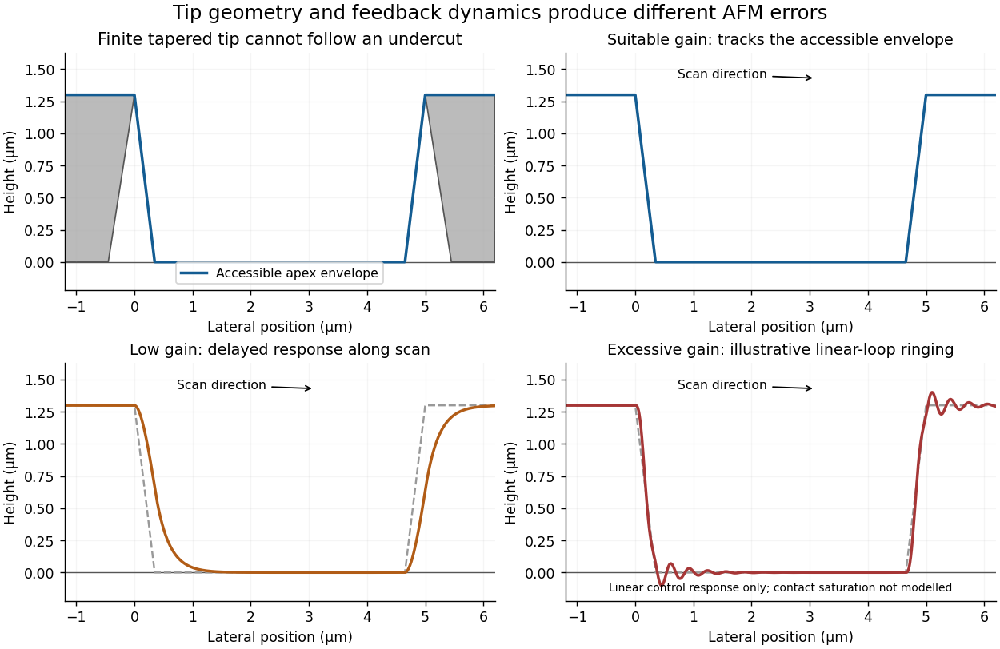

<h1 id="section-a-i/2/i/a/solution">Solution</h1>

↑ **Parent:** [A](../a.md)

With suitable [atomic force microscopy](../../../../../../../atomic-force-microscopy.md) feedback gains, the trace follows the accessible surface while maintaining the chosen oscillation-amplitude setpoint. The measured trench is narrower than the accessible opening because the finite tip encounters an edge before its apex reaches that edge's true lateral position. For an ideal tip flank angle $\alpha=15^\circ$ relative to the tip axis and height change $h=1.3\,\mu\mathrm m$, the geometrical setback is $h\tan\alpha\simeq0.35\,\mu\mathrm m$ per side.

The conventional tapered tip cannot recover the underside of the overhang, even when feedback is perfect: the first contact with the upper edge or shank limits access. This geometrical envelope must be distinguished from errors caused by feedback dynamics. The stated tip height is sufficient for the vertical range; it does not remove the lateral-access problem.

**[Figure 1](#section-a-i/2/i/a/image-illustrative-afm-trace-geometry-and-the-effects-of-insufficient-or-excessive-feedback-gain). Illustrative AFM trace geometry and the effects of insufficient or excessive feedback gain**.

## ↑ Ancestors (12)

1. [A](../a.md)
2. [I](../../i.md)
3. [2](../../../2.md)
4. [Section A(i)](../../../../section-a-i.md)
5. [Paper 1](../../../../../paper-1-split.md)
6. [2023](../../../../../split.md)
7. [Past exam of the MPhil in micro- and nanotechnology enterprise course of the University of Cambridge](../../../../../../split.md)
8. [MPhil in micro- and nanotechnology enterprise course of the University of Cambridge](../../../../../../../mphil-in-micro-and-nanotechnology-enterprise-course-of-the-university-of-cambridge.md)
9. [Course of the University of Cambridge](../../../../../../../course-of-the-university-of-cambridge.md)
10. [University of Cambridge](../../../../../../../university-of-cambridge-split.md)
11. [List of universities](../../../../../../../list-of-universities.md)
12. [Codex Wiki](../../../../../../../split.md)
