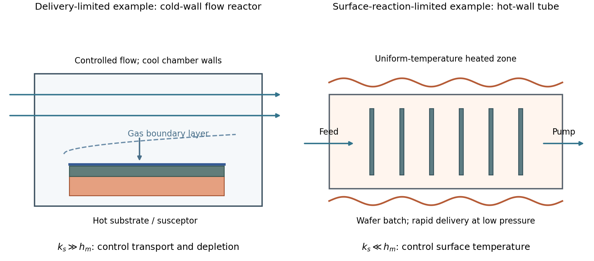

<h1 id="section-a-ii/4/i/solution">Solution</h1>

↑ **Parent:** [I](../i.md)

A simple [chemical vapor deposition](../../../../../../chemical-vapor-deposition.md) model separates transport through a gas boundary layer, with coefficient $h_m$, from surface reaction, with coefficient $k_s$:

$$
J=h_m(C_b-C_s)=k_sC_s,\qquad
\boxed{J=\frac{h_mk_s}{h_m+k_s}C_b}.
$$

For $k_s\gg h_m$, growth is [mass-transfer-limited deposition](../../../../../../mass-transfer-limited-deposition.md). A typical cold-wall, flowing reactor heats the substrate strongly while keeping most chamber walls cooler. A shaped inlet, controlled flow and tilted or rotating susceptor help control boundary-layer thickness and precursor depletion. The essential design problem is delivering a similar flux everywhere; heating a surface still further gives little benefit once delivery limits growth.

For $k_s\ll h_m$, growth is [reaction-limited deposition](../../../../../../reaction-limited-deposition.md). A hot-wall, low-pressure batch tube can hold many wafers in a nearly uniform-temperature zone. Faster gas transport makes surface concentrations more uniform, while slow chemistry reduces consumption before precursors reach downstream surfaces. Temperature uniformity is particularly important because surface rates can depend strongly on temperature.

These are illustrative architectures, not a rule that wall type alone determines the regime. Temperature, pressure, flow and precursor chemistry jointly set $k_s/h_m$.

**[Figure 2](#section-a-ii/4/i/image-transport-and-surface-reaction-impose-different-cvd-design-constraints). Transport and surface reaction impose different CVD design constraints**. Original qualitative reactor sketches. A flowing cold-wall reactor emphasizes delivery across a boundary layer; a heated low-pressure tube emphasizes uniform surface temperature. The drawings do not prescribe a particular precursor chemistry or operating recipe.

## ↑ Ancestors (11)

1. [I](../i.md)
2. [4](../../4.md)
3. [Section A(ii)](../../../section-a-ii.md)
4. [Paper 1](../../../../paper-1-split.md)
5. [2023](../../../../split.md)
6. [Past exam of the MPhil in micro- and nanotechnology enterprise course of the University of Cambridge](../../../../../split.md)
7. [MPhil in micro- and nanotechnology enterprise course of the University of Cambridge](../../../../../../mphil-in-micro-and-nanotechnology-enterprise-course-of-the-university-of-cambridge.md)
8. [Course of the University of Cambridge](../../../../../../course-of-the-university-of-cambridge.md)
9. [University of Cambridge](../../../../../../university-of-cambridge-split.md)
10. [List of universities](../../../../../../list-of-universities.md)
11. [Codex Wiki](../../../../../../split.md)
