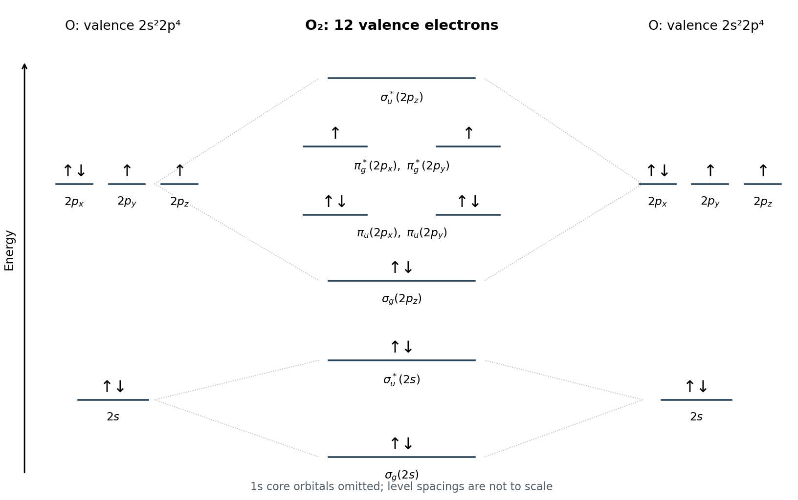

<h1 id="section-a-iii/5/i/a/solution">Solution</h1>

↑ **Parent:** [A](../a.md)

The oxygen atom has **$1s^2\,2s^2\,2p^4$**. Each oxygen contributes six valence electrons, so the molecular diagram contains twelve. Taking the internuclear direction as $z$, the relevant ordering for oxygen is

$$
\sigma_g(2s)<\sigma_u^*(2s)<\sigma_g(2p_z)
<\pi_u(2p_x)=\pi_u(2p_y)
<\pi_g^*(2p_x)=\pi_g^*(2p_y)<\sigma_u^*(2p_z).
$$

The valence occupation is

$$
\boxed{[\sigma_g(2s)]^2[\sigma_u^*(2s)]^2
[\sigma_g(2p_z)]^2[\pi_u(2p_x)]^2[\pi_u(2p_y)]^2
[\pi_g^*(2p_x)]^1[\pi_g^*(2p_y)]^1}.
$$

The final two electrons occupy the degenerate antibonding orbitals singly with parallel spin, following [Hund's rules](../../../../../../../hund-s-rules.md). Thus oxygen has two unpaired electrons and is paramagnetic. The $1s$ core orbitals are deliberately omitted from the valence-only [molecular orbital diagram](../../../../../../../molecular-orbital-diagram.md).

**[Figure 3](#section-a-iii/5/i/a/image-valence-molecular-orbital-occupation-of-ground-state-oxygen). Valence molecular-orbital occupation of ground-state oxygen**. Original qualitative energy-level diagram with both oxygen atomic-orbital sets and all valence molecular orbitals. Energies and separations are illustrative; arrows indicate electron occupation. The two singly occupied antibonding pi orbitals explain the triplet ground state.

## ↑ Ancestors (12)

1. [A](../a.md)
2. [I](../../i.md)
3. [5](../../../5.md)
4. [Section A(iii)](../../../../section-a-iii.md)
5. [Paper 1](../../../../../paper-1-split.md)
6. [2023](../../../../../split.md)
7. [Past exam of the MPhil in micro- and nanotechnology enterprise course of the University of Cambridge](../../../../../../split.md)
8. [MPhil in micro- and nanotechnology enterprise course of the University of Cambridge](../../../../../../../mphil-in-micro-and-nanotechnology-enterprise-course-of-the-university-of-cambridge.md)
9. [Course of the University of Cambridge](../../../../../../../course-of-the-university-of-cambridge.md)
10. [University of Cambridge](../../../../../../../university-of-cambridge-split.md)
11. [List of universities](../../../../../../../list-of-universities.md)
12. [Codex Wiki](../../../../../../../split.md)
