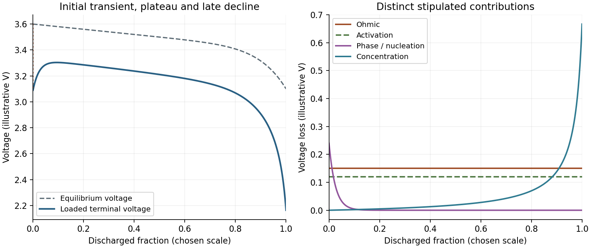

<h1 id="section-a-iii/7/i/solution">Solution</h1>

↑ **Parent:** [I](../i.md)

At fixed discharge current, delivered voltage can be represented as

$$
V=E_{\rm eq}(Q)-IR-\eta_{\rm act}-\eta_{\rm conc}-\eta_{\rm phase},
$$

where $Q$ is discharged charge and the terms denote distinct physical losses. A typical trace has an initial drop from open circuit, an approximately flat useful region and a final decline toward cutoff. Its exact shape depends on the cell chemistry and current; not every battery has an equally flat plateau.

Four distinguishable contributions are:

- **[Ohmic polarization](../../../../../../ohmic-polarization.md):** electronic, ionic and contact resistance cause a rapid $IR$ drop on applying current. This need not wait for a concentration gradient to develop.
- **[Activation overpotential](../../../../../../activation-overpotential.md):** finite electrode-reaction kinetics require a departure from equilibrium to sustain charge transfer. It is important when the exchange current is small.
- **[Concentration overpotential](../../../../../../concentration-overpotential.md):** electrolyte transport and diffusion within active particles can deplete reactants or accumulate products near reaction sites. These losses often grow near the end of discharge or at high current.
- **[Phase-transformation polarization](../../../../../../phase-transformation-polarization.md):** nucleation and growth of a new phase can require extra driving force, produce an initial voltage dip or cause hysteresis. It is especially relevant to conversion and two-phase electrodes, rather than a universal independent loss in every chemistry.

Terminology sometimes groups solid-state transport or phase-change effects differently. The important distinction is the mechanism, not counting the same diffusion loss under two names. A falling equilibrium voltage as composition changes is also not, by itself, polarization.

**[Figure 5](#section-a-iii/7/i/image-an-illustrative-discharge-voltage-combines-equilibrium-changes-and-distinct-losses). An illustrative discharge voltage combines equilibrium changes and distinct losses**. Original stipulated model, not battery measurements. The loss components show an instantaneous resistive contribution, activation loss, a transient nucleation-related contribution and increasing late-discharge transport loss. The equilibrium curve is plotted separately.

## ↑ Ancestors (11)

1. [I](../i.md)
2. [7](../../7.md)
3. [Section A(iii)](../../../section-a-iii.md)
4. [Paper 1](../../../../paper-1-split.md)
5. [2023](../../../../split.md)
6. [Past exam of the MPhil in micro- and nanotechnology enterprise course of the University of Cambridge](../../../../../split.md)
7. [MPhil in micro- and nanotechnology enterprise course of the University of Cambridge](../../../../../../mphil-in-micro-and-nanotechnology-enterprise-course-of-the-university-of-cambridge.md)
8. [Course of the University of Cambridge](../../../../../../course-of-the-university-of-cambridge.md)
9. [University of Cambridge](../../../../../../university-of-cambridge-split.md)
10. [List of universities](../../../../../../list-of-universities.md)
11. [Codex Wiki](../../../../../../split.md)
