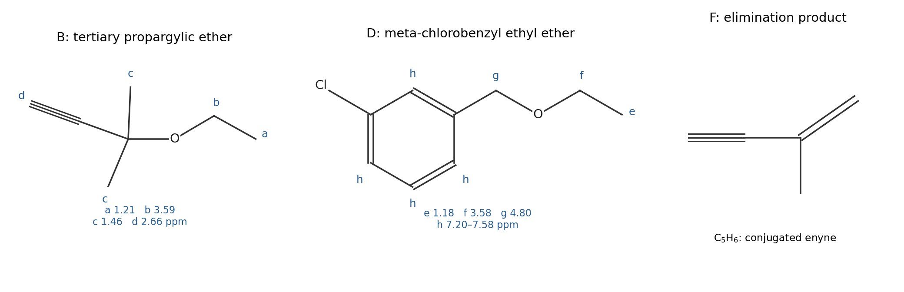

<h1 id="section-b/10/ii/a/solution">Solution</h1>

↑ **Parent:** [A](../a.md)

The products are

$$
\boxed{\mathrm B=HC{\equiv}C{-}C(CH_3)_2{-}OCH_2CH_3},
$$

$$
\boxed{\mathrm D=3{-}ClC_6H_4{-}CH_2{-}OCH_2CH_3}.
$$

B retains the terminal alkyne and replaces the tertiary propargylic chlorine with ethoxy. D replaces the benzylic chlorine while retaining the aromatic chlorine; its meta arrangement follows from the drawn starting material, rather than from four aromatic protons alone.

| Product | Proton shift / ppm | Assignment |
| --- | --- | --- |
| B | 1.21, 3H triplet | Ethoxy terminal methyl, coupled to the adjacent two protons. |
| B | 1.46, 6H singlet | Two equivalent methyl groups on the substituted carbon, with no neighboring proton to split them. |
| B | 2.66, 1H singlet | Terminal alkyne proton. |
| B | 3.59, 2H quartet | Ethoxy methylene next to oxygen, coupled to its methyl group. |
| D | 1.18, 3H triplet; 3.58, 2H quartet | The ethoxy group, with a common approximately 7 Hz coupling. |
| D | 4.80, 2H singlet | Benzylic methylene attached to oxygen, with no vicinal aliphatic proton. |
| D | Two aromatic multiplet regions, 4H total | The four remaining ring protons of the disubstituted aromatic ring. |

For B, the strong $3300\,\mathrm{cm^{-1}}$ band is the terminal sp C–H stretch, the $2950\,\mathrm{cm^{-1}}$ band is aliphatic C–H stretching, and the weak $2100\,\mathrm{cm^{-1}}$ band is the alkyne stretch. The terminal proton and alkyne band together distinguish this from an alcohol interpretation of the high-frequency absorption.

For D, $3050\,\mathrm{cm^{-1}}$ is aromatic C–H stretching, $2950\,\mathrm{cm^{-1}}$ is aliphatic C–H stretching, and the $1600$ and $1580\,\mathrm{cm^{-1}}$ bands are aromatic skeletal stretches. The listed spectrum is a selected peak list, so omission of a C–O band is not evidence that the ether bond is absent.

**[Figure 7](#section-b/10/ii/a/image-derived-ether-products-and-the-competing-elimination-product). Derived ether products and the competing elimination product**. Original skeletal drawings of B, D and F. B and D retain the unsaturation indicated by the spectral data; F is the conjugated enyne formed by loss of hydrogen chloride from the tertiary propargylic substrate.

## ↑ Ancestors (12)

1. [A](../a.md)
2. [Ii](../../ii.md)
3. [10](../../../10.md)
4. [Section B](../../../../section-b.md)
5. [Paper 1](../../../../../paper-1-split.md)
6. [2023](../../../../../split.md)
7. [Past exam of the MPhil in micro- and nanotechnology enterprise course of the University of Cambridge](../../../../../../split.md)
8. [MPhil in micro- and nanotechnology enterprise course of the University of Cambridge](../../../../../../../mphil-in-micro-and-nanotechnology-enterprise-course-of-the-university-of-cambridge.md)
9. [Course of the University of Cambridge](../../../../../../../course-of-the-university-of-cambridge.md)
10. [University of Cambridge](../../../../../../../university-of-cambridge-split.md)
11. [List of universities](../../../../../../../list-of-universities.md)
12. [Codex Wiki](../../../../../../../split.md)
