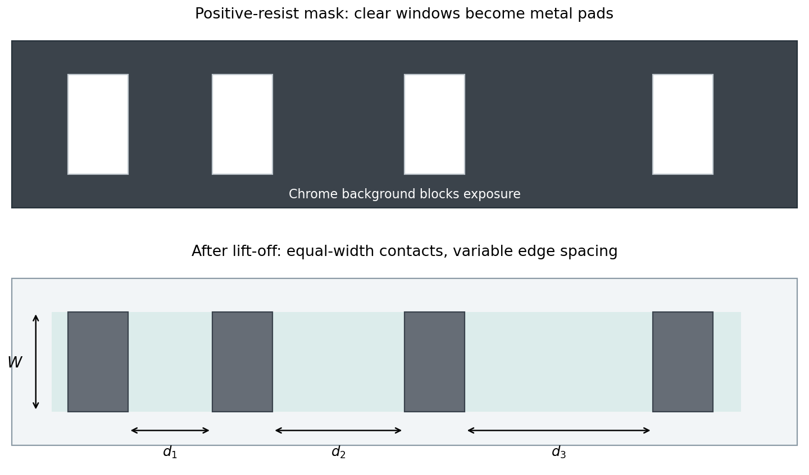

<h1 id="section-b/9/v/solution">Solution</h1>

↑ **Parent:** [V](../v.md)

Use equal-width rectangular contact windows in a row with several different edge-to-edge spacings. For positive-resist **lift-off**, the future metal pads correspond to clear windows in an otherwise chrome-covered mask: exposure removes resist there, and the unexposed background retains resist beneath unwanted metal.

For ordinary ohmic [transmission line contact measurement](../../../../../../transmission-line-contact-measurement.md), a conducting strip or isolated mesa of width $W$ connects adjacent pads. Measure several spacings $d$ so that

$$
R(d)=2R_c+R_\square\frac dW.
$$

The intercept separates two contact contributions from the sheet-resistance slope. Large enough pad length relative to the transfer length is needed for the simplest contact-resistivity extraction.

Prepare separate arrays on the appropriate surfaces: annealed source/drain metal on the n+ cap, and gate metal on cap-removed AlGaAs. A Schottky gate is nonlinear, so its interface cannot be assigned an ohmic zero-bias contact resistivity merely by fitting the same straight line. Use bias-dependent current–voltage or differential-contact analysis, accounting for the two rectifying contacts.

**[Figure 6](#section-b/9/v/image-positive-resist-lift-off-mask-and-variable-spacing-contact-array). Positive-resist lift-off mask and variable-spacing contact array**. Original schematic. Pale windows in the dark chrome background define future metal pads. The resulting equal-width pads have different edge spacings. Ohmic TLM analysis and bias-dependent analysis of a Schottky contact require distinct electrical models.

## ↑ Ancestors (11)

1. [V](../v.md)
2. [9](../../9.md)
3. [Section B](../../../section-b.md)
4. [Paper 1](../../../../paper-1-split.md)
5. [2023](../../../../split.md)
6. [Past exam of the MPhil in micro- and nanotechnology enterprise course of the University of Cambridge](../../../../../split.md)
7. [MPhil in micro- and nanotechnology enterprise course of the University of Cambridge](../../../../../../mphil-in-micro-and-nanotechnology-enterprise-course-of-the-university-of-cambridge.md)
8. [Course of the University of Cambridge](../../../../../../course-of-the-university-of-cambridge.md)
9. [University of Cambridge](../../../../../../university-of-cambridge-split.md)
10. [List of universities](../../../../../../list-of-universities.md)
11. [Codex Wiki](../../../../../../split.md)
