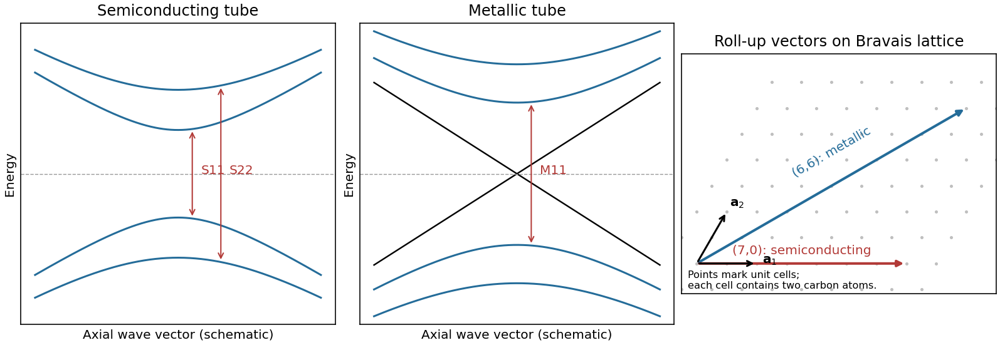

<h1 id="section-a-i/13/i/solution">Solution</h1>

↑ **Parent:** [I](../i.md)

A [single-walled carbon nanotube](../../../../../../single-walled-carbon-nanotube.md) confines the [electron](../../../../../../electron.md) around its circumference while allowing motion along its axis. [Nanotube zone folding](../../../../../../nanotube-zone-folding.md) therefore turns the [graphene](../../../../../../graphene.md) bands into one-dimensional subbands. A [semiconducting carbon nanotube](../../../../../../semiconducting-carbon-nanotube.md) has no allowed circumferential wave vector through a [Dirac valley](../../../../../../dirac-valley.md); a metallic tube has a band crossing at the [Fermi energy](../../../../../../fermi-energy.md) in the ideal model. Each massive subband edge gives a [one-dimensional van Hove singularity](../../../../../../one-dimensional-van-hove-singularity.md) in the [density of states](../../../../../../density-of-states.md), and corresponding peaks appear in the [joint density of states](../../../../../../joint-density-of-states.md).

For [light](../../../../../../light.md) polarized along the tube, the main [electric-dipole selection rule](../../../../../../electric-dipole-selection-rule.md) conserves circumferential angular momentum: transitions connect matching valence and conduction subbands. These finite-energy transitions are conventionally $S_{11},S_{22},\ldots$ in a [semiconducting carbon nanotube](../../../../../../semiconducting-carbon-nanotube.md) and $M_{11},M_{22},\ldots$ in a metallic tube. A metallic band crossing does not make its first strong interband peak have zero energy. Perpendicular polarization admits different angular-momentum channels, often much weaker because of depolarization. [Excitons](../../../../../../exciton.md), dielectric screening and trigonal warping modify the simple band-edge transition energies.

**[Figure 1](#section-a-i/13/i/image-nanotube-optical-transitions-and-two-example-roll-up-vectors). Nanotube optical transitions and two example roll-up vectors**. [Source](paper-2-nanotube-bands.py). Original band and lattice schematics. Arrows indicate matching-subband transitions; the metallic crossing is separate from its finite-energy interband resonance. Lattice points represent graphene unit cells rather than individual atoms.

Experimentally, measure absorption versus photon energy; [Raman spectroscopy](../../../../../../raman-spectroscopy.md) becomes resonantly enhanced when the excitation matches an optical transition. A [photoluminescence excitation spectrum](../../../../../../photoluminescence-excitation-spectrum.md) of dispersed semiconducting tubes correlates excitation near $S_{22}$ with emission near $S_{11}$ after relaxation. Metallic tubes generally lack comparable bright emission because nonradiative relaxation is efficient. Combining optical energies with radial-breathing-mode [Raman spectroscopy](../../../../../../raman-spectroscopy.md) or [electron diffraction](../../../../../../electron-diffraction.md) assigns tube diameter and roll-up indices; a [Kataura plot](../../../../../../kataura-plot.md) organizes those assignments.[Excitation-emission spectroscopy and assignments to nanotube structures](../../../../../../structure-assigned-optical-spectra-of-single-walled-carbon-nanotubes-by-sergei-m-bachilo-and-others.md)

## ↑ Ancestors (11)

1. [I](../i.md)
2. [13](../../13.md)
3. [Section A(i)](../../../section-a-i.md)
4. [Paper 2](../../../../paper-2-split.md)
5. [2023](../../../../split.md)
6. [Past exam of the MPhil in micro- and nanotechnology enterprise course of the University of Cambridge](../../../../../split.md)
7. [MPhil in micro- and nanotechnology enterprise course of the University of Cambridge](../../../../../../mphil-in-micro-and-nanotechnology-enterprise-course-of-the-university-of-cambridge.md)
8. [Course of the University of Cambridge](../../../../../../course-of-the-university-of-cambridge.md)
9. [University of Cambridge](../../../../../../university-of-cambridge-split.md)
10. [List of universities](../../../../../../list-of-universities.md)
11. [Codex Wiki](../../../../../../split.md)
