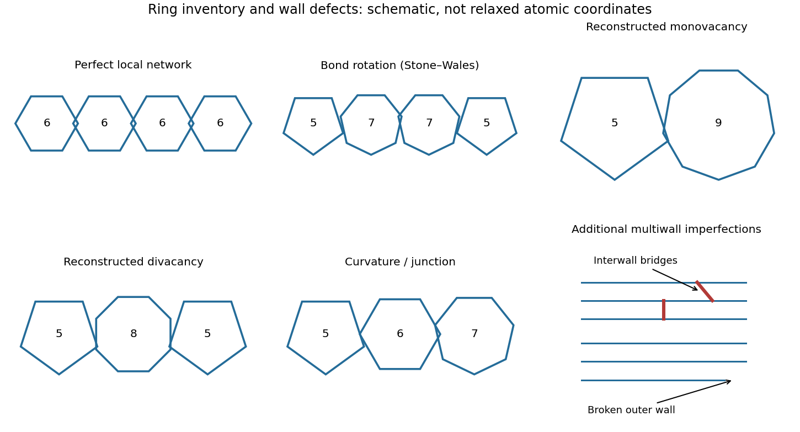

<h1 id="section-a-i/13/iii/solution">Solution</h1>

↑ **Parent:** [Iii](../iii.md)

The important distinctions are changes of ring topology, missing or added atoms, and changes of local bonding:

- A [Stone-Wales defect](../../../../../../stone-wales-defect.md) rotates one carbon-carbon bond by approximately $90^\circ$, converting four hexagons into a $5$-$7$-$7$-$5$ ring arrangement without adding or removing atoms. It changes strain and electronic scattering.
- A [carbon nanotube vacancy defect](../../../../../../carbon-nanotube-vacancy-defect.md) removes an atom. Reconstruction commonly gives a pentagon and a nine-membered ring, with an undercoordinated site; a reconstructed divacancy can give a $5$-$8$-$5$ arrangement. Larger vacancies make holes or broken walls.
- An adjacent pentagon-heptagon pair acts as a [dislocation](../../../../../../dislocation.md) in the hexagonal network. It can connect regions with different wrapping indices, producing a bend or an electronic junction. Isolated nonhexagonal rings impose curvature: pentagons favor positive curvature and heptagons negative curvature.
- An [interstitial defect](../../../../../../interstitial-defect.md), an adsorbed atom, or chemical functionalization can distort the network and locally change $sp^2$ bonding toward $sp^3$. These defects can scatter carriers and create chemically reactive sites.

**[Figure 2](#section-a-i/13/iii/image-carbon-ring-inventories-and-additional-imperfections-in-multiwall-nanotubes). Carbon-ring inventories and additional imperfections in multiwall nanotubes**. [Source](paper-2-carbon-defects.py). Original topological sketches: polygon labels identify ring sizes, not a relaxed atom-by-atom geometry. The wall sketch illustrates interwall bridges and an interrupted outer shell.

Closed end caps require nonhexagonal rings, typically six pentagons per hemispherical cap; these are part of the cap topology rather than necessarily damage. Kinks, buckling, branches and incomplete closure are larger-scale structural imperfections.

A [multi-walled carbon nanotube](../../../../../../multi-walled-carbon-nanotube.md) can contain any of these defects in individual shells, plus interrupted or terminated shells, extra incomplete graphitic layers, irregular interwall spacing, and covalent interwall bridges formed by displaced atoms. Such bridges change intershell coupling and sliding. Different shells having different wrapping indices is normal and is not, by itself, a defect.

## ↑ Ancestors (11)

1. [Iii](../iii.md)
2. [13](../../13.md)
3. [Section A(i)](../../../section-a-i.md)
4. [Paper 2](../../../../paper-2-split.md)
5. [2023](../../../../split.md)
6. [Past exam of the MPhil in micro- and nanotechnology enterprise course of the University of Cambridge](../../../../../split.md)
7. [MPhil in micro- and nanotechnology enterprise course of the University of Cambridge](../../../../../../mphil-in-micro-and-nanotechnology-enterprise-course-of-the-university-of-cambridge.md)
8. [Course of the University of Cambridge](../../../../../../course-of-the-university-of-cambridge.md)
9. [University of Cambridge](../../../../../../university-of-cambridge-split.md)
10. [List of universities](../../../../../../list-of-universities.md)
11. [Codex Wiki](../../../../../../split.md)
