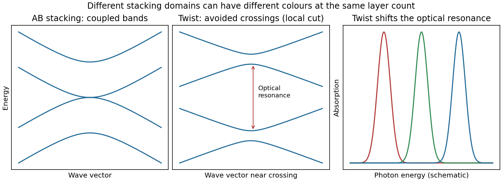

<h1 id="section-a-i/14/i/solution">Solution</h1>

↑ **Parent:** [I](../i.md)

Two layers need not have the same electronic structure everywhere. Different rotational alignments create domains of [twisted bilayer graphene](../../../../../../twisted-bilayer-graphene.md); AB-stacked regions instead have the usual coupled low-energy bilayer bands. In a twisted domain, displaced [Dirac cones](../../../../../../dirac-cone.md) hybridize where they meet, producing avoided crossings and saddle points in the two-dimensional [dispersion relation](../../../../../../dispersion-relation-split.md). The resulting [Van Hove singularities](../../../../../../van-hove-singularity.md) enhance optical transitions at energies that depend on the twist angle. Different domains therefore absorb different parts of the visible spectrum and can show different colours despite having the same layer count.[Angle-dependent band hybridization and optical absorption resonances](../../../../../../optical-absorption-in-twisted-bilayer-graphene-by-pilkyung-moon-and-mikito-koshino.md)

**[Figure 3](#section-a-i/14/i/image-bilayer-stacking-changes-the-bands-and-optical-absorption). Bilayer stacking changes the bands and optical absorption**. [Source](paper-2-bilayer-bands.py). Original illustrative bands: AB-stacked bands, a local cut through avoided crossings in a twisted domain, and schematic angle-dependent absorption peaks. The middle panel is a local cut, not the entire two-dimensional band structure.

On a silicon/silicon-dioxide substrate, reflected beams from the film stack also interfere. The wavelength-dependent optical response of the [bilayer graphene](../../../../../../bilayer-graphene.md) changes this reflected contrast, making the domain differences visible. The observation is consistent with stacking domains; colour alone does not uniquely prove a twist angle. Variations in oxide thickness, trapped contamination, folds or local doping can also change contrast and should be checked independently, for example by [Raman spectroscopy](../../../../../../raman-spectroscopy.md).

## ↑ Ancestors (11)

1. [I](../i.md)
2. [14](../../14.md)
3. [Section A(i)](../../../section-a-i.md)
4. [Paper 2](../../../../paper-2-split.md)
5. [2023](../../../../split.md)
6. [Past exam of the MPhil in micro- and nanotechnology enterprise course of the University of Cambridge](../../../../../split.md)
7. [MPhil in micro- and nanotechnology enterprise course of the University of Cambridge](../../../../../../mphil-in-micro-and-nanotechnology-enterprise-course-of-the-university-of-cambridge.md)
8. [Course of the University of Cambridge](../../../../../../course-of-the-university-of-cambridge.md)
9. [University of Cambridge](../../../../../../university-of-cambridge-split.md)
10. [List of universities](../../../../../../list-of-universities.md)
11. [Codex Wiki](../../../../../../split.md)
