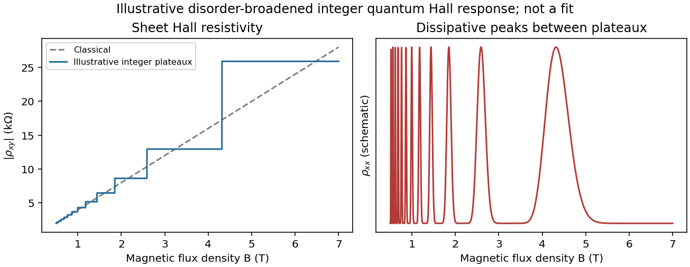

<h1 id="section-a-ii/15/iv/solution">Solution</h1>

↑ **Parent:** [Iv](../iv.md)

On an integer plateau the sheet transverse resistivity has magnitude

$$
|\rho_{xy}|=\frac{h}{\nu e^2},
$$

where the integer $\nu$ counts occupied resolved [quantum Hall edge states](../../../../../../quantum-hall-edge-state.md). Increasing $B$ at fixed sheet density reduces the [Landau filling factor](../../../../../../landau-filling-factor.md) $\nu_{\mathrm{fill}}=n_sh/(eB)$. The observed trace is therefore a staircase toward larger $|\rho_{xy}|$, with transitions between plateaux rather than the classical straight line. In the plateau regions $\rho_{xx}\simeq0$; dissipative peaks occur at transitions.

**[Figure 4](#section-a-ii/15/iv/image-classical-hall-line-and-illustrative-integer-quantum-hall-plateaux). Classical Hall line and illustrative integer quantum Hall plateaux**. [Source](paper-2-hall-response.py). Original schematic responses, with the classical slope fixed by the later calculation. Plateau widths and dissipative peak shapes are illustrative rather than fitted to an experimental trace.

It is not correct to demand an exactly integer value of $n_sh/(eB)$ everywhere along a finite-width plateau. Localization accommodates changes in total population without changing the number of extended current-carrying channels. If spin remains unresolved, the usual spin-degenerate sequence contains even integers rather than every integer.

## ↑ Ancestors (11)

1. [Iv](../iv.md)
2. [15](../../15.md)
3. [Section A(ii)](../../../section-a-ii.md)
4. [Paper 2](../../../../paper-2-split.md)
5. [2023](../../../../split.md)
6. [Past exam of the MPhil in micro- and nanotechnology enterprise course of the University of Cambridge](../../../../../split.md)
7. [MPhil in micro- and nanotechnology enterprise course of the University of Cambridge](../../../../../../mphil-in-micro-and-nanotechnology-enterprise-course-of-the-university-of-cambridge.md)
8. [Course of the University of Cambridge](../../../../../../course-of-the-university-of-cambridge.md)
9. [University of Cambridge](../../../../../../university-of-cambridge-split.md)
10. [List of universities](../../../../../../list-of-universities.md)
11. [Codex Wiki](../../../../../../split.md)
