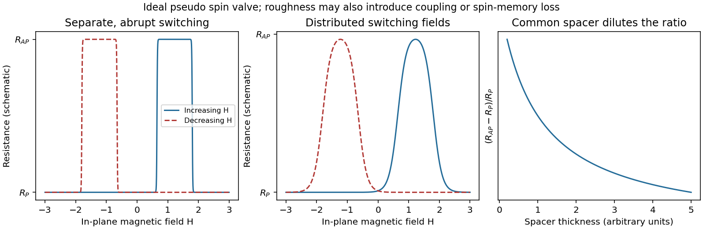

<h1 id="section-a-ii/16/ii/solution">Solution</h1>

↑ **Parent:** [Ii](../ii.md)

Assume NiFe is the softer layer, with $0<H_{c,\mathrm{NiFe}}<H_{c,\mathrm{Co}}$, and that interlayer coupling is weak enough to permit separate reversal. Starting at large negative $H$, both [magnetizations](../../../../../../magnetization.md) point in the same direction and $R=R_P$. During an increasing-field sweep:

- At $H=H_{c,\mathrm{NiFe}}$, NiFe reverses while Co does not: the state is antiparallel and the resistance rises to $R_{AP}$.
- At $H=H_{c,\mathrm{Co}}$, Co also reverses: the state becomes parallel and the resistance returns to $R_P$.

On decreasing $H$ from positive saturation, the high-resistance window instead lies between $-H_{c,\mathrm{Co}}$ and $-H_{c,\mathrm{NiFe}}$. Thus the two sweep directions give displaced rectangular high-resistance windows, not a single reversible resistance peak centered on zero.

**[Figure 5](#section-a-ii/16/ii/image-pseudo-spin-valve-resistance-loops-distributed-switching-and-spacer-dilution). Pseudo spin-valve resistance loops, distributed switching and spacer dilution**. [Source](paper-2-spin-valve.py). Original illustrative curves. Separate coercive fields create an antiparallel window on each sweep. The middle panel isolates switching-field broadening; its retained peak height is not a claim that real roughness leaves the GMR amplitude unchanged.

If Co were the softer layer, the sequence of layer labels would be exchanged. A continuous spacer and sufficiently weak coupling are additional assumptions: negligible surface roughness alone does not guarantee independent switching at every Cu thickness.

## ↑ Ancestors (11)

1. [Ii](../ii.md)
2. [16](../../16.md)
3. [Section A(ii)](../../../section-a-ii.md)
4. [Paper 2](../../../../paper-2-split.md)
5. [2023](../../../../split.md)
6. [Past exam of the MPhil in micro- and nanotechnology enterprise course of the University of Cambridge](../../../../../split.md)
7. [MPhil in micro- and nanotechnology enterprise course of the University of Cambridge](../../../../../../mphil-in-micro-and-nanotechnology-enterprise-course-of-the-university-of-cambridge.md)
8. [Course of the University of Cambridge](../../../../../../course-of-the-university-of-cambridge.md)
9. [University of Cambridge](../../../../../../university-of-cambridge-split.md)
10. [List of universities](../../../../../../list-of-universities.md)
11. [Codex Wiki](../../../../../../split.md)
