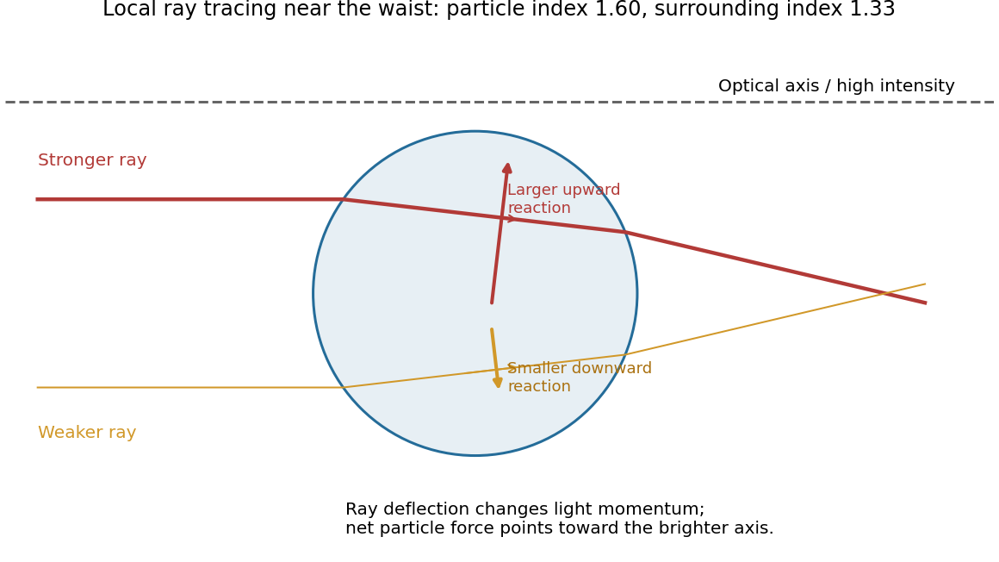

<h1 id="section-a-iii/19/ii/solution">Solution</h1>

↑ **Parent:** [Ii](../ii.md)

Because the sphere lies below the optical axis, a ray passing through its upper half samples a brighter part of the [Gaussian beam](../../../../../../gaussian-beam.md) than a comparable ray through its lower half. For a particle with higher [refractive index](../../../../../../refractive-index.md) than its surroundings, the stronger upper ray is deflected downward overall and transfers an upward reaction to the particle. The weaker lower ray gives a smaller downward reaction. Their transverse sum is therefore upward, toward the brighter axis.

**[Figure 6](#section-a-iii/19/ii/image-unequal-refracted-rays-give-a-transverse-restoring-force). Unequal refracted rays give a transverse restoring force**. [Source](paper-2-optical-forces.py). Original local ray tracing near a beam waist, with chosen refractive indices. The sphere is below the optical axis. The stronger ray contributes the larger upward reaction; the diagram isolates transverse restoration rather than reconstructing the examination figure.

If the displacement reverses, the force reverses, so the central position is transversely stable. Summing all the rays gives an [optical gradient force](../../../../../../optical-gradient-force.md) toward the intensity maximum. There is also a forward [optical scattering force](../../../../../../optical-scattering-force.md). A tightly focused beam can have an axial restoring component that balances it, generally at a small displacement downstream of the ideal focus.[Single-beam trapping by a sufficiently strong intensity gradient](../../../../../../observation-of-a-single-beam-gradient-force-optical-trap-for-dielectric-particles-by-arthur-ashkin-and-others.md)

Three-dimensional stability requires the restoring axial component to exceed the forward force over part of the trajectory. A Gaussian transverse intensity profile alone does not prove that condition; insufficient focusing can yield transverse confinement while the particle still moves downstream.

## ↑ Ancestors (11)

1. [Ii](../ii.md)
2. [19](../../19.md)
3. [Section A(iii)](../../../section-a-iii.md)
4. [Paper 2](../../../../paper-2-split.md)
5. [2023](../../../../split.md)
6. [Past exam of the MPhil in micro- and nanotechnology enterprise course of the University of Cambridge](../../../../../split.md)
7. [MPhil in micro- and nanotechnology enterprise course of the University of Cambridge](../../../../../../mphil-in-micro-and-nanotechnology-enterprise-course-of-the-university-of-cambridge.md)
8. [Course of the University of Cambridge](../../../../../../course-of-the-university-of-cambridge.md)
9. [University of Cambridge](../../../../../../university-of-cambridge-split.md)
10. [List of universities](../../../../../../list-of-universities.md)
11. [Codex Wiki](../../../../../../split.md)
