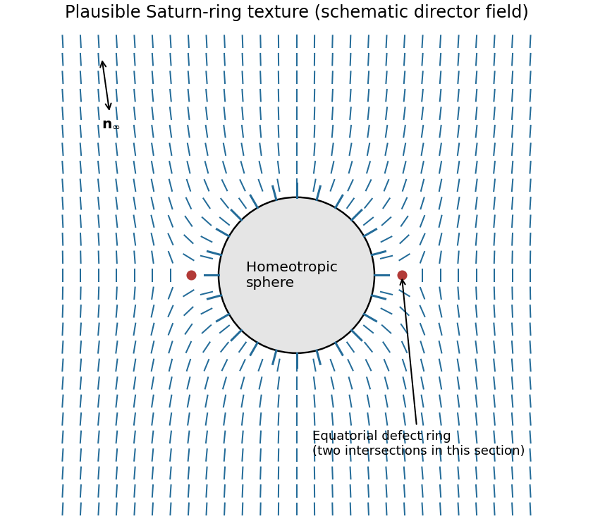

<h1 id="section-a-iii/19/iii/solution">Solution</h1>

↑ **Parent:** [Iii](../iii.md)

[Homeotropic anchoring](../../../../../../homeotropic-anchoring.md) means that the [nematic director](../../../../../../nematic-director.md) is locally normal to the particle surface, hence radial on a sphere. Far away, the uniform [nematic liquid crystal](../../../../../../nematic-liquid-crystal.md) has a fixed director $\mathbf n_\infty$, with $\mathbf n$ and $-\mathbf n$ physically equivalent.

One plausible configuration is a quadrupolar [Saturn-ring defect](../../../../../../saturn-ring-defect.md): the director is radial near the particle, bends into $\mathbf n_\infty$ far away, and has a disclination loop just outside the particle's equator, in the plane perpendicular to $\mathbf n_\infty$. A meridional section cuts the loop at two points.

**[Figure 7](#section-a-iii/19/iii/image-homeotropic-surface-anchoring-matched-to-a-uniform-far-field-director). Homeotropic surface anchoring matched to a uniform far-field director**. [Source](paper-2-nematic-director.py). Original schematic Saturn-ring texture. Short rods represent a headless director; the two marked defect cores are intersections of a three-dimensional equatorial ring with the section. This is not a numerical free-energy minimizer.

The defect compensates the topological distortion introduced by the radial surface boundary condition. A dipolar configuration with a nearby hyperbolic point defect is another possible texture. Which is stable depends on particle size, anchoring strength, elastic constants and external confinement; the boundary conditions alone do not uniquely select one.[Competing dipolar, Saturn-ring and surface-ring configurations](../../../../../../director-field-configurations-around-a-spherical-particle-in-a-nematic-liquid-crystal-by-holger-stark.md)

## ↑ Ancestors (11)

1. [Iii](../iii.md)
2. [19](../../19.md)
3. [Section A(iii)](../../../section-a-iii.md)
4. [Paper 2](../../../../paper-2-split.md)
5. [2023](../../../../split.md)
6. [Past exam of the MPhil in micro- and nanotechnology enterprise course of the University of Cambridge](../../../../../split.md)
7. [MPhil in micro- and nanotechnology enterprise course of the University of Cambridge](../../../../../../mphil-in-micro-and-nanotechnology-enterprise-course-of-the-university-of-cambridge.md)
8. [Course of the University of Cambridge](../../../../../../course-of-the-university-of-cambridge.md)
9. [University of Cambridge](../../../../../../university-of-cambridge-split.md)
10. [List of universities](../../../../../../list-of-universities.md)
11. [Codex Wiki](../../../../../../split.md)
