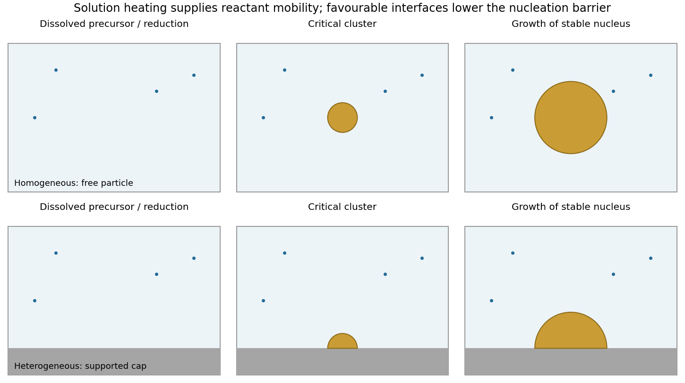

<h1 id="section-b/20/i/solution">Solution</h1>

↑ **Parent:** [I](../i.md)

[Nucleation](../../../../../../nucleation.md) is the formation of a sufficiently large embryo of the new metallic phase. Producing metal atoms from dissolved precursor can create [supersaturation](../../../../../../supersaturation.md); aggregation lowers bulk free energy but initially creates costly metal-medium interface. In the simplest spherical [classical nucleation theory](../../../../../../classical-nucleation-theory.md),

$$
\Delta G_{\mathrm{hom}}(r)=4\pi r^2\gamma-\frac{4\pi}{3}r^3\Delta g_v,\qquad
r_c=\frac{2\gamma}{\Delta g_v},
$$

where $\gamma$ is the metal-medium interfacial free energy and $\Delta g_v>0$ is the bulk driving force per volume. Clusters below the critical size tend to redissolve; larger ones can grow.

In [homogeneous nucleation](../../../../../../homogeneous-nucleation.md), the critical cluster forms in the solution without a pre-existing interface: the initial products are free particles. In [heterogeneous nucleation](../../../../../../heterogeneous-nucleation.md), a substrate, vessel wall or suspended seed replaces part of that costly new interface. For a spherical cap on a planar substrate,

$$
\Delta G_{\mathrm{het}}^\ddagger=
\frac{(2+\cos\theta)(1-\cos\theta)^2}{4}
\Delta G_{\mathrm{hom}}^\ddagger.
$$

A wetting substrate therefore lowers the barrier; this assumes the same bulk driving force and isotropic interfacial energies.

**[Figure 8](#section-b/20/i/image-free-and-supported-particles-arise-through-different-nucleation-histories). Free and supported particles arise through different nucleation histories**. [Source](paper-2-nucleation.py). Original sequential schematics: metal precursor is dispersed in the liquid, a critical embryo forms, and the stable nucleus grows. The lower sequence represents cap nucleation on a fixed substrate.

A final supported particle need not have nucleated heterogeneously: a free particle can nucleate in solution and later adsorb on the support. Conversely, a particle nucleated heterogeneously on a suspended seed can remain freely dispersed as a composite particle. Nucleation location and final support status are different classifications.

Microwave absorption heats the medium and possibly the support, changing reduction, diffusion and supersaturation. Preferential local heating can change the relative rates of the two routes. Microwave irradiation alone does not remove the thermodynamic nucleation barrier or demonstrate a special nonthermal mechanism.

## ↑ Ancestors (11)

1. [I](../i.md)
2. [20](../../20.md)
3. [Section B](../../../section-b.md)
4. [Paper 2](../../../../paper-2-split.md)
5. [2023](../../../../split.md)
6. [Past exam of the MPhil in micro- and nanotechnology enterprise course of the University of Cambridge](../../../../../split.md)
7. [MPhil in micro- and nanotechnology enterprise course of the University of Cambridge](../../../../../../mphil-in-micro-and-nanotechnology-enterprise-course-of-the-university-of-cambridge.md)
8. [Course of the University of Cambridge](../../../../../../course-of-the-university-of-cambridge.md)
9. [University of Cambridge](../../../../../../university-of-cambridge-split.md)
10. [List of universities](../../../../../../list-of-universities.md)
11. [Codex Wiki](../../../../../../split.md)
